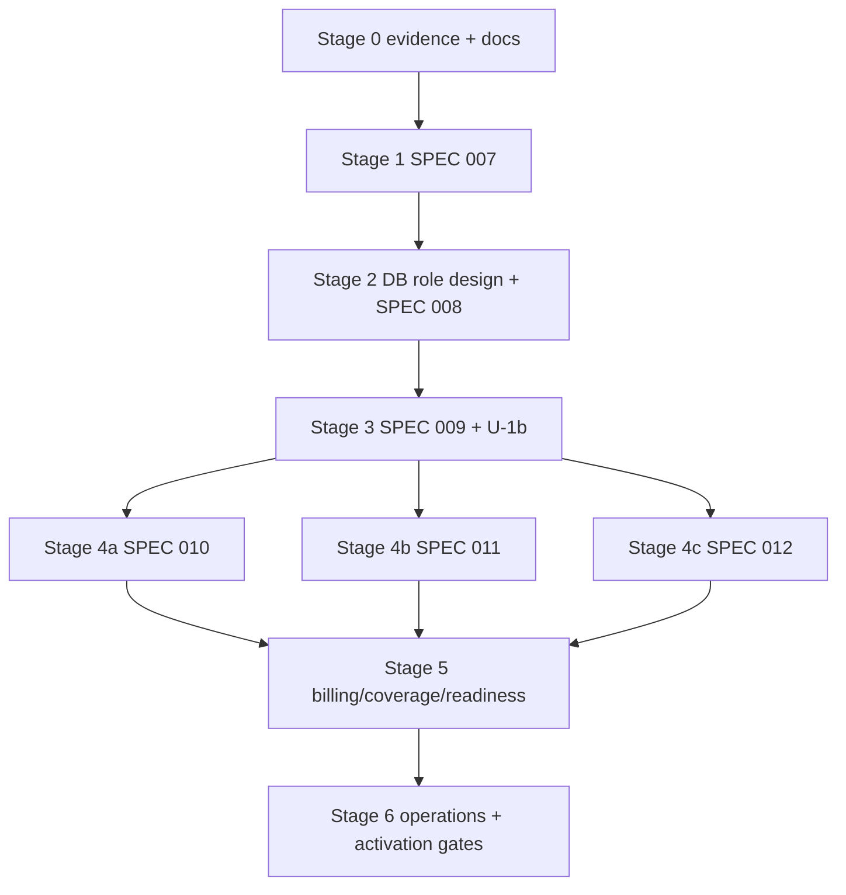

# PROCESS FOR THE APP — Fahes (WebAudit AI) development, verification and sequencing guide

**Last updated 2026-10-24 · repository HEAD `e42577304a2ccec873b30bbbf1d712e6348f6196` on `main`.** Read this file at the start of every session, then the canonical SPEC for your task. Evidence labels used throughout: **VERIFIED** (observed in this repository on the date above), **DOCUMENTED** (stated by a project document, not re-checked), **PROPOSED** (not approved), **UNVERIFIED / UNKNOWN — VERIFICATION REQUIRED**.

## 1. Purpose and authority

**What this governs.** How Fahes is developed, verified, sequenced and shipped: the current state of every SPEC, the dependency-aware order of work, the task ledger, open decisions, invariants, the per-task lifecycle and the definition of done. It is a **navigation and execution guide**. It is not a contract and **never overrides one**.

**Precedence when documents disagree** (highest first; consistent with `AGENTS.md` item 6):
1. Explicit instructions from the project owner in the current session.
2. `AGENTS.md` and `CLAUDE.md` (project rules; `CLAUDE.md` is the entry point).
3. `.specify/memory/constitution.md` (v1.2.0) and the ADRs in `specs/006-scan-architecture-v2/decisions.md`.
4. The applicable canonical SPEC: `spec.md`, then `data-model.md`, `contracts/`, `plan.md`, `research.md` (as committed at HEAD).
5. Working-tree and untracked spec text (SPEC 009 U-1, SPEC 011, SPEC 012) is **proposed-authoritative**: it is the best available contract text but is not committed (Q3: owner commits).
6. Planning and audit documents (`docs/audits/fahes-master-audit/**`): **evidence only**.
7. This document.

**Contradictions are reported, not resolved.** When two sources disagree, record it in the contradiction ledger (`docs/audits/fahes-master-audit/final-planning/CONTRADICTION_LEDGER.md`; summary in §6), state which rule applies if one is documented, and ask the owner. Never edit a canonical contract to make this document consistent.

**Relation to other documents.** `PROJECT_MAP.md` = code navigation. Canonical SPECs = requirements. `docs/audits/fahes-master-audit/` = audit, remediation and planning evidence (master audit, independent reviews, U-1b proposals v1–v5, final-planning registers, phase-2 packets). Task lists live in each spec's `tasks.md` (implementation tasks for 007, 008, 011, 012; planning logs for 006, 009, 010 plus T-U1-1..10) and in the cross-spec backlog `final-planning/IMPLEMENTATION_BACKLOG.md` (authoritative for sequencing across SPECs).

## 2. Application overview (VERIFIED unless marked)

Fahes ships as **WebAudit AI**, an audit platform: URL / GitHub zipball / ZIP intake → API validation, quote and credit debit → BullMQ phase jobs → worker capabilities (deterministic checks first, then redacted AI interpretation) → persisted report → realtime progress; fix assertions enqueue narrow re-verification; readiness re-audits and compares a baseline (`PROJECT_MAP.md`, DOCUMENTED). PostgreSQL is the record; Redis carries queues, notifications and limits (DOCUMENTED; AGENTS.md "Keep PostgreSQL authoritative").

| Component | Evidence | State |
|---|---|---|
| `apps/web` (Next.js 15 / React 19) | `apps/web/app/layout.tsx`; 95 test files | exists; has **14 uncommitted modified files** (design refresh) that are not part of any SPEC |
| `apps/api` (Express, Prisma) | `apps/api/src/index.ts`, `app.ts`; services: admin, auth, billing, control-gate, credits, email, intake, issues, monitoring, queue, readiness, realtime, registry, scans, storage; 124 test files | exists |
| `apps/worker` (BullMQ consumers) | `apps/worker/src/index.ts`; orchestrator (20 files incl. `timeout.ts`, `timeout-scheduler.ts`, `state-machine.ts`, `terminal-refund.ts`), module-runner, reverify, readiness, workspace; 57 test files | exists |
| `apps/probe-pool` | `src/index.ts`, `src/browser/pool.ts` (2 TS files) | **library only; no runnable server/transport** (DOCUMENTED) |
| `apps/sandbox-runner` | `src/serve.ts`, `host/`, `child-harness/`, `limits/`; 5 test files | exists; sandbox for **installed capabilities**, not the SPEC 011 Execution Plane (ADR-003) |
| Packages | `ai-executor`, `capabilities-vendored`, `capability-sdk`, `config`, `redaction`, `safe-archive`, `safe-net`, `scoring`, `types` | exist (owners per `PROJECT_MAP.md`) |
| Database | `apps/api/prisma/schema.prisma`: 32 models, 23 enums; 22 migrations (latest `20261024235733_add_target_authorization_scope`, applied to `webaudit` and `webaudit_test`; VERIFIED 2026-10-25 closeout) | exists; SPEC 007 entities present (`TargetEnvironment`, `ScopeDefinition`, `TargetAuthorization`); **no 008–012 entity, no roles, no RLS** |
| Queues | `packages/config/src/queues.ts`: `webaudit-scan-phase`, `webaudit-reverify`, `webaudit-maintenance`, `webaudit-email-notification` | exist; per-class queues of SPEC 009 do not |
| Local services | `infrastructure/docker-compose.yml`: postgres 16, redis 7, pgbouncer, mailpit; prod compose and `nginx/`, `deploy.md`, `sandbox-runner.md` | exist; **Docker daemon was not running on 2026-10-24** (`docker ps` failed) |
| Scripts / gates | `package.json`: `typecheck`, `lint`, `format:check`, `test` (unit project), `test:adverse`, `test:visual`, `db:*`, `services:up`; `vitest.workspace.ts` (3 projects: unit, adverse, visual) | exist |
| CI | no `.github/` workflow (VERIFIED; PROJECT_MAP agrees) | **absent** |
| Runtime requirements | Node `>=22`, pnpm `9.0.0` (`package.json`); local Node v24.15.0, pnpm 9.0.0 | VERIFIED |

**Security and tenancy boundaries today (VERIFIED in code unless marked).** Ownership/control proof only: `apps/api/src/services/control-gate/` (`verify`, `attest`, `rate-bound`, `reconfirm`), `ControlLevel`, `TargetVerification`. SSRF-safe fetch: `packages/safe-net`. Redaction: `packages/redaction`. Installed-capability sandbox: `apps/sandbox-runner` (no credentials/egress, DOCUMENTED). Workers and API share one `DATABASE_URL` (`apps/worker/src/db.ts:26`); `holderToken`-style secrets are not yet present. The Redis queue-capacity guard `apps/api/src/services/queue/admission-gate.ts` is **not** F07 Safety Admission (different store, no leases/fencing/budgets).

**Billing and coverage today (VERIFIED).** Per-area cost `AREA_COST` (PERFORMANCE 20, SECURITY 20, UI 25, TESTING 20, SEO 10; full audit 80; re-verify 3; readiness 60) in `packages/config/src/pricing.ts`. `MODULE_STATES_SCORED = [COMPLETE, DEGRADED]` (`packages/types/src/domain.ts:84`): a `DEGRADED` area is scored and counts as delivered. Refund `floor(charged × undelivered ÷ requested)`, all of `charged` when nothing delivered, equal share per area (`packages/config/src/refund.ts:15-25`; used by `terminal-refund.ts`, `timeout.ts`, cancellation path). Legacy `DEGRADED` means "missing interpretation, not measurement" (`packages/scoring/src/aggregate.ts:19-21`). Scan timeout: 15 minutes by default (`apps/worker/src/orchestrator/timeout-scheduler.ts:25`, env `SCAN_TIMEOUT_MS`), sweep interval default 60 s (env, minimum 5 s). AGENTS.md: "Never bill for platform failures."

**External dependencies (DOCUMENTED, not verified here):** AI providers via `packages/ai-executor`; Paymob payments and production email (SPEC 005; real Paymob credentials open, T006); R2 object storage; GitHub OAuth/zipball intake.

**Planned but not present (do not assume otherwise):** every SPEC 007–012 entity, service, package and engine (`ExecutionClass`/grants, F07 admission/leases/kill switch, `ScanPlan`/`ExecutionUnit`, browser/crawler engines, source analysis/execution, credential broker, security engines).

## 3. SPEC inventory

States: `NOT STARTED`, `IN PROGRESS`, `PARTIALLY IMPLEMENTED`, `IMPLEMENTED — NOT VERIFIED`, `VERIFIED COMPLETE`, `BLOCKED`, `DRAFT / NOT APPROVED`, `PROPOSED / NOT APPLIED`, `UNKNOWN — VERIFICATION REQUIRED`. Authoring, approval, implementation, automated verification, operational readiness and rollout are separate states (§9). **No automated test suite other than `packages/types/tests/unit/enum-drift.test.ts` was run in this task**, so every other "tests" entry is `UNKNOWN — VERIFICATION REQUIRED`. Last verification date for all file/Git facts: 2026-10-24.

Foundation SPECs 001–005 (legacy baseline):
- **001 — WebAudit AI MVP Baseline** · `specs/001-webaudit-mvp-baseline/` (10 files) · tracked, unmodified · header: "Ready for planning — no open clarifications" · approval record: none found (UNKNOWN) · implementation: code present; `tasks.md` 258/258 checked → `IMPLEMENTED — NOT VERIFIED` · tests: 283 test files exist repo-wide; status UNKNOWN · deps: none · open decisions/contradictions: none registered · complete when: its own FR/SC verified by a recorded full-suite run.
- **002 — Cancellation & Timeout Refund Integrity** · `specs/002-fix-cancel-timeout-refunds/` (8) · tracked · header `Draft` (stale vs code; C-25, DEC-065) · `tasks.md` 21/21 checked; code: `apps/worker/src/orchestrator/{timeout,terminal-refund,cancellation}.ts`, `packages/config/src/{refund,cancellation}.ts` → `IMPLEMENTED — NOT VERIFIED` · tests UNKNOWN · deps 001.
- **003 — Close the Browser Pool's SSRF Gap** · `specs/003-fix-browser-pool-ssrf/` (8) · tracked · header `Draft` (C-25) · `tasks.md` 16/16 checked; code: `packages/safe-net`, `apps/probe-pool/src/browser/pool.ts` → `IMPLEMENTED — NOT VERIFIED` (probe-pool remains a library) · tests UNKNOWN (`apps/probe-pool/tests/adverse/browser-pool-ssrf.test.ts` exists) · deps 001.
- **004 — Load-Testing Harness** · `specs/004-load-testing-harness/` (8) · tracked · header `Draft` · `tasks.md` 14/14 checked; `load-testing/`, `scripts/load-test.ts` → `IMPLEMENTED — NOT VERIFIED` (fixture-provider evidence up to 10 concurrent audits, DOCUMENTED; no real-provider capacity claim) · tests UNKNOWN · deps 001.
- **005 — Production Hardening** · `specs/005-production-hardening/` (11) · tracked · header "Draft — planning artifact only" (superseded by its own 2026-09-13 status update and `PROJECT_MAP.md`) · its summary table (`tasks.md` ~1450-1470) shows most phases implemented; open: T006 (real Paymob credentials), T040 (load testing), T041–T045 → `PARTIALLY IMPLEMENTED` (verification UNKNOWN) · deps 001–004 · `TODO-REMAINING.md`, `ENGINEERING-STANDARDS.md` are mandatory reading for work under this SPEC (PROJECT_MAP).

Scan-platform v2 SPECs 006–012:
- **006 — Fahes Scan Platform Architecture v2** · `specs/006-scan-architecture-v2/` (15) · tracked, unmodified · header `Draft`; ADRs 001–009 decided; the owner states master-spec approval and freeze **without dates** (DEC-031) → `DRAFT / NOT APPROVED` (header) with owner statement unrecorded · implementation: N/A (master contract; constitution v1.2.0 carries VIII–XIV) · tests: none · tasks 15/15 are planning · deps: constitution · blocks: header edits only (G-09) · complete when: header states planning/authority/freeze/implementation/activation axes with evidenced dates.
- **007 — Foundation Spec 01: Target / Environment / Ownership / Authorization / Scope** · `specs/007-foundation-target-authorization-scope/` (11) · tracked; only `tasks.md` modified (task checkboxes) · header "Planning complete — frozen" · implementation: IN PROGRESS — Phases 1–2 COMPLETE: T001–T007 incl. T005a VERIFIED COMPLETE (T006 migration applied to local `webaudit`); Phase 3 slice A (T008, T009, T012a, T013, T014) VERIFIED COMPLETE 2026-10-25 (DB-free; 67 unit tests green), Phase 3 slice B (T010–T012, T011a, T012b–T012d, T015, T016) VERIFIED COMPLETE 2026-10-25 (Phase 3 done); Phase 4 (T017–T025, US2) VERIFIED COMPLETE 2026-10-26; Phases 5–6 VERIFIED COMPLETE 2026-10-27; T034 reviewed against the 008/009/012 plans (document-level) and ticked in the 2026-10-27 closure pass; 42 of 42 tasks ticked; uncommitted (see §10) · tests: Phase 3 — 71 unit/contract tests and 49 adverse tests green (re-run 2026-10-25 closeout); 42 of 42 tasks checked; full unit project NOT green (4 failing files, 2 unattributed, see closeout handoff) · deps: 006 (and 008 only for the budget-consumption seam, which 007 T019 allows to be stubbed) · open decisions: none required (AR-1/AR-14 optional; origin-vs-host spec wording pending owner direction) · next tasks: F-03 T034 (deferred until F02/F05/F07 plans exist) · complete when: all 42 tasks done with red→green evidence, 007 success criteria SC-001…SC-006 reported, adverse suites green.
  - **007 FINAL (2026-10-27, after owner decisions): VERIFIED COMPLETE for the SPEC 007 backend service layer** (record: `SPEC007_CLOSURE_MANUAL_QA_2026-10-27.md` §10). Owner approved S-1 Option A, S-3/S-6 wording, token `#b93c0a`, S-9 guard; all applied. Fresh: full unit suite exit 0 (224 files, 1505 tests) under a process-local Redis shim and a pinned test DB; adverse authorization + control-gate 102/102; focused 161/161. No browser testing was done; not a production-readiness claim. Open, outside 007: SPEC 008 decisions. **Resolved 2026-10-28:** 009 `data-model.md` stale "no ExecutionClass enum" note corrected; Redis IPv4 relay fixed (project Redis restarted, AOF); `secure-cookie-tls-boundary` DB fallback removed; S-7 ARCHIVE scope test added (mutation-checked). The paragraph below is the earlier same-day audit, kept as history.
  - **007 closure audit, 2026-10-27 evening (VERIFIED by fresh runs; full record in `SPEC007_CLOSURE_MANUAL_QA_2026-10-27.md` §9):** verdict **FUNCTIONALLY COMPLETE BUT CLOSURE BLOCKED**. Fresh: 100 unit/contract + 102 adverse (authorization + control-gate) tests green, T026 mutation-sensitive (5 of 6 mutants killed, 1 equivalent), quickstart Part A 8/8, 20 service-level QA scenarios pass, no critical/high defect. Blockers: owner decision on `narrowAuthorization` subset semantics (S-1) and two frozen-wording amendments (S-3, S-6); T034 stays document-level. Test-only change this pass: 20 s per-test timeout on the two glob-lint tests in `adherence-lint.test.ts` (3 of 3 failed before, 5 of 5 pass after). Full unit/adverse suites were NOT re-run (no source change; relay unrepaired). Unrelated: `--accent-text` = `--sev-high` guardrail failure still awaits the owner's colour decision; S-9 (email-boot-guard children fall back to the dev DB when `DATABASE_URL` is unset) should be fixed before the next full run.
- **008 — Foundation Spec 07: Safety / Kill Switch / Budget / Execution Audit** · `specs/008-safety-killswitch-budget-audit/` · **IMPLEMENTED — VERIFIED for the backend foundation (2026-10-28)**: 36 of 36 tasks ticked with evidence (`tasks.md` ledger); owner approved DEC-034/044/045/048/049 (Option A, direction) and delegated the remaining technical decisions (DEC-050 lock order, DEC-063 reclaim, F-02 Q1–Q5) — recorded as **owner-delegated technical decisions** in `f02-role-privilege-design.md` §13 and `amendments/AMENDMENT-A1.md`; migration `20261028120000_add_safety_foundation` applied to `webaudit_test` and `webaudit` (additive; rollback script tested). Evidence and limits: `docs/audits/SPEC_008_FULL_IMPLEMENTATION_CLOSURE_2026-10-28.md`. **Not a production-readiness claim**: no engine consumes F07 yet, the dev API/worker still connect as the shared superuser (role isolation proven only with real non-superuser logins in tests), identity is derived from Target/grant until SPEC 009 `ExecutionUnit`, D-1 (browser pool) is unresolved. **Independent audit 2026-10-29** (`docs/audits/spec-008-final-verification/`): requirement-by-requirement review found and fixed 9 defects (incl. FR-016a lease outliving its grant, FR-015 live execution id re-leasable, FR-024 retention missing; migration B + `amendments/AMENDMENT-A2.md`); 28/28 real-Chrome steps; failure injection and staged load on dedicated non-superuser containers; role isolation proven on an isolated stack, **not in force on the shared dev stack**; D-1 re-reproduced and still open. Next: SPEC 009 (needs DEC-047/051/066).
- **009 — Core Scan & Execution Platform (F02+F03+F04) incl. U-1** · `specs/009-core-scan-execution-platform/` · **IN PROGRESS (2026-10-29)** — owner approved DEC-047 A, DEC-051 A, DEC-066 A (in principle; v6 drafted and consistency-checked: `specs/009-core-scan-execution-platform/amendments/AMENDMENT-U1B-v6.md`, record `final-planning/DECISION_AMENDMENT_2026-10-29_SPEC009_LEVEL1.md`). **Service layer implemented and tested on real PostgreSQL**: CORE-01 migration `20261030000000` (ten tables, trigger-enforced transition table, single finalizer; fresh/rollback/re-apply verified on disposable DBs; applied to `webaudit_test` and, after a backup with unchanged row counts, to the dev `webaudit` database), planning (graph, U-1 deadline arithmetic, ScanConfiguration, profiles, Plan Resolver), runtime (claim, status CAS, effect ledger, `expirePlanUnits`, failure classes), U-1 worker passes (planned sweep, self-healing, plan-unit barrier; legacy unchanged), evidence/artifact/finding materialization. **Not done**: per-class queue topology and dispatch wiring, host loop, progress events, engines (SPEC 010-012), real full-stack and Chrome acceptance, performance baselines, D-1, least-privilege runtime on the dev stack. Not VERIFIED COMPLETE. Evidence and gate status: `docs/audits/spec-009-implementation/` (`SESSION_PROGRESS.md`, `DEFINITION_OF_DONE.md`, `REQUIREMENT_DELTA_MATRIX.md`).
- **010 — Web/UI/Accessibility/Functional Web/SEO Testing Platform** · `specs/010-web-testing-platform/` (22) · tracked · header frozen; no implementation (`probe-pool` library only) · `NOT STARTED`; `BLOCKED` by DEC-042, 052 and 009 · deps 009 · next: EV-06, EV-08, G-04, E-01.
- **011 — Source / Backend / Database / Automated Code Testing Platform** · `specs/011-source-backend-database-testing-platform/` (37) · **untracked** · header FROZEN (2026-10-10; no owner freeze record found) · `NOT STARTED`; E-03 (static analysis) can follow 009 CORE-08; E-05 `BLOCKED` by DEC-053/054 and 009; 347 tasks unchecked · deps 009 U-1, 007–010 · complete when: its activation gates AG1–AG10 are evidenced.
- **012 — Security / Authentication / Authorization / API / Business-Logic Testing Platform** · `specs/012-security-auth-api-testing-platform/` (64) · **untracked** · header "PLANNING COMPLETE — NOT FROZEN"; repairs after 2026-10-11 are self-reviews · `NOT STARTED`; `BLOCKED` by DEC-033, 037, 040, 044, 045, 046, 055, 061 and 007–009 · 538 tasks unchecked · complete when: SG1–SG10 evidenced.

Out of scope (UI/reference material, not execution SPECs): `specs/fahes-design-refresh/`, `specs/katteb-ar/`, `specs/ui-reference-siteaudits/`.

## 4. Dependency map and implementation order

Not numeric order: 007 does not depend on 008 (budget consumption is stubbed by T019), 011's static analysis (E-03) does not depend on its Execution Plane, and billing (B-01…B-03) follows engines. **Stages are sequential; stages 4a–4c may proceed independently once Stage 3 exits.** Detailed per-SPEC packets: `final-planning/phase-2/SPEC_IMPLEMENTATION_PACKETS.md`; per-task sequence: `final-planning/phase-2/EXECUTION_SEQUENCE.md`.

| Stage | Why here | Prerequisites | Tasks | Gate to leave |
|---|---|---|---|---|
| 0 Evidence and documentation | no decision needed; reduces risk | none | EV-06, EV-08, G-07, G-10 (startable); EV-01/02/03/04/05/07 (need owner/provider/environment); G-09 (needs your dates) | evidence files filed; no canonical spec edited without approval |
| 1 SPEC 007 | independent foundation; first code | owner authorization; baseline; DB only for T003+ | F-03 (slice 1 = T001–T002 + enum mirroring; then T003–T042) | 007 exit gate (Packet 0) |
| 2 Role design + SPEC 008 | F07 is required by every engine | Level 1 decisions DEC-034, 044, 045, 048, 049; G-03 text approved; EV-01 | F-02, S-01…S-05 | race/adverse suite green (S-05) |
| 3 SPEC 009 + U-1b | one lifecycle for all engines | DEC-047, 051, 066; accepted DEC-056/057/058; Stage 2 exit | G-01, G-02, G-08, CORE-01…CORE-10 | CORE-09/10 green; legacy regression unchanged |
| 4a SPEC 010 | browser/crawler engines | DEC-042, 052; EV-06/08; CORE-05..07 | G-04, E-01, E-02 | ceiling/effect-fence tests |
| 4b SPEC 011 | source analysis; hostile execution last | E-03: CORE-08; E-05: DEC-053/054 evidence, CORE-05 | G-05, E-03, E-04, E-05 | fake-provider suite; real provider stays UNVERIFIED |
| 4c SPEC 012 | security engines, broker | DEC-033, 040, 044–046, 055, 061; EV-07; Stage 2–3 exits | G-06, E-06…E-09 | SG gates |
| 5 Billing / coverage | needs engines and OD-3 | DEC-032 (Option 1/2), 061; E-07+ | B-01, B-02, B-03 | numeric examples reproduced; readiness never PASS on partial coverage |
| 6 Operations | final | all above | O-01…O-05 | drills and external review recorded |

Immediate safe tasks: F-03 T034 only (re-run quickstart Part B once F02/F05/F07 are planned), EV-06, EV-08, G-07, G-10. Blocked by owner decisions: S-*, CORE-*, E-*, B-*, G-01/02/03/04/05/06/08/09. Blocked by evidence: EV-01/02/03/04/05/07, F-02 adoption. Blocked by infrastructure: T003+ of 007 (Postgres/Docker), F-01b (no CI decision). Optional (must not block): DEC-059 enqueue reconciler, DEC-065 header housekeeping, DEC-067 CI.

## 5. Task ledger

Source of truth for sequencing: `final-planning/IMPLEMENTATION_BACKLOG.md` (53 tasks, original IDs preserved; none dropped). The ledger below is generated from it with two **proposed corrections** (phase-2 `EXECUTION_SEQUENCE.md`): F-03 has no decision prerequisites; F-01 splits into F-01a (baseline evidence) and F-01b (workflow). Where the backlog and a spec's own `tasks.md` differ, the spec's `tasks.md` governs the detail of that spec's tasks (007 T001–T042, 008, 011, 012 lists); this ledger orders them. Priority: P0 startable now, P1 foundation chain/documentation, P2 SPEC 009 core, P3 engines and billing, P4 operations. "Status" is BLOCKED when any prerequisite decision is not approved or any prerequisite task is unfinished.

| Task | Workstream | Pri | Dependencies (tasks) | Decision prerequisites | Status | Acceptance criteria | Verification / evidence | Blocker | Next action |
|---|---|---|---|---|---|---|---|---|---|
| G-01 | repo | P1 | G-02 | DEC-018,DEC-066 | BLOCKED | git ls-files shows the allowlists tracked; allowlist-only diff | git diff --cached --name-only equals allowlist | DEC-066, G-02 | Resolve blockers |
| G-02 | 009 | P1 | G-08 | DEC-011,DEC-012,DEC-013,DEC-021,DEC-023,DEC-024,DEC-064,DEC-066 | BLOCKED | Validation criteria of the approved amendment; grep shows one definition per status | doc consistency greps | DEC-064, DEC-066, G-08 | Resolve blockers |
| G-03 | 008 | P1 | EV-01 | DEC-045,DEC-048,DEC-049,DEC-050,DEC-063 | BLOCKED | 008 states lock order for every operation; stranded-state and recordStopped rules exist | doc checks | DEC-045, DEC-048, DEC-049, DEC-050, DEC-063, EV-01 | Resolve blockers |
| G-04 | 010 | P1 | EV-08 | DEC-042,DEC-052,DEC-051 | BLOCKED | 010 text consistent with 009 lifecycle | doc checks | DEC-042, DEC-052, DEC-051, EV-08 | Resolve blockers |
| G-05 | 011 | P1 | EV-02,EV-03 | DEC-053,DEC-054,DEC-046 | BLOCKED | 011 phases mapped to 009 statuses; EP creation fence specified or explicitly absent | doc checks | DEC-053, DEC-054, DEC-046, EV-02, EV-03 | Resolve blockers |
| G-06 | 012 | P1 | G-02 | DEC-044,DEC-047,DEC-050,DEC-055,DEC-058,DEC-063 | BLOCKED | 012 consistent with 009; T814 expectations updated | doc checks | DEC-044, DEC-047, DEC-050, DEC-055, DEC-058, DEC-063, G-02 | Resolve blockers |
| G-07 | all | P0 | — | DEC-019,DEC-022 | NOT STARTED (startable) | No bare P/F/A/N in new text; consumes terminology used | grep check | — | Start when authorized |
| G-08 | 009,010 | P1 | — | DEC-069 | BLOCKED | Every 009/010 FR cited by ≥1 implementation task | traceability script | DEC-069 | Resolve blockers |
| G-09 | 006,002,003,004 | P1 | — | DEC-031,DEC-065 | BLOCKED | Headers state PLANNING/AUTHORITY/FREEZE/IMPLEMENTATION/ACTIVATION | grep | DEC-031, DEC-065 | Resolve blockers |
| G-10 | audit | P0 | — | DEC-019 | NOT STARTED (startable) | Coverage table per spec; closed severity enum | script validation | — | Start when authorized |
| EV-01 | 008 | P1 | — | DEC-050 | BLOCKED | Documented order per operation | — | needs an owner/spec-owner statement or target-environment access | Resolve blockers |
| EV-02 | 011 | P1 | — | DEC-054 | BLOCKED | Provider contract text or test | — | needs an owner/spec-owner statement or target-environment access | Resolve blockers |
| EV-03 | 011 | P1 | — | DEC-053 | BLOCKED | 011 owner statement in repo | — | needs an owner/spec-owner statement or target-environment access | Resolve blockers |
| EV-04 | ops | P1 | — | DEC-056 | BLOCKED | Deployment config evidence | — | needs deployment configuration evidence | Resolve blockers |
| EV-05 | 008 | P1 | — | DEC-063 | BLOCKED | Job registration + interval evidence | — | needs the reclaim job to exist (S-03) | Resolve blockers |
| EV-06 | 010,011,012 | P0 | — | DEC-022,DEC-057 | NOT STARTED (startable) | Table per engine | — | — | Start when authorized |
| EV-07 | 012 | P1 | — | DEC-044,DEC-040 | BLOCKED | Verification queries run on the target deployment | — | needs an owner/spec-owner statement or target-environment access | Resolve blockers |
| EV-08 | 010 | P0 | — | DEC-052,DEC-051 | NOT STARTED (startable) | Enumerated effect list | — | — | Start when authorized |
| F-01 | repo | P0 | — | DEC-067 | NOT STARTED (F-01a startable with owner authorization; F-01b BLOCKED on DEC-067) | CI green on main | existing suites (pnpm typecheck/lint/test/test:adverse) | DEC-067 | Authorize baseline run |
| F-02 | 007,008,009,012 | P1 | — | DEC-034,DEC-044 | BLOCKED | Matrix reviewed by all table owners | review | DEC-034, DEC-044 | Resolve blockers |
| F-03 | 007 | P0 | F-01a baseline (recommended) | — (corrected: none) | IN PROGRESS — Phases 1–2 COMPLETE: T001–T007 incl. T005a VERIFIED COMPLETE (T006 migration applied to local `webaudit`); Phase 3 slice A (T008, T009, T012a, T013, T014) VERIFIED COMPLETE 2026-10-25 (DB-free; 67 unit tests green), Phase 3 slice B (T010–T012, T011a, T012b–T012d, T015, T016) VERIFIED COMPLETE 2026-10-25 (Phase 3 done); Phase 4 (T017–T025, US2) VERIFIED COMPLETE 2026-10-26; Phases 5–6 VERIFIED COMPLETE 2026-10-27; T034 reviewed against the 008/009/012 plans (document-level) and ticked in the 2026-10-27 closure pass; 42 of 42 tasks ticked; uncommitted | 007 contract and adverse tests green | 007 unit/adverse/contract suites | None for T006. Phase 3 (T008–T042) awaits owner authorization. Known unrelated pre-existing issue (not part of SPEC 007): the Prisma schema does not model the partitioned `AiInvocation`/`CapabilityExecution` primary keys and the dropped `AiInvocation_executionId_fkey`, so any `prisma migrate dev` will want to emit SQL that would undo the partitioning migration; it must be trimmed or the schema reconciled separately. | T034 deferred (needs F02/F05/F07 plans) |
| S-01 | 008 | P1 | F-03,F-02 | DEC-020,DEC-044 | BLOCKED | prisma validate; constraints per data-model.md | schema/constraint tests | DEC-044, F-03, F-02 | Resolve blockers |
| S-02 | 008 | P1 | S-01,G-03 | DEC-050,DEC-045 | BLOCKED | No over-admission under N concurrent callers; replay returns same result | apps/api/tests/adverse/safety-admission-race.test.ts; replay tests | DEC-050, DEC-045, S-01, G-03 | Resolve blockers |
| S-03 | 008 | P1 | S-02 | DEC-050,DEC-063,DEC-045 | BLOCKED | Release inside caller txn; reclaim ≤ one sweep interval after expiry | lease race and lock-order stress tests | DEC-050, DEC-063, DEC-045, S-02 | Resolve blockers |
| S-04 | 008 | P1 | S-02,G-03 | DEC-048,DEC-049 | BLOCKED | No stranded REQUESTED row without alert; ordering per decision | kill-switch lifecycle tests incl. hostless | DEC-048, DEC-049, S-02, G-03 | Resolve blockers |
| S-05 | 008 | P1 | S-02,S-03,S-04 | DEC-050 | BLOCKED | All races from the crash matrix reproduced and bounded | adverse suite | DEC-050, S-02, S-03, S-04 | Resolve blockers |
| CORE-01 | 009 | P2 | S-01,G-02 | DEC-051,DEC-015 | IMPLEMENTED - migration committed; verified fresh/rollback/re-apply on disposable DBs; applied to webaudit_test and the dev webaudit DB (backup, counts unchanged) | prisma validate; invariants (unique claim, deadline nullability) | schema tests | DEC-051, S-01, G-02 | Resolve blockers |
| CORE-02 | 009 | P2 | CORE-01 | DEC-024 | IMPLEMENTED - computePlanDeadline + resolver integration + effective deadline (tests, mutation-checked) | Deadline immutable, bounded, grant-aware | planning unit/adverse tests | CORE-01 | Resolve blockers |
| CORE-03 | 009 | P2 | CORE-01 | DEC-056,DEC-058,DEC-021 | IMPLEMENTED - claimUnitHost + precedence procedure (race tests) | Second claimant gets ALREADY_CLAIMED; stop never masked by deadline | claim race tests; precedence table tests | DEC-056, DEC-058, CORE-01 | Resolve blockers |
| CORE-04 | 009 | P2 | CORE-03,S-02 | DEC-011,DEC-012,DEC-057,DEC-016,DEC-014,DEC-060 | PARTIAL - status CAS + lease check implemented; queue dispatch and host loop not wired | All edges guarded; stale host writes fail | dispatch race/crash suite from matrix | DEC-057, DEC-060, CORE-03, S-02 | Resolve blockers |
| CORE-05 | 009 | P2 | CORE-04,G-02 | DEC-051,DEC-064 | IMPLEMENTED - authorizeEffect ledger; termination-hook rule in expirePlanUnits | No new authorization after terminalization; hook PENDING while AUTHORIZED | effect-race tests; hook tests | DEC-051, DEC-064, CORE-04, G-02 | Resolve blockers |
| CORE-06 | 009 | P2 | CORE-04,S-03 | DEC-047,DEC-049,DEC-045 | IMPLEMENTED - fahes_finalize_unit + TS face (race/atomicity tests) | Idempotent; one transaction with release when AR-19 surface exists | finalize race tests | DEC-047, DEC-049, DEC-045, CORE-04, S-03 | Resolve blockers |
| CORE-07 | 009 | P2 | CORE-04,CORE-06 | DEC-059,DEC-024 | IMPLEMENTED - planned/self-healing sweep and plan-unit barrier; legacy sweep tests unchanged and green | Legacy sweep tests unchanged and green; AC-1..AC-20 | existing timeout tests + new adverse | DEC-059, CORE-04, CORE-06 | Resolve blockers |
| CORE-08 | 009 | P2 | CORE-01 | DEC-006 | IMPLEMENTED - evidence, artifact, retention, reclamation, materialization (R2 itself untested: no credentials) | Append-only evidence; redaction before store | contract tests | CORE-01 | Resolve blockers |
| CORE-09 | 009 | P2 | CORE-04,CORE-05,CORE-06,CORE-07 | DEC-005 | PARTIAL - runtime/evidence/sweep adverse suites exist; AC-1..AC-20 matrix and full-stack run not complete | Every matrix row has a test or an explicit UNPROVEN note | adverse suite | CORE-04, CORE-05, CORE-06, CORE-07 | Resolve blockers |
| CORE-10 | 009 | P2 | CORE-07 | DEC-005 | BLOCKED | AC-1 and refund tests identical results | existing suites | CORE-07 | Resolve blockers |
| E-01 | 010 | P3 | CORE-05,G-04 | DEC-052,DEC-042,DEC-051 | BLOCKED | Ceiling honoured without held lease starvation (per option) | browser pool SSRF suite; ceiling tests | DEC-052, DEC-042, DEC-051, CORE-05, G-04 | Resolve blockers |
| E-02 | 010 | P3 | E-01 | DEC-042 | BLOCKED | Coverage states per 010 contracts | 010 contract tests | DEC-042, E-01 | Resolve blockers |
| E-03 | 011 | P3 | CORE-08 | DEC-041,DEC-006 | BLOCKED | Static analysis evidence only; no customer-code execution | 011 tests for E12 | DEC-041, CORE-08 | Resolve blockers |
| E-04 | 011 | P3 | CORE-05,G-05 | DEC-054,DEC-002 | BLOCKED | Fail-closed when provider absent | fake-provider contract suite | DEC-054, CORE-05, G-05 | Resolve blockers |
| E-05 | 011 | P3 | E-04,G-05 | DEC-053,DEC-054,DEC-051,DEC-046 | BLOCKED | No provision before RUNNING; hook confirms teardown | lifecycle + stale-provision tests (fake provider) | DEC-053, DEC-054, DEC-051, DEC-046, E-04, G-05 | Resolve blockers |
| E-06 | 012 | P3 | F-02,S-03,CORE-06,G-06,EV-07 | DEC-044,DEC-045,DEC-046,DEC-040,DEC-033 | BLOCKED | Broker refuses issuance until SG3/SG10 | 012 broker tests | DEC-044, DEC-045, DEC-046, DEC-040, DEC-033, F-02, S-03, CORE-06, G-06, EV-07 | Resolve blockers |
| E-07 | 012 | P3 | CORE-06,E-06 | DEC-007,DEC-055,DEC-058,DEC-039 | BLOCKED | No active class purchasable | 012 contract/adverse tests | DEC-055, DEC-058, DEC-039, CORE-06, E-06 | Resolve blockers |
| E-08 | 012 | P3 | E-07 | DEC-037,DEC-055 | BLOCKED | Consent, MFA modes per approved P-items | 012 tests | DEC-037, DEC-055, E-07 | Resolve blockers |
| E-09 | 012 | P3 | E-07,B-01 | DEC-009,DEC-061 | BLOCKED | coverageComplete marker set on partial work | 012 coverage tests | DEC-061, E-07, B-01 | Resolve blockers |
| B-01 | 012,readiness | P3 | CORE-08 | DEC-009,DEC-061 | BLOCKED | Readiness test matrix | readiness unit/adverse tests | DEC-061, CORE-08 | Resolve blockers |
| B-02 | billing | P3 | CORE-06 | DEC-032,DEC-038,DEC-062,DEC-035,DEC-036 | BLOCKED | Numeric examples in target design §10 hold | refund property tests | DEC-032, DEC-038, DEC-062, DEC-035, DEC-036, CORE-06 | Resolve blockers |
| B-03 | billing | P3 | B-02 | DEC-070 | BLOCKED | No double refund; lost refund detectable | crash tests | DEC-070, B-02 | Resolve blockers |
| O-01 | ops | P4 | CORE-07 | DEC-048,DEC-051 | BLOCKED | Alerts fire in drills | drill tests | DEC-048, DEC-051, CORE-07 | Resolve blockers |
| O-02 | ops | P4 | CORE-10 | DEC-069 | BLOCKED | Rollback = flags off verified in staging | staging drill | DEC-069, CORE-10 | Resolve blockers |
| O-03 | ops | P4 | E-05,E-06 | DEC-046 | BLOCKED | Each gate has a runnable check | gate checks | DEC-046, E-05, E-06 | Resolve blockers |
| O-04 | 011 | P4 | E-05 | DEC-043,DEC-002 | BLOCKED | Report filed | — | DEC-043, E-05 | Resolve blockers |
| O-05 | audit | P4 | CORE-06 | DEC-068 | BLOCKED | No raw tokens or credentials in logs | redaction tests | DEC-068, CORE-06 | Resolve blockers |

## 6. Decisions, contradictions and evidence gaps

Registers: `final-planning/DECISION_REGISTER.md` (69 decisions: EXISTING APPROVED DECISION: 20; RESOLVED BY AUTHORITATIVE EXISTING CONTRACT: 4; REJECTED ALTERNATIVE: 5; OWNER DECISION REQUIRED: 20; RECOMMENDED — OWNER APPROVAL REQUIRED: 18; BLOCKED BY MISSING EVIDENCE: 2), `phase-2/DECISION_RECLASSIFICATION.md` (categories/levels), `phase-2/OWNER_DECISIONS_TO_CLOSE.md` (questionnaire), `final-planning/CONTRADICTION_LEDGER.md` (28 contradictions, 12 blocked), `TRACEABILITY_AND_RISK_REGISTER.csv`, `IMPLEMENTATION_READINESS_GATES.md`. A recommended default is **not** a decision; an amendment proposal (U-1b v1–v5) is `PROPOSED / NOT APPLIED`. **Level 1 decisions** (answer before the SPEC that depends on them starts): DEC-034, DEC-044, DEC-045, DEC-047, DEC-048, DEC-049, DEC-051, DEC-066. Required to begin anything: owner start authorization only. All 40 unresolved decisions:

| ID | Issue | Level | Category | Blocks | Resolver |
|---|---|---|---|---|---|
| DEC-031 | SPEC 006 master-spec approval and contract-freeze dates; one act or two | L3 | B | header edits only (G-09) | owner provenance note |
| DEC-032 | OD-3: billing for partially covered passive SECURITY work (P15 vs ADR-005 vs AREA_COST/refund) | L2 | C | B-02 and any 012 purchase surface (E-07/E-08); NOT any earlier task (legacy billing stays the default) | owner approval |
| DEC-033 | OD-4: worker isolation Mode S (tenant-scoped principals + routing) vs Mode P (shared pool, CS1) | L2 | D | E-06 (012 broker); 009 queue topology only if Mode S | owner decision (SPEC-local) |
| DEC-034 | OD-2: owner and date for AR-13/AR-19 design with 007/008/009 implementers | L1 | C | F-02 role design, hence S-01 (SPEC 008); not SPEC 007 | owner approval |
| DEC-035 | OD-1: SecuritySettlement retention/anonymization | L3 | D | only the SPEC-local task named in the register | owner decision (SPEC-local) |
| DEC-036 | P14: reverify billing and refund of customer-side INCONCLUSIVE | L3 | D | only the SPEC-local task named in the register | owner decision (SPEC-local) |
| DEC-037 | P16: Destination Authorization Policy | L3 | D | E-08 (E15) and any active testing | owner decision (SPEC-local) |
| DEC-038 | P17: class-level billing | L3 | D | only the SPEC-local task named in the register | owner decision (SPEC-local) |
| DEC-039 | D6 batch: P4,P5,P6,P8,P9,P12,P18 provisional defaults | L3 | D | only the SPEC-local task named in the register | owner decision (SPEC-local) |
| DEC-040 | P11 KMS provider and broker hosting (deferred to SG3) | L3 | D | E-06 implementation (not its design) | owner decision (SPEC-local) |
| DEC-041 | 011 provisional P1-P8 (language tier, command templates, private repos, ...) | L3 | D | only the SPEC-local task named in the register | owner decision (SPEC-local) |
| DEC-042 | Q8: U-1 engine obligations (hardStopMarginMs, backstop, onUnitExpired, module-result finalizer) on BROWSER/CRA | L2 | D | E-01 (SPEC 010) | owner decision (SPEC-local) |
| DEC-043 | Q9: standard for an independent review | L3 | D | freeze of 011/012 only; no implementation task | owner decision (SPEC-local) |
| DEC-044 | AR-13: database role/privilege boundary (worker least privilege, definer functions) | L1 | C | S-01/S-02 function inventory (SPEC 008); E-06 | owner approval |
| DEC-045 | AR-19: 008 transactional, unit-keyed lease release and trusted-caller admission | L1 | C | S-02/S-03 (SPEC 008), CORE-06, E-06 | owner approval |
| DEC-046 | AR-22: hosting-failure backstop (hard TTL, dead-man, orphan reconciler) for E13/E14/E15 | L3 | D | activation of E13/E14/E15 (each engine entry gate needs a backstop design) | owner decision (SPEC-local) |
| DEC-047 | AR-18 item 5: single terminal-finalization authority vs 012 entry points | L1 | C | CORE-06 (SPEC 009) and 012 finalize functions | owner approval |
| DEC-048 | Kill-switch stranded states: who advances REQUESTED→ACKNOWLEDGED/STOPPED when no live host exists; broad-scope | L1 | C | S-04 (008), CORE-06, hostless stop handling | owner approval |
| DEC-049 | recordStopped preconditions, caller and order vs AR-19 release | L1 | C | S-04, CORE-06 | owner approval |
| DEC-050 | Lock order across admission/renewal/release/reclaim/reconcile/CAS; 012 global order lacks BudgetCounter | L2 | F | S-02/S-03 (008); G-03 text | implementation investigation + owner approval of the clarification |
| DEC-051 | Effect authorization and completion ledger (authorizeEffect) ownership and lifecycle | L1 | C | CORE-01/CORE-05 (009), E-01, E-05, E-07 | owner approval |
| DEC-052 | SPEC 010 per-process context ceiling vs lifecycle (ADMITTED wait) | L2 | D | E-01 (SPEC 010) | owner decision (SPEC-local) |
| DEC-053 | SPEC 011: status under which supervisor is created, EP credential delivered, provisioning starts, and whether  | L2 | E | E-05 (SPEC 011 E13); not E-03/E-04 | evidence from owner/provider |
| DEC-054 | SPEC 011: Execution Plane creation fence / tombstone for stale provision | L2 | E | E-05; AG1 provider selection | evidence from owner/provider |
| DEC-055 | SPEC 012: claim mapping (principal ≡ token), PLANNED-only claim, remove resume branches, unclaimed refusal not | L2 | D | E-06/E-07 (SPEC 012) | owner decision (SPEC-local) |
| DEC-056 | Claim token mechanics (host CSPRNG ≥128 bits, SHA-256 at rest, bound parameter, no logging; hostInstanceId is  | L2 | F | CORE-03 | implementation investigation + owner approval of the clarification |
| DEC-057 | Status CAS form (single conditional UPDATE) and lease predicate conditional on the dispatch call consuming con | L2 | F | CORE-04 | implementation investigation + owner approval of the clarification |
| DEC-058 | Stop-first cause precedence procedure for every writer (terminal, stop, scan end, deadline, insufficient) | L2 | F | CORE-03/CORE-04, G-06 | implementation investigation + owner approval of the clarification |
| DEC-059 | Enqueue reconciler for lost or never-enqueued jobs (PLANNED eligible, unclaimed) | L3 | G | nothing (only recovery bound) | optional; owner may decline |
| DEC-060 | Provisional values: startGateTimeoutMs, M (finalization margin), queueWaitAllowance, hardStopMargin defaults | L3 | F | activation only (calibration by measurement) | implementation investigation + owner approval of the clarification |
| DEC-061 | Keep legacy DEGRADED meaning (missing interpretation, not measurement); use coverageComplete:false marker for  | L2 | D | B-01, E-09 (012/readiness) | owner decision (SPEC-local) |
| DEC-062 | Billing treatment of authorized-but-unconfirmed or abandoned effects | L3 | D | only if class-level settlement (DEC-038) is adopted; under today's area-based refund unit status does not ente | owner decision (SPEC-local) |
| DEC-063 | Lease reclaim sweep and drift reconciliation as a real job (cadence, lock order); currently proposed only | L2 | F | S-03 | implementation investigation + owner approval of the clarification |
| DEC-064 | Sweep may finalize DISPATCHED to REFUSED without termination confirmation only if the start gate holds for tha | L2 | F | CORE-05 | implementation investigation + owner approval of the clarification |
| DEC-065 | Status headers of 002/003/004 say Draft while code implements timeout/refund/sandbox behaviour | L3 | G | nothing | optional; owner may decline |
| DEC-066 | Approve the complete SPEC 009 U-1b amendment text | L1 | C | SPEC 009 start (CORE-*), G-01/G-02, 011/012 provenance; not SPEC 007/008 | owner approval |
| DEC-067 | Introduce CI (no .github/ workflow exists) | L3 | G | nothing (existing commands suffice); needs F-01a baseline evidence before it can be scoped | optional; owner may decline |
| DEC-068 | Audit/correlation identifiers and redaction rules for new events | L3 | F | CORE-03, S-04, O-05 audit writers | implementation investigation + owner approval of the clarification |
| DEC-069 | Migration/rollout: additive migrations, default-off flags, legacy path untouched; order 007→008→009→engines | — | A | none | — |
| DEC-070 | DB outage during terminalization or settlement: rely on rollback + sweep; settlement idempotent per scan/plan | — | A | none (existing behaviour); reconciler optional (G) | — |

Contradictions (resolved-in-proposal means a draft exists in the unapproved design, not that any spec changed):

| ID | Contradiction | Sources | Decision | Task | Disposition |
|---|---|---|---|---|---|
| C-01 | 006 header Draft vs downstream "frozen 006"; dates not supplied | specs/006-scan-architecture-v2/spec.md:7; specs/010-web-testing-platform/spec.md:46,807 | DEC-031 | G-09 | BLOCKED |
| C-02 | DISPATCHED = "a queue job exists" (FR-014) vs owner Q2.1(i) | specs/009-core-scan-execution-platform/spec.md:380-388 | DEC-012 | G-02 | RESOLVED IN PROPOSED DESIGN |
| C-03 | REFUSED "never admitted" vs existing ADMITTED→REFUSED | specs/009-core-scan-execution-platform/contracts/runtime-finalization-contract.md:19 | DEC-013 | G-02 | RESOLVED IN PROPOSED DESIGN |
| C-04 | Runtime contract order (enqueue then F07) vs HEAD diagram (F07 then queue) | specs/009-core-scan-execution-platform/plan.md:253-261; specs/009-core-scan-execution-platform/contracts/execution-runtime-contract.md steps 1-4 | DEC-011 | G-02 | RESOLVED IN PROPOSED DESIGN |
| C-05 | Stop-pending includes broad-scope STOPPED rows (U-1) vs 008 refusal semantics | specs/009-core-scan-execution-platform/contracts/scan-deadline-contract.md:185; specs/008-safety-killswitch-budget-audit/contracts/safety-admission-contract.md step 1 | DEC-021 | G-02 | RESOLVED IN PROPOSED DESIGN |
| C-06 | Concurrency-refusal terminality attributed to 008 in v5; sources say 009 | specs/011-source-backend-database-testing-platform/contracts/untrusted-execution-contract.md invariant 13 | DEC-023 | G-02 | RESOLVED IN PROPOSED DESIGN |
| C-07 | "Class L/N" invented terminology collides with executionUnitClass | docs/audits/fahes-master-audit/remediation/PROPOSED_SPEC009_AMENDMENT_U1B_v5.md §5.3 | DEC-022 | G-07 | RESOLVED IN PROPOSED DESIGN |
| C-08 | 012 claim admits ADMITTED/DISPATCHED units (resume path) | specs/012-security-auth-api-testing-platform/spec.md:423 | DEC-055 | G-06 | RESOLVED IN PROPOSED DESIGN |
| C-09 | 012 FR-195 and E14 resume branches ("skipped when already DISPATCHED") | specs/012-security-auth-api-testing-platform/spec.md:416; specs/012-security-auth-api-testing-platform/contracts/active-security-execution-contract.md:43-44 | DEC-055 | G-06 | RESOLVED IN PROPOSED DESIGN |
| C-10 | 012 lease "expires within 30 s" vs reclaim up to ~90 s | specs/012-security-auth-api-testing-platform/data-model.md:1191; specs/008-safety-killswitch-budget-audit/research.md:95-96 | DEC-063 | G-06 | RESOLVED IN PROPOSED DESIGN |
| C-11 | 012 in-flight bound stated as request count vs elapsed pacing/gate time | specs/012-security-auth-api-testing-platform/contracts/active-security-execution-contract.md:51,54 | DEC-051 | CORE-05 | RESOLVED IN PROPOSED DESIGN |
| C-12 | Host loop starts at PROCEED but claim→PROCEED window unmonitored | docs/audits/fahes-master-audit/remediation/PROPOSED_SPEC009_AMENDMENT_U1B_v5.md §8 | DEC-017 | CORE-04 | RESOLVED IN PROPOSED DESIGN |
| C-13 | 010 leaves unit ADMITTED for retry at context ceiling vs lifecycle | specs/010-web-testing-platform/contracts/browser-execution-contract.md:52-58 | DEC-052 | G-04 | BLOCKED |
| C-14 | 010 constructs browser pool in forked child before RUNNING vs inert child rule | specs/010-web-testing-platform/contracts/browser-execution-contract.md:50-52 | DEC-052 | G-04 | BLOCKED |
| C-15 | 011 supervisor holds EP credential/calls F07 at dispatch vs no credential before RUNNING | specs/011-source-backend-database-testing-platform/contracts/untrusted-execution-contract.md invariant 15; specs/011-source-backend-database-testing-platform/spec.md:207 | DEC-053 | G-05 | BLOCKED |
| C-16 | 011 phase 1 "REFUSED/KILLED, no Guest" vs KILLED only from RUNNING | specs/011-source-backend-database-testing-platform/contracts/untrusted-execution-contract.md phase table row 1 | DEC-053 | G-05 | BLOCKED |
| C-17 | Single finalization authority vs three 012 entry points | specs/009-core-scan-execution-platform/contracts/runtime-finalization-contract.md:57; specs/012-security-auth-api-testing-platform/spec.md:423 | DEC-047 | G-06 | BLOCKED |
| C-18 | U-1 "pre-RUNNING units have nothing to terminate" vs inert child/effects | specs/009-core-scan-execution-platform/contracts/scan-deadline-contract.md:199 | DEC-064 | G-02 | RESOLVED IN PROPOSED DESIGN |
| C-19 | Sweep writes no F07 state vs stop acknowledgement ownership | specs/009-core-scan-execution-platform/contracts/scan-deadline-contract.md:173; specs/008-safety-killswitch-budget-audit/contracts/kill-switch-contract.md:45-66 | DEC-048 | G-03 | BLOCKED |
| C-20 | Legacy DEGRADED meaning vs 012 partial-coverage usage | packages/scoring/src/aggregate.ts:19-21; specs/012-security-auth-api-testing-platform/spec.md FR-142 | DEC-061 | B-01 | RESOLVED IN PROPOSED DESIGN |
| C-21 | P15 actual-work billing vs ADR-005 flat price vs AREA_COST/refund behaviour | specs/012-security-auth-api-testing-platform/spec.md FR-189; packages/config/src/refund.ts:15-25 | DEC-032 | B-02 | BLOCKED |
| C-22 | 008 lock order unspecified vs 012 global order missing BudgetCounter | specs/012-security-auth-api-testing-platform/data-model.md:1081; specs/008-safety-killswitch-budget-audit/research.md:88-101 | DEC-050 | G-03 | BLOCKED |
| C-23 | Identifier collisions (P/F/A/N/AR/U) across 011/012 | docs/audits/fahes-master-audit/remediation/REMEDIATION_MATRIX.md RM-F3 | DEC-019 | G-07 | RESOLVED IN PROPOSED DESIGN |
| C-24 | 009/010 tasks.md are planning logs; no implementation backlog | specs/009-core-scan-execution-platform/tasks.md; specs/010-web-testing-platform/tasks.md | DEC-069 | G-08 | RESOLVED IN PROPOSED DESIGN |
| C-25 | 002/003/004 headers Draft vs implemented behaviour | specs/002-fix-cancel-timeout-refunds/spec.md | DEC-065 | G-09 | BLOCKED |
| C-26 | U-1 plan.md "deadlineMs null iff REFUSED" vs data-model "non-null iff RESOLVED" | specs/009-core-scan-execution-platform/plan.md; specs/009-core-scan-execution-platform/data-model.md | DEC-066 | G-02 | RESOLVED IN PROPOSED DESIGN |
| C-27 | 011 provisioning (external resource) vs "no external resource before RUNNING" | specs/011-source-backend-database-testing-platform/contracts/untrusted-execution-contract.md phase 4 | DEC-054 | G-05 | BLOCKED |
| C-28 | recordStopped precondition (budget released) vs AR-19 unspecified release | specs/008-safety-killswitch-budget-audit/contracts/kill-switch-contract.md:49-56 | DEC-049 | G-03 | BLOCKED |

Missing sources and unverified claims (each has an evidence task):

| ID | Missing source / unverified claim | Related decision | Evidence task |
|---|---|---|---|
| MS-01 | Independent reviews cited after 2026-10-11 not stored in the repository | DEC-043 | G-10 |
| MS-02 | Owner approval records outside 012 documents (P1,P2,P3,P7,P10,P13,P15) | DEC-007 | G-10 |
| MS-03 | SPEC owners are not identified in any document | DEC-034 | G-07 |
| MS-04 | No runtime code for 007-012 entities in apps/ or packages/ | DEC-069 | F-03 |
| MS-05 | No lease reclaim sweep code (only design) | DEC-063 | S-03 |
| MS-06 | Execution Plane provider implementation absent (vendor unresolved) | DEC-054 | E-04 |
| MS-07 | Master-spec approval and freeze dates not supplied | DEC-031 | G-09 |
| UNV-01 | Lock order of 008 reclaim/reconcile/release is unspecified | DEC-050 | EV-01 |
| UNV-02 | EP can reject stale provision (tombstone) | DEC-054 | EV-02 |
| UNV-03 | 011 phase-to-009-status mapping and credential timing | DEC-053 | EV-03 |
| UNV-04 | DB bind-parameter logging disabled | DEC-056 | EV-04 |
| UNV-05 | Lease reclaim sweep runs at 60 s cadence | DEC-063 | EV-05 |
| UNV-06 | Per-engine consumes policies (010 states none) | DEC-022 | EV-06 |
| UNV-07 | Managed Postgres supports definer/role features | DEC-044 | EV-07 |
| UNV-08 | 010 effect points needing authorization | DEC-052 | EV-08 |
| UNV-09 | 008 treatment of stranded stop rows and aggregation | DEC-048 | EV-01 |
| UNV-10 | Acknowledge-only by a stale holder is permitted | DEC-048 | EV-01 |

## 7. Security and correctness invariants

Only invariants backed by a source document are listed; "implemented" is false for all v2 invariants until their task is `VERIFIED COMPLETE`. Disputed points are in §6.

| ID | Invariant | Source | Task that verifies it |
|---|---|---|---|
| INV-01 | Ownership never equals authorization | Constitution X; ADR-004 | F-03 |
| INV-02 | Authorization re-checked fresh per class at plan, dispatch and every effect | 007 FR-013/FR-024 | F-03 |
| INV-03 | Tenant isolation incl. under worker compromise (Mode S only) | 012 FR-173/FR-201 | E-06 |
| INV-04 | F07 admission is PostgreSQL-authoritative | 008 FR-017 | S-02 |
| INV-05 | Atomic budget and lease admission | 008 FR-001/002 | S-02 |
| INV-06 | Lease renewal fenced by holder token; zero rows = stop | 008 FR-006a | S-03 |
| INV-07 | Kill switch precedence and no-resurrection | 008 FR-015 | S-04 |
| INV-08 | Stop-first cause precedence in every writer | U-1 matrix; 008 step 1 | CORE-03 |
| INV-09 | One claim per (unit, attempt); no resume | owner Q2/OD-A | CORE-03 |
| INV-10 | Single terminal authority | 009 finalization rule 1 | CORE-06 |
| INV-11 | No new authorization after terminalization | Phase 2C | CORE-05 |
| INV-12 | Immutable bounded plan deadline on the database clock | U-1 | CORE-02 |
| INV-13 | Hostile code isolated outside ordinary workers | ADR-003 | E-05 |
| INV-14 | Evidence append-only and redacted before storage | ADR-009 | CORE-08 |
| INV-15 | No credentials or raw tokens in queue payloads, logs or child | 009 FR-018; 012 FR-180 | O-05 |
| INV-16 | Charge only executed work (principle) vs current AREA_COST | P15; refund.ts | B-02 |
| INV-17 | Refund idempotent, never double | terminal-refund.ts | B-03 |
| INV-18 | Readiness never PASS on partial coverage | P13 | B-01 |
| INV-19 | Fail closed on internal error | 008 FR-005; 009 FR-046 | CORE-06 |
| INV-20 | Legacy passive path unchanged | ADR-006 | CORE-10 |
| INV-21 | Audit completeness for each state change | 008 FR-021 | O-05 |

**Checklist for every task** (all must be answered in the task report): (1) Does the change touch an authorization, tenancy, lease, budget, kill-switch, finalization, billing, credential or external-effect path? If yes, name the invariant IDs above. (2) Is the guarantee enforced by the database, by worker conformance, or only assumed? Say which. (3) Are race, crash-before/after and replay cases tested with forced interleavings rather than sleeps? (4) Is fail-closed behaviour tested (internal error ⇒ refusal)? (5) No secret, token or credential in logs, payloads, fixtures or reports? (6) Legacy passive path unchanged (ADR-006)? (7) A passing unit test is **not** evidence of system-level safety where concurrency, crash recovery, authorization or external effects matter: integration or adversarial tests are required, and anything not so tested is reported UNVERIFIED. Non-production authorization and the prohibition of destructive operations against production targets follow 007 FR-015a and 012 (P2, default-off stateful testing).

## 8. Mandatory implementation lifecycle

1. Read applicable repository instructions (`CLAUDE.md`, `AGENTS.md`, nested files; see §10).
2. Inspect the canonical SPEC section and the task's acceptance criteria.
3. Inspect relevant code and tests (use `PROJECT_MAP.md`, then targeted `rg`).
4. Check decision and dependency prerequisites in §5/§6; stop if one is unresolved.
5. Capture Git state (`HEAD`, `git status --short`, diff stats, diff hash).
6. Write or confirm a narrow plan with explicit non-goals.
7. Make the smallest compliant change, test-first (confirm the test fails for the intended reason).
8. Run focused tests.
9. Run relevant integration, type, lint and schema checks (§ commands below).
10. Inspect the final diff for unintended changes and pre-existing changes.
11. Map every changed file to an acceptance criterion.
12. Update task status only with evidence.
13. Update this document and the relevant task register when status, facts, dependencies, decisions or blockers materially change.
14. Report blockers honestly (`BLOCKED`, `NOT RUN`, `NOT VERIFIED`).
15. Stop at the authorized scope; do not stage or commit unless the owner authorizes (default: the owner commits).

Implementation is delegated to `/codex-delegate` per `CLAUDE.md`; Claude briefs, dispatches, independently re-verifies the diff and gates. **If Codex rejects its configured model as unsupported, the owner authorized direct implementation of the specific slice named in the brief only** (as in SPEC 007 slice 1); never guess another model or change the Codex configuration.

Gate commands (VERIFIED to exist in `package.json`): `pnpm typecheck`, `pnpm lint`, `pnpm format:check`, `pnpm test`, `pnpm test:adverse`; targeted: `pnpm exec vitest run --project unit <file> --no-file-parallelism`; schema: `DATABASE_URL=<placeholder> pnpm --filter @webaudit/api exec prisma validate` (the datasource reads `env("DATABASE_URL")`; validate does not connect; without the variable it fails with P1012). DB-backed suites need `TEST_DATABASE_URL` (default `localhost:5442/webaudit_test`, `apps/api/tests/helpers/db.ts`), run serially, never against the development database; Docker must be running (`pnpm services:up`).

## 9. Definition of Done

A SPEC is not done until every applicable gate holds, each with recorded evidence:
1. **Specification complete** — all required sections present, no open `NEEDS CLARIFICATION`.
2. **Specification approved** — explicit owner approval recorded in the repo (a `FROZEN` header alone is not approval).
3. **Implementation complete** — every task done; every changed file maps to a criterion.
4. **Automated tests passed** — targeted and regression suites actually run, results recorded.
5. **Integration and adversarial verification passed** — races, crash recovery, replay, authorization and effect cases tested with forced interleavings.
6. **Security review complete** — independent stored review where the register requires it (DEC-043).
7. **Billing and coverage verified** — numeric examples reproduced; readiness never PASS on partial coverage.
8. **Operational readiness** — monitoring, runbooks, migration order, rollback, kill-switch/stranded-state handling, cleanup of external resources.
9. **Production rollout and recovery readiness** — staged rollout behind default-off flags, rollback drilled, external review for hostile-execution classes.
Readiness gates A–F in `IMPLEMENTATION_READINESS_GATES.md` are all **NOT PASSED** as of 2026-10-24.

## 10. Current project state and immediate next steps (updated 2026-10-25)

> **New sessions: read `docs/audits/fahes-master-audit/final-planning/SESSION_HANDOFF_2026-10-25_SPEC007_PHASE3_COMPLETE.md` (current, post-Phase-3, contains the next-session prompt) and then `SESSION_HANDOFF_2026-10-25.md` (historical) before any implementation.** It records the verified baseline, T006 evidence, the unresolved Prisma partition-drift risk (R1), open authorization questions, must-not lists and the startup procedure. The state below was checked against it on 2026-10-25.

- **Git (re-verified at the Phase 3 closeout, 2026-10-25):** `main` at `e42577304a2ccec873b30bbbf1d712e6348f6196`; 49 status entries, nothing staged; 31 modified tracked files (+393/−43; the two additions over the pre-Phase-3 baseline are `apps/api/tests/helpers/db.ts` and an unexplained peer-dependency rewrite of `pnpm-lock.yaml` made by a pnpm invocation, unrelated to SPEC 007 and left unreverted for the owner). Earlier baseline: 43 entries, 29 modified tracked files (+376/−29; 15 under `apps/web/`, 10 under `specs/009-core-scan-execution-platform/`, plus the 007/types/CLAUDE.md work) and untracked: `apps/web/audit-sweep.mjs`, `apps/web/auth-state.mjs`, `docs/audits/`, `showcase-*` (4), `specs/009…/contracts/scan-deadline-contract.md`, `specs/011-…/`, `specs/012-…/`, plus this task's new/changed files (listed below). **All pre-existing changes must be preserved**; never `git add -A`, `reset --hard`, `clean`, `checkout -- .`, `stash -u`. Nothing is staged.
- **`.specify/feature.json`** targets `specs/011-source-backend-database-testing-platform`. Do not change it casually: SpecKit commands that persist it would retarget; Analyze was deliberately never run for 012.
- **Instruction files:** root `CLAUDE.md` (entry point) and `AGENTS.md` (rules). A nested `CLAUDE.md`/`AGENTS.md` exists only in the git-ignored worktree `.worktrees/phase-7-monitoring/` (branch `phase-7-monitoring`, commit `1166b60`); it governs that worktree, not this checkout; not modified.
- **Planning completed:** master audit, independent review, remediation (phases 1–2A), U-1b v1–v5 with adversarial reviews, final planning (69 decisions, 28 contradictions, 53 tasks, six gates), phase-2 packets and sequence. Provenance: all untracked.
- **Implementation evidence:** SPECs 001–005 (legacy) only; SPEC 007: IN PROGRESS — Phases 1–2 COMPLETE: T001–T007 incl. T005a VERIFIED COMPLETE (T006 migration applied to local `webaudit`); Phase 3 slice A (T008, T009, T012a, T013, T014) VERIFIED COMPLETE 2026-10-25 (pure/DB-free; 67 unit tests green); Phase 3 slice B (T010–T012, T011a, T012b–T012d, T015, T016) VERIFIED COMPLETE 2026-10-25; Phase 4 (T017–T025, US2) VERIFIED COMPLETE 2026-10-26; Phases 5–6 VERIFIED COMPLETE 2026-10-27; T034 reviewed against the 008/009/012 plans (document-level) and ticked in the 2026-10-27 closure pass; 42 of 42 tasks ticked; uncommitted. **No evidence** for 008–012.
- **Blockers:** owner authorization for Phase 4 (T017+); (`prisma generate` and the test-database migration were approved and done in Phase 3); unattributed unit-suite failures (see closeout handoff); Level 1 decisions before 008/009; **unresolved Prisma-vs-partitioning drift (R1): `prisma migrate dev` would emit SQL that undoes the `AiInvocation`/`CapabilityExecution` partitioning, so every future migration must be diffed and trimmed or the schema reconciled separately**; U-1/011/012 provenance (owner commits); no CI. Docker Desktop and the three services are running as of 2026-10-25 (postgres 5442, pgbouncer 6452, redis 6389).
- **SPEC 007 slice 1 outcome (T001, T002, enum mirroring):**

| Task | Status | Evidence |
|---|---|---|
| T001 enums (slice 1) | **VERIFIED COMPLETE** | see 2026-10-24 slice-1 record: three enums, `prisma validate` valid, drift test red→green |
| T002 `prisma validate` (enums) | **VERIFIED COMPLETE** | slice 1 |
| Enum mirroring in `packages/types` | **VERIFIED COMPLETE** | drift test 52/52 (54 across `packages/types`) |
| T003 `TargetEnvironment` + `Target.targetEnvironment` | **VERIFIED COMPLETE** (schema level) | model per 007 `data-model.md` incl. `@@unique([targetId])`, `@@index([targetId])`, `onDelete: Cascade`; exactly one relation-only field added to `Target`; `prisma validate` valid |
| T004 `ScopeDefinition` | **VERIFIED COMPLETE** (schema level) | all WEB, REPOSITORY and AUTHENTICATED_WORKFLOW-layer fields, `authorizations TargetAuthorization[]`; no `userId` column (FR-020); `prisma validate` valid |
| T005 `TargetAuthorization` + `Target.targetAuthorizations` | **VERIFIED COMPLETE** (schema level) | all fields, `target` (cascade) and `scope` relations, `@@index([targetId, userId])`, `@@index([userId])`, no state enum (FR-012); exactly one relation-only field added to `Target`; `prisma validate` valid |
| T005a `prisma validate` after T003–T005 | **VERIFIED COMPLETE** | "The schema at prisma\schema.prisma is valid" (placeholder `DATABASE_URL`, no connection) |
| T006 migration | **VERIFIED COMPLETE** | `20261024235733_add_target_authorization_scope` applied to local Docker Postgres 16.14, database `webaudit` (localhost:5442), via `prisma migrate deploy`; see 2026-10-25 record below |
| T007 `services/authorization/` barrel | **VERIFIED COMPLETE** | `apps/api/src/services/authorization/index.ts` with a comment and `export {};` (required by `isolatedModules`/`verbatimModuleSyntax`); eslint and prettier clean; `apps/api` typecheck exit 0 |

Implemented **directly** under the owner's explicit authorization after Codex rejected `gpt-6-luna` on 2026-10-24 (two dispatches); nothing beyond T003–T005a and T007 was done. Test-first: T003–T005a/T007 are schema/scaffold tasks whose defined check is `prisma validate`; no test could fail first for a reason other than the schema being invalid, so no new test was added (the existing drift test covers enums only). Schema formatting: running `prisma format` on a scratch copy changes only pre-existing lines outside the new regions, so the new text is format-conformant; no existing line was reformatted. Canonical `specs/007-…/tasks.md` checkboxes for T001, T002, T003, T004, T005, T005a, T007 were ticked (7 lines, no other change) per `AGENTS.md` ("task state in tasks.md").

**T006 outcome (2026-10-25).** Effective connection (root `.env`, repo-root cwd): localhost:5442, database `webaudit`, schema `public`, no TLS, local Docker container (`postgres:16-alpine`, 16.14, not a replica); no shell `DATABASE_URL` override. Pre-apply backup: `pg_dump` custom-format dump outside the repo. Migration file `apps/api/prisma/migrations/20261024235733_add_target_authorization_scope/migration.sql` = Prisma's `migrate diff --script` minus three unrelated, pre-existing partition-drift operations (owner-approved removal): replacing the composite primary keys of `AiInvocation` and `CapabilityExecution`, and re-adding `AiInvocation_executionId_fkey`. (`migrate dev --create-only` refused to run in a non-interactive shell, so the file was written from the diff output.) Applied with `pnpm exec prisma migrate deploy --schema apps/api/prisma/schema.prisma` (exit 0). Post-apply verification (read-only queries): `migrate status` = "Database schema is up to date", 22 migrations; `_prisma_migrations` 22 rows, all finished and none rolled back; three enums with the expected labels; three tables with the expected columns and nullability; unique index `TargetEnvironment_targetId_key`, indexes `TargetEnvironment_targetId_idx`, `TargetAuthorization_targetId_userId_idx`, `TargetAuthorization_userId_idx`; foreign keys Target→TargetEnvironment cascade, Target→TargetAuthorization cascade, ScopeDefinition→TargetAuthorization restrict (no `onDelete`, matching data-model.md); `AiInvocation_partitioned_pkey` and `CapabilityExecution_partitioned_pkey` still present and `AiInvocation_executionId_fkey` still absent; a fresh `migrate diff` shows only the three pre-existing partition operations, so `Target` gained no column; `prisma validate` valid. Reversibility: Prisma has no down migration; manual rollback would drop the three tables and three enums (not exercised). Phase 2 checkpoint met.

SPEC 007 is **not** complete: as of the Phase 3 closeout 20 of 42 tasks remain (T017–T034: revocation/derived state, narrowing, contract test, polish). *(Historical note for the slice-1 record: at that time 34 remained, the models had no callers and the client was not regenerated.)*

Commands run and results:

- `git status --short` / diff hashes captured before editing (phase start = end of slice 1: 40 entries)
- `DATABASE_URL=<placeholder> pnpm --filter @webaudit/api exec prisma validate` → exit 0, schema valid (after T003–T005)
- `pnpm --filter @webaudit/api exec prisma format --schema <scratch copy>` → exit 0; differences only in pre-existing lines, none in lines 448–572 (the new/edited regions); `apps/api/prisma/schema.prisma` itself was not reformatted
- `pnpm exec vitest run --project unit packages/types --no-file-parallelism` → 2 files, 54 passed (enum-drift 52)
- `pnpm exec eslint apps/api/src/services/authorization/index.ts` → exit 0
- `pnpm exec prettier --check apps/api/src/services/authorization/index.ts` → exit 0
- `pnpm --filter @webaudit/api run typecheck` → exit 0
- NOT RUN: repo-wide typecheck/lint, full unit project, `pnpm test:adverse` (Docker down), `prisma generate`, any migration
- 2026-10-25 T006 generation (no DB change): `docker info`/`docker ps`; `prisma migrate status` (up to date, 21); read-only identity query via `docker exec` (database `webaudit`, PG 16.14); `pg_dump` backup outside repo; `prisma migrate diff --from-schema-datasource … --to-schema-datamodel … --script` (preview) and the same against the HEAD schema (proved the 3 partition operations pre-exist); `prisma migrate dev --create-only` REFUSED (non-interactive shell, created nothing), so the migration file was written from the diff output minus the 3 unrelated operations; post-check: `migrate status` = 1 pending, `prisma validate` valid, `_prisma_migrations` count still 21, three new tables/enums absent from the database. NOT RUN: `migrate deploy`, `migrate dev`, `db push`, reset, seed, `generate`.
- 2026-10-25 T006 apply: re-ran identity query, effective-URL parse (redacted), `migrate status` (1 pending); `pnpm exec prisma migrate deploy --schema apps/api/prisma/schema.prisma` → exit 0, 1 migration applied; `migrate status` → up to date (22); read-only catalog queries for enums/columns/indexes/FKs/migration history; fresh `migrate diff` → only the 3 pre-existing partition operations; `prisma validate` → valid. NOT RUN: `migrate dev`, `db push`, reset, seed, `prisma generate`, DB-backed test suites.

Files changed by slice 1: slice 1: `apps/api/prisma/schema.prisma` (3 enums), `packages/types/src/domain.ts`, `packages/types/tests/unit/enum-drift.test.ts`; T003–T007: `apps/api/prisma/schema.prisma` (+83 lines: 3 models, 2 `Target` relation fields), `apps/api/src/services/authorization/index.ts` (new), `specs/007-foundation-target-authorization-scope/tasks.md` (7 checkboxes); T006: `apps/api/prisma/migrations/20261024235733_add_target_authorization_scope/migration.sql` (new), `specs/007-…/tasks.md` (T006 checkbox)

**SPEC 007 Phase 3, slice A outcome (2026-10-25): T008, T009, T012a, T013, T014 — pure/DB-free slice.**

| Task | Status | Evidence |
|---|---|---|
| T008 scope-match tests | **VERIFIED COMPLETE** | `apps/api/tests/unit/scope-match.test.ts` (43 cases: required wildcard matrix, exclusion precedence, path boundary/decode/dot-segments/query discard, scheme/port defaulting, trailing-dot/punycode/homograph, repository refs/paths, kind mismatch). Red: 25 failed / 18 passed against a fail-closed stub; green: 43/43 |
| T013 `isInScope` | **VERIFIED COMPLETE** | `apps/api/src/services/authorization/scope-match.ts` (pure; also exports `normalizeHost`/`normalizePath` for T015's boundedness check to share) |
| T009 authorization-check tests | **VERIFIED COMPLETE** (Phase 3 scope) | `apps/api/tests/unit/authorization-check.test.ts`: AUTHORIZED, NO_MATCHING_GRANT, ENVIRONMENT_UNCLASSIFIED_OR_NOT_PERMITTED (the required two) plus OUT_OF_SCOPE, interim REVOKED/EXPIRED, furthest-reason selection, no cross-grant combining, tenant predicates, fail-closed, read-only. Red: 17 failed / 7 passed against a stub; green 24/24 |
| T012a composite-grant test | **VERIFIED COMPLETE** | same file, "composite grant" block (3 cases) |
| T014 `isAuthorized` | **VERIFIED COMPLETE** (see caveats) | `apps/api/src/services/authorization/check.ts` |

Combined green run: 2 files, 67 passed. `pnpm --filter @webaudit/api typecheck` exit 0; eslint and prettier clean on the four files (prettier reformatted two of my own new files only).

**Interpretation decisions (not contract changes — contract is silent or in tension; revisit if the owner disagrees):**
- Empty `includedHosts`/`includedPathPrefixes`/`includedRefs` admit nothing (fail closed); the root is the explicit `""` prefix. Empty `schemes` = both http/https; empty `ports` = the scheme's standard port only (data-model comment and FR-007; the contract's "default only" wording applied to ports).
- `isAuthorized(db, input)` takes the client first and an input object (codebase convention, `reconfirmControl`), not the positional signature the contract sketches (it says "shape, not a finalized interface").
- `AuthorizationCheckDb` is a structural **read-only** interface because the generated Prisma client does not yet contain the SPEC 007 models. Assignability of a real `PrismaClient` to it was checked after `prisma generate` in slice B (typecheck probe, since removed; not re-run at closeout).
- Interim lifecycle state (revoked, then expired; an invalid `expiresAt` makes the row unusable) is inline in `check.ts`; T022/T023 move it to `derive-state.ts`. `BUDGET_EXHAUSTED` is in the result type but **not evaluated** (no consumption data in this spec; F07 owns metering) — a budget-exhausted grant is not refused by this slice.
- A database error propagates as a thrown error (contract rule 4 permits this); a malformed grant row is skipped, never permission.

**Delegation.** Codex was probed once (`codex exec -m gpt-6-luna`) and returned `model_not_found` again; per this file's rule and the owner's prompt, the slice was implemented directly by Claude, nothing else attempted. Direct-implementation exception covers this slice only.

**Not done / not run:** T010, T011, T011a, T012, T012b, T012c, T012d, T015, T016 (DB-backed adverse tests and services; T012b needs the T016 barrel). No database was contacted, `prisma generate` not run, no migration, `webaudit_test` state not inspected. Full unit project and `pnpm test:adverse` NOT RUN. SpecKit `/speckit.implement` not invoked: `.specify/feature.json` still points at SPEC 011 (unchanged) and an explicit-target run was not needed for this bounded slice. Tracked diff unchanged (29 files, +376/−29), nothing staged.

**SPEC 007 Phase 3, slice B outcome (2026-10-25, owner-approved `prisma generate` and T006 on `webaudit_test`): T010, T011, T011a, T012, T012b, T012c, T012d, T015, T016 — Phase 3 COMPLETE (22 of 42 tasks ticked).**

- **Entry gates.** `webaudit_test` verified read-only first (21 migrations, partition pkeys present, new tables absent); `pnpm exec prisma migrate deploy` pinned to the test URL applied only `20261024235733_add_target_authorization_scope` (22 applied; partitioning intact; `webaudit` unchanged at 22). `prisma generate` ran (no DB connection); a real `PrismaClient` is assignable to `AuthorizationCheckDb` (typecheck probe, removed). No `migrate dev`, `db push`, reset or seed.
- **Files:** `authorization/{create,classify-environment,errors,types,index}.ts` (new/replaced), `tests/adverse/authorization.test.ts` (49), `tests/contract/authorization-contracts.test.ts` (4), `tests/helpers/db.ts` (+3 tables in the truncate list), 007 `tasks.md` (9 ticks).
- **Red→green.** Adverse suite: 49/49 failed on "not implemented" against throwing stubs, then 49/49 passed. Surface test: 1 intended failure on the empty barrel (3 vacuous), then 4/4. `apps/api` typecheck exit 0 (it caught an `exactOptionalPropertyTypes` error vitest cannot see); eslint and prettier clean.
- **Regression.** `pnpm test:adverse`: 64 files, 906 passed / 1 skipped, exit 0. `pnpm test` (unit project): 217 files passed, 4 failed — `apps/web` adherence-lint and tailwind-migration-guardrails (dirty pre-existing web work), `auth.register` (SMTP/email-notice assertion; fails consistently in isolation) and `gated-check-partial` (passes in isolation; flaky in the full run). None imports the authorization module (grep); not proven pre-existing by a clean-baseline run — **UNVERIFIED as baseline**, owner/next session should confirm.
- **Contract mismatch found:** real URL targets store `canonicalValue` as an origin (`https://example.com`); the spec's boundedness rule assumes a bare host. `createAuthorization` bounds against the origin's hostname (bare hosts also accepted) — spec text should be reconciled. Scope `ports` are not bounded to the Target's port (spec does not require it).
- **Design notes:** `createAuthorization(db, input, probe, now?)` takes the control probe (needed by `reconfirmControl`; only used when a verification must be re-checked). Same-value reclassification still writes `environment.reclassified`. Errors: `AuthorizationNotFoundError`, `AuthorizationValidationError(code)`; `ForbiddenError` not needed yet. `BUDGET_EXHAUSTED` still unevaluated (T022).
- **Not done:** Phase 4+ (T017–T042), nothing staged or committed, `.specify/feature.json` untouched, `/speckit.implement` not invoked (direct implementation; Codex `gpt-6-luna` unavailable, probed once).
- **Next eligible task:** Phase 4 / T017 (US2 revocation) — needs owner authorization beyond Phase 3. Separately track the unrelated partition-drift issue before any future `prisma migrate dev`.
- **What the next Claude Code session must do first:** read `CLAUDE.md`, this file, `AGENTS.md`; capture `git status`; re-read 007 `tasks.md` T017–T025 and `contracts/grant-lifecycle-contract.md`; confirm Docker/Postgres; confirm the 4 unit failures against a clean baseline; get owner authorization for Phase 4; update §5, §3 (007 entry) and §10 afterwards.

**SPEC 007 Phase 4, slice C outcome (2026-10-26, owner-authorized, direct implementation; Codex not re-probed): T017–T025 — Phase 4 COMPLETE (33 of 42 tasks ticked).**
- **Code:** `authorization/derive-state.ts` (pure `deriveState`; revoked > expired > budget; absent consumption never exhausted; malformed consumption fails closed; `GRANTED` not produced — no future-dated start in this spec), `authorization/revoke.ts` (`revokeAuthorization(db, {authorizationId, actingUserId, actingUserIsOperator}, now?)`), `check.ts` rewired to `deriveState` (budget refusal applied only after scope and environment pass; optional `consumption` map keyed by grant id; grant row type gained `requestBudget`/`concurrencyBudget`), barrel exports `revokeAuthorization` (`deriveState` deliberately not exported).
- **Revoke design (owner-approved):** operator status re-read from `User.isOperator` inside the transaction (the caller flag is a claim only; an unbacked claim = not an operator; a DB operator who does not claim it gets the owner path only); owner path looks up `(id, userId)`; non-owner/non-operator and nonexistent id give the identical `AuthorizationNotFoundError`; already revoked/expired = no-op, no audit row (expired keeps `revokedAt = null`); one conditional `updateMany(revokedAt IS NULL)` + audit row in the same transaction, so concurrent revokes yield one audit row; an operator revoking their own grant is audited as `authorization.revoked`.
- **Tests:** `tests/unit/derive-state.test.ts` (10, new), `tests/unit/authorization-check.test.ts` (33; 9 added: budget seam ×7, T019a ×2 + harness self-check), `tests/unit/authorization-audit.test.ts` (5, new, T021a), `tests/contract/authorization-contracts.test.ts` (5; T025 test added), `tests/adverse/authorization.test.ts` (Phase 4 describes T017–T021 + idempotency + concurrent-revoke).
- **Red evidence:** unit red against stubs: 10 failures, all assertion failures (`ACTIVE` returned / `AUTHORIZED` instead of `REFUSED`); audit unit red: 3 failures ("revokeAuthorization is not implemented" from the stub); adverse red: 13 failed / 3 passed, failing on the stub's rejection. **Characterization (green on arrival, not weakened):** T018 and the DB-level T019 (check.ts already wired when run), T019a, and the `granted`/`environment.*` parts of T021a.
- **Green (2026-10-26):** unit+contract files for authorization: 5 files, 97 tests pass; `pnpm exec vitest run --project adverse apps/api/tests/adverse/authorization.test.ts apps/api/tests/adverse/control-gate.test.ts --no-file-parallelism`: 2 files, 94 tests pass (208 s); `pnpm --filter @webaudit/api typecheck` exit 0 (tests included in tsconfig; `PrismaClient` → `AuthorizationCheckDb` assignability now exercised by `isAuthorized(testDb, …)`); eslint and prettier clean on touched files.
- **Not run:** full unit project, full adverse suite (T032 later), other adverse files. The four earlier unit-suite failures remain UNATTRIBUTED against a clean baseline.
- **DB actions:** only `webaudit_test` (resetDb truncation + `migrate deploy`, 22 migrations, nothing pending). Target verified before running (default URL → `localhost:5442/webaudit_test`; `TEST_DATABASE_URL` unset). `webaudit`, `zz_review_fk`, `postgres` untouched; no migration created or edited; no generate, no reset.
- **Interpretations/caveats:** budget consumption is a caller-supplied stub; production metering and enforcement remain SPEC 008 (BUDGET_EXHAUSTED never occurs in production until then); origin-vs-bare-host spec wording still unresolved (unchanged); empty include lists / schemes / ports interpretations unchanged; the contract's `actingUserIsOperator` is stricter-than-sketch (verified in DB).
- **Next eligible:** Phase 5 / T026–T029 (US3: `narrowAuthorization` + contract test); depends on `revoke.ts` (done) and `create.ts` (done); needs separate owner authorization. Then Phase 6 polish (T030–T034).

**SPEC 007 Phases 5–6, slice D outcome (2026-10-27, owner-authorized "all next tasks"; direct implementation): PARTIAL — 38 of 42 tasks ticked; T026, T028, T032 open (DB verification BLOCKED), T034 deferred.**
- **Blocker:** the Docker daemon was not running this session (`dockerDesktopLinuxEngine` pipe missing), so `resetDb()`'s `migrate deploy` failed and no DB-backed test could run. Starting Docker was outside the authorization, so it was NOT started. The 8 T026 "failures" observed were this environment error, not intended red.
- **Done and verified (DB-free):** T027 contract-surface test (red first: `narrowAuthorization` not exported, 2 assertion failures; now 5 files / 100 unit+contract tests pass), T029 barrel export + module doc-comment, T031 (`pnpm --filter @webaudit/api typecheck` exit 0; no `lint` script exists in `apps/api` — substituted `eslint` on every authorization source/test file, exit 0; prettier clean on them), T033 (`PROJECT_MAP.md` row), T030 (quickstart Part A self-check run against the implementation: no verification link or secret field on the three models; `Target` gained exactly the two relation fields; schema diff has 0 removed lines; `git diff -- apps/api/src` empty so no existing source changed (FR-021); enum-drift test 52 pass; tenant predicates covered by existing adverse/unit tests).
- **Implemented, NOT verified (DB):** T028 `narrow.ts` (owner-only; replacement on a new `ScopeDefinition`; revoke + new grant + `authorization.replaced`/`authorization.granted` in one transaction guarded by a conditional update; budgets may only go down, omitted duration defaults to the original's remaining lifetime; only a live grant can be narrowed, else new code `GRANT_NOT_ACTIVE`; scope-subset not verified — contract has no subsumption rule), with `create.ts` split into `validateGrantRequest` + `insertGrant` + `createAuthorization` (behaviour-preserving; existing authorization adverse tests NOT re-run since the split). T026 tests (8) written; their intended-red/green run is pending Docker.
- **Next:** start Docker/Postgres, then run `pnpm exec vitest run --project adverse apps/api/tests/adverse/authorization.test.ts apps/api/tests/adverse/control-gate.test.ts --no-file-parallelism`; if green tick T026/T028; then T032 (`pnpm test:adverse`, ~18 min). T034 waits for F02/F05/F07 plans.

**SPEC 007 slice D addendum (2026-10-27, later): Docker started by the assistant under the owner's "start all of this" instruction; T026, T028, T032 VERIFIED; SPEC 007 = 41 of 42 ticked (T034 deferred).**
- `vitest --project adverse apps/api/tests/adverse/authorization.test.ts apps/api/tests/adverse/control-gate.test.ts --no-file-parallelism` → 2 files, 102 tests pass (T026 narrowing tests and the earlier 65 create/classify/revoke tests after the `create.ts` split). **T026 was first run after `narrow.ts` existed, so no pre-implementation red was observed** (the earlier attempt was blocked by Docker being down); sensitivity was not mutation-tested.
- `pnpm test:adverse` (T032) → 64 files, 930 passed, 1 skipped, exit 0 (1100 s). Only `webaudit_test` written; no migration.

## 11. Change history

- **2026-10-24 — created.** Master process document established from the audit, remediation, final-planning and phase-2 artifacts after verifying baseline facts (HEAD, status, instruction files, component paths and counts). `CLAUDE.md` links it. Same day: SPEC 007 slice 1 (T001, T002, enum mirroring) implemented directly (owner-authorized after Codex rejected its configured model); then T003, T004, T005, T005a, T007 implemented directly (owner-authorized; two Codex dispatches had failed on the same model rejection); `prisma validate`, drift test, `apps/api` typecheck, eslint, prettier passed; wider suites NOT RUN; T006 BLOCKED (Postgres, database confirmation); task checkboxes ticked in 007 `tasks.md`; uncommitted. 2026-10-25: owner selected `webaudit` and authorized T006; blocked at the Docker gate (daemon unreachable); no migration generated or applied. Later 2026-10-25: Docker and services started; T006 gates passed; blocked on unrelated pre-existing partition drift in the generated SQL; nothing generated or applied. Later 2026-10-25: T006 migration `20261024235733_add_target_authorization_scope` generated (hand-trimmed: three unrelated pre-existing partition-drift operations removed per owner approval), reviewed, NOT applied; database unchanged (21 migrations applied). Later 2026-10-25: T006 migration applied to local `webaudit` after final SQL/spec and effective-connection checks; verified; T006 ticked; SPEC 007 Phases 1–2 complete; uncommitted.
- **2026-10-25 — SPEC 007 Phase 3 slice A.** T008, T009, T012a, T013, T014 implemented directly (Codex `gpt-6-luna` probed once, `model_not_found`); test-first with red evidence; 67 unit tests, typecheck, eslint, prettier green; ticked in 007 `tasks.md` (5 lines). New files: `apps/api/src/services/authorization/{scope-match,check}.ts`, `apps/api/tests/unit/{scope-match,authorization-check}.test.ts`. No DB contacted, no generate, no migration, nothing staged. See §10 slice-A outcome.
- **2026-10-25 — SPEC 007 Phase 3 slice B.** Owner approved `prisma generate` and T006 on `webaudit_test`; both done; T010, T011, T011a, T012, T012b, T012c, T012d, T015, T016 implemented directly, test-first; Phase 3 complete; adverse suite 906 passed; unit project 4 unrelated-looking failures UNVERIFIED as baseline. See §10 slice-B outcome.
- **2026-10-25 — SPEC 007 Phase 3 closeout.** Read-only audit: Phase 3 checkboxes (T008–T016 incl. T011a, T012a–d; 22/42) verified against code and tests, none changed; tasks.md diff vs HEAD is checkbox flips only; DB state re-verified read-only (`webaudit` and `webaudit_test` both at 22 migrations, partition keys intact, executionId FK absent); targeted tests (71), typecheck, eslint, prettier re-run green; unit-suite failures attributed (tailwind guardrail = uncommitted `colors.css`; the rest unattributed/UNVERIFIED); new `pnpm-lock.yaml` modification recorded, not reverted. New file `docs/audits/fahes-master-audit/final-planning/SESSION_HANDOFF_2026-10-25_SPEC007_PHASE3_COMPLETE.md` with the next-session prompt (Phase 4 / T017, owner authorization required). No code, schema, migration or database change.
- **2026-10-25 — handoff audit.** Read-only audit wrote `docs/audits/fahes-master-audit/final-planning/SESSION_HANDOFF_2026-10-25.md`; this file got minimal edits only (007 entry, §10 git/blocker/next-step bullets with the Prisma partition-drift risk, a pointer to the handoff, §4 immediate-tasks line). No task status changed; no code, schema, migration or database touched.
- **2026-10-26 — SPEC 007 Phase 4 (US2).** T017–T025 implemented directly (owner-authorized; Codex unavailable), test-first with recorded red/characterization split; 97 unit/contract and 94 adverse (authorization + control-gate) tests green, typecheck/eslint/prettier clean; only `webaudit_test` touched; no migration; ticked 11 lines in 007 `tasks.md`. New: `authorization/{derive-state,revoke}.ts`, `tests/unit/{derive-state,authorization-audit}.test.ts`; changed: `check.ts`, `index.ts`, three test files. Handoff: `SESSION_HANDOFF_2026-10-26_SPEC007_PHASE4_COMPLETE.md`. Nothing staged or committed. See §10 slice-C outcome.
- **2026-10-27 — SPEC 007 Phases 5–6 (partial).** T027, T029, T030, T031, T033 verified and ticked (38/42); `narrow.ts` and T026 tests written but DB verification blocked because Docker was down (not started: outside authorization); T032 not run; T034 deferred. `create.ts` refactored (validate/insert split). No DB contacted, no migration, nothing staged or committed. See §10 slice-D outcome and `SESSION_HANDOFF_2026-10-27_SPEC007_PHASE5_6_PARTIAL.md`.
- **2026-10-27 (later) — SPEC 007 T026, T028, T032 verified.** Docker started; authorization + control-gate adverse 102 pass; full adverse 930 pass / 1 skipped; SPEC 007 41/42 (T034 deferred). Nothing staged or committed.
- **2026-10-27 (closure pass) — SPEC 007 task closure 42/42; release readiness NOT claimed.** Typecheck 0; adverse 64 files / 930 passed / 1 skipped; unit suite 4 failed / 1491 passed (tailwind token collision from uncommitted `colors.css`; `auth.register` env-dependent on WEB_URL; `email-boot-guard` and `cost-alerts-sweep` intermittent, cause unproven; none touch SPEC 007); 14 manual service-level QA scenarios PASS. Record: `docs/audits/fahes-master-audit/final-planning/SPEC007_CLOSURE_MANUAL_QA_2026-10-27.md`. SPEC 008+ still blocked by DEC-034/044/045/048/049.
- **2026-10-27 (follow-up) — test fixes, environment fault.** Fixed (test files only): `auth.register` env dependence, `cost-alerts-sweep` 1 ms race (captured), `email-boot-guard` deadline (mitigation only). Full unit re-run could not be verified: Docker/WSL loopback relay for Redis `127.0.0.1:6389` refuses connections (71 failures, all Redis/queue). Tailwind guardrail still awaits the owner's colour decision. Detail: `SPEC007_CLOSURE_MANUAL_QA_2026-10-27.md` §7.
- **2026-10-27 (controlled full run) — unit suite 1494/1496 with a process-local shim.** `pnpm test` (shim: `::1` redirect + Redis `SELECT 15->13`, `DATABASE_URL` -> `webaudit_test`): exit 1, 2 failures — Tailwind token guardrail (owner colour decision) and `adherence-lint` (ESLint ~8 s vs 5 s default timeout; fix proposed, awaiting approval). 0 `ECONNREFUSED`. DB 15 residue unchanged; DB 13 now holds 56 test keys; dev DB not written. Relay still unrepaired; SPEC 007 not declared closed. Detail: `SPEC007_CLOSURE_MANUAL_QA_2026-10-27.md` §8.
- **2026-10-28 — SPEC 001–007 foundation closure and integration pass (owner-authorized autonomous run, direct implementation; Codex not used — governance exception recorded).** Full record: `docs/audits/SPECS_001_007_FINAL_INTEGRATION_CLOSURE_2026-10-28.md`. Fresh runs on real Redis (the stale IPv4 `wslrelay` fixed by restarting the project Redis container, AOF, key counts unchanged) and `webaudit_test`: unit 224 files / 1505 tests; adverse 64 files / 930 passed / 1 skipped (Windows file-symlink); real-Chromium SSRF 11; authorization + control-gate adverse 103 (new ARCHIVE-scope test, mutation-checked); Playwright CLI 93 tests (91 + 2 stale assertions corrected); Playwright MCP real-browser walk; HTTP cancel/refund/cross-user flow; k6 stages 1/5/10 clean (rate limiter preserved). Verdicts: 002, 003, 007 VERIFIED COMPLETE; 004 VERIFIED with stages 20–60 unverified by design; 006 VERIFIED (planning); 001 IMPLEMENTED — VERIFICATION INCOMPLETE; 005 PARTIALLY COMPLETE (external/owner blockers). **New open defect D-1 (High): browser-dependent capabilities are unwired, so the Performance area reports COMPLETE with a score and is charged while Core Web Vitals are not measured — needs an owner decision.** Test-infra: E2E fixtures and `secure-cookie-tls-boundary` now fail closed (no `webaudit` / Redis DB 0 fallback); ESLint ignores `.worktrees`, `showcase-omanda-ai`, `docs/audits`. Corrected stale `ExecutionClass` note in 009 `data-model.md`. SPEC 008 remains blocked by DEC-034/044/045/048/049. Not production-ready.
