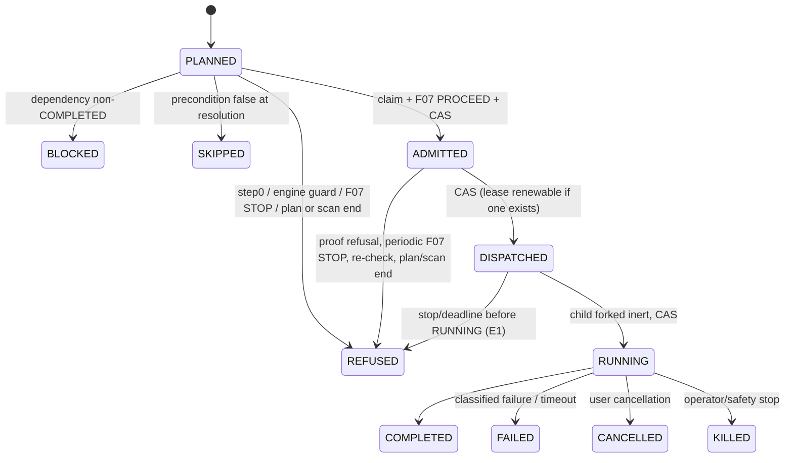

# Cross-Spec Target Design — Fahes execution platform

**PROPOSED — NOT APPROVED.** Planning only; nothing here is applied, implemented or tested. Decision IDs (`DEC-xxx`), task IDs, contradiction IDs (`C-xx`) refer to `DECISION_REGISTER.md`, `IMPLEMENTATION_BACKLOG.md` and `CONTRADICTION_LEDGER.md`. Baseline: HEAD `e42577304a2ccec873b30bbbf1d712e6348f6196`. Labels: **[CANON]** current canonical text · **[OWNER]** owner statement in this conversation · **[IMPL]** existing code evidence · **[PROP]** proposal · **[UNV]** unverified · **[PG]** documented PostgreSQL behaviour (general knowledge, not a repo file).

## 1. Scope and source authority
Authority order used when sources disagree (no document states one; this ordering is itself a proposal, DEC-019): (1) constitution v1.2.0 and ADRs [CANON]; (2) owner statements in this conversation [OWNER]; (3) committed spec text at HEAD; (4) working-tree/untracked spec text (U-1, 011, 012) as *proposed-authoritative* until committed (DEC-018); (5) audit/review documents as evidence only. Conflicts are recorded in `CONTRADICTION_LEDGER.md`; none is resolved silently.
In scope: specs 006–012 plus the foundations they cite (001 baseline, 002 cancel/timeout/refunds, 003 browser SSRF, 005 hardening) and the legacy code those depend on. Out of scope: SPEC 013/014, E16 load, E17 telemetry, F06 pricing (unspecified).

## 2. Target component architecture
```mermaid
graph LR
  API[apps/api: intake, planning (resolvePlan), authorization (007), safety (008), billing] -->|PostgreSQL authoritative| PG[(PostgreSQL)]
  API -->|jobs {executionUnitId}| Q[(BullMQ/Redis: queues, notifications only)]
  W[apps/worker: dispatch host, claim, host loop, finalize, sweeps] --> PG
  W --> Q
  W -->|IPC| CH[per-unit child (inert until RUNNING)]
  CH -.->|engine-specific| EP[(Execution Plane / browser pool / egress gate)]
  SW[timeout-sweep + reclaim/reconcile jobs] --> PG
  BR[credential broker (012)] --> PG
```
Facts: PostgreSQL is the record; Redis carries queues, notifications and limits [CANON PROJECT_MAP; 008 kill-switch rule 1]; the legacy Redis `admission-gate.ts` is a queue-capacity guard and not F07 [IMPL; DEC-020, DEC-025]. Existing apps: web, api, worker, probe-pool (library), sandbox-runner (a different system, DEC-002). Planned packages/apps for 011/012 do not exist [IMPL: absent paths].

## 3. Ownership and authorization boundaries
- Ownership (legacy `ControlLevel`, `TargetVerification`, `services/control-gate/`) stays; authorization is a separate entity per execution class (007) and is evaluated fresh at plan resolution, dispatch checkpoint and every effect [CANON; DEC-003]. `ExecutionClass` (six values) vs `ExecutionUnitClass` (nine incl. `PASSIVE_HTTP`, `SOURCE_STATIC`, `TELEMETRY`) [CANON 007/009 data models].
- Database roles: today one shared `DATABASE_URL` for api and worker, no RLS/roles [IMPL]. Target [PROP, DEC-044]: separate roles per component with definer functions for security-sensitive writes (012 FR-201 design); until then **no compromised-worker resistance is claimed** and conformance is a worker-side rule. Tenant isolation under worker compromise exists only in Mode S (DEC-033).
- Claims are authority for hosting only; they grant no authorization (DEC-015).

## 4. End-to-end lifecycle and legal transitions (non-passive units with `requiresSafetyCheckpoint`)

Transition table for every edge (writer, predicate, transaction, competing transitions, audit): `U1B_RACE_CRASH_MATRIX_v2.md` §2 and `PROPOSED_SPEC009_AMENDMENT_U1B_v5.md` Appendix A are the evidence base; this design adopts them with the corrections below. Terminal authority: `finalizeExecutionUnit` is one logical function; the host (claim token) and the sweep (orchestrator authority) are the only callers; 012's three entry points share one body (DEC-047). Edges for HEAD: `ADMITTED→REFUSED` [CANON `plan.md:257`]; U-1 adds `PLANNED→REFUSED`, `DISPATCHED→REFUSED` [working tree]; `DISPATCHED→REFUSED` approved in principle [OWNER DEC-013].

**Sequence (Q2 = B; DEC-011/012):**
```mermaid
sequenceDiagram
  participant P as Plan driver
  participant Q as Queue
  participant H as Worker host
  participant DB as PostgreSQL
  participant F as F07 (008)
  P->>Q: enqueue {executionUnitId} (unit PLANNED, no lease)
  Q->>H: pickup
  H->>DB: re-read; non-PLANNED => ignore
  H->>H: engine-local capacity check (DEC-052, pre-F07)
  H->>DB: claimUnitHost (step0 + stop-first classifier, unique claim)
  H->>DB: engine guards; pre-F07 re-read
  H->>F: safetyCheckpoint (consumes flags per call)
  F-->>H: PROCEED (+lease iff consumes.concurrency) | STOP
  H->>DB: CAS PLANNED->ADMITTED (lease renewable predicate iff lease exists)
  H->>DB: proofs, re-check; CAS ADMITTED->DISPATCHED
  H->>H: fork child (inert) ; host loop running
  H->>DB: CAS DISPATCHED->RUNNING
  H->>DB: authorizeEffect (unit FOR SHARE, status RUNNING, claim, lease) then effect
  H->>DB: finalizeExecutionUnit (release lease, BLOCKED propagation)
```
Refusal, timeout, stop, crash and retry paths are enumerated in §7, §12 and the matrices; no path is hidden by the diagrams.

## 5. Per-engine variations
| Engine / class | Differences | Status |
|---|---|---|
| `PASSIVE_HTTP`, `SOURCE_STATIC` | Legacy `webaudit-scan-phase` queue; no F07 checkpoint (`requiresSafetyCheckpoint=false`); U-1 step 0 not applied; 15-minute legacy limit unless a plan carries a deadline | [CANON 009 FR-040] |
| `TELEMETRY` | `PLANNED→COMPLETED` at generation; no claim | [CANON data-model comment] |
| `BROWSER`/`CRAWLER` (010) | Browser pool built in forked child; per-process context ceiling; unit may sit `ADMITTED` | conflicts C-13, C-14; target: ceiling check before F07, pool built after `RUNNING` (DEC-052 owner decision) |
| `SOURCE_EXECUTION` (011) | One unit = one run = one Guest; Supervisor child; EP provisioning; `consumes {request:true, concurrency:true}` at dispatch then `{false,false}` loop; EP dead-man/TTL | status mapping unverified (DEC-053); creation fence unverified (DEC-054) |
| `ACTIVE_SECURITY` (012 E14) | Child has no network path; parent gate; per-request pipeline; dispatch `{request:false, concurrency:true}`, per request `{true,false}` | [CANON 012] |
| `AUTHENTICATED_WORKFLOW` (012 E15) | Credentials only via broker after `RUNNING` | [CANON 012] |
| `LOAD_CAPACITY` | No spec | out of scope |

## 6. F07 admission, budget and lease semantics
- Admission is atomic in PostgreSQL: kill-switch rows first, then `isAuthorized`, then `BudgetCounter` row `FOR UPDATE`, then insert consumption/lease; a lease exists iff the call set `consumes.concurrency`; a repeated `(targetAuthorizationId, idempotencyKey)` returns the same result including the holder token [CANON 008 admission contract steps 1-4, rule 3].
- Lease: 30 s expiry; renewal needs the holder token and **has no expiry test**, so an expired-but-unreclaimed lease can be renewed; a reclaim sweep (60 s default cadence, ≤ ~90 s worst case after a crash) is design intent only [CANON `008/data-model.md:66-70`; `research.md:95-96`; IMPL none; DEC-063].
- Consumption terminology in all text: the call's `consumes {request, concurrency}` and the engine's unit-consumption policy; no "Class L/N" (DEC-022). Lease-dependent checks apply only where the dispatch call consumed concurrency (DEC-057).
- Fencing is the conjunction of: unique claim, token-guarded single-statement CAS, renewable-lease predicate under `FOR SHARE`, terminal-status read in the host loop, start gate, AR-19 release. None alone is complete; against a bypassing worker none applies (AR-13).

## 7. Stop, deadline and terminalization precedence
One classifier `classifyPreRunCause` used by every writer (claim, re-checks, host loop, guards, sweep, effect authorization) [PROP DEC-058]: (1) terminal → no-op; (2) stop pending = `REQUESTED`/`ACKNOWLEDGED` row in any applicable scope, or `STOPPED` for `(EXECUTION, unit)` only [CANON 008; fixes U-1 `:185`, C-05]; (3) scan terminal; (4) deadline passed; (5) remaining < `timeoutPolicyMs + hardStopMarginMs`. Host loop per iteration: terminal? → stop, write nothing; renew lease if one exists; classify; lease lost → abort, kill child, withhold work, **no finalization** (acknowledge-only is UNV); stop → acknowledge → abort → kill → owner finalizes; expiry → owner finalizes `REFUSED(SCAN_*)` from the status held. Writers outside 009 (012 unclaimed refusal, 012 sweep entry) must follow the same order (DEC-055). `finalizeExecutionUnit` today accepts any caller reason, so precedence is a conformance rule except inside 012's definer functions [CANON runtime-finalization-contract.md:19].

## 8. Lock order and transaction boundaries
Proposed global order [PROP DEC-050; not proven deadlock-free]: `BrokerPrincipalState` → tenant advisory (012) → `ExecutionUnit` → host claim (read) → `AdmissionLease` → `BudgetCounter` → consumption rows → engine ledger/claims → evidence/findings. Evidence: CAS/finalize/012 wrappers lock unit then lease [CANON `012/data-model.md:1038,1081`]; admission locks the counter first then inserts a lease [CANON admission contract :57,63]; reclaim/reconcile order is unspecified [UNV, DEC-050, EV-01]; 012's global order omits `BudgetCounter`. Mandated shapes [PROP DEC-057]: status change = one conditional `UPDATE … WHERE status = :from AND EXISTS(claim token hash)`; lease check = a second statement in the same transaction `SELECT … FOR SHARE` on the lease row (unit first); a failed predicate rolls back. A `FOR SHARE` CTE is not used because lock order within a statement is not guaranteed [PG]. Isolation is READ COMMITTED (repo precedent `credits/debit.ts:13`); the lease predicate protects the commit instant only. Residual cross-transaction gaps: F07 calls are separate transactions from the claim/status checks until AR-19 (DEC-045).

## 9. Effect authorization, cancellation and external fencing
**Ledger [PROP DEC-051].** 009 owns a contract; engines may use conforming ledgers (012 reuses `MutationIntent`/`sec-probe-attempt`; 011 `ep-run-start`); a generic table exists for engines without one. Record: `id`, `executionUnitId`, `attempt`, `claimId`, `effectKind` (engine-declared), `ordinal`, `idempotencyKey = H(unit.idempotencyKey, effectKind, ordinal)`, `state`, `authorizedAt`, `confirmedAt` (database clock), `engineRef` (opaque, e.g. EP `runId`). `@@unique(unit, attempt, effectKind, ordinal)`. States: `AUTHORIZED → CONFIRMED_DONE | CONFIRMED_NOT_PERFORMED | ABANDONED_UNCONFIRMED` (the last written by the sweep once `hardStopMarginMs` after the deadline has passed, with an alert). Authorization transaction: `unit FOR SHARE` → verify `RUNNING`, claim, scan/deadline (§7), lease (iff one exists, `FOR SHARE`) → insert `AUTHORIZED` → commit; then the effect, outside the transaction.
Rules: retry of an ordinal in `AUTHORIZED` must **reconcile** (e.g. EP `getRun`) and not re-perform unless the effect is declared idempotent (EP `provision` is create-or-get [CANON 011 EP interface]); crash between authorization and effect → record stays `AUTHORIZED`; effect succeeded but completion not recorded → stays `AUTHORIZED` until reconciled (hook returns `PENDING`); terminalization racing an authorized effect → the effect may proceed, `onUnitExpired` returns `TERMINATED` only when no record is `AUTHORIZED` (otherwise `PENDING`, bounded by U-1's hard-stop margin then `FAILED/TERMINATION_UNCONFIRMED`). Retention follows the unit's evidence retention (ADR-007); audit event per transition; lock order unit(share) → lease(share) → ledger insert.
**Guarantees kept separate:** (a) no new database authorization after terminalization — conditional on every engine using the ledger; (b) no new external effect after terminalization — **not guaranteed** (effect outside transaction, post-commit window up to the engine's pipeline latency, e.g. 012 rate pacing plus gate idle timeout; the 012 "at most one F07 unit per request" is a consumption bound, not a time bound [CANON FR-190]); (c) no in-flight effect after terminalization — **not guaranteed**; (d) external resource cleanup — engine/EP-dependent (dead-man, hard TTL, reconciler, AR-22) and **unbuilt**. A database fence cannot make an external system reject a stale request; for 011 that needs an EP-side tombstone/epoch or a database pre-claim of `ep-run-start`; the EP interface has neither [CANON; DEC-054, EV-02].

## 10. Billing and settlement
Current behaviour [IMPL]: charge up front per area (`AREA_COST` PERFORMANCE 20, SECURITY 20, UI 25, TESTING 20, SEO 10; all five = `FULL_AUDIT_COST` 80); `MODULE_STATES_SCORED = [COMPLETE, DEGRADED]` so DEGRADED counts as delivered; refund `= floor(charged × undelivered ÷ requested)`, all of `charged` when none delivered, equal share per area [`packages/config/src/refund.ts:15-25`; `terminal-refund.ts` uses `chargedCredits`, `requestedModules.length`, delivered count]. Worked examples (real formula):
| Case | charged | requested | delivered | refund |
|---|---|---|---|---|
| Full audit, SECURITY `DEGRADED` (partial coverage) | 80 | 5 | 5 | **0** |
| Full audit, three delivered | 80 | 5 | 3 | floor(80×2/5) = **32** |
| Full audit, none delivered | 80 | 5 | 0 | **80** |
| SECURITY only, partial coverage | 20 | 1 | 1 | **0** (P15 would charge less — mechanism unapproved) |
| UI(25)+SEO(10), UI undelivered | 35 | 2 | 1 | floor(35×1/2) = **17**, not 25 |
| UI(25)+SEO(10), SEO undelivered | 35 | 2 | 1 | **17**, not 10 |
| PERFORMANCE+SECURITY+SEO, one undelivered | 50 | 3 | 2 | floor(50×1/3) = **16** |
Hypothetical class-level (not approved, FR-198): SECURITY price 20, executedWeight 6 of plannedWeight 12 → charge floor(20×6/12) = 10, refund 10.
Design [PROP]: keep the formula and `AREA_COUNT` unchanged until OD-3 is decided (DEC-032: recommended Option 1, time-boxed exception with expiry date; Option 2 needs P17+AR-17+AR-15); keep legacy `DEGRADED` meaning and add a separate `coverageComplete:false` marker (DEC-061); settlement idempotent per scan (refund after guarded move; crash between move and refund loses, never doubles [CANON scan-deadline :236-237]); unit status does not enter legacy billing (refund uses module states); treatment of authorized-unconfirmed effects is an owner decision (DEC-062). F07 request units consumed at admission are budgets, not billing.

## 11. Coverage and readiness
`COMPLETE`/`DEGRADED` both carry a score (legacy). 012 requires a partial-coverage marker and no readiness PASS when `coverageComplete:false` (P13 approved) [CANON]; implementation absent (task B-01). A requested check that did not run must show `NOT_TESTED`/`BLOCKED`, never PASS (012 FR-186). Zero probes executed must not yield PASS.

## 12. Crash recovery and operational assumptions
Recovery table (all unchanged from `U1B_RACE_CRASH_MATRIX_v2.md` §4): host lost in `PLANNED`(claimed)/`ADMITTED`/`DISPATCHED`, or job lost/never enqueued → no resume; sweep finalizes at plan deadline (≤ 6 h ceiling) + sweep interval, shortened only if the proposed enqueue reconciler (DEC-059) is adopted for the never-enqueued case. Slot reclamation ≈ 90 s applies to a **crashed** holder only and only if the reclaim sweep runs at its default 60 s cadence (env-configurable ≥ 5 s for the existing timeout sweep [IMPL `timeout-scheduler.ts:23,29`]); it is not a bound on a paused-but-live holder, who can renew an expired-unreclaimed lease. Orphans: inert child exit on parent loss/gate timeout (new requirement), EP dead-man 15 s/hard TTL (documented, unbuilt). DB outage during terminalization: transaction rolls back; sweep retries; settlement idempotent (DEC-070). Redis loss: stop state is read from PostgreSQL within ≤ 5 s polling; queue loss strands `PLANNED` units until sweep/reconciler. Existing legacy behaviour is untouched for passive-only scans (DEC-005).

## 13. Audit and observability
Events (existing F07 audit types plus `AuditLogEntry` actions, no F07 enum extension): authorization, claim (claimSeq), admission/lease change, refusal with cause, terminalization with writer (host/sweep/ANY), effect authorization/completion, stop request/acknowledge/record, settlement/refund, provisioning/destroy. Correlation: `unitId` + `claimSeq` + effect ordinal + scan id (DEC-068). Never log claim tokens, holder tokens, credentials, or raw bind parameters (DEC-056, EV-04).

## 14. Migration and compatibility
Additive migrations only; new engines default-off behind flags; legacy path unchanged; order 007 → 008 → 009 → engines; rollback = flags off (DEC-069). U-1 columns are nullable additive. DB role changes (AR-13) must precede 012 broker/active engines and ideally precede 007/008 schemas (DEC-034).

## 15. Guarantees
| Guarantee | Class |
|---|---|
| No re-dispatch of terminal units; pickup-ignore | PROVEN BY REPOSITORY TEXT |
| Pre-RUNNING stop ⇒ REFUSED | PROVEN BY REPOSITORY TEXT |
| Immutable DB-clock plan deadline | PROVEN BY REPOSITORY TEXT (U-1, uncommitted) |
| Stop-first precedence in every writer | PROPOSED; conformance only outside 012 definer functions |
| One claim per (unit, attempt) | CONDITIONAL ON CONFORMANCE (shared DB role) |
| One winner per status edge | IMPLEMENTATION-DEPENDENT (mandated form) |
| Lease predicate atomic with CAS | IMPLEMENTATION-DEPENDENT; lock order UNVERIFIED |
| Deadlock freedom | UNVERIFIED |
| No new authorization after terminalization | CONDITIONAL ON CONFORMANCE |
| No effect / no in-flight effect after terminalization | UNPROVEN |
| External resource cleanup | UNPROVEN (AR-22; EP unbuilt) |
| Prompt atomic lease release | UNPROVEN (AR-19) |
| Stop acknowledgement for host-less units | UNPROVEN (DEC-048) |
| Compromised-worker resistance / tenant isolation under compromise | NOT CLAIMED (AR-13; Mode S only) |
| Billing equals executed work | NOT TRUE today (OD-3) |
Open risks are tracked as decisions and tasks in the registers; none is declared closed by this document.
