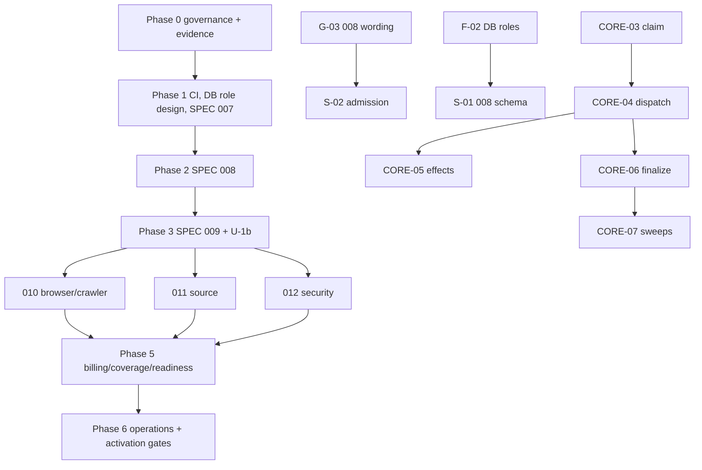

# Implementation Backlog (planning only)

**No task is started. All statuses are `NOT STARTED`.** Written in the writing-plans format adapted to the constraints of this phase: no commit steps, no implementation, new files only. Existing per-spec task lists remain the detailed source: SPEC 007 `tasks.md` T001-T042, 008 `tasks.md` (36), 011 `tasks.md` (347), 012 `tasks.md` (538); 009 and 010 `tasks.md` are planning logs (task G-08 creates their implementation lists). Order is by dependency, not spec number. A task may not start until its prerequisite decisions are `EXISTING APPROVED DECISION` or owner-approved and its prerequisite tasks are done.

## Dependency graph

## Counts

- Phase 0 — Governance, evidence and spec finalization (documentation/evidence only): 18 tasks
- Phase 1 — Foundations (CI, DB role design, SPEC 007): 3 tasks
- Phase 2 — SPEC 008 safety control plane: 5 tasks
- Phase 3 — SPEC 009 core platform and U-1b: 10 tasks
- Phase 4 — Engines (010, 011, 012): 9 tasks
- Phase 5 — Billing, coverage and readiness: 3 tasks
- Phase 6 — Operations hardening and activation gates: 5 tasks

Total: 53 tasks.

## Phase 0 — Governance, evidence and spec finalization (documentation/evidence only)

| ID | Spec | Prereq decisions | Prereq tasks | Files/contracts expected to change (future) | Scope and non-goals | Acceptance criteria | Tests | Migration / rollout | Definition of done | Risk | Status |
|---|---|---|---|---|---|---|---|---|---|---|---|
| G-01 | repo | DEC-018,DEC-066 | G-02 | specs/009-core-scan-execution-platform/** (11 paths per FUTURE_COMMIT_PLAN); specs/011-source-backend-database-testing-platform/ | Owner commits U-1(+U-1b) then 011 by explicit paths. Non-goal: committing 012, apps/web, showcase-* | git ls-files shows the allowlists tracked; allowlist-only diff | git diff --cached --name-only equals allowlist | none | Evidence of owner-run commits recorded | Medium | NOT STARTED |
| G-02 | 009 | DEC-011,DEC-012,DEC-013,DEC-021,DEC-023,DEC-024,DEC-064,DEC-066 | G-08 | specs/009-core-scan-execution-platform/{spec.md,plan.md,data-model.md,research.md,tasks.md,contracts/*} | Apply only the owner-approved amendment text. Non-goals: 008/010/011/012 files | Validation criteria of the approved amendment; grep shows one definition per status | doc consistency greps | none | Diff reviewed against approval | Medium | NOT STARTED |
| G-03 | 008 | DEC-045,DEC-048,DEC-049,DEC-050,DEC-063 | EV-01 | specs/008-safety-killswitch-budget-audit/contracts/{safety-admission,safety-checkpoint,kill-switch}-contract.md; data-model.md; research.md | Lock order, release surface, stranded-stop handling, recordStopped, reclaim job. Non-goal: runtime code | 008 states lock order for every operation; stranded-state and recordStopped rules exist | doc checks | none | 008 owner decisions recorded | High | NOT STARTED |
| G-04 | 010 | DEC-042,DEC-052,DEC-051 | EV-08 | specs/010-web-testing-platform/{spec.md,contracts/browser-execution-contract.md,plan.md} | Ceiling ordering, pool construction after RUNNING, per-effect fence, U-1 obligations. Non-goal: runtime | 010 text consistent with 009 lifecycle | doc checks | none | 010 owner decision | Medium | NOT STARTED |
| G-05 | 011 | DEC-053,DEC-054,DEC-046 | EV-02,EV-03 | specs/011-source-backend-database-testing-platform/{spec.md,plan.md,contracts/untrusted-execution-contract.md} | Status mapping, post-RUNNING provisioning, creation fence, no second F07 call. Non-goal: choose a vendor | 011 phases mapped to 009 statuses; EP creation fence specified or explicitly absent | doc checks | none | 011 owner decisions | High | NOT STARTED |
| G-06 | 012 | DEC-044,DEC-047,DEC-050,DEC-055,DEC-058,DEC-063 | G-02 | specs/012-security-auth-api-testing-platform/{spec.md,data-model.md,contracts/active-security-execution-contract.md,contracts/auth-workflow-execution-contract.md,tasks.md,plan.md,upstream-amendment-requests.md} | PLANNED-only claim, remove resume branches, 30 s wording, BudgetCounter in global order, unclaimed refusal rule. 012 remains untracked | 012 consistent with 009; T814 expectations updated | doc checks | none | 012 owner decision | Medium | NOT STARTED |
| G-07 | all | DEC-019,DEC-022 | — | docs/audits/fahes-master-audit/final-planning/ (glossary section of SPEC_CHANGE_PLAN) ; future spec glossary file | Terminology and SPEC-prefixed ID map. Non-goal: rewrite history | No bare P/F/A/N in new text; consumes terminology used | grep check | none | Glossary adopted | Low | NOT STARTED |
| G-08 | 009,010 | DEC-069 | — | specs/009-core-scan-execution-platform/tasks.md; specs/010-web-testing-platform/tasks.md (new implementation sections)  | Write implementation task lists mirroring this backlog. Non-goal: implement | Every 009/010 FR cited by ≥1 implementation task | traceability script | none | Task lists reviewed | Low | NOT STARTED |
| G-09 | 006,002,003,004 | DEC-031,DEC-065 | — | specs/006-scan-architecture-v2/spec.md header; specs/002..004 spec.md headers | Status axes once owner supplies dates. Non-goal: infer dates | Headers state PLANNING/AUTHORITY/FREEZE/IMPLEMENTATION/ACTIVATION | grep | none | Dates supplied by owner | Low | NOT STARTED |
| G-10 | audit | DEC-019 | — | docs/audits/fahes-master-audit/ (new TRACE_v2.csv, FINDINGS_v2.csv) | New CSVs with file:line refs, normalized severity, independence labels, coverage of 007-012. Non-goal: overwrite old CSVs | Coverage table per spec; closed severity enum | script validation | none | Review of new CSVs | Low | NOT STARTED |
| EV-01 | 008 | DEC-050 | — | evidence report (new file) | Obtain 008 lock-order statements/implementation plan for admission, renewal, release, reclaim, reconcile | Documented order per operation | — | none | Evidence filed | Medium | NOT STARTED |
| EV-02 | 011 | DEC-054 | — | evidence report | Confirm whether the Execution Plane can reject stale provision (tombstone/epoch) | Provider contract text or test | — | none | Evidence filed | High | NOT STARTED |
| EV-03 | 011 | DEC-053 | — | evidence report | Confirm 011 phase-to-009-status mapping and credential timing | 011 owner statement in repo | — | none | Evidence filed | High | NOT STARTED |
| EV-04 | ops | DEC-056 | — | evidence report | Verify DB bind-parameter logging disabled and statement logging config | Deployment config evidence | — | none | Evidence filed | Medium | NOT STARTED |
| EV-05 | 008 | DEC-063 | — | evidence report | Verify the lease reclaim sweep exists/cadence once implemented | Job registration + interval evidence | — | none | Evidence filed | Medium | NOT STARTED |
| EV-06 | 010,011,012 | DEC-022,DEC-057 | — | evidence report | Collect each engine's consumes policy per call (010 states none) | Table per engine | — | none | Evidence filed | Medium | NOT STARTED |
| EV-07 | 012 | DEC-044,DEC-040 | — | evidence report | Verify managed Postgres supports non-superuser NOLOGIN owners, CREATE/TEMP revocation, pooler identity | Verification queries run on the target deployment | — | none | Evidence filed | High | NOT STARTED |
| EV-08 | 010 | DEC-052,DEC-051 | — | evidence report | Confirm 010 effect points needing authorization (context creation, navigation) | Enumerated effect list | — | none | Evidence filed | Medium | NOT STARTED |

## Phase 1 — Foundations (CI, DB role design, SPEC 007)

| ID | Spec | Prereq decisions | Prereq tasks | Files/contracts expected to change (future) | Scope and non-goals | Acceptance criteria | Tests | Migration / rollout | Definition of done | Risk | Status |
|---|---|---|---|---|---|---|---|---|---|---|---|
| F-01 | repo | DEC-067 | — | .github/workflows/ci.yml; package.json scripts | CI for typecheck, lint, unit, adverse on PR. Non-goal: deploy | CI green on main | existing suites (pnpm typecheck/lint/test/test:adverse) | none | Workflow merged | Low | NOT STARTED |
| F-02 | 007,008,009,012 | DEC-034,DEC-044 | — | infrastructure/db-roles.md (new design doc); apps/api/prisma/migrations/<ts>_roles (future) | Role/grant matrix and function inventory for 007/008/009/012 tables. Non-goal: implement 012 functions | Matrix reviewed by all table owners | review | additive roles migration; rollout order before engines | Design reviewed | High | NOT STARTED |
| F-03 | 007 | DEC-003,DEC-034 | F-01,F-02 | apps/api/prisma/schema.prisma; apps/api/src/services/authorization/; apps/api/tests/adverse/authorization.test.ts; 007 tasks.md T001-T042 | Implement 007 tasks T001-T042 tests-first: ExecutionClass enums, TargetEnvironment, TargetAuthorization, ScopeDefinition, isAuthorized. Non-goal: 008/009 | 007 contract and adverse tests green | 007 unit/adverse/contract suites | additive migration; legacy control-gate untouched | All 007 tasks done with red→green evidence | High | NOT STARTED |

## Phase 2 — SPEC 008 safety control plane

| ID | Spec | Prereq decisions | Prereq tasks | Files/contracts expected to change (future) | Scope and non-goals | Acceptance criteria | Tests | Migration / rollout | Definition of done | Risk | Status |
|---|---|---|---|---|---|---|---|---|---|---|---|
| S-01 | 008 | DEC-020,DEC-044 | F-03,F-02 | apps/api/prisma/schema.prisma (BudgetCounter, BudgetConsumption, AdmissionLease, KillSwitchState, ExecutionAuditEvent); migrations | 008 data model. Non-goal: engines | prisma validate; constraints per data-model.md | schema/constraint tests | additive migration | Migration reviewed | Medium | NOT STARTED |
| S-02 | 008 | DEC-050,DEC-045 | S-01,G-03 | apps/api/src/services/safety/ (requestAdmission, safetyCheckpoint) | Atomic admission with locked counter, replay lookup before counter lock, trusted-caller/identity derivation per DEC-045. Non-goal: Redis authority | No over-admission under N concurrent callers; replay returns same result | apps/api/tests/adverse/safety-admission-race.test.ts; replay tests | none | Race suite green | High | NOT STARTED |
| S-03 | 008 | DEC-050,DEC-063,DEC-045 | S-02 | apps/api/src/services/safety/lease.ts; apps/worker/src/orchestrator/ (reclaim/reconcile job) | Renewal (token), release by authority (unit-keyed, token-free, transaction-joinable), reclaim and drift reconcile jobs with fixed lock order | Release inside caller txn; reclaim ≤ one sweep interval after expiry | lease race and lock-order stress tests | job registered via upsertJobScheduler | Evidence EV-05 | High | NOT STARTED |
| S-04 | 008 | DEC-048,DEC-049 | S-02,G-03 | apps/api/src/services/safety/kill-switch.ts; apps/worker/src/orchestrator/kill-switch.ts | triggerStop/acknowledge/recordStopped/escalation plus stranded-state handling per owner decision | No stranded REQUESTED row without alert; ordering per decision | kill-switch lifecycle tests incl. hostless | none | Decision implemented as recorded | High | NOT STARTED |
| S-05 | 008 | DEC-050 | S-02,S-03,S-04 | apps/api/tests/adverse/safety-*.test.ts | Concurrency/adverse suite: duplicate admission, release vs reclaim, finalize vs renewal, competing lock orders | All races from the crash matrix reproduced and bounded | adverse suite | none | Suite in CI | Medium | NOT STARTED |

## Phase 3 — SPEC 009 core platform and U-1b

| ID | Spec | Prereq decisions | Prereq tasks | Files/contracts expected to change (future) | Scope and non-goals | Acceptance criteria | Tests | Migration / rollout | Definition of done | Risk | Status |
|---|---|---|---|---|---|---|---|---|---|---|---|
| CORE-01 | 009 | DEC-051,DEC-015 | S-01,G-02 | apps/api/prisma/schema.prisma (ScanPlan, ExecutionUnit, ExecutionDependency, ExecutionUnitHostClaim, effect ledger, Evidence, Artifact); migrations | 009 data model incl. claim and ledger. Non-goal: engines | prisma validate; invariants (unique claim, deadline nullability) | schema tests | additive | Migration reviewed | Medium | NOT STARTED |
| CORE-02 | 009 | DEC-024 | CORE-01 | apps/api/src/services/planning/; packages/config/src/queues.ts | resolvePlan, computePlanDeadline (T-U1-1..3). Non-goal: dispatch | Deadline immutable, bounded, grant-aware | planning unit/adverse tests | legacy unaffected | AC-2,AC-3 subset | Medium | NOT STARTED |
| CORE-03 | 009 | DEC-056,DEC-058,DEC-021 | CORE-01 | apps/worker/src/execution-runtime/claim.ts; cause-classifier module | claimUnitHost, token mechanics, stop-first cause classifier | Second claimant gets ALREADY_CLAIMED; stop never masked by deadline | claim race tests; precedence table tests | none | Tests green | High | NOT STARTED |
| CORE-04 | 009 | DEC-011,DEC-012,DEC-057,DEC-016,DEC-014,DEC-060 | CORE-03,S-02 | apps/worker/src/execution-runtime/dispatch.ts; apps/worker/src/orchestrator/timeout-scheduler.ts | Dispatch sequence, pickup-ignore, pre-F07 read, conditional lease predicate (two ordered statements), host loop from PROCEED, CAS transitions | All edges guarded; stale host writes fail | dispatch race/crash suite from matrix | flag-off by default | Matrix traces pass | High | NOT STARTED |
| CORE-05 | 009 | DEC-051,DEC-064 | CORE-04,G-02 | apps/worker/src/execution-runtime/effects.ts; ledger tables | Start gate, authorizeEffect, effect ledger, onUnitExpired hook contract | No new authorization after terminalization; hook PENDING while AUTHORIZED | effect-race tests; hook tests | additive | Per-engine conformance harness | High | NOT STARTED |
| CORE-06 | 009 | DEC-047,DEC-049,DEC-045 | CORE-04,S-03 | apps/worker/src/execution-runtime/finalize.ts | finalizeExecutionUnit sole terminal writer, BLOCKED propagation, lease release integration, recordStopped integration | Idempotent; one transaction with release when AR-19 surface exists | finalize race tests | — | Equivalence test with 012 entry points | High | NOT STARTED |
| CORE-07 | 009 | DEC-059,DEC-024 | CORE-04,CORE-06 | apps/worker/src/orchestrator/timeout.ts; timeout-scheduler.ts | Planned-pass sweep, expirePlanUnits, continueScanIfPlanTerminal (T-U1-6..8), enqueue reconciler | Legacy sweep tests unchanged and green; AC-1..AC-20 | existing timeout tests + new adverse | job extension, flag | AC suite green | High | NOT STARTED |
| CORE-08 | 009 | DEC-006 | CORE-01 | apps/worker/src/evidence/; apps/api/src/services/storage/ | Evidence envelope, artifacts, progress, finding materialization (009 FR-026..FR-037) | Append-only evidence; redaction before store | contract tests | additive | Tests green | Medium | NOT STARTED |
| CORE-09 | 009 | DEC-005 | CORE-04,CORE-05,CORE-06,CORE-07 | apps/worker/tests/adverse/ (new) | Race/crash adverse suite from U1B_RACE_CRASH_MATRIX_v2 and final-planning adversarial pass | Every matrix row has a test or an explicit UNPROVEN note | adverse suite | — | Suite in CI | Medium | NOT STARTED |
| CORE-10 | 009 | DEC-005 | CORE-07 | apps/worker/tests/ (legacy sweep/refund regression) | Passive-only and no-plan scans unchanged | AC-1 and refund tests identical results | existing suites | none | No legacy diff in behaviour | Low | NOT STARTED |

## Phase 4 — Engines (010, 011, 012)

| ID | Spec | Prereq decisions | Prereq tasks | Files/contracts expected to change (future) | Scope and non-goals | Acceptance criteria | Tests | Migration / rollout | Definition of done | Risk | Status |
|---|---|---|---|---|---|---|---|---|---|---|---|
| E-01 | 010 | DEC-052,DEC-042,DEC-051 | CORE-05,G-04 | apps/worker/src/execution-runtime/; apps/probe-pool/src/browser/pool.ts; apps/worker/src/web-checks/ | Browser engine (E10) per decided ceiling option; context creation after RUNNING with authorizeEffect | Ceiling honoured without held lease starvation (per option) | browser pool SSRF suite; ceiling tests | flag-off | Tests green | High | NOT STARTED |
| E-02 | 010 | DEC-042 | E-01 | apps/worker/src/web-checks/ ; crawler module | Crawler (E11) and domains D22-D25 | Coverage states per 010 contracts | 010 contract tests | flag-off | Tests green | Medium | NOT STARTED |
| E-03 | 011 | DEC-041,DEC-006 | CORE-08 | packages/source-analysis/; apps/worker (source-static) | E12 SOURCE_STATIC (011 tasks) | Static analysis evidence only; no customer-code execution | 011 tests for E12 | flag-off | Tests green | Medium | NOT STARTED |
| E-04 | 011 | DEC-054,DEC-002 | CORE-05,G-05 | packages/source-execution-contract/; fake provider; DisabledProvider | Execution Plane provider interface, fake provider, DisabledProvider; no real provider | Fail-closed when provider absent | fake-provider contract suite | flag-off | AG7 suite | High | NOT STARTED |
| E-05 | 011 | DEC-053,DEC-054,DEC-051,DEC-046 | E-04,G-05 | apps/worker/src/ (supervisor); 011 tasks | E13 supervisor lifecycle with post-RUNNING provisioning, effect authorization, onUnitExpired | No provision before RUNNING; hook confirms teardown | lifecycle + stale-provision tests (fake provider) | flag-off | AG1-AG10 gates unchanged | High | NOT STARTED |
| E-06 | 012 | DEC-044,DEC-045,DEC-046,DEC-040,DEC-033 | F-02,S-03,CORE-06,G-06,EV-07 | apps/credential-broker/; apps/api/src/services/security/; roles migrations | Credential broker, vault, principals, definer functions | Broker refuses issuance until SG3/SG10 | 012 broker tests | flag-off | Roles deployed in target env | High | NOT STARTED |
| E-07 | 012 | DEC-007,DEC-055,DEC-058,DEC-039 | CORE-06,E-06 | packages/security-registry/; packages/security-engine/; apps/worker/src/security/ | E14 passive-first engine and registry | No active class purchasable | 012 contract/adverse tests | flag-off | Tests green | High | NOT STARTED |
| E-08 | 012 | DEC-037,DEC-055 | E-07 | apps/worker/src/security/ | E15 authenticated workflow | Consent, MFA modes per approved P-items | 012 tests | flag-off | Tests green | High | NOT STARTED |
| E-09 | 012 | DEC-009,DEC-061 | E-07,B-01 | apps/worker/src/security/; coverage materialization | D20 checks and coverage materialization | coverageComplete marker set on partial work | 012 coverage tests | additive | Tests green | Medium | NOT STARTED |

## Phase 5 — Billing, coverage and readiness

| ID | Spec | Prereq decisions | Prereq tasks | Files/contracts expected to change (future) | Scope and non-goals | Acceptance criteria | Tests | Migration / rollout | Definition of done | Risk | Status |
|---|---|---|---|---|---|---|---|---|---|---|---|
| B-01 | 012,readiness | DEC-009,DEC-061 | CORE-08 | apps/worker/src/readiness/verdict.ts; packages/scoring/src/aggregate.ts; apps/worker/src/readiness/diff.ts | Coverage marker; readiness never PASS when coverageComplete:false | Readiness test matrix | readiness unit/adverse tests | additive field | Tests green | High | NOT STARTED |
| B-02 | billing | DEC-032,DEC-038,DEC-062,DEC-035,DEC-036 | CORE-06 | apps/api/src/services/intake/create-scan.ts; packages/config/src/{pricing,refund}.ts; apps/api/src/services/credits/refund.ts; apps/worker/src/orchestrator/{terminal-refund,timeout}.ts | Implement the owner-approved OD-3 outcome; default AREA_COUNT unchanged until then | Numeric examples in target design §10 hold | refund property tests | settlement mode snapshot per scan | Owner-approved formula implemented | High | NOT STARTED |
| B-03 | billing | DEC-070 | B-02 | apps/worker/tests/ ; apps/api/tests/ | Idempotent settlement and outage tests (finalize vs refund crash window) | No double refund; lost refund detectable | crash tests | — | Tests green | Medium | NOT STARTED |

## Phase 6 — Operations hardening and activation gates

| ID | Spec | Prereq decisions | Prereq tasks | Files/contracts expected to change (future) | Scope and non-goals | Acceptance criteria | Tests | Migration / rollout | Definition of done | Risk | Status |
|---|---|---|---|---|---|---|---|---|---|---|---|
| O-01 | ops | DEC-048,DEC-051 | CORE-07 | apps/worker/src/orchestrator/ (alerts/metrics) | Alerts: stuck units, stranded stop rows, AUTHORIZED effects past margin, orphan leases | Alerts fire in drills | drill tests | — | Runbook entries | Medium | NOT STARTED |
| O-02 | ops | DEC-069 | CORE-10 | infrastructure/ (runbooks); feature flags | Rollout/rollback runbooks and flags default-off | Rollback = flags off verified in staging | staging drill | — | Runbook reviewed | Medium | NOT STARTED |
| O-03 | ops | DEC-046 | E-05,E-06 | specs plan SG1-SG10 / AG1-AG10 verification harness | Gate verification harness | Each gate has a runnable check | gate checks | — | Gates evidenced | Medium | NOT STARTED |
| O-04 | 011 | DEC-043,DEC-002 | E-05 | external review (not code) | External isolation review and penetration test of the Execution Plane (011 FR-041) | Report filed | — | — | Report in repo | High | NOT STARTED |
| O-05 | audit | DEC-068 | CORE-06 | apps/api/src/services/ audit writers | Correlation ids and redaction for new events | No raw tokens or credentials in logs | redaction tests | — | Tests green | Medium | NOT STARTED |

