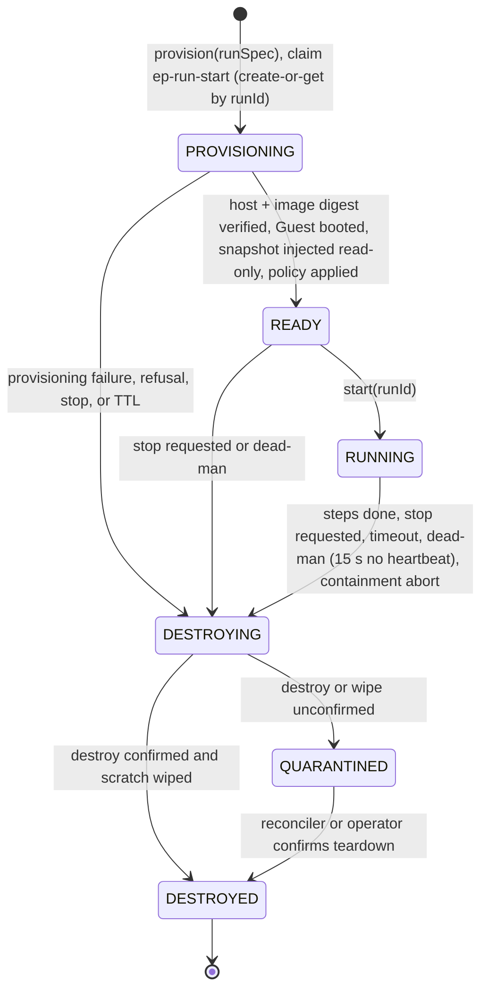
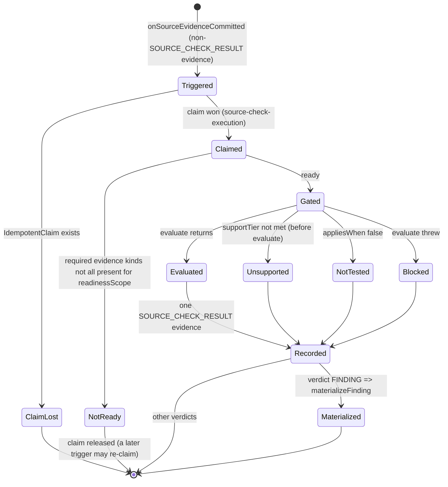
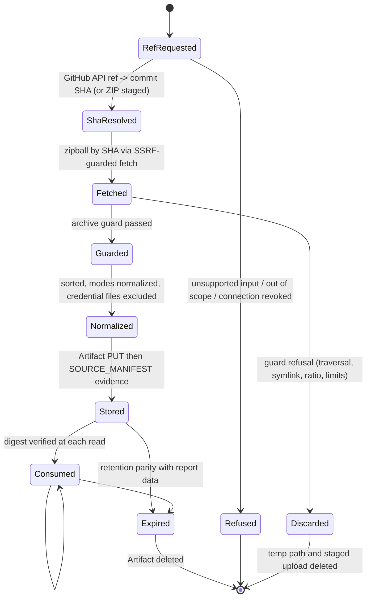

# Phase 1 Data Model: Source / Backend / Database / Automated Code Testing Platform

**Status**: planning artifact only. No Prisma migration is written or run, `schema.prisma` is not edited, no
dependency is added. Every shape below is a contract a future implementation must satisfy, not existing code.
Code-level shapes are labelled **not final**.

**Outcome (spec FR-116, SC-005)**: SPEC 011 introduces **zero new Prisma models** and **zero `@relation` edges into
any frozen model** (scalar ids only, the 009 FR-040 pattern). The only persisted-schema change is two additive enum
extensions: four `ModuleType` values and ten `EvidenceKind` values. The only persisted objects SPEC 011 creates are
rows of tables defined upstream (009 `Evidence`, `Artifact`, `Issue`/`IssueEvidenceLink`, `ExecutionUnit`; 010
`IdempotentClaim`; 008 audit/lease tables), written exclusively through their existing write paths.

Authority split (binding): the **reason-code registry** is owned by `contracts/source-evidence-contract.md` and this file
mirrors it with identical code names, verdicts and `kind` values. This file is the **single authority for the payload field
schemas of the ten EvidenceKinds** and for **IdempotentClaim scopes and claimKey formats**; contracts that restate a payload
must conform to it or simply point here. The 13-phase lifecycle table and the Execution Plane run states are owned by
`contracts/untrusted-execution-contract.md`; the state diagram below conforms to it. The `engineId` list is owned by
`plan.md` (this file conforms).

## Entity Decision Table

Test applied to every candidate (master prompt section 52, 010 precedent): **"Can a typed Evidence payload plus a
code-level versioned registry do this?"** A table is created only on a "no". Every row below answered "yes" (or "not
persisted at all").

Decision vocabulary: Durable entity | Versioned configuration | Execution-local state | Evidence payload | Artifact |
Derived view.

| Concept | Decision | Lives in | Justification | Evidence + registry test |
|---|---|---|---|---|
| SourceSnapshot | Artifact + Derived view | `Artifact` (contentType `application/vnd.fahes.source-snapshot`) addressed through `SOURCE_MANIFEST` Evidence | Immutable bytes need object storage; identity (digest, SHA, ref) is a small typed record; per-scan, tenant-keyed, retention parity, never shared | YES: Artifact + Evidence suffice; no table |
| SourceManifest | Evidence payload | `SOURCE_MANIFEST` | One record per acquisition, written once, read by checks | YES |
| LanguageProfile | Evidence payload | `SOURCE_MANIFEST.languages[]` section | Detection result per workspace, versioned by matrix version, no lifecycle of its own | YES |
| ToolchainProfile | Evidence payload | `SOURCE_MANIFEST.toolchain[]` section | Same; carries declared vs selected versions and `toolchainSubstitution` | YES |
| AnalysisRule | Versioned configuration | `packages/source-analysis/` rule registry (code, semver) | Adding a rule must need zero core edits (FR-022); rule definitions change with releases, not at runtime | YES: registry; persisting rules would add a second source of truth |
| SourceDiagnostic | Evidence payload | `TOOL_DIAGNOSTIC` (+ reused `SOURCE_LOCATION`, `CODE_FLOW`) | Immutable observation tied to a snapshot; bulk goes to Artifact | YES |
| IsolatedExecutionEnvironment | Execution-local state | Execution Plane run record keyed by `runId` | Lifetime = one Guest (minutes); authoritative state is on the EP, mirrored by `ExecutionUnit.status` + F07 audit | YES: persisting would create a second lifecycle and violate FR-049 |
| ExecutionImage | Versioned configuration | Image catalog (code) + signed image digest | Identity must be digest-pinned in source control and attested, not mutable DB data | YES |
| TestSuite | Evidence payload | `TEST_RESULT` (`kind: SUITE`) | Per-run result, immutable | YES |
| TestCaseResult | Evidence payload | `TEST_RESULT` (`kind: CASE`, batched) | Stable identity (FR-081) is a fingerprint input, not a key | YES |
| CoverageSummary | Derived view + Evidence payload | `scanSourceCoverageSummary(scanPlanId)` read function; `COVERAGE_REPORT` per tool | Summary computes from committed evidence; computes no verdict or score (FR-127) | YES |
| BackendContract | Evidence payload (+ Artifact for the inventory body) | `SOURCE_SURFACE`, `CONTRACT_RESULT` | Source-derived or probe-derived facts about one snapshot | YES |
| DatabaseSchemaSnapshot | Evidence payload (+ Artifact for diagram) | `SCHEMA_SNAPSHOT` | Declared and introspected object lists, per run | YES |
| MigrationTestResult | Evidence payload (+ Artifact for log) | `MIGRATION_RESULT` | Per-migration outcome with SQLSTATE; immutable | YES |
| SourceExecutionPolicy | Versioned configuration | `FAHES_SOURCE_*` flags + code-level policy constants + grant fields (F01) | Consumption policy is a declaration (FR-050); budgets live in F01/F07 | YES |
| SourceCheckDefinition | Versioned configuration | `apps/worker/src/source-testing/checks/` registry | Pure functions cannot be rows (010 `WebCheckDefinition` precedent) | YES |
| CommandTemplate | Versioned configuration | `packages/source-execution-contract/` (code) | Argv templates must be reviewed code, never data a tenant can edit | YES |
| SupportMatrix | Versioned configuration | Language/toolchain capability matrix (code, versioned) | Tier decisions are product policy under source control | YES |
| ExecutionPlaneRun | Execution-local state | EP run record; supervisor mirror = `ExecutionUnit` + audit | See IsolatedExecutionEnvironment; the supervisor derives `runId` deterministically | YES |
| FixtureSpec | Versioned configuration | Code-level fixture catalog; selected set recorded in `ExecutionUnit.configuration` | Selection is data on a unit; the catalog is code | YES |
| ReasonCode registry | Versioned configuration | `packages/source-execution-contract/` single registry module | One code-level set referenced by all contracts (FR-136); free text never drives logic | YES |
| Idempotency record | Durable entity (reused, not new) | 010 `IdempotentClaim`, four new scope strings | Race-safe dedup needs a unique constraint; 010 already supplies it | n/a: reuse |

**Result**: 22 candidates evaluated, 0 new tables.

## Additive enum changes

Both changes are additive-only. No existing member is renamed, removed, reordered in the database, or repurposed.

### `ModuleType` (existing enum, `apps/api/prisma/schema.prisma:28-34`)

Real schema today (verified): `PERFORMANCE`, `SECURITY`, `UI`, `TESTING`, `SEO`. 010 adds `ACCESSIBILITY` and
`FUNCTIONAL`. 011 appends four:

```prisma
enum ModuleType {
  PERFORMANCE
  SECURITY
  UI
  TESTING
  SEO
  // --- added by SPEC 010 (not yet in schema.prisma) ---
  ACCESSIBILITY
  FUNCTIONAL
  // --- added by SPEC 011 ---
  SOURCE_QUALITY   // contexts B and D (E12 evidence, D26 checks)
  BACKEND          // context E
  DATABASE         // context F
  AUTOMATED_TESTS  // context G
}
```

Migration form (PostgreSQL): `ALTER TYPE "ModuleType" ADD VALUE IF NOT EXISTS 'SOURCE_QUALITY';` and likewise for the
other three. A newly added enum value cannot be used in the same transaction that adds it (and the Prisma migration
must not insert rows using it); no 011 migration inserts rows. Existing `TESTING` is unrelated and unchanged:
`AUTOMATED_TESTS` is a distinct value because `TESTING` is a legacy HTTP-capability bucket with prices, thresholds and
capability rows attached (FR-115).

Activation touchpoints (010 FR-003a pattern; enum values existing does not make domains purchasable): flat pricing
`AREA_COST` (`packages/config/src/pricing.ts`), scan-form `ALL_AREAS`, any exhaustive `switch` over `ModuleType` in
scoring/readiness/report code, and the AI prompt registry. The new modules MUST NOT be customer-purchasable until F06
provides pricing (FR-115); the future implementation owns the grep for exhaustive switches.

### `EvidenceKind` (009's enum; absent from the real schema today)

009 creates `EvidenceKind` with 14 values (`HTTP_TRANSACTION, SOURCE_LOCATION, SCREENSHOT, SCREENSHOT_DIFF, DOM_NODE,
ACCESSIBILITY_NODE, BROWSER_TRACE, HAR, VIDEO, LOAD_METRICS, SECURITY_REPRODUCTION, CODE_FLOW, DEPENDENCY,
TELEMETRY`); 010 adds `CONSOLE_MESSAGE, CRAWL_DISCOVERY, STRUCTURED_DATA, CHECK_RESULT`. 011 appends ten:

```prisma
enum EvidenceKind {
  // 009 (14 values) and 010 (4 values) precede; unchanged. 011 reuses SOURCE_LOCATION, CODE_FLOW, DEPENDENCY as-is.
  SOURCE_MANIFEST         // acquisition: snapshot identity, toolchain/language/workspace profile
  SOURCE_SURFACE          // static route/handler/middleware/env/DB-access inventory
  TOOL_DIAGNOSTIC         // parser/rule/compiler/linter diagnostic (static or in-Guest)
  EXECUTION_STEP_RESULT   // one Step of a command plan
  TEST_RESULT             // suite and case results, plus static discovery
  COVERAGE_REPORT         // instrumented code coverage, per tool; analysis coverage
  SCHEMA_SNAPSHOT         // declared and introspected database objects
  MIGRATION_RESULT        // per-migration apply outcome and integrity-probe outcomes
  CONTRACT_RESULT         // OpenAPI/JSON-Schema validation and local probe outcomes
  SOURCE_CHECK_RESULT     // exactly one per Source Check execution (all six verdicts)
}
```

`SOURCE_CHECK_RESULT` is 011's own kind; 010's `CHECK_RESULT` payload is web-shaped (`pageIdentity`) and MUST NOT be
widened or reused (FR-114).

### Migration ordering dependency (important)

- Today `ModuleType` exists; `EvidenceKind`, `ExecutionUnit`, `Evidence`, `Artifact` and `IdempotentClaim` do **not**
  exist in `schema.prisma` (verified). They arrive with SPEC 009 and 010 runtime implementation (FR-138).
- Required order: 009 migration (creates `EvidenceKind`) -> 010 migration (`ADD VALUE` x4 on `EvidenceKind`, x2 on
  `ModuleType`, creates `IdempotentClaim`) -> **011 migration** (`ADD VALUE` x10 on `EvidenceKind`, x4 on `ModuleType`).
- The `ModuleType` additions have no dependency on 009/010 and could technically land earlier, but doing so would
  expose unusable values to the existing `Scan.requestedModules` column; keep them in the single 011 migration.
- 011 defines no interim table or private substitute for any missing upstream entity (FR-138).

### Additive-only proof statement

(1) The migration is a list of `ALTER TYPE ... ADD VALUE` statements and nothing else: no `CREATE TABLE`, no column
add/drop, no index, no constraint, no backfill. (2) `ADD VALUE` never rewrites rows or invalidates existing values; a
code version unaware of the new values keeps working as long as it does not exhaustively switch (touchpoints above).
(3) Rolling back the application leaves unused enum values, which is harmless; PostgreSQL does not support removing an
enum value, so the migration is forward-only by design and that is acceptable because nothing references the values
until the activation flags are on. (4) No existing production call site can emit the new values (compat evidence to be
recorded in `research.md`; `ModuleType` writers are `Scan` creation and `ModuleResult`/`Capability` seeding only).

## Evidence payload schemas

All payloads are JSON validated by the trusted side against these schemas before `recordEvidence`. Conventions:

- **Envelope** (every kind): `schemaVersion: int`, `producedBy: {engineId, toolId?, toolVersion?, imageId?}`,
  `snapshotDigest: string` (sha256 hex), `workspacePath: string` (workspace-relative, `.` for root), `redaction:
  {applied: true, ruleSetVersion}`. "req" = required, "opt" = optional.
- **Redaction**: every payload that can contain source text, logs, stack traces, schema or SQL is passed through
  `@webaudit/redaction` before storage (FR-117), including `SOURCE_STATIC` evidence (009 forces it only for
  `SOURCE_EXECUTION`). Excerpts: at most 7 lines and 600 characters; never from credential-denylist files (FR-118).
  Guest-produced values are untrusted: validated, size-capped and redacted on the trusted side.
- **Size**: payloads at or below 009's inline ceiling stay inline; above it, `recordEvidence` externalizes to an
  Artifact (never truncates inline). 011 per-object ceiling 20 MiB and per-run 50 MiB *(provisional)*; logs 10 MiB per
  step (head + tail with `TRUNCATED` marker). Evidence batches carry at most 500 items *(provisional)*.

### SOURCE_MANIFEST (producer: `SOURCE_STATIC` unit `source-static.acquire`)

| Field | Type | Req | Notes |
|---|---|---|---|
| `input` | `{kind: "GITHUB_REPO"\|"ZIP_UPLOAD", repositoryFullName?, uploadSha256?}` | req | Exactly the two v1 input kinds. `repositoryFullName` matches `REPO_PATTERN` (`owner/name`); for ZIP uploads (ARCHIVE Target, REPOSITORY scope shape) `repositoryFullName == Target.canonicalValue` |
| `requestedRef` / `resolvedCommitSha` | string / 40-hex | opt / opt | Both present for GitHub (a request without an explicit ref records the repository's resolved default branch name as `requestedRef`); absent for ZIP (F01 destination ref for ZIP is the empty string). Ref grammar: <= 255 chars, no `..`, no control characters, no leading `-`, no whitespace; a commit SHA is 40 hex; violations are `REPO_REF_INVALID` before any network call |
| `workspacePath` | string | req | Constrained by F01 scope path prefixes when a grant is involved |
| `contentDigest` | sha256 hex | req | Over canonical manifest (path, size, sha256 per file) |
| `snapshotArtifactId` | string | req | Scalar ref to the snapshot Artifact |
| `fileCount`, `bytes` | int | req | |
| `acquiredAt`, `tenantUserId` | ISO, string | req | |
| `scopeGrantRef` | `{targetAuthorizationId}` | opt | Present only on execution-bound acquisitions (FR-004) |
| `denylistVersion` | string | req | Version of the code-level `credential-denylist` applied (v1 pattern list in `research.md` R33 plus `*.kdbx`, `*.ovpn`, FR-153) |
| `sourceForm` | `"GITHUB_EXPORT_ARCHIVE"\|"ZIP_UPLOAD"` | req | How the content was obtained; a GitHub export archive is `git archive` output |
| `exportAttributesPresent` | boolean | req | The repository `.gitattributes` contains `export-ignore`/`export-subst`: files hidden by the owner are invisible and undetectable (stated limitation, residual-risk register) |
| `refKind` | `"BRANCH"\|"TAG"\|"SHA"\|"DEFAULT"` | opt | Refs are resolved fully qualified (`refs/heads/...`, `refs/tags/...`) so a tag and a branch of one name cannot be confused |
| `excludedFiles[]` | `{path, reason}` | req | Paths only; reasons `EXCLUDED_CREDENTIAL_FILE`, VCS metadata |
| `skipped[]` | `{path, reasonCode}` | req | `LFS_POINTER_UNRESOLVED`, `SUBMODULE_NOT_FETCHED`, `SKIPPED_TOO_LARGE` (per-file analysis cap 2 MiB; per-file execution-snapshot cap 10 MiB); max 2000 then marker `truncated: true`. Acquisition limits are the existing 50 MiB archive / 512 MiB extracted / 20,000 files; the 20 MiB/50 MiB cap below is for Artifacts 011 produces, not the snapshot |
| `languages[]` | `{workspacePath, language, files, tier, confidence, justifyingPaths[]}` | req | LanguageProfile section |
| `toolchain[]` | `{workspacePath, packageManager, lockfile?, declaredNode?, selectedImageId?, toolchainSubstitution?, confidence, justifyingPaths[]}` | req | ToolchainProfile section |
| `workspaces[]` | `{path, kind, parent?}` | req | Monorepo partition; default readiness scope (FR-013). At most 4 Tier-1 partitions are executed per scan (FR-152); the rest are recorded `WORKSPACE_CAP_EXCEEDED` |
| `frameworks[]`, `testRunners[]` | `{workspacePath, id, version?, confidence}` | opt | |
| `executableConfigs[]` | `{path, kind}` | opt | `EXECUTABLE_CONFIG_PRESENT`, never evaluated |
| `supportMatrixVersion` | string | req | Versioned decision input (FR-014) |

### SOURCE_SURFACE (producer: `SOURCE_STATIC` `source-static.analyze.backend-surface`)

Envelope plus: `origin: "SOURCE_DERIVED"` (req, fixed), `framework`, `routes[]` `{method, pattern, handlerSymbol,
file, line, validationSchemaRef?, middleware[], declaredResponses[]}` (req; `RouteIdentity` inputs per
`source-correlation-contract`), `envReads[]` `{name, file, line, hasDefault}`, `externalHttpCalls[]`, `dbAccessSites[]`
`{file, line, kind}`, `confidence`, `workspacePath` (req; the service/workspace the surface belongs to), `surfaceComplete` (req boolean; `false` when any route/mount is dynamic or unresolved or a service could not be resolved, so SPEC 012 knows the inventory is not exhaustive). Bulk inventory above the inline ceiling goes to an Artifact.

### TOOL_DIAGNOSTIC (producers: E12 observers `source-static.analyze.*`; also `SOURCE_EXECUTION` for `tsc`/`eslint`)

Envelope plus: `source: "OBSERVER"\|"TSC"\|"ESLINT"\|"PARSER"` (req), `ruleId?` + `ruleVersion?` (observers), `code`
(rule id or compiler code, req), `severityHint`, `file`, `line`, `column`, `endLine?`, `symbolPath?`, `message`
(req; redacted, 500 char cap), `excerpt?` (req-or-absent per FR-118), `suppressed: bool` (inline `fahes-ignore` is
recorded, not hidden), `confidence`, `perFileStatus?` (`ANALYZED\|PARSE_FAILED`, with `parser`, `errorClass`). Static
diagnostics use the reused `SOURCE_LOCATION` kind for pure location facts and `CODE_FLOW` for import/dependency cycles
(`nodes[]` as qualified paths); `DEPENDENCY` carries manifest/lockfile observations (FR-028, FR-068).

### EXECUTION_STEP_RESULT (producer: `SOURCE_EXECUTION` `source-execution.run`)

Single authority for this payload (`build-typecheck-contract` `StepResult` and the other contracts conform to it). Envelope plus:
`stepKind` (req: `PLAN\|INSTALL\|TYPECHECK\|LINT\|BUILD\|TEST\|DB_MIGRATE\|BACKEND_PROBE\|FIXTURE`), `stepIndex`, `templateId`,
`templateVersion`, `argv` (as run, redacted), `phase` (`P1..P4`), `startedAt`, `durationMs`, `exitCode?`, `signal?`,
`outcome: "EXITED"\|"TIMED_OUT"\|"RESOURCE_LIMIT"\|"NOT_RUN"\|"ABORTED_BY_CONTAINMENT"` (req; maps the contract's
`EXECUTED\|TIMED_OUT\|NOT_RUN`), `reasonCode?` (registry), `classification` (req for non-`PLAN` steps:
`CODE_DEFECT\|ENVIRONMENT_LIMITATION\|TOOLING_DEFECT\|INDETERMINATE\|MEASURED`; `ENVIRONMENT_LIMITATION` carries `reasonCode`),
`commitSha?` (40-hex, GitHub input only), `toolchain {node, packageManager, tool}`, `diagnosticCount` + `diagnosticsTruncated:
bool` (the diagnostics themselves are `TOOL_DIAGNOSTIC` rows, capped at 500 per step, excess counted not dropped), `truncated:
bool` (log head+tail), `resources {cpuSeconds, peakMemBytes, scratchBytes, netBytes}`, `networkBlockedAttempts`, `imageId`,
`imageDigest`, `toolVersions{}`, `envIdentity` (names only, synthetic values never echoed), `logArtifactId?` (head+tail, 10 MiB
cap). Unmet preconditions produce `NOT_RUN` with `reasonCode`, never a missing record; a step not started because the run
envelope ended is `NOT_RUN` + `RUN_BUDGET_EXHAUSTED`.

`stepKind: "PLAN"` (recorded at lifecycle phase 2): carries `commandPlan: [{stepIndex, templateId, templateVersion, params,
phase, dependsOn?, rerunSafe}]` (bound from the digest-verified `SOURCE_MANIFEST`; `rerunSafe` true ONLY for unit-test steps that
start no fixtures) and `denylistVersion` of the manifest used; it has no `exitCode`/`classification`.

### TEST_RESULT (producers: `SOURCE_EXECUTION` for results; `SOURCE_STATIC` for discovery with `phase: "DISCOVERY"`)

Envelope plus: `phase: "DISCOVERY"\|"EXECUTION"` (req), `runnerId` (`vitest\|jest\|node-test\|pytest`), `suiteFile`
(req), `runnerVersion?`, `exitCode?`, `reporterFormat?`, `suiteStatus` (taxonomy FR-077/FR-080: `DISCOVERED\|SUPPORTED\|UNSUPPORTED_RUNNER\|REQUIRES_CONFIGURATION\|
REQUIRES_EXTERNAL_SERVICE\|REQUIRES_SECRETS\|UNSAFE_TO_EXECUTE\|NO_TESTS_FOUND\|NOT_DISCOVERED\|RUNNER_SETUP_FAILED\|
SKIPPED\|EXECUTED_PASSED\|EXECUTED_FAILED\|RUNNER_REPORTED_ZERO_TESTS`), `reasonCode?`, `discoveredCount`,
`executedCount`, `cases[]` `{describePath[], name, dupIndex, status: "passed"\|"failed"\|"skipped"\|"timedOut", durationMs, errorMessage?,
stack?, attemptIndex, networkBlockedAttempts}` (case identity = suiteFile + describePath + name + dupIndex, FR-081; a `timedOut` case is a failed test case, not a platform timeout),
`rerunOf?`, `sequenceSeed?`, `tz: "UTC"`, `sequenceRecorded`. The stored names are the contract's `attemptIndex`/`sequenceSeed` and the four lower-case case statuses. Stack traces redacted; message cap 1000 chars; at most 5000 cases
per batch.

### COVERAGE_REPORT (producers: `SOURCE_EXECUTION` for instrumented coverage; `SOURCE_STATIC` for analysis coverage)

Envelope plus: `section: "CODE_COVERAGE"\|"SOURCE_ANALYSIS"` (req; the other two coverage sections are derived views, never
stored). `CODE_COVERAGE`: `tool`, `toolVersion`, `instrumentation` (`v8\|istanbul\|c8\|node-experimental`),
`metrics {statements, branches, functions, lines}` each `{covered, total}` (counts only; a percentage is a derived read-time view, never stored in the payload),
`exclusions[]`, `filesMeasured`, `filesInSnapshot`, `unsupportedPortions[]`, `flags[]` (`COVERAGE_EXCLUDES_MOST_FILES`).
`SOURCE_ANALYSIS`: per language `{analyzed, skipped, parseFailed}`, `rulesExecuted[]`, `rulesSkipped[]
{ruleId, reasonCode}`, `suppressedCount`, `budgetExhausted?: {dimension}`. No cross-tool aggregate field exists (FR-088).

### SCHEMA_SNAPSHOT (producers: `SOURCE_STATIC` for `origin: DECLARED`; `SOURCE_EXECUTION` for `origin: INTROSPECTED`)

Envelope plus: `origin` (req), `dialect: "POSTGRESQL"`, `ecosystem: "PRISMA"\|"SQL_MIGRATIONS"`, `objects[]`
`{kind: TABLE\|COLUMN\|INDEX\|UNIQUE\|FOREIGN_KEY\|ENUM, qualifiedName, type?, nullable?, default?, onDelete?, onUpdate?,
source {file, line}?}`, `relationMode?`, `integrityMarkers[]` (declarative `fahes.database.json`, FR-103),
`migrationHistory[] {id, file, order, hash}`, `nonDisposableReferenceObserved: bool` (value never stored, FR-100),
`diagramArtifactId?`. No row data of any customer table is ever included.

### MIGRATION_RESULT (producer: `SOURCE_EXECUTION`, step `db.migrate.sql` and probes)

Single authority for this payload. Envelope plus: `scenario: "FRESH_DB"\|"SEQUENTIAL"\|"ORDERING"\|"MISSING_OR_GAP"\|
"REPEATED_APPLY"\|"CONSTRAINT_COMPATIBILITY"\|"TRANSACTIONAL_FAILURE"\|"DRIFT"\|"DOWN_MIGRATION"\|"DATA_PRESERVATION"\|
"INTEGRITY_PROBES"` (req; the 11 scenarios), `status: "APPLIED"\|"FAILED"\|"PARTIAL"\|"NOT_RUN"` (req; `PARTIAL` is
never presented as `APPLIED` and later migrations are `NOT_RUN`; there is NO `STOPPED` value: a killed or timed-out run destroys the Guest, writes no `MIGRATION_RESULT` and the coverage summary shows the scenario `NOT_RUN`, FR-107), `appliedVia: "fahes-applier"` (req; PASS means "SQL applied under the Fahes applier on PostgreSQL 16", not equivalence with the customer's migration tool), `migrationIdentity? {id, order, fileDigest}`, `reasonCode?` (for `NOT_RUN`, for example
`FIXTURE_GENERATION_UNSUPPORTED`, `DRIFT_UNTESTABLE`), `sqlState?`, `objectName?`, `errorMessage?` (redacted),
`partialState?` (honest description, required when `status = PARTIAL`), `objects? [{kind, qualifiedName, action}]`,
`orderObserved?[]`, `probe? {type: FK_VIOLATION\|UNIQUE_DUPLICATE\|NOT_NULL\|CASCADE\|ORPHAN, expected, observed}`, `drift?[]
{objectKind, qualifiedName, expected, actual}`, `postgresVersion`, `fixtureId`, `fixtureSeed?` (seed), `rowsBound` (<= 1,000
per table), `logArtifactId?`. SQL text is redacted; connection strings are never present. A down-migration scenario with no
explicit down files is NOT PLANNED: no scenario evidence, no `MIGRATION_RESULT` row and no check (it is counted only in `migrationsExercised.declared`); no reverse migrations are ever inferred (`migration-testing-contract.md` Inputs).

### CONTRACT_RESULT (producers: `SOURCE_STATIC` for source-side validation; `SOURCE_EXECUTION` for local probes)

Envelope plus: `origin: "SOURCE_DERIVED"\|"EXECUTED_LOCAL"` (req; `LIVE_TARGET` is forbidden and rejected at the
validation layer, FR-091), `contractRef {file, kind: OPENAPI\|JSON_SCHEMA, valid: bool, errors[]}` (static), `checks[]
{routeIdentity, aspect: ROUTE_EXISTS\|STATUS_CODE\|RESPONSE_SHAPE\|PARAM_BOUNDARY\|PAGINATION, expected, observed,
outcome: MATCH\|MISMATCH\|NOT_EXERCISED, reasonCode?}`, `requestBudget {used, max}`, `startTemplateId?`. Request and
response bodies are redacted and capped at 2 KiB each.

### SOURCE_CHECK_RESULT (producer: parent-worker Source Check dispatcher; no ExecutionUnit class)

Envelope-lite (no `producedBy.imageId`) plus: `checkId`, `checkVersion`, `domain: ModuleType`, `verdict` (one of the
six, req), `reasonCode?` (req iff verdict is not `PASS`/`FINDING`), `readinessScope`, `supportTier`, `ruleClass` (one of the three stored classes),
`supportingEvidenceIds[]` (never includes another `SOURCE_CHECK_RESULT`), `claimKey`. No web fields (`pageIdentity`,
`browserMatrixEntryHash`) exist. The row is attributed (009 `Evidence.executionUnitId`) to the unit whose commit
completed readiness; for sweep-recorded outcomes with no completing evidence it is attributed to the plan's acquire
unit. Final attribution convention is aligned with 010 at implementation time (UNKNOWN - REQUIRES INVESTIGATION whether
010 fixed one; this spec does not depend on it).

## Code-level (non-persisted) registry shapes

TypeScript-style sketches, shapes only, **not final**. They live in source control; none is a table.

```ts
type CheckVerdict = "PASS" | "FINDING" | "NOT_TESTED" | "UNSUPPORTED" | "BLOCKED" | "INCONCLUSIVE";
type CheckOutcome =
  | { verdict: "PASS" }
  | { verdict: "FINDING"; findingShape: FindingShape; supportingEvidenceIds: string[] }
  | { verdict: Exclude<CheckVerdict, "PASS" | "FINDING">; reason: ReasonCode };

interface SourceCheckDefinition {                       // domain registries, parent-worker side
  id: string; version: string;                          // "src.circular-dependency", semver
  domain: "SOURCE_QUALITY" | "BACKEND" | "DATABASE" | "AUTOMATED_TESTS";
  requiredEvidenceKinds: EvidenceKind[];                // MUST NOT contain SOURCE_CHECK_RESULT (rejected at load)
  requiredEngine: "SOURCE_STATIC" | "SOURCE_EXECUTION" | "NONE";
  supportTier: 1 | 2;                                   // below the tier => UNSUPPORTED before evaluate
  ruleClass: RuleClass;
  readinessScope(e: Evidence): string;                  // default `${workspacePath}@${snapshotDigest}`
  appliesWhen(batch: Evidence[]): boolean;              // false => NOT_TESTED
  evaluate(batch: Evidence[]): CheckOutcome;            // pure, synchronous, no I/O, no AI
  fingerprintPartsFor(batch: Evidence[], o: CheckOutcome): readonly string[]; // no line numbers, no tool version
  reverifyStrategy: "STATIC_OBSERVER_ONLY" | "INSTALL_PLUS_STEP" | "MIGRATION_ONLY" | "STATIC_SCHEMA" | "FULL_WORKSPACE";
}

// FR-032's fourth class (AI-only interpretation) is NOT stored: classes 1-3 are the `ruleClass` recorded on every check;
// class 4 exists only in AI-layer output labelled AI_JUDGMENT and can never be a check or a Finding.
type RuleClass = "DETERMINISTIC_DEFECT" | "MAINTAINABILITY_RISK" | "HEURISTIC_SUGGESTION";
// Domain ownership of check ids: tests.build.* / tests.typecheck.* / tests.lint.* / tests.run.* / tests.coverage.*
// belong to AUTOMATED_TESTS; src.* to SOURCE_QUALITY; backend.* to BACKEND; db.* to DATABASE.
interface SourceRule {                                  // E12 observer packs
  ruleId: string; ruleVersion: string; ruleClass: RuleClass;
  languages: string[]; severityCap: Severity;           // DETERMINISTIC up to CRITICAL; MAINT <= MEDIUM; HEUR <= LOW (ceilings, not floors)
  appliesWhen(ctx: WorkspaceCtx): boolean;
  fingerprintPartsFor(obs: Observation): readonly string[];
  falsePositiveHandling: { inlineSuppression: boolean; frameworkAllowlist?: string[]; confidence: number };
  parameters?: Record<string, number | string>;         // versioned thresholds (FR-033)
}

interface CommandTemplate {                             // "ts.typecheck.tsc", "test.vitest", "db.migrate.sql", ...
  templateId: string; version: string; toolchainKind: string;
  argv: ReadonlyArray<string | { param: string }>;      // no shell, no string eval
  params: Record<string, { enum?: string[]; pattern?: string; from: "MANIFEST" | "DETECTED" }>;
  cwdPolicy: "WORKSPACE_ROOT"; envPolicy: { allow: string[]; synthetic: Record<string, string> };
  networkPolicy: "NONE" | "LOCKFILE_PROXY";
  limits: { wallMs: number; cpu: number; memBytes: number; scratchBytes: number; pids: number; outputBytes: number };
  outputParser: string; artifactPolicy: { kinds: string[]; maxBytes: number }; rerunSafe: boolean;
}

interface ExecutionImage {                              // catalog entry
  imageId: string; digest: string; signatureRef: string; sbomRef: string; provenanceRef: string;
  node: ("22"|"24")[]; packageManagers: Record<string, string>; runners: Record<string, string>;
  postgres: "16"; prismaEnginesBaked: string[]; patchSlaDays: number;
  toolVersions: Record<string, string>;                // incl. db.apply.sql, db.seed.synthetic, db.integrity.probes, db.drift.compare, backend.probe.schema
  vulnScanResult: { maxSeverity: "NONE"|"LOW"|"MEDIUM"|"HIGH"|"CRITICAL"; scannedAt: string };
  eolDate: string;                                      // earliest end-of-life among Node/package managers/PostgreSQL; image refused past it or with an unpatched critical CVE (IMAGE_NOT_TRUSTED)
}

interface SupportMatrixEntry {
  language: string; framework?: string; packageManager?: string; runner?: string; database?: string; orm?: string;
  tier: 1 | 2 | 3; capabilities: { analyze: boolean; execute: boolean }; versionRange?: string; matrixVersion: string;
}

interface FixtureSpec {                                 // selected explicitly, destroyed with the Guest
  fixtureId: "POSTGRES16" | "MAIL_SINK" | "HTTP_STUB" | "FAKE_PAYMENT_GATEWAY" | "QUEUE";
  version: string; seed?: number; maxRows?: number /* default 1,000 per table */; healthCheck: { kind: string; timeoutMs: number };
  bindsVia: Record<string, string>;                     // platform-set env/base-URL variables only
}

interface ExecutionPlaneRun {                           // EP-side record; NEVER a Fahes table
  runId: string;                                        // H(executionUnitId, attempt)
  state: "PROVISIONING" | "READY" | "RUNNING" | "DESTROYING" | "DESTROYED" | "QUARANTINED";   // authority: untrusted-execution-contract
  imageId: string; hostId: string; createdAt: string; lastHeartbeatAt: string; ttlAt: string;
  destroyConfirmedAt?: string; scratchWipedAt?: string; usage: ResourceUsage;
}

interface ReasonCodeEntry {
  code: ReasonCode; meaning: string; typicalVerdict: CheckVerdict; owningContext: "A"|"B"|"C"|"D"|"E"|"F"|"G"|"X";
  introducedIn: string;                                 // spec/contract version
}
```

## ExecutionUnit.configuration shapes

009 `ExecutionUnit.configuration` is untyped `Json`; these shapes are 011's contract for the unit kinds (identified by
`engineId`). `ExecutionUnitClass` is **not** widened (FR-036). `idempotencyKey` is the 009 key derived from
`(executionUnitId, attempt)`.

```ts
// engineId "source-static.acquire"  (class SOURCE_STATIC, queue webaudit-scan-phase)
{ input: {kind: "GITHUB_REPO", repositoryFullName, requestedRef?: string} | {kind: "ZIP_UPLOAD", uploadSha256},
  workspacePath: string, executionIntent: boolean,      // true when SOURCE_EXECUTION units depend on this snapshot
  limits: {archiveBytes, extractedBytes, files, perFileBytes}, originScanId?: string }

// engineId "source-static.analyze.<family>"  family in ts | python | declarative | schema | backend-surface   (plus "source-static.discover.tests"; list owned by plan.md)
{ snapshotArtifactId: string, snapshotDigest: string, workspacePath: string,
  rulePackVersion: string, supportMatrixVersion: string, budget: {files, bytes, astMemoryBytes, wallMs},
  rules?: string[]                                      // REVERIFY: only the rule(s) of the affected finding
}

// engineId "source-execution.run"  (class SOURCE_EXECUTION, queue webaudit-exec-source-execution, attempts 1)
{ snapshotArtifactId: string, snapshotDigest: string, workspacePath: string,
  resolvedCommitSha?: string, requestedRef?: string,
  imageId: string, imageDigest: string,
  requestedStepKinds: Array<{ kind: "INSTALL"|"TYPECHECK"|"LINT"|"BUILD"|"TEST"|"DB_MIGRATE"|"BACKEND_PROBE",
                              phase: "P1"|"P3"|"P4", dependsOn?: number[] }>,   // plan-time: kinds only, no parameters
  fixtureSpec: FixtureSpec[], limits: {vcpu, memBytes, scratchBytes, pids, runWallMs, netBytes, outputBytes},
  lockfileAllowlistDigest?: string,                     // digest of the exact-URL proxy allowlist the trusted side built
  originScanId?: string,                                // REQUIRED for REVERIFY units (FR-140)
  reverifyOf?: { issueId: string, fingerprint: string, minimalStepSet: number[] } }
```

**Plan-time vs run-time binding.** A resolved plan is immutable and the snapshot does not exist at resolution, so the
unit configuration carries only `requestedStepKinds` (no parameters). At lifecycle phase 2 trusted code reads the
digest-verified `SOURCE_MANIFEST` and binds the concrete ordered `commandPlan` (`{stepIndex, templateId,
templateVersion, params, phase, dependsOn?, rerunSafe}`), validates it, and records it as one `EXECUTION_STEP_RESULT`
Evidence row with `stepKind: "PLAN"`; the same value is the `commandPlan` in the Provider Port `RunSpec`. REVERIFY
units additionally carry `reverifyOf.minimalStepSet` as step kinds.

Partition chaining (FR-152): for a monorepo the resolver emits one `source-execution.run` unit per scan-configuration `executionWorkspaces` entry (max 4, fixed before detection; extras truncated and recorded `WORKSPACE_CAP_EXCEEDED`) and chains consecutive units with `ExecutionDependency` edges that carry no data dependency, so at most one runs at a time; a platform-failed predecessor leaves successors `BLOCKED` (009 fan-in) whereas customer-code outcomes end `COMPLETED` and never block.

Validation rules (service layer, at plan resolution for `requestedStepKinds` and again at phase 2 for the bound
`commandPlan`): each bound template exists in the registry at the stated version; every param matches its declared
enum/pattern and refers only to manifest-derived values; `snapshotDigest` equals the artifact's recorded digest; `imageId` is in the signed catalog; `fixtureSpec` entries are in
the catalog; `originScanId` is non-null whenever the owning plan is `REVERIFY`. A unit failing validation is refused
with `INVALID_CONFIGURATION`.

## Identity and uniqueness rules

- **Unit idempotency**: `ExecutionUnit.idempotencyKey = H(executionUnitId, attempt)` (009); `@@unique([scanPlanId,
  idempotencyKey])` (009). `attempts` stays 1 for `SOURCE_EXECUTION`.
- **Run identity**: `runId = "run_" + base32(sha256(executionUnitId + ":" + attempt))` truncated to 26 chars. The
  Provider Port `provision` is create-or-get by `runId`; at most one Guest exists per `(executionUnitId, attempt)`.
- **IdempotentClaim scopes** (010 table, claim/retry semantics unchanged; 011 adds four scope strings). EVERY `claimKey`
  begins with `scanPlanId` (REVERIFY plans have a `scanPlanId` too), so keys cannot collide across tenants or scans:

| `scope` | `claimKey` | Holder | Guarantees |
|---|---|---|---|
| `source-check-execution` | `${scanPlanId}:${checkId}:${checkVersion}:${readinessScope}` (`readinessScope` default `${workspacePath}@${snapshotDigest}`, so the snapshot digest is part of the key) | Source Check dispatcher | One evaluation per check/version/workspace@digest; not-ready releases the claim; `resultRef` = `SOURCE_CHECK_RESULT` Evidence id |
| `source-acquire` | `${scanPlanId}:${executionUnitId}:${attempt}` | acquire unit | One snapshot write per acquire attempt; the snapshot Artifact key (009 `artifacts/<scanId>/<executionUnitId>/<contentDigest>`) is content-addressed by `contentDigest`, so a re-claim after a stale holder converges on the same object; a retry reuses the recorded resolved SHA found via the prior `resultRef`; `resultRef` = `SOURCE_MANIFEST` Evidence id |
| `ep-run-start` | `${scanPlanId}:${executionUnitId}:${attempt}` (`runId` derives from the unit and attempt only) | execution supervisor | Prevents duplicate provisioning under redelivery; stale re-claim is safe because EP `provision` is create-or-get; `resultRef` = `runId` |
| `evidence-write` (NEW) | `${scanPlanId}:${executionUnitId}:${attempt}:${kind}:${naturalKey}` | every 011 evidence writer (acquire, E12, supervisor, dispatcher) | 009 `recordEvidence` has no dedupe, so each writer first claims this scope; redelivery or a replayed batch converges on one row; `resultRef` = Evidence id. `naturalKey` per kind: manifest `contentDigest`; static observation `ruleId+workspaceRelPath+anchor+occurrenceIndex`; step `stepIndex`; test `suiteFile+batchIndex`; coverage `tool+workspacePath`; schema `origin+workspacePath`; migration `scenario+migrationId`; contract `routeIdentity+aspect`; check result `checkId+checkVersion+readinessScope` |

  Every `claimKey` embeds `scanPlanId` and therefore a tenant-owned scan (010 CHK-TPS017 rule). The `automated-test-contract`
  check claim key is the `source-check-execution` row above (no separate format).
- **Finding fingerprints** (via 009's unchanged `fingerprintOf(parts)`; no line numbers, no tool version):
  source rule `[ruleId, workspaceRelPath, symbolPath|anchor, occurrenceIndexInDeclaration]`; tool diagnostic
  `[toolId, diagnosticCode, workspaceRelPath, symbolPath|anchor, normalizedMessageSignature]`; step
  `[templateId, stepKind, normalizedFirstErrorSignature]`; test `[runnerId, suiteFile, describePath+testName(+dupIndex)]`;
  route/contract `[workspacePath, METHOD, normalizedRoutePattern, operationId?, checkId]`; root-cause group `[runnerId|toolId, "root-cause", rootCauseKey]`; capped aggregate `[checkId, "capped", workspacePath]`; schema object `[objectKind, qualifiedName,
  checkId]`; migration `[migrationId, failureClass, SQLSTATE+objectName signature]`.
- **Snapshot identity**: `contentDigest` over the canonical manifest; snapshot Artifact key is 009's own
  `artifacts/<scanId>/<executionUnitId>/<contentDigest>` (no 011-custom prefix; tenant scoping comes from `Artifact.userId` +
  `scanId`); digest verified at every consumption. For REVERIFY units `Artifact.scanId = originScanId` (FR-148).
- **Test case identity**: `(suiteFile, describePath[], testName, dupIndex)`; independent of line numbers (FR-081).

## State machines

### Execution Plane run lifecycle (EP-local; mirrored, never persisted by Fahes)



A refusal (`DisabledProvider`, untrusted image, cancelled before start) never creates a Guest; the EP record, if any, goes
straight to `DESTROYING` then `DESTROYED`. The six states are exactly those of the contract's `getRun` result.

Timing (FR-158): the EP dead-man is 15 s with a 5 s supervisor heartbeat; `timeoutPolicyMs` is 33 min 50 s (the sum of the 13 lifecycle phase maxima (30 + 30 + 10 + 120 + 30 + 1 500 + 60 + 120 + 30 + 60 + 30 + 10 s = 2 030 s: the 25 min run envelope from `READY` plus every setup, validation, persistence, teardown and finalization phase; provisioning retries must fit inside the 120 s phase budget)); the hard TTL is an ABSOLUTE instant computed at dispatch (dispatch time + `timeoutPolicyMs` + 5 min); the EP refuses (does not queue) a second concurrent run for one tenant.

`STOPPED` (F07) is recorded only on `DESTROYED`; a `QUARANTINED` host receives no new tenant work and raises an
operator alert (FR-051, FR-057).

### Source Check execution (parent-worker side)



`sweepUnresolvedSourceChecks(scanPlanId)` runs once after every unit is terminal and records `BLOCKED` (producer unit
failed, was cancelled, killed or refused) or `NOT_TESTED` (precondition never met) for any applicable check with no
outcome (FR-112).

### Snapshot lifecycle



## Tenant isolation, retention, lifecycle

| Object | Tenant scoping | Storage / key | Retention and deletion | Notes |
|---|---|---|---|---|
| Source snapshot | `Artifact.userId` + `scanId`; never shared across tenants or scans | R2 `artifacts/<scanId>/<executionUnitId>/<contentDigest>` | Retention parity with report data (`report-retention-parity`); orphan sweep reclaims objects without a row | Never exposed through report routes; only full-source object (FR-118) |
| Staged ZIP upload | `uploads/<userId>/<sha256>.zip` (existing) | R2 | Known gap: no proven deletion call site today; 011 MUST add one before relying on it (FR-012). Retention rule (single): the staged upload is RETAINED until the owning scan's report-data retention expires (ZIP reverify re-acquires it) and is then deleted by that new call site; it is never deleted at acquisition completion | Do not introduce any new storage location without a deletion call site |
| Evidence payloads | Via owning `ExecutionUnit` -> scan -> `userId`; lookups `(id, userId)` scoped | Postgres inline or Artifact | Same as report data | Redacted before write |
| Log, coverage, schema, migration artifacts | `Artifact.userId` + `scanId` | `artifacts/<scanId>/<executionUnitId>/<sha256-or-cuid>` | Parity; per-object 20 MiB, per-run 50 MiB *(provisional)* | Written only by the trusted side from validated Guest output |
| Guest scratch, fixtures | One Guest per run, never reused | EP tmpfs/overlay | Wiped at DESTROYED; confirmation required before STOPPED | No shared caches across tenants |
| Dependency proxy allowlist | Per-run entry set (exact URLs only; redirects followed only to URLs on the same allowlist) | EP edge | Removed at teardown (FR-057) | No cross-run or cross-tenant cache of any kind |
| EP run record | `runId` derived from unit id | EP | TTL = unit timeout + 5 min margin; orphan reconciler destroys runs older than TTL with no live unit | Not a Fahes table |
| Idempotency claims | `claimKey` embeds tenant identity | 010 `IdempotentClaim` | 010's retention | |
| REVERIFY artifacts | `Artifact.scanId = originScanId` (009 `createArtifact` is caller-supplied; FR-148); `configuration.originScanId` is required on REVERIFY units | as above | follows the origin scan | Also drives F07 SCAN-scope kill subscription (FR-140); prior-evidence lookups (drift flag, reverify comparison) filter by tenant and target (FR-149) |
| Read paths (snapshot download for presign, evidence, artifact, coverage summary, correlation lookups) | every read filters `(id, userId)`; a non-owner gets NotFound indistinguishable from nonexistent (FR-145) | as above | as above | Operators see run metadata and diagnostics without payloads; never snapshots, logs or evidence payloads (FR-144) |

Presigned URL rules: (1) only the **Execution Plane** (never the Guest) receives a presigned GET for the snapshot;
single object, read-only, TTL 10 minutes *(provisional; the one value used everywhere)*, bound to the run. The only other per-run credential is a run-scoped bearer credential for the supervisor-to-EP API valid only for that `runId` (FR-146). (2) The Guest and EP receive **no**
presigned PUT and no R2 credential; Guest output returns over the host-side channel and the trusted supervisor writes
Artifacts. (3) URLs are never logged and never placed in Evidence. (4) A URL is revoked by expiry at teardown at the
latest.

## Schema invariant ownership

Enforced-by vocabulary: STRUCTURAL (impossible by construction), DATABASE (constraint/transaction), SERVICE
(application code, tested), EXTERNAL (Execution Plane / IAB).

| Invariant | Enforced by | Owning spec |
|---|---|---|
| No new Prisma model or relation edge from SPEC 011 | STRUCTURAL (migration is `ADD VALUE` only; review gate SC-005) | 011 |
| Evidence has exactly one producing unit | DATABASE (009 FK) | 009 |
| Evidence written only by `recordEvidence` with live lease token | SERVICE | 009 + 008 |
| Idempotent claim uniqueness `(scope, claimKey)` | DATABASE (unique) | 010 |
| One `SOURCE_CHECK_RESULT` per check execution | DATABASE (claim unique) + SERVICE (sweep) | 011 |
| `SOURCE_CHECK_RESULT` never in `requiredEvidenceKinds` | SERVICE (registry load rejects) | 011 |
| Snapshot immutable and digest-verified at every read | SERVICE + Artifact content-addressed key | 011 over 009 |
| Source text and logs redacted before persistence | SERVICE (`@webaudit/redaction`) | 011 (FR-117) |
| Customer code runs only in a Guest on the EP | EXTERNAL (IAB) + SERVICE (`DisabledProvider` default; no local provider) | 011 |
| `ExecutionUnitClass` not widened | STRUCTURAL | 009 / 011 |
| At most one Guest per `(executionUnitId, attempt)` | SERVICE (`ep-run-start` claim) + EXTERNAL (create-or-get) | 011 |
| `STOPPED` only after `DESTROYED` and wipe | SERVICE + EXTERNAL | 008 + 011 |
| New ModuleTypes not purchasable before F06 | SERVICE (activation flags, pricing gate) | 011 / F06 |
| One Postgres 16 fixture per run; no customer DB connection | EXTERNAL (egress deny) + SERVICE (env sanitizer) | 011 |
| Reason codes only from the registry | SERVICE (typed union, load-time check) | 011 |
| `REVERIFY` units carry `originScanId`, and their Artifacts use it as `scanId` | SERVICE (resolver validation) | 011 |
| Every 011 evidence write first claims `evidence-write`; every claimKey begins with `scanPlanId` | SERVICE + DATABASE (claim unique) | 011 over 010 |
| Finding title/explanation/consequence/fix-prompt text passes `@webaudit/redaction` before `materializeFinding` | SERVICE | 011 (FR-150) |
| Repository/ref grammar validated before any network call | SERVICE | 011 (FR-151) |
| At most 4 Tier-1 workspace partitions executed per scan | SERVICE (resolver) | 011 (FR-152) |
| Credential denylist version recorded in every `SOURCE_MANIFEST` | SERVICE | 011 (FR-153) |
| Revoked IAB attestation refuses admission; each supervisor destroys its own Guest (no PLATFORM-scope stop) | SERVICE + EXTERNAL | 011 (FR-143) |

## Reason-code registry

Owner of the normative text: `contracts/source-evidence-contract.md`. Context: A acquisition, B static, C execution,
D quality, E backend, F database, G tests, X cross-cutting. Every code has exactly one `kind`: `VERDICT` (explains a non-PASS check verdict; exactly one verdict per code, no dual verdicts) or `FLAG` (annotation or observation recorded on Evidence, never itself a verdict and never a Finding; verdict column `n/a`). The registry is closed; adding a code is an edit to the contract table first, mirrored here with identical code names and verdicts. `NO_RECOGNIZED_START` does not exist (use `START_TEMPLATE_UNRECOGNIZED`). `SANDBOX_POLICY_VIOLATION` (FLAG: the detected signal) and `CONTAINMENT_ABORT` (VERDICT: the abort outcome) are two codes for two roles of one event.


| Code | Meaning | Verdict (FLAG = annotation only, never a verdict) | Context |
|---|---|---|---|
| UNSUPPORTED_SOURCE_INPUT | Source kind not GitHub-via-connection or ZIP | UNSUPPORTED | A |
| SUBMODULE_NOT_FETCHED | `.gitmodules` present; submodules never fetched | NOT_TESTED | A |
| LFS_POINTER_UNRESOLVED | Git LFS pointer detected, not resolved | NOT_TESTED | A |
| EXCLUDED_CREDENTIAL_FILE | Credential-denylist file excluded from snapshot (path only) | NOT_TESTED | A |
| EXECUTABLE_CONFIG_PRESENT | Config can execute code; not evaluated by E12 | NOT_TESTED | B |
| PARSE_FAILED | File could not be parsed | INCONCLUSIVE | B |
| UNSUPPORTED_LANGUAGE | Language outside Tier 1/2 | UNSUPPORTED | B |
| UNSUPPORTED_FRAMEWORK | Framework not supported | UNSUPPORTED | B |
| UNSUPPORTED_VERSION | Declared toolchain version outside image catalog | UNSUPPORTED | B |
| UNSUPPORTED_RUNNER | Test runner not Vitest/Jest/`node:test` | UNSUPPORTED | B |
| UNSUPPORTED_COMMAND | `package.json` script not a recognized template | UNSUPPORTED | C |
| UNSUPPORTED_DEPENDENCY_SOURCE | git, tarball-URL, file, link or private-registry dependency | UNSUPPORTED | C |
| UNSUPPORTED_DATABASE | Database outside PostgreSQL 16 | UNSUPPORTED | F |
| UNSUPPORTED_ORM | ORM outside Prisma/SQL | UNSUPPORTED | F |
| NO_LOCKFILE | No lockfile for execution tier | NOT_TESTED | C |
| REQUIRES_LIFECYCLE_SCRIPTS | Dependency needs lifecycle scripts (disabled in v1) | NOT_TESTED | C |
| PRISMA_ENGINE_UNAVAILABLE | Prisma engine not baked for this version range | NOT_TESTED | C |
| MISSING_ENV_VAR | Required variable Fahes cannot supply | NOT_TESTED | C |
| MISSING_BUILD_INPUT | Required build input absent or ungenerated | NOT_TESTED | C |
| REQUIRES_EXTERNAL_SERVICE | Needs a service Fahes does not provide | NOT_TESTED | G |
| REQUIRES_SECRETS | Needs real secrets | NOT_TESTED | G |
| REQUIRES_CONFIGURATION | Needs customer configuration Fahes cannot derive | NOT_TESTED | G |
| UNSAFE_TO_EXECUTE | Suite classified unsafe to execute | NOT_TESTED | G |
| RUNNER_SETUP_FAILED | Runner or fixture setup failed (not a test failure) | BLOCKED | G |
| RUNNER_REPORTED_ZERO_TESTS | Exit 0, zero executed tests, tests discovered | INCONCLUSIVE | G |
| NO_TESTS_FOUND | Static discovery empty; emitted ONLY at HIGH discovery confidence (Tier 1); LOW confidence uses `LOW_DETECTION_CONFIDENCE` | FINDING | G |
| NOT_DISCOVERED | Suite not found by static discovery (also route not statically derivable) | NOT_TESTED | G |
| TIMED_OUT | Step or run wall clock exceeded; cause ambiguous so the customer is not accused (a single test over its limit is simply a failed test case) | INCONCLUSIVE | C |
| RESOURCE_LIMIT_EXCEEDED | Contained cap hit (memory, disk, pids); cause ambiguous | INCONCLUSIVE | C |
| FLAKY_SUSPECTED | Failed then passed on rerun (MAINTAINABILITY_RISK) | FINDING | G |
| COVERAGE_EXCLUDES_MOST_FILES | FLAG on `COVERAGE_REPORT`: `filesMeasured / filesInSnapshot` low; check `tests.coverage-breadth` records INCONCLUSIVE | FLAG | G |
| FINDINGS_CAPPED | FLAG on the aggregate Finding: per-scan-plan finding cap reached | FLAG | X |
| NON_DISPOSABLE_DATABASE_REFERENCE | FLAG (observation): source points at a non-disposable DB; never used to connect, never echoed; DB checks proceed on the in-Guest fixture | FLAG | F |
| EXECUTION_PLANE_UNAVAILABLE | EP unprovisioned, unhealthy or no IAB attestation | BLOCKED | C |
| ANALYSIS_BUDGET_EXHAUSTED | E12 budget dimension exhausted | INCONCLUSIVE | B |
| LOW_DETECTION_CONFIDENCE | Detection confidence LOW | INCONCLUSIVE | B |
| NETWORK_BLOCKED_BY_POLICY | Network attempt denied by policy | NOT_TESTED | C |
| FIXTURE_STARTUP_FAILED | In-Guest fixture failed health check | BLOCKED | G |
| SANDBOX_POLICY_VIOLATION | FLAG: containment-policy signal detected and recorded in Evidence; the abort outcome is `CONTAINMENT_ABORT` | FLAG | C |
| TOOLCHAIN_SUBSTITUTED | FLAG: nearby supported version used; explicit in evidence | FLAG | B |
| OUT_OF_SCOPE | Ref or path not admitted by F01 / requests another spec's scope | BLOCKED | A |
| CONTRACT_ABSENT | No OpenAPI/JSON Schema contract in source | NOT_TESTED | E |
| START_TEMPLATE_UNRECOGNIZED | No recognized backend start template | NOT_TESTED | E |
| DRIFT_UNTESTABLE | Schema/migration drift cannot be compared (introspection unsupported) | NOT_TESTED | F |
| ARCHIVE_GUARD_REFUSED | Archive guard rejected the upload | BLOCKED | A |
| SNAPSHOT_DIGEST_MISMATCH | Snapshot digest failed verification at consumption | BLOCKED | A |
| ALL_TESTS_SKIPPED | Suite entirely skipped | INCONCLUSIVE | G |
| RULE_APPLICABILITY_UNPROVEN | Rule needs applicability evidence not present | INCONCLUSIVE | X |
| NETWORK_CUT_UNVERIFIED | Supervisor probe could not confirm egress cut before P3/P4 | BLOCKED | C |
| CONTAINMENT_ABORT | Run aborted by supervisor containment policy (unit `FAILED` + `CUSTOMER_CODE_FAILURE`, F07 `SAFETY_VIOLATION`); includes 3 contained resource-cap kills in one run (provisional) | BLOCKED | C |
| STALE_RESULT_REJECTED | Evidence from a stale lease holder rejected | BLOCKED | C |
| CHECK_EVALUATE_THREW | A check evaluate threw; recorded not propagated | BLOCKED | X |
| REVERIFY_UNVERIFIABLE | Toolchain or support changed so the original cannot be reproduced | INCONCLUSIVE | X |
| REVERIFY_PARAMETER_MISSING | Reverify parameter absent from fresh manifest | BLOCKED | X |
| TOOLCHAIN_CHANGED | FLAG: toolchain/image identity differs from the original evidence | FLAG | B |
| COVERAGE_NOT_INSTRUMENTED | No real coverage instrumentation ran; no metric reported | NOT_TESTED | G |
| REQUEST_BUDGET_EXHAUSTED | In-Guest probe request budget exhausted | INCONCLUSIVE | E |
| INTEGRITY_ENFORCED_ELSEWHERE | Declared that integrity is enforced outside the schema; FK rule not applicable | NOT_TESTED | F |
| FK_APPLICABILITY_UNKNOWN | FK rule applicability undeclared and unprovable | INCONCLUSIVE | F |
| FIXTURE_GENERATION_UNSUPPORTED | Synthetic data generation unsupported for this schema | NOT_TESTED | F |
| IMAGE_NOT_TRUSTED | Execution Image unsigned, not digest-pinned or not in catalog | BLOCKED | C |
| EP_TEARDOWN_UNCONFIRMED | Execution Plane could not confirm destroy and wipe | BLOCKED | C |
| TEMPLATE_PARAMETER_INVALID | Command Template parameter failed validation against the manifest | BLOCKED | C |
| RUNNER_OUTPUT_UNPARSEABLE | Structured reporter output could not be parsed | INCONCLUSIVE | C |
| LOCKFILE_OUT_OF_SYNC | Lockfile does not match manifest; frozen install refused | NOT_TESTED | C |
| INTEGRITY_MISMATCH | Downloaded package integrity does not match lockfile | BLOCKED | C |
| MODULE_RESOLUTION_FAILED | Type-check could not resolve a module (environment limitation unless code-attributable) | NOT_TESTED | C |
| GENERATED_CODE_MISSING | Generated code (for example ORM client) unavailable | NOT_TESTED | C |
| MISSING_INTEGRITY | Lockfile entry lacks an integrity hash; frozen install refused | NOT_TESTED | C |
| DYNAMIC_ROUTE_UNRESOLVED | Route pattern computed dynamically and not statically resolvable | INCONCLUSIVE | E |
| SKIPPED_TOO_LARGE | File over the per-file cap (2 MiB analysis / 10 MiB execution snapshot); listed in `skipped[]`; dependent checks do not run on it | NOT_TESTED | A |
| DISCOVERY_CAPPED | Test-file discovery cap of 5,000 files hit; discovery incomplete | INCONCLUSIVE | G |
| RUN_BUDGET_EXHAUSTED | Run wall envelope exhausted; remaining steps not executed | INCONCLUSIVE | C |
| WORKSPACE_CAP_EXCEEDED | A detected Tier-1 workspace was not among the (at most 4) workspaces selected for execution in the scan configuration; its execution-dependent checks are not run (FR-152, provisional cap) | NOT_TESTED | B |
| WORKSPACE_NOT_FOUND | A workspace path selected for execution does not exist as a Tier-1 workspace in the snapshot; the unit ends at lifecycle phase 2 | BLOCKED | B |
| SCAN_DEADLINE_EXPIRED | The SPEC 009 plan deadline had passed (or the scan was terminal) when the unit was dispatched or expired; the unit was refused or ended by the deadline | BLOCKED | C |
| SCAN_DEADLINE_INSUFFICIENT | Less than the unit's `timeoutPolicyMs + hardStopMarginMs` of plan deadline remained at dispatch; refused before F07 admission, no budget consumed | BLOCKED | C |
| TENANT_NOT_ENABLED | The tenant is not in the `FAHES_SOURCE_EXECUTION_TENANTS` allowlist; execution refused | BLOCKED | X |
| SYMLINK_SKIPPED | A committed symlink was dropped (never extracted) from a GitHub export archive; checks that depend on that path are `INCONCLUSIVE` and a build or type-check failure that references it is not a customer defect | NOT_TESTED | A |
| REPO_REF_INVALID | Repository, ref or workspacePath violates the grammar (FR-151); refused before any network call | BLOCKED | A |
| SOURCE_TOO_LARGE | Zipball or snapshot over the size limit (50 MiB archive; snapshot Artifact ceiling); no snapshot produced | BLOCKED | A |
| SQL_META_COMMAND_REFUSED | Migration file contains a line starting with a backslash meta-command; refused statically by the Fahes applier | NOT_TESTED | F |
| MOSTLY_SKIPPED | Suite executed at least one case but more than 50% of discovered cases were skipped (ALL_TESTS_SKIPPED stays for 100%) | INCONCLUSIVE | G |

## Feasibility verification against actual schema.prisma

Read-only inspection of `apps/api/prisma/schema.prisma` (no command executed against the repo):

- **`ModuleType` exists** at lines 28-34 with exactly `PERFORMANCE`, `SECURITY`, `UI`, `TESTING`, `SEO`. It is used by
  `Scan.requestedModules ModuleType[]` (line 473), `ModuleResult.module` (536), `Capability.module` (641) and
  `CapabilityExecution.module` (687). Adding values is non-breaking for all four columns.
- **No name collision**: none of `SOURCE_QUALITY`, `BACKEND`, `DATABASE`, `AUTOMATED_TESTS` is an enum member, and no
  model or enum named `EvidenceKind`, `Evidence`, `Artifact`, `ExecutionUnit`, `IdempotentClaim`, `SourceSnapshot` or
  any concept in the decision table exists. The 20 existing enums and 29 models (User through EmailSendAttempt, per
  `^(model|enum)` scan) contain no source/test/database-testing construct.
- **Spec-only today**: `EvidenceKind`, `ExecutionUnit`, `Evidence`, `Artifact`, `ScanPlan`, `IdempotentClaim` and all
  007/008 entities are not in `schema.prisma`; they arrive with SPEC 007-010 runtime. The 011 migration is therefore
  blocked on those landing (FR-138). ACCESSIBILITY and FUNCTIONAL (`ModuleType`) arrive with 010.
- **Surprises**: (1) legacy `TESTING` coexists with new `AUTOMATED_TESTS`; any exhaustive switch or UI mapping must treat
  them as distinct. (2) `Scan.requestedModules` is a Postgres enum array; accepting new values at scan creation must be
  gated by the activation flags in service code, since the database will accept them as soon as the enum is extended.
  (3) `ADD VALUE` cannot be followed by use in the same migration transaction. No 011 migration inserts rows, so this
  is satisfied.
- **Not verified (out of scope for planning)**: Prisma client generation, the exact migration SQL Prisma will emit
  for enum additions, and `Capability` seed data referencing `ModuleType`.
