# Implementation Plan: Source / Backend / Database / Automated Code Testing Platform

**Branch**: `011-source-backend-database-testing-platform` (spec directory only; no git branch created) | **Date**: 2026-10-09 | **Spec**: [spec.md](./spec.md)

**Input**: Feature specification from `specs/011-source-backend-database-testing-platform/spec.md` (FR-001..FR-158, SC-001..SC-010).

**Note on template fit**: like 009 and 010, this plan implements nothing: no migration runs, no application code, queue, container or infrastructure is created or changed. It is the architecture a later implementation pass must satisfy. Unlike 010 (two engines, four domains over a browser), this plan covers seven bounded contexts (A-G): one acquisition context, two engines (E12 static, E13 untrusted execution) and four domains. The single hardest problem it resolves is **how Fahes executes a customer's own install/build/test code without executing it inside any trusted Fahes process**, which Constitution Principle XI and ADR-003 forbid. It resolves this at architecture level (FR-037/FR-041) and defers vendor choice and production activation to an acceptance bar (IAB), never to a weaker fallback. Every contract named below lives under `contracts/` and is written by the same planning pass; `research.md` (R1-R36), `data-model.md`, `quickstart.md`, `tasks.md`, `checklists/*` (eight files, listed under `## Project Structure`) and `adversarial-review.md` are sibling documents referenced here, not duplicated.

## Summary

SPEC 011 turns 009's generic `ExecutionUnit`/`Evidence`/`Artifact`/`Finding` backbone into Fahes's first real source-level testing capability. Today (audit, `HEAD e425773`) Fahes fetches a GitHub zipball of the default branch with no ref pinning, runs four regex/JSON heuristic capabilities in-process, and has no AST, no lint, no type-check, no test-result, no coverage and no database handling anywhere; `apps/sandbox-runner` is a `node:vm` + `--permission` host for vetted Fahes capability JavaScript and is explicitly not a boundary for customer code.

The design has five load-bearing decisions.

1. **Immutable Source Snapshot** (Context A). A requested ref is resolved to a commit SHA first, content is fetched by that SHA through the existing SSRF-guarded zipball path (no git binary, no clone), the safe-archive guard runs, and Fahes re-packs a normalized deterministic archive stored as a 009 `Artifact` plus a `SOURCE_MANIFEST` `Evidence`. No new table (FR-010, FR-116).
2. **E12 Static Source Analysis** (Context B, `SOURCE_STATIC`, existing scan-phase queue) parses with real parsers (TypeScript compiler API, tree-sitter for Python, dedicated declarative parsers) in a scrubbed, permission-restricted, kill-armed child process and emits typed Evidence only. It never evaluates executable configuration (FR-019).
3. **E13 Untrusted Source Execution** (Context C, `SOURCE_EXECUTION`, dedicated queue `webaudit-exec-source-execution`, `attempts: 1`) runs the customer's install/build/type-check/lint/test inside a per-run, one-shot, hardware-virtualized microVM (Firecracker-class) on a **separate Execution Plane** reached through a Provider Port. Default provider is `DisabledProvider`; a `LocalProcessProvider` is forbidden in every build; production activation is gated by the Isolation Acceptance Bar (IAB, FR-041) and external review. Termination is destruction of the whole Guest (FR-051).
4. **Engines produce Evidence, Domains register Source Checks** (FR-111): a code-level, versioned `SourceCheckDefinition` registry dispatched parent-worker-side on each committed Evidence, claimed through 010's `IdempotentClaim` with new scope strings, recording exactly one `SOURCE_CHECK_RESULT` per check execution across six verdicts, with a one-time sweep after all units are terminal.
5. **Honest coverage** (FR-090, FR-127): four separate sections (source-analysis coverage, platform capability coverage, test-execution status, instrumented code-coverage metrics), no universal percentage, no fabricated pass.

Schema impact is purely additive: **zero new Prisma models**, four `ModuleType` values and ten `EvidenceKind` values (FR-114, FR-115, FR-116). The existing five/seven `ModuleType`s, prices, queues, capabilities, report format and UX are unchanged in behavior (strict parallel run, 006 ADR-006 and FR-024/025; three independently default-off flags with two dependency rules, FR-133). 011 adds NEW sibling code; any edit to an existing production file is additive only and enumerated in the touch list under `## Current-Capability Migration Map`.

## Technical Context

**Language/Version**: Node.js >= 22 and TypeScript (existing monorepo standard) for all trusted code. The Guest agent (runs inside the microVM, no shell, argv exec only) is a small static binary; language is `UNKNOWN - REQUIRES INVESTIGATION` at implementation time (memory-safe, statically linked; Rust preferred, Go acceptable). Guest images are Linux; Tier-1 toolchain baked per image: Node LTS 22 and 24 (Node 20 is end-of-life and is not supported), npm, pnpm (lockfileVersion 9.0 verified; other versions blocked), yarn classic (yarn berry is analysis-only in v1 and is not executed), PostgreSQL 16 server and libpq (FR-047, FR-101); the Fahes in-Guest tools `db.apply.sql`, `db.seed.synthetic`, `db.integrity.probes`, `db.drift.compare`, `backend.probe.schema` ship in the image (`toolVersions`).

**Primary Dependencies** (ALL PLANNED, NONE INSTALLED; see `## Proposed Dependencies and Infrastructure`): TypeScript compiler API (`typescript`), `web-tree-sitter` plus the Python grammar (WASM), a Prisma schema parser in WASM (no engine binary), a PostgreSQL-dialect SQL parser, JSON/YAML/TOML parsers, an OpenAPI/JSON Schema validator, Firecracker-class microVM runtime with jailer, an image build/sign/SBOM/scan pipeline, a lockfile-pinned exact-URL registry proxy, mutually authenticated transport (mTLS). Reused existing: `packages/safe-archive`, `packages/safe-net`, `@webaudit/redaction`, `packages/scoring` `fingerprintOf`, BullMQ queue skeleton, 009 `recordEvidence`/`createArtifact`/`materializeFinding`/`finalizeExecutionUnit`, F01 `isAuthorized`/`isInScope`, F07 `requestAdmission`/`safetyCheckpoint`/`triggerStop`/`recordExecutionAuditEvent`, 010 `IdempotentClaim` (consumed by pattern with new scope strings only).

**Storage**: PostgreSQL via Prisma with **zero new models**: additive enum values only (`ModuleType` +4, `EvidenceKind` +10). Source Snapshot = `Artifact` (contentType `application/vnd.fahes.source-snapshot`) + `SOURCE_MANIFEST` `Evidence`. Object storage (R2) uses 009's `artifacts/<scanId>/<executionUnitId>/...` family unchanged; staged uploads use the existing `uploads/<userId>/<sha256>.zip` key and this spec adds a proven deletion call site (FR-012, FR-130; the known staged-upload gap is not inherited). Execution Plane run records are execution-local state keyed by deterministic run id, never a Fahes table. Redis remains queue/pub-sub accelerant only (F07).

**Testing**: existing Vitest stack plus (a) per-contract tests, (b) the correctness-fixture and hostile-fixture catalogs (FR-141; listed in `quickstart.md`/`tasks.md`), (c) a Linux-only CI job that runs the real isolation conformance suite against the real provider, and (d) a `FakeExecutionPlane` for all developer machines. No hostile fixture ever executes on a developer workstation host (FR-061). Prompt-injection fixtures cover README, comments, test names and log lines (FR-129).

**Target Platform**: Trusted side: `apps/worker` (acquisition and E12 unit bodies, supervisor, Source Check dispatcher, evidence writers) on the existing Railway-style containers. **Execution Plane**: new, separately deployed Linux x86_64 hosts with KVM (bare-metal or nested-virt-capable VMs) running jailed Firecracker-class VMMs; vendor/hosting is `UNKNOWN - REQUIRES INVESTIGATION` (self-managed vs managed Firecracker-class service) but any choice must pass the IAB conformance suite before activation. Windows developer machines run only the fake provider and static work.

**Project Type**: foundation/testing-platform planning artifact; the first spec in this lineage that defines a hostile-code execution plane.

**Performance Goals**: no running-system targets are claimed (planning pass). Bounds inherited and enforced: no unit loads all evidence into memory at once (coverage summaries are bounded aggregate reads); stop latency never looser than 5 s (FR-123); dead-man destroy within 15 s of lost supervisor heartbeat (FR-052); every dimension in FR-124 is a hard-enforced budget (`## Resource Budget Table`).

**Constraints**: (1) zero change to existing capabilities, pricing, queues, UX, report format (FR-133); (2) zero `@relation` edges into frozen models, scalar ids only (FR-116); (3) no second scheduler, queue or lifecycle (FR-110); (4) Execution Plane and Guest hold no Fahes secret (FR-039, FR-045); (5) no AI in any authorization, scope, safety, admission, stop, budget, verdict, fingerprint or coverage decision (FR-137); (6) no new `ExecutionUnitClass` (FR-036); (7) customer commands are Fahes Command Templates only (FR-070/071); (8) the new modules are not customer-purchasable until F06 (FR-115).

**Scale/Scope**: 7 bounded contexts, 2 engines, 4 domains, 4 `ModuleType` values, 10 `EvidenceKind` values, 19 contracts, 1 new infrastructure deployable (Execution Plane), 3 activation flags, 13 execution-lifecycle phases, 15 diagrams. Directly unblocks SPEC 012-014 source-level inputs (`SOURCE_SURFACE`, correlation identifiers, source evidence) without those specs inventing a private source path (downstream contract freeze).

## Constitution Check

*GATE: evaluated against `.specify/memory/constitution.md` v1.2.0 (Principles I-XIV) for the whole spec; contexts are named where one carries the weight. Principles XI and XIV carry the heaviest obligations.*

| Principle | Check | Result |
|---|---|---|
| I. Skills Are Plugins; Core Stays Closed | Rules (FR-022), Source Checks (FR-111), Command Templates (FR-070), parser adapters (FR-018) and Execution Images (FR-047) are code-level registries. Core dispatch (`onSourceEvidenceCommitted`, supervisor, E12 pipeline) dispatches by declared evidence kind / engineId only; adding or removing a rule or check needs zero core edits. Resolver reaches engines only through 009 `engineId`. | PASS |
| II. Vendored Forever, Never Fetched | Fahes-side parsers are pinned dependencies (no runtime fetch). Guest images are signed, digest-pinned and built offline-reproducibly (FR-047). The only runtime fetch is the *customer's own lockfile dependencies* through the exact-URL proxy inside the Guest (FR-066); that is customer code, not Fahes capability code. No Fahes capability or rule pack is fetched at runtime. Customer dependency fetch is the one declared outbound exception and is scoped to P1 only. | PASS |
| III. Deterministic Before Probabilistic | Every Source Check is a pure deterministic `evaluate` over committed Evidence (FR-111); AI runs after the deterministic layer and carries no verdict/coverage/version fields (FR-128). AI-only interpretations never become Findings (FR-032). | PASS |
| IV. No Single Point of AI Failure | AI is optional enrichment via existing `AIExecutor`; absence degrades gracefully (FR-129); no source verdict depends on a model. | PASS |
| V. Untrusted Code Runs Isolated | Customer code never runs in the API process, any worker, the sandbox-runner, a shared workspace or a privileged container (FR-035). E12 parses hostile *text* in a restricted child as depth (FR-026), explicitly not a Principle XI claim. | PASS |
| VI. Metered, Reconciled Cost | Metering is narrow to `SOURCE_EXECUTION` (ADR-005). FR-125 records Guest seconds, CPU seconds, peak memory, scratch bytes, network bytes and step counts into 009 cost/usage fields for F06; no price invented; provisioning/platform faults are not customer charges (consumed from existing refund-on-failure behavior; F06 owns policy). | PASS |
| VII. Verify Narrowly, Rescan Rarely | Reverify is a fresh minimal single-class 009 REVERIFY plan with the minimum Steps (FR-121; Diagram 14). Whole-repo-context findings (dead code, cycles) re-run only the single observer on the affected workspace; no full re-audit. | PASS |
| VIII. Engines Serve Domains | E12/E13 emit typed Evidence only; domains register checks and never execute (FR-017, FR-031). Reuses 009 plan/runtime/evidence/finding, 007/008, 010's `IdempotentClaim` and check-registry *pattern* rather than a parallel mechanism. The one new deployable (Execution Plane) is justified by a genuine isolation need (`## Complexity Tracking` row 1), not org-chart mirroring. | PASS |
| IX. Evidence Is Reproducible; Judgment Is Labeled | Typed payloads in `contracts/source-evidence-contract.md`; observers are idempotent over snapshot digest + rule-pack version (FR-030); fingerprints use unchanged `fingerprintOf` with identity parts, excluding line numbers and tool versions (FR-120); heuristics carry confidence; inability to measure is `NOT_TESTED`/`UNSUPPORTED`/`BLOCKED`/`INCONCLUSIVE`, never a placeholder (FR-113). | PASS |
| X. Authorization Is Not Ownership | Acquisition and E12 need Target ownership only and are explicitly not authorization to execute (FR-003); `SOURCE_EXECUTION` needs a separate `TargetAuthorization` listing the class with REPOSITORY scope, with ref and path scope-checked (FR-004, FR-122), F07 admission and per-checkpoint re-evaluation, and a separate audit trail. Public readability grants nothing. Consistent with ADR-004 (authorization is not ownership). | PASS |
| XI. Untrusted Code Needs Its Own Isolation Boundary | Per-run hardware-virtualized microVM on a separate Execution Plane, Provider Port with `DisabledProvider` default, no weaker fallback (FR-037/038/058), IAB items 1-10 each with a proving mechanism (`## Hostile-Code Isolation Model`), egress default-deny outside the Guest, no Fahes secret reachable. Does not reuse or extend `apps/sandbox-runner` (ADR-003). Resolves `TODO(UNTRUSTED_EXECUTION_MECHANISM)` at architecture level; production activation remains gated. | PASS (gated) |
| XII. Long-Running Work Declares Its Own Lifecycle | Dedicated queue, `attempts: 1`, 13-phase lifecycle table with timeout/failure/retry/cancel/checkpoint/audit/recovery per phase, dead-man switch and orphan reconciler (G3), no cross-attempt customer-step retry (FR-054). E12 runs on the scan-phase queue within its 5-minute bound and does not inherit execution-class assumptions. | PASS |
| XIII. Tenant Boundaries Survive Every New Engine | One Guest per run, never reused; no shared caches/volumes (no cross-run or cross-tenant tarball cache either, FR-042/FR-046); every read path filters `(id, userId)` and a non-owner gets an indistinguishable NotFound (FR-145); per-tenant concurrency; tenant-scoped snapshot/artifact keys with retention parity; deletion path on every exit path including crash recovery (FR-046, FR-130). Staged-upload deletion call site is added, not inherited. | PASS |
| XIV. Every Future Capability Declares Its Contract Before It Ships | `## Principle XIV Contract Declaration` covers every item for both `SOURCE_STATIC` (E12) and `SOURCE_EXECUTION` (E13); 19 named contracts exist under `contracts/`; FR-142 requires this consolidation. | PASS |

**Gate result: PASS.** Principle XI passes at architecture level only; production activation of E13 stays blocked by IAB items 7 and 9 (conformance suite on the real provider, external penetration review) and the residual-risk acceptance (IAB item 10). Complexity Tracking lists the justified added complexity; no principle is violated.

### Post-design re-check

After Phase 1 (contracts, data model, research) the check was re-run against the finished design. Changes of substance: (a) confirmed no new `ExecutionUnitClass` was needed (D2, FR-036); the check dispatcher stays parent-worker-side so Principle XII is not reopened (bounded by already-bounded Evidence and a fixed per-domain check count); (b) the status-semantics decision (FR-056) was made explicit so Principle XII "recovery is a decision" holds for customer-code outcomes versus platform faults; (c) the SOURCE_STATIC redaction obligation (FR-117) was added as this spec's own responsibility because 009 forces redaction only for `SOURCE_EXECUTION` (same precedent as 010 FR-045); (d) the plan-time versus run-time snapshot-binding problem (a plan is immutable but the snapshot does not exist at resolution) is handled by declaring step *kinds* in the plan and binding concrete parameters inside the unit at lifecycle phase 2 from the digest-verified manifest, recorded as Evidence (see `## SPEC 009 Integration`); (e) FR-139 (scan-wide timeout interaction) is resolved by the owner-authorized SPEC 009 amendment U-1 (plan deadline policy), with SOURCE_EXECUTION activation waiting for its implementation tasks. Result: **PASS, no new violations**.

## Principle XIV Contract Declaration

Normative per FR-142. `SOURCE_STATIC` covers Context A acquisition and all E12 work; `SOURCE_EXECUTION` covers all E13 work (Contexts C and the execution halves of F/G).

| Item (Principle XIV) | SOURCE_STATIC (E12; acquisition) | SOURCE_EXECUTION (E13) |
|---|---|---|
| Execution class and trust boundary | 009 `SOURCE_STATIC`. Trusted Fahes code (parsers, rule packs) over untrusted data (repo text). Acquisition and extraction in the trusted worker under the safe-archive guard; parsing in a forked child (scrubbed empty env, `--permission` read-only on the snapshot dir, memory cap, no network, parent-armed SIGKILL; defense in depth, NOT a Principle XI claim, FR-026). Nothing from the customer executes (FR-019). | 009 `SOURCE_EXECUTION`. **Untrusted customer code**. Boundary = per-run hardware-virtualized microVM on the separate Execution Plane; supervisor (trusted, worker side) holds credentials; Execution Plane and Guest hold none (FR-037/039). Guest output is untrusted data, validated, size-capped and redacted on the trusted side. |
| Inputs / outputs | In: GitHub repo ref (resolved to SHA) via token vault, or ZIP (FR-001/002); workspace path; rule-pack version. Out: Source Snapshot (`Artifact`), `SOURCE_MANIFEST`, `SOURCE_SURFACE`, `TOOL_DIAGNOSTIC`, `DEPENDENCY`, `SOURCE_LOCATION`, `CODE_FLOW`, `SCHEMA_SNAPSHOT` (static), `COVERAGE_REPORT` (analysis coverage), per-check `SOURCE_CHECK_RESULT`. | In: authorized immutable snapshot (artifact id + digest), requested step kinds, image id, fixture spec. Out: `EXECUTION_STEP_RESULT`, `TEST_RESULT`, `COVERAGE_REPORT`, `MIGRATION_RESULT`, `CONTRACT_RESULT`, `SCHEMA_SNAPSHOT` (introspected), `TOOL_DIAGNOSTIC`, redacted log Artifacts, metering usage. |
| Authorization level + environment restrictions | Target ownership (F01) only, no `TargetAuthorization` (FR-003). Any environment. Execution-time scope matching does not apply. | F01 `TargetAuthorization` listing `SOURCE_EXECUTION`, REPOSITORY scope, ref and path admitted by `isInScope`; F07 admission + checkpoints; `environmentRestriction` non-empty, `PRODUCTION` permitted for this class (F01 FR-015a; risk is to Fahes infrastructure, FR-122). Additionally gated by `FAHES_SOURCE_EXECUTION` (no effect unless `FAHES_SOURCE_TESTING` is on), the tenant allowlist (execution only), and a healthy Execution Plane with a non-revoked IAB attestation (FR-058, FR-133, FR-143). Before any run an audit event `source.sent_to_execution_plane` (an `AuditLogEntry` action; F07's closed `ExecutionAuditEventType` is not extended) is recorded (FR-147). |
| Resource budget | archive 50 MiB, extracted 512 MiB, 20,000 files, per-file 2 MiB, AST 512 MiB per E12 child with a worker semaphore `FAHES_E12_MAX_CONCURRENT` (default 2, so children sum to <= 1 GiB of the worker's 2 GiB), snapshot Artifact 128 MiB per object / 256 MiB per scan (provisional), E12 wall 5 min (full table: `## Resource Budget Table`). | Guest 2 vCPU, 4 GiB RAM, 8 GiB scratch, pids 1024, run wall envelope 25 min (per-step walls are maxima clamped to the remaining run wall), at most 4 workspace partitions per scan (FR-152), download 1 GiB, 10 MiB per-step logs, artifacts 20 MiB/object and 50 MiB/run, 1 Guest per tenant concurrently, F07 request/concurrency units (one of each per run, FR-050). |
| Timeout / retry / cancellation | E12 wall 5 min, parent-armed SIGKILL deadline; 009 `attempts: 1` on scan-phase queue; transient fetch faults retried within acquisition only; cancel via existing cooperative flag, units killed by parent SIGKILL, temp paths deleted on every exit path (FR-008). | Per-step and per-run walls; `attempts: 1`; provisioning-only failures may retry provisioning within the same attempt, never after any customer Step started (FR-054); failed-test reruns only for `rerunSafe` templates, at most 2 (FR-086); cancellation = destroy the Guest, STOPPED only after confirmed DESTROYED and wipe (FR-051); dead-man 15 s (three missed 5 s heartbeats); `timeoutPolicyMs` = 33 min 50 s (the sum of the 13 lifecycle phase maxima (30 + 30 + 10 + 120 + 30 + 1 500 + 60 + 120 + 30 + 60 + 30 + 10 s = 2 030 s: the 25 min run envelope from `READY` plus every setup, validation, persistence, teardown and finalization phase; provisioning retries must fit inside the 120 s phase budget)); TTL = `timeoutPolicyMs` + 5 min margin; SOURCE_EXECUTION runs under the SPEC 009 U-1 plan deadline (`timeoutPolicyMs` 33 min 50 s, `hardStopMarginMs` 5 min; activation also waits for the 009 U-1 implementation tasks). Table: `## Execution Lifecycle (13 phases)`. |
| Evidence schema + finding-identity strategy | Typed payloads per `contracts/source-evidence-contract.md`; every observation carries path, line, column, rule id/version, tool identity/version, snapshot digest, redacted minimal excerpt (FR-020). Fingerprint parts: `[ruleId, workspaceRelPath, symbolPath or anchor, occurrenceIndexInDeclaration]`; tool diagnostic `[toolId, diagnosticCode, path, symbolPath or anchor, normalizedMessageSignature]`; schema object `[objectKind, qualifiedName, checkId]`; route `[METHOD, normalizedRoutePattern, operationId?, checkId]`. No line numbers, no tool versions (FR-120). | Finding text (title, explanation, consequence, fix-prompt) derived from evidence passes `@webaudit/redaction` before `materializeFinding` (FR-150). Fingerprint parts: build/step `[templateId, stepKind, normalizedFirstErrorSignature]`; test `[runnerId, suiteFile, describePath + testName (+ duplicate index)]`; migration `[migrationId, failureClass, SQLSTATE + objectName signature]`. Evidence records template id/version, argv, image identity, toolchain, exit code, bounded diagnostics (FR-073). |
| Cost / metering model | Flat per scan within the domain; no execution cost beyond worker CPU time recorded as usage. No price invented. | Duration/resource-scaled usage recorded per run (Guest seconds, CPU seconds, peak memory, scratch bytes, network bytes, step counts) into 009 `costMicros`/usage fields for F06 (FR-125); `SOURCE_EXECUTION` is one of the two metered classes (ADR-005). Pricing is F06's, not this spec's (FR-124). |
| Reverify strategy | 009 REVERIFY plan, `SOURCE_STATIC`: fresh acquisition (ref re-resolved, possibly new SHA), re-analyze only the rule's observer on the affected workspace; existing `webaudit-reverify` runner untouched (Clarification; FR-121). | 009 REVERIFY plan, `SOURCE_EXECUTION`: fresh snapshot, fresh F01 `isAuthorized` (new commit may fall out of scope and is refused), minimum Steps (type error: install + type-check; failed test: install + that test id; build: install + that build; migration: migration test only) (D22). Carries `originScanId` (FR-140); Artifacts use `scanId = originScanId` (FR-148). A "not reproduced/resolved" outcome requires the check to have re-run against the same workspace-relative path/identity and passed; a vanished file/symbol identity is INCONCLUSIVE `REVERIFY_UNVERIFIABLE` (rename guard). An ARCHIVE-origin finding is reverified only against the retained original upload (environment/toolchain changes only); a corrected ZIP is a new upload, new Target, new scan, new grant; original gone = `REVERIFY_UNVERIFIABLE`. |
| Retention | Snapshot and static evidence at report-data retention parity, tenant-scoped, per-scan; staged ZIP deleted with a proven call site; temp paths deleted every exit path (FR-130). | Evidence and Artifacts at report-data retention parity; Guest, scratch, proxy allowlist entries, presigned URLs and EP run records destroyed on every exit path; reconciler destroys orphans (FR-057). No customer data persists on the Execution Plane after teardown. |
| Observability (no secrets) | Parse failure counts per language, files analyzed/skipped, rule durations, child kill/OOM events, acquisition outcomes. | Queue wait, provisioning time, per-phase duration, resource usage, cap hits, destroy latency, cleanup outcomes, failure classes; escape-detection signals (seccomp kills, VMM faults, egress-deny hits) as operator telemetry (FR-059). No payloads or secrets. |

## Bounded Contexts A-G

Seven contexts, never collapsed (consolidation note). Engines emit typed Evidence only; domains evaluate and materialize Findings and never execute.

| Attribute | A Source Acquisition | B Static Source Analysis (E12) | C Untrusted Source Execution (E13) | D Code Quality (D26) | E Backend Testing | F Database and Migration Testing | G Automated Code Testing |
|---|---|---|---|---|---|---|---|
| Ownership | Ref->SHA resolution, fetch, archive guard, normalization, snapshot, toolchain detection (FR-001..016) | Parsers, observers, rule registry, E12 pipeline, partial-result handling (FR-017..030) | Provider Port, supervisor, Guest lifecycle, Command Templates, dependency policy, fixtures, cleanup (FR-035..076) | Source-quality `SourceCheckDefinition`s, rule classes, severity caps (FR-031..034) | Route/contract extraction checks, probes, backend contract checks (FR-091..099) | Schema, migration, integrity checks, drift comparator (FR-100..109) | Test discovery/interpretation checks, build/type-check/lint result checks, coverage checks (FR-077..090) |
| Inputs | GitHub OAuth token (vault) + ref, or staged ZIP key, workspace path | Snapshot (digest-verified), manifest, rule-pack version | Snapshot artifact + digest, step kinds, image id, fixture spec | Committed Evidence only (never `SOURCE_CHECK_RESULT`) | `SOURCE_SURFACE`, `CONTRACT_RESULT`, `TEST_RESULT` | `SCHEMA_SNAPSHOT`, `MIGRATION_RESULT`, `SOURCE_SURFACE` | `TEST_RESULT`, `EXECUTION_STEP_RESULT`, `TOOL_DIAGNOSTIC`, `COVERAGE_REPORT`, discovery evidence |
| Outputs | Snapshot Artifact; `SOURCE_MANIFEST` | `SOURCE_SURFACE`, `TOOL_DIAGNOSTIC`, `DEPENDENCY`, `SOURCE_LOCATION`, `CODE_FLOW`, static `SCHEMA_SNAPSHOT`, analysis `COVERAGE_REPORT` | `EXECUTION_STEP_RESULT`, `TEST_RESULT`, `COVERAGE_REPORT`, `MIGRATION_RESULT`, `CONTRACT_RESULT`, `SCHEMA_SNAPSHOT`, log Artifacts | `SOURCE_CHECK_RESULT` (ModuleType `SOURCE_QUALITY`); Findings | `SOURCE_CHECK_RESULT` (`BACKEND`); Findings | `SOURCE_CHECK_RESULT` (`DATABASE`); Findings | `SOURCE_CHECK_RESULT` (`AUTOMATED_TESTS`); Findings |
| Contracts | `source-acquisition-contract`, `source-snapshot-contract`, `language-toolchain-detection-contract` | `static-analysis-contract`, `source-rule-registry-contract` | `untrusted-execution-contract`, `isolation-policy-contract`, `command-policy-contract`, `dependency-installation-contract`, `execution-fixture-contract` | `source-rule-registry-contract`, `source-evidence-contract` | `backend-contract-testing-contract` | `database-schema-contract`, `migration-testing-contract` | `automated-test-contract`, `build-typecheck-contract`, `coverage-contract` |
| Execution class | `SOURCE_STATIC` (no grant) | `SOURCE_STATIC` | `SOURCE_EXECUTION` (grant + F07) | none (parent-worker computation over Evidence; not a unit class) | none (checks) over `SOURCE_STATIC` and `SOURCE_EXECUTION` evidence | none (checks) | none (checks) |
| Safety boundary | SSRF-guarded fixed-host fetch, archive guard, credential-file exclusion, no git binary, token never leaves the trusted worker | Forked child, scrubbed env, read-only snapshot, no network, memory cap, kill deadline; never evaluates executable config | Separate Execution Plane microVM, default-deny egress outside Guest, no Fahes secrets, destroy-the-Guest termination, IAB | Pure `evaluate`, no I/O, no AI; `evaluate` throw = `BLOCKED` | Probes only against the Guest-local app; no attack payloads; no non-Guest traffic | Disposable in-Guest PostgreSQL only; customer connection strings never used or echoed | Customer tests only via recognized templates; no external services; network cut in P3/P4 |
| Evidence | `SOURCE_MANIFEST` with exclusions and skips | Observations with provenance; `PARSE_FAILED` per file | Step/test/coverage/migration evidence with template, image, toolchain, exit status | One `SOURCE_CHECK_RESULT` per check execution | Labeled `SOURCE_DERIVED` or `EXECUTED_LOCAL`, never `LIVE_TARGET` (FR-091) | Schema snapshots and migration logs as redacted Artifacts, never raw customer data (FR-109) | Per-case results with stable identity; coverage only from real instrumentation |
| Coverage | Files accepted/excluded/skipped; `SUBMODULE_NOT_FETCHED`, `LFS_POINTER_UNRESOLVED` | Files analyzed/skipped/parse-failed per language; rules run; suppressed counts | Steps executed vs not run with reasons; image and version drift | Per-check verdict counts, support tier | Routes inventoried vs exercised; contracts probed vs not | Schema objects analyzed; migrations exercised vs not | Suites discovered vs executed vs passed/failed/skipped; code-coverage per tool and workspace |
| Failure semantics | `TARGET_UNAVAILABLE`, `INVALID_CONFIGURATION`, `TRANSIENT_INFRASTRUCTURE`; no partial snapshot (FR-012) | `PARSE_FAILED`, budget exhaustion -> `INCONCLUSIVE` partial, child kill -> `ENGINE_DEFECT` or `TIMEOUT` | Customer outcomes `COMPLETED` with step verdicts; containment abort `FAILED` + `CUSTOMER_CODE_FAILURE`; platform faults per `FailureClass` (FR-056) | Unsupported -> `UNSUPPORTED`; precondition false -> `NOT_TESTED` | Needs-infrastructure -> `NOT_TESTED`/`UNSUPPORTED`, never PASS | Fixture failure -> `BLOCKED`/`RUNNER_SETUP_FAILED`; kill mid-migration = stopped execution, not a result (FR-107) | Zero tests or all skipped never PASS; runner exit 0 without tests `INCONCLUSIVE` |
| Reverify | Re-acquire; new SHA possible | Re-run one observer on the workspace | Minimum Steps in a fresh Guest after fresh authorization | Per-check `reverifyStrategy` | Re-run route/contract check or its test | Migration test only or static schema check | Re-run the single test id or step |

## Consolidation Mapping

Roadmap item -> contexts -> ModuleType, engines and contracts. Consolidation changes planning granularity only; the architectural boundaries above stay separate.

| Roadmap / master-prompt item | Contexts | ModuleType | Engine / engineIds | Primary contracts |
|---|---|---|---|---|
| E12 Static Source Analysis Engine | A, B | `SOURCE_QUALITY` evidence source (no check of its own) | `source-static.acquire`, `source-static.analyze.ts`, `source-static.analyze.python`, `source-static.analyze.declarative`, `source-static.analyze.schema`, `source-static.analyze.backend-surface`, `source-static.discover.tests` | `source-acquisition-contract`, `source-snapshot-contract`, `language-toolchain-detection-contract`, `static-analysis-contract` |
| E13 Untrusted Source Execution Engine | C | evidence source for `AUTOMATED_TESTS`, `BACKEND`, `DATABASE`, `SOURCE_QUALITY` | `source-execution.run` | `untrusted-execution-contract`, `isolation-policy-contract`, `command-policy-contract`, `dependency-installation-contract`, `execution-fixture-contract` |
| D26 Source / Code Quality Evolution | D | `SOURCE_QUALITY` | none (checks) | `source-rule-registry-contract`, `source-evidence-contract` |
| Backend implementation testing | E | `BACKEND` | consumes E12 `backend-surface` and E13 | `backend-contract-testing-contract` |
| Database schema/migration/integrity testing | F | `DATABASE` | consumes E12 `schema` and E13 | `database-schema-contract`, `migration-testing-contract` |
| Automated unit/integration/build/lint/type-check/coverage | G | `AUTOMATED_TESTS` | consumes E12 `discover.tests` and E13 | `automated-test-contract`, `build-typecheck-contract`, `coverage-contract` |
| Reverify and correlation | cross-cutting | all four | 009 REVERIFY plan | `source-reverify-contract`, `source-correlation-contract` |

Decision (R2, binding): execution-derived checks (build, framework build, type-check, lint-execution, tests, coverage) belong to Context G / `AUTOMATED_TESTS` with check ids `tests.build.*`, `tests.typecheck.*`, `tests.lint.*`, `tests.run.*`, `tests.coverage.*`; static source checks use `src.*` (`SOURCE_QUALITY`), backend `backend.*` (`BACKEND`), database `db.*` (`DATABASE`). Source Quality may additionally consume `TOOL_DIAGNOSTIC` from lint for maintainability signals, but those are `src.*` checks and are not duplicates of `tests.lint.*` (FR-075 distinguishes built-in E12 rules from Guest-run tooling).

## SPEC 009 Integration

011 consumes 009 without private alternatives (FR-110): `resolvePlan`, `ExecutionGraph`, `ExecutionUnit` lifecycle and `transitionStatus`, `dispatchExecutionUnit` (specialized as `dispatchSourceUnit`), `finalizeExecutionUnit`, progress, `recordEvidence`, `createArtifact`, `materializeFinding`, queues, REVERIFY, `scanCoverageSummary` (extended by `scanSourceCoverageSummary`).

### ExecutionUnit templates per scenario

Plan templates are engine-declared dependency templates (009 execution-plan-contract step 4). A scan resolves one `acquire` unit and, depending on the requested modules, analyze and run units.

| Scenario | Units (engineId, class, queue) | Dependency edges |
|---|---|---|
| Static source quality only (`FAHES_SOURCE_TESTING` on, execution off) | `source-static.acquire` -> `source-static.analyze.ts` and/or `.python` / `.declarative` (one per workspace partition and adapter) (all `SOURCE_STATIC`, `webaudit-scan-phase`) | acquire -> each analyze |
| Static schema/backend surface | acquire -> `source-static.analyze.schema`, `source-static.analyze.backend-surface`, `source-static.discover.tests` | acquire -> each |
| Install + type-check/build/lint/test | acquire -> `source-execution.run` (`SOURCE_EXECUTION`, `webaudit-exec-source-execution`) with step kinds `install`, `typecheck`, `build`, `lint`, `test` | acquire -> run; run also depends on detect output carried in the verified manifest |
| Backend probes | as above, step kinds add `backend.start`, `contract.probe` (only if OpenAPI/JSON Schema contract in source and a recognized start template) | acquire -> run |
| Database migration testing | step kinds `db.postgres.start`, `db.migrate`, `db.schema.introspect`, `db.integrity.probe` in the same run | acquire -> run |
| Monorepo, several workspaces | one `run` unit per entry of the scan configuration's `executionWorkspaces` list (default `["."]`, at most 4, provisional, config; FR-152), FIXED AT PLAN RESOLUTION so the plan graph and `deadlineMs` never depend on detection output (a missing path is `WORKSPACE_NOT_FOUND`; unselected detected workspaces are `WORKSPACE_CAP_EXCEEDED`). Units are independent (own Guest, own lease, own budget) and are CHAINED by plan-level `ExecutionDependency` edges with no data dependency so at most one runs at a time; nothing relies on a refused lease being redelivered (009 treats a concurrency refusal as terminal); a platform-failed predecessor leaves successors `BLOCKED` (009 fan-in rule) while customer-code outcomes are `COMPLETED` and never block; analyze units per partition | acquire -> each analyze and each run |
| REVERIFY | single-class minimal plan: `acquire` + exactly one analyze **or** one `run` limited to the minimal Steps; carries `configuration.originScanId` (FR-140) | acquire -> unit |

Run id is deterministic: `runId = H(executionUnitId, attempt)` (FR-054, FR-135).

**Plan-time vs run-time binding.** A resolved plan is immutable and the snapshot does not exist at resolution. The plan therefore carries, in `ExecutionUnit.configuration`: `requestedStepKinds`, `workspacePath` (scope-checked at resolution, FR-004), `requestedRef`, `fixtureSpec`, image selection policy, and `snapshotRef = FROM_DEPENDENCY(acquire)`. At lifecycle phase 2 trusted code reads the digest-verified `SOURCE_MANIFEST`, derives the concrete ordered `commandPlan` (template ids + validated parameters; never repo strings, FR-070/071), and records it as one `EXECUTION_STEP_RESULT` Evidence row with `stepKind: "PLAN"` (payload in `data-model.md`). The unit `configuration` carries only `requestedStepKinds`. No unit is created at dispatch; steps are not units (FR-049).

### engineId list (authority for the package; `data-model.md` conforms)

`source-static.acquire`, `source-static.analyze.ts`, `source-static.analyze.python`, `source-static.analyze.declarative` (JSON/YAML/TOML/SQL/Dockerfile), `source-static.analyze.schema` (Prisma + SQL migrations), `source-static.analyze.backend-surface`, `source-static.discover.tests`, `source-execution.run`. Source Checks are not engineIds and not units.

### Queues, progress, failure mapping

- Queues: `SOURCE_STATIC` units stay on `webaudit-scan-phase` with unchanged configuration (FR-017); `SOURCE_EXECUTION` uses `webaudit-exec-source-execution` (name reserved by 009), `attempts: 1`, payload `{executionUnitId}` only. Maintenance queue gains the sweeps below.
- Progress sub-steps (009 progress contract; indeterminate when total unknown): acquire (`resolve-ref`, `fetch`, `guard`, `normalize`, `snapshot`); analyze (`parse`, `observe`, `emit`); run (`provision`, `install`, `typecheck`, `build`, `lint`, `test`, `db`, `probe`, `teardown`). Durable `progressSnapshot` throttled; ticks ephemeral.

| Situation (owning worker's finalization classifies; never self-reported) | Unit status | `FailureClass` | Notes |
|---|---|---|---|
| Customer build exit != 0, type errors, failing tests, step timeout, contained OOM/disk-full/pid-limit | `COMPLETED` | none | Measured result in `EXECUTION_STEP_RESULT`/`TEST_RESULT` (FR-056). Resolves 009 ambiguity locally. |
| Supervisor containment abort: guest-agent tamper, seccomp-kill-class violation, output-flood hard cap, repeated resource kills (3 contained resource-cap kill events within one run, provisional) | `FAILED` | `CUSTOMER_CODE_FAILURE` | Reason `CONTAINMENT_ABORT` (detected signal `SANDBOX_POLICY_VIOLATION` recorded in Evidence); writes F07 `SAFETY_VIOLATION`. |
| Uncaught exception in Fahes engine/supervisor code | `FAILED` | `ENGINE_DEFECT` | Never auto-retried. |
| Outer unit deadline fired with no completion | `FAILED` | `TIMEOUT` | Guest destroyed first. |
| EP/provider unavailable, host lost, supervisor loss with surviving Guest | `FAILED` | `TRANSIENT_INFRASTRUCTURE` | Provisioning-only failure before any customer Step may retry provisioning in the same attempt. |
| F01/F07 refusal or checkpoint STOP | `REFUSED` or `KILLED` | `SAFETY_REFUSED` where `FAILED` applies | Reason recoverable from F07 records. |
| EP unprovisioned/unhealthy/no or revoked IAB attestation | `REFUSED` | `SAFETY_REFUSED` with reason `EXECUTION_PLANE_UNAVAILABLE` | No fallback (FR-058); revocation also ends in-flight runs: each supervisor destroys its own Guest on its 5 s loop (no PLATFORM-scope stop, FR-143). |
| Malformed input, unsupported source, bad parameters | `FAILED` | `INVALID_CONFIGURATION` | Never retried. |
| Revoked/missing connection or repository | `FAILED` | `TARGET_UNAVAILABLE` | Acquisition. |
| User cancel / operator stop / revocation | `CANCELLED` / `KILLED` | none | Three-way distinction preserved (FR-053). |
| Missing lockfile, unsupported dependency source, lifecycle scripts required, unsupported language | `COMPLETED` | none | Check verdicts `NOT_TESTED`/`UNSUPPORTED`; never `FINDING` (FR-069). |

### Evidence, Artifact, Finding flow

All through 009: every 011 writer FIRST passes the lease/terminal/deadline fence (T310), THEN claims `IdempotentClaim` scope `evidence-write` (009 `recordEvidence` has no dedupe; key in `data-model.md`), then engines call `recordEvidence` (redaction forced for `SOURCE_EXECUTION` by 009; applied by this spec to every 011 payload containing source text, logs, stack traces, schema or SQL, FR-117), large bodies through `createArtifact` (20 MiB per object, 50 MiB per run, FR-119), Findings only through `materializeFinding` with `fingerprintParts` and `supportingEvidenceIds`, with Finding text redacted first (FR-150). Per-run Finding cap (100) is per scan plan across all units; remainder is one aggregate Finding (`FINDINGS_CAPPED` FLAG). Domains never write Evidence directly. REVERIFY units create Artifacts with `scanId = originScanId` (FR-148); prior-evidence lookups (toolchain-drift flag, reverify comparison) are filtered by tenant and target (FR-149).

### Fingerprint handoff

`SourceCheckDefinition.fingerprintPartsFor(batch, outcome)` returns identity parts (path, symbol, route, schema object, migration id, test id); the dispatcher passes them to `materializeFinding`; unchanged `fingerprintOf` hashes them. Tool version is excluded and recorded in Evidence; version drift is flagged in coverage. Line insertions do not change a fingerprint; file renames do (accepted limitation).

### Check registry dispatch

```
onSourceEvidenceCommitted(evidence, scanPlanId)       // parent worker, synchronous, per committed non-SOURCE_CHECK_RESULT row
 1 for each check whose requiredEvidenceKinds includes evidence.kind
 2   scopeKey = check.readinessScope(evidence)         // default: workspace path + snapshot digest
 3   claimKey = scanPlanId:checkId:checkVersion:scopeKey   // every 011 claimKey begins with scanPlanId
 4   IdempotentClaim(scope "source-check-execution")   // lost: stop
 5   readiness: every required kind has a committed row for scopeKey? no: release claim, stop
 6   support-tier / appliesWhen gate -> UNSUPPORTED or NOT_TESTED without evaluate
 7   try evaluate(batch)  (pure, deterministic, bounded wall clock); throw -> BLOCKED
 8   record exactly one SOURCE_CHECK_RESULT (any of six verdicts); set claim resultRef
 9   FINDING -> fingerprintPartsFor -> materializeFinding
sweepUnresolvedSourceChecks(scanPlanId)                // once, after every unit terminal
   BLOCKED if the producing unit ended FAILED/CANCELLED/KILLED/REFUSED/BLOCKED; NOT_TESTED if precondition never satisfied
```

`SOURCE_CHECK_RESULT` is never in any trigger set (checked at registry load). Dispatch is by declared evidence kinds alone; no domain-specific branch (Principle I).

### Sweeps (all on `webaudit-maintenance`, `upsertJobScheduler` pattern)

`sweepUnresolvedSourceChecks` (per plan on completion); `reconcileExecutionPlaneOrphans` (lists EP runs older than TTL with no live unit and destroys them; alerts and quarantines on failure, FR-057); staged-upload deletion proof sweep for `uploads/` keys whose Target is terminal; 009's `reclaimOrphanedArtifacts` reused unchanged for snapshot/log objects.

## F01 Integration

- **Acquisition (`SOURCE_STATIC`)**: Target ownership only. Source Targets are ordinary `Target` rows (`REPOSITORY`/`ARCHIVE`); no new Target kind or Scope dimension (Clarification; G5). Database and backend testing target only Guest-local fixtures, which are not Targets.
- **Execution (`SOURCE_EXECUTION`)**: `isAuthorized(targetId, userId, SOURCE_EXECUTION, RepositoryDestination{repositoryFullName, ref, path}, now)` at plan resolution (snapshot grant id only, never a verdict) and, through F07, at every dispatch and checkpoint (FR-122).
- **Ref semantics**: the ref **as requested** (or the SHA if supplied) is the F01 destination ref; a request with no explicit ref uses the repository's resolved DEFAULT BRANCH NAME (resolved via the GitHub API) with `path` = the selected workspace path. ZIP uploads: the ARCHIVE Target uses the REPOSITORY scope shape with `repositoryFullName == Target.canonicalValue`, destination ref = "" (empty string; a grant with empty `includedRefs` admits it, a grant listing refs does not), `path` = workspace path. `repositoryFullName` matches `REPO_PATTERN` (`owner/name`); ref <= 255 chars, no `..`, no control characters, no leading `-`, no whitespace; a commit SHA is 40 hex; violations are `REPO_REF_INVALID` before any network call (FR-151). The resolved SHA is recorded and is the only executed identity. A grant whose `includedRefs` lists only SHAs refuses a branch-name request (`OUT_OF_SCOPE`) unless the user pins the SHA. `path` is the selected workspace path and must satisfy `includedPathPrefixes` (segment-boundary matching per F01).
- **Environment**: restriction non-empty; `PRODUCTION` permitted for this class (F01 FR-015a).
- **Reverify**: fresh `isAuthorized` against current grants; a new commit outside scope refuses with F01's reason and nothing starts (FR-121).
- Plan resolution never substitutes for the dispatch-time checkpoint (009 FR-022a). No call to `isAuthorized` for a safety-sensitive action outside admission/checkpoint (FR-123).

## F07 Integration

| Concern | 011 design |
|---|---|
| Unit-consumption policy (declared per F07 FR-019) | One request unit and one concurrency lease **per run**, not per step, held for the Guest's lifetime (FR-050). Idempotency key = `H(executionUnitId, attempt)`. |
| Dispatch | After 009's re-read, parent worker calls `safetyCheckpoint` with `consumes {request: true, concurrency: true}`; PROCEED holds `leaseId` + `holderToken`; STOP -> `REFUSED`/`KILLED`, no Guest provisioned. |
| Checkpoint loop | The **supervisor** (the 009 per-unit child process, via IPC to the parent that owns DB access) calls `safetyCheckpoint` once at dispatch with `consumes {request: true, concurrency: true}` and then at least every 5 s with `consumes {request: false, concurrency: false}` (so the unit's own held lease is never re-counted against the concurrency budget; 008 admission re-checks concurrency on every call that sets it), renewing the lease separately (30 s expiry, renewal every 5 s) and sending the EP heartbeat; dispatch of an already `RUNNING` or terminal unit is a no-op; the Guest never calls F07 and cannot forge a result (FR-050). |
| Lease and fencing | `holderToken` presented on every renewal; a stale token (zero rows updated) is treated exactly as a stop: abort composed signal, `destroy(runId)`, no further evidence trusted (FR-050, FR-055). Evidence writes require a live token. |
| Stop latency | Never looser than F07's 5 s ceiling (FR-123). Budget: Redis channel or poll observes REQUESTED within <= 1 s typical / <= 5 s worst; supervisor issues `destroy(runId)` immediately; ACKNOWLEDGED when destroy requested, no more Steps issued, no more evidence trusted; STOPPED only after EP confirms `DESTROYED` and scratch wipe (FR-051). |
| Channels | Subscribes to execution, scan, grant, target, tenant and platform channels. REVERIFY units have no scan: the unit carries the reverified issue's `originScanId` and also subscribes to that scan's channel (FR-140, G7). |
| Escalation | If no ACKNOWLEDGED within 5 s of `requestedAt`, **escalation = destroy**: parent calls EP `destroy(runId)` directly (independent of the supervisor), sets `escalatedAt`, writes `ESCALATED`. Backstops: EP dead-man (15 s no heartbeat) and hard TTL. In-process work is not relied upon. |
| Stop that cannot be confirmed | Run stays non-STOPPED; host quarantined from new work; operator alert (FR-051). |
| Uncertainty is stop | Unreadable `KillSwitchState` aborts and stops (F07 FR-021). |
| Revocation and operators | Revoking the IAB attestation immediately refuses new `SOURCE_EXECUTION` admission (`EXECUTION_PLANE_UNAVAILABLE`); each supervisor re-reads the attestation on its 5 s loop and, when revoked, destroys its own Guest and finalizes the unit `FAILED`/`SAFETY_REFUSED` (audited in `AuditLogEntry`); operators may additionally issue per-execution `OPERATOR_EMERGENCY_STOP`. No PLATFORM-scope stop is used (it would refuse admission for every safety-gated class platform-wide) and no new F07 automatic trigger is claimed; re-attestation is required after any image, VMM or kernel change (FR-143). Operators may stop runs and view run metadata and diagnostics without payloads; they MUST NOT read tenant snapshots, logs or evidence payloads in v1 (FR-144). |
| Per-run credentials | Only (a) a one-time, single-object, read-only presigned snapshot URL (TTL 10 min) consumed by the Execution Plane and (b) a run-scoped bearer credential for the supervisor-to-EP API valid only for that `runId`; the Guest receives none; both die with the run (FR-146). |
| Audit events used | F07 writes `ADMISSION_GRANTED`/`ADMISSION_REFUSED`, `BUDGET_RESERVED`/`BUDGET_CONSUMED`/`BUDGET_RELEASED`, `STOP_REQUESTED`, `STOP_ACKNOWLEDGED`, `STOPPED`. 011 writes F07 events through `recordExecutionAuditEvent` only: `SAFETY_VIOLATION` (containment abort, FR-056), `EXECUTION_COMPLETED` (after cleanup confirmed), `ESCALATED` (escalation path), and `source.sent_to_execution_plane` (an `AuditLogEntry` action; F07's closed `ExecutionAuditEventType` is not extended) (before any run: tenant, target, snapshot digest, EP run id; no content; FR-147). `outcome` short bounded strings; payload redacted. |
| Duration budget | Not F07's; F01 `EXPIRED` surfaces at the next checkpoint. The 25 min run envelope is a Fahes bound; the plan is REFUSED at resolution when a grant would expire before the plan deadline (`GRANT_EXPIRES_BEFORE_DEADLINE`, SPEC 009 U-1; the deadline is never clamped), and F01 `durationBudget` is the grant's total lifetime, not a per-run bound. |

## SPEC 010/012/013/014 Boundaries

| Concern | Owner | 011 hand-off |
|---|---|---|
| Browser, crawler, page identity, SEO, accessibility, visual baselines | SPEC 010 (frozen, unchanged) | None consumed. 011 reuses only the six-verdict taxonomy by restatement, `IdempotentClaim` with new scope strings, and the check-registry pattern; it never calls browser/crawl code (FR-132). |
| Live/deployed API security, auth bypass, IDOR, injection, brute force, fuzzing beyond schema, secrets management, credential infrastructure, private registries and other git hosts credentials | SPEC 012 (and F05) | `SOURCE_SURFACE` route inventory, `SourceIdentity`/`RouteIdentity`/`BuildArtifactIdentity`/commit SHA (`source-correlation-contract`); 011 refuses live-target requests as out of scope (FR-091, FR-095). |
| Load, stress, capacity, production DB profiling, APM, long-running monitoring | SPEC 013 | Static indicators and EXPLAIN plans on synthetic fixtures only (FR-108); correlation ids for later joins. |
| Cross-domain correlation, readiness verdicts, production-readiness engine | SPEC 014 | `scanSourceCoverageSummary` (no verdict, no score), `SOURCE_CHECK_RESULT` taxonomy, correlation identifiers; 011 implements no readiness logic (FR-131). |
| Plan/runtime/evidence/finding backbone | SPEC 009 | Consumed unchanged; no second scheduler, store or lifecycle (FR-110). |
| Target/Authorization/Scope | SPEC 007 (F01) | Consumed unchanged; no DB/API Target kind needed. |
| Safety, kill, budget, audit | SPEC 008 (F07) | Consumed unchanged; unit-consumption policy declared here. |
| Pricing and quote for new modules | F06 | New modules not purchasable until F06 (FR-115). |

## Execution Lifecycle (13 phases)

FR-048. One `SOURCE_EXECUTION` unit equals one run in one Guest. **Authority**: `contracts/untrusted-execution-contract.md` owns this table; the rows below reproduce its timeouts, failure classes, retry, cancel, checkpoint/audit and recovery cells verbatim. The "Failure class" column contains ONLY 009 `FailureClass` names; reason codes (registry in `contracts/source-evidence-contract.md`) are in the separate column. Times are provisional tuning defaults, hard-enforced. No phase after Phase 6 begins may retry customer work.

| # | Phase | Timeout | Failure class | Reason code(s) | Retry | Cancel/stop | F07 checkpoint / audit | Recovery |
|---|---|---|---|---|---|---|---|---|
| 1 | Resolve authorized immutable snapshot | 30 s | refused -> `SAFETY_REFUSED`; digest mismatch -> `ENGINE_DEFECT` | digest mismatch: `SNAPSHOT_DIGEST_MISMATCH` | none | REFUSED/KILLED, no Guest | dispatch `safetyCheckpoint`; `ADMISSION_GRANTED/REFUSED` | re-read unit; no-resurrection check |
| 2 | Detect toolchain (and bind `commandPlan`, recorded as `EXECUTION_STEP_RESULT` `stepKind: "PLAN"`) | 30 s | `INVALID_CONFIGURATION` | `UNSUPPORTED_VERSION` | none | stop before provision | checkpoint | recompute (pure) |
| 3 | Select signed image | 10 s | no trusted image -> `SAFETY_REFUSED` | `EXECUTION_PLANE_UNAVAILABLE`, `IMAGE_NOT_TRUSTED` | none | stop | checkpoint | none needed |
| 4 | Provision Guest, inject snapshot | 120 s | `TRANSIENT_INFRASTRUCTURE` | none | re-provision same attempt (no customer step yet) | `destroy` | checkpoint each 5 s | `getRun(runId)`; destroy partial |
| 5 | Apply resource + network policy | 30 s | `ENGINE_DEFECT` (policy unverifiable) | none | none | `destroy` | checkpoint | destroy on doubt |
| 6 | Execute Steps | run envelope <= 25 min from `READY`; per-step maxima clamped to the remaining envelope | step outcomes are measured; containment abort -> `CUSTOMER_CODE_FAILURE` | measured: `TIMED_OUT`, `RESOURCE_LIMIT_EXCEEDED`, `RUN_BUDGET_EXHAUSTED`; abort: `CONTAINMENT_ABORT` | none across attempts | `destroy`, no more steps | checkpoint <= 5 s; `SAFETY_VIOLATION` on abort | Guest alive after crash -> destroy |
| 7 | Capture stdout/stderr + results | with phase 6 | output flood -> truncate (head+tail, `TRUNCATED`); hard cap -> abort (`CUSTOMER_CODE_FAILURE`) | hard cap: `CONTAINMENT_ABORT` | none | stop reading | checkpoint | n/a (ephemeral) |
| 8 | Validate + redact (credential-less redaction worker, FR-156) | 60 s | invalid payload -> `BLOCKED` check; `ENGINE_DEFECT` if redactor fails | none | none | skip, persist nothing new | checkpoint | rerun idempotently |
| 9 | Persist via 009 | 120 s | `TRANSIENT_INFRASTRUCTURE` | none | idempotent `recordEvidence`/`createArtifact` (each write first claims `evidence-write`) | persist already-validated only | lease token required | orphan sweep (009) |
| 10 | Terminate Guest | 30 s | unconfirmed -> quarantine (`TRANSIENT_INFRASTRUCTURE`) | `EP_TEARDOWN_UNCONFIRMED` | `destroy` repeated | same | `STOP_ACKNOWLEDGED` | reconciler `listRuns` |
| 11 | Wipe + confirm cleanup | 60 s | `TRANSIENT_INFRASTRUCTURE` (alert) | `EP_TEARDOWN_UNCONFIRMED` | repeat | same | none | host stays quarantined |
| 12 | Release lease, `finalizeExecutionUnit` | 30 s | `TRANSIENT_INFRASTRUCTURE` | none | idempotent (key = unit key) | same | `BUDGET_RELEASED`, `EXECUTION_COMPLETED` | redelivery returns prior outcome |
| 13 | Record final F07 stop/audit | 10 s | alert only | none | idempotent | `recordStopped` | `STOPPED` | sweep backfills |

**Run envelope (binding, R3).** The per-run wall clock (default 25 min; a Fahes bound, not derived from the grant `durationBudget`) is the binding envelope. Per-step walls (install 10, build 10, type-check 5, lint 5, test 10 min) are maxima clamped to the REMAINING run wall; their sum (40 min) may exceed the run wall. A step cut by the clamp is a measured `TIMED_OUT`; steps not started when the envelope is exhausted are `NOT_TESTED`/`INCONCLUSIVE` with `RUN_BUDGET_EXHAUSTED`. Reruns (<= 2) consume the same envelope. `rerunSafe` is true ONLY for unit-test steps that start no fixtures; all integration steps (even with resettable fixtures) are never rerun in v1. Repeated resource kills: 3 contained resource-cap kill events within one run abort the run (`CONTAINMENT_ABORT`, unit `FAILED` + `CUSTOMER_CODE_FAILURE`, F07 `SAFETY_VIOLATION`; provisional). The unit's `timeoutPolicyMs` is 33 min 50 s = the sum of the 13 lifecycle phase maxima (30 + 30 + 10 + 120 + 30 + 1 500 + 60 + 120 + 30 + 60 + 30 + 10 s = 2 030 s: the 25 min run envelope from `READY` plus every setup, validation, persistence, teardown and finalization phase; provisioning retries must fit inside the 120 s phase budget) (FR-158), so 009's parent-armed SIGKILL (`timeoutPolicyMs` + fixed margin, never extended by the child) cannot cut a run that legitimately uses its whole envelope while it is persisting or tearing down. The EP dead-man is 15 s with a 5 s heartbeat (shorter than the 30 s F07 lease) and the hard TTL is an ABSOLUTE instant computed at dispatch (dispatch time + `timeoutPolicyMs` + 5 min margin). Crash recovery runs from the deterministic `runId` via `getRun`, and the 011 maintenance sweep `finalizeStuckSourceExecutionUnits` finalizes units that are `RUNNING` with no live lease and no live EP run as `FAILED` + `TRANSIENT_INFRASTRUCTURE`. The scan-wide timeout sweep is NOT this lifecycle's mechanism: SPEC 009 U-1 (applied 2026-10-10) gives each plan an immutable bounded `deadlineMs` (here: `unitBudgetMs` = 2 030 000 + 300 000 + 60 000 = 2 390 000 ms; four chained partitions: 900 000 + 4 x 2 390 000 + 300 000 = 10 760 000 ms, 2 h 59 min 20 s, under the 6 h ceiling), dispatch refuses a unit with fewer than `timeoutPolicyMs` + `hardStopMarginMs` = 2 330 000 ms remaining (before F07 admission), and the Supervisor's 5 s loop ends the Guest on scan/plan expiry. Activation additionally waits for the 009 implementation tasks T-U1-1..T-U1-10 (FR-139).


## Hostile-Code Isolation Model

The Isolation Acceptance Bar (FR-041, D12) is the concrete meaning of "no known escape path": items 1-9 satisfied and no unpatched published escape for the pinned VMM/kernel version, plus a documented residual-risk acceptance (item 10). It resolves 006 open decision #5 and Constitution `TODO(UNTRUSTED_EXECUTION_MECHANISM)` at architecture level. Containers alone are never claimed to provide perfect hostile-code isolation.

| IAB item | Requirement | Proving mechanism / test |
|---|---|---|
| 1 | Kernel boundary per run via hardware virtualization (or gVisor-class user-space kernel inside a dedicated VM) | Firecracker-class microVM, KVM, jailer, seccomp on the VMM, dedicated unprivileged user. Conformance: guest kernel-exploit-class fixtures (kernel module load, `/dev/mem`, `ptrace` of other guests) fail; host kernel identity is not the guest's (`isolation-policy-contract`). |
| 2 | No writable state shared between runs or tenants | Rootfs read-only from signed image; per-run ephemeral scratch (tmpfs/overlay); no shared package or build cache. Fixture: run A writes a marker file/cache entry, run B (other tenant, same host) asserts absence; scratch wipe verified. |
| 3 | Default-deny egress enforced outside the Guest; no route to RFC1918/link-local/metadata/EP management/control plane | Host network policy (tap + nftables or equivalent) outside the Guest; P1 egress only via exact-URL allowlist proxy; P3/P4 egress none, verified by a supervisor probe before customer code in P3 starts. Fixtures: metadata IP, Redis/Postgres internal addresses, management interface, DNS exfil, raw sockets, other-tenant Guest. |
| 4 | Resource caps enforced outside the Guest | VMM cgroups/limits for vCPU, memory, disk image size, IOPS, bandwidth, wall clock; pids via guest limits plus VMM. Fixtures: fork bomb, memory bomb, disk fill, infinite loop, output flood; each a contained measured result and Guest destroyed. |
| 5 | No Fahes secret/credential/env reachable | Guest receives only synthetic non-secret env; snapshot excludes credential-denylist files; GitHub token never leaves the trusted worker; presigned URL pulled by the EP host, not the Guest. Escape fixtures read env, `/proc`, mounts, vsock peers, instance metadata. |
| 6 | Image signed, digest-pinned, SBOM-bearing, vulnerability-scanned; patch SLA for host kernel and VMM | Image build pipeline with signature and SBOM; provider refuses unsigned or digest-mismatched images; patch-SLA record is part of the IAB attestation; CVE gate on every image/VMM bump. |
| 7 | Escape-fixture suite passes against the REAL provider in Linux CI and on every image/VMM change | Linux-only CI job runs the full hostile catalog (malicious `postinstall`, fork/memory/disk bombs, loops, host FS/Docker socket/metadata/internal Redis/Postgres, exfiltration, cross-tenant) against `MicroVmProvider`; the fake provider runs the same contract tests on developer machines (FR-061). Failure blocks activation. |
| 8 | Teardown proof | `destroy` confirmed by EP ack, scratch wipe, no residual process/tap/device; orphan reconciler lists runs older than TTL with no live unit; fixture kills the supervisor mid-run and asserts dead-man destroy within 15 s (plus destroy-confirmation tolerance); unconfirmed teardown quarantines the host. |
| 9 | External penetration review before first production activation | Gate recorded in the IAB attestation record id required by `FAHES_SOURCE_EXECUTION`; without it the provider is `DisabledProvider` (FR-040, FR-058). The attestation record can be revoked (FR-143): revocation refuses new admission and each supervisor destroys its own Guest within its 5 s loop; any image, VMM or kernel change requires re-attestation. The attestation is a signed, expiring document (isolation-policy-contract "Attestation record"), not an opaque id. |
| 10 | Documented residual-risk acceptance | Residual-risk register in `research.md` (VMM/kernel zero-day class, proxy covert channels, shared-host side channels, image supply-chain compromise; FR-060) signed off at activation. |

Provider Port `ExecutionPlaneProvider`: `provision(runSpec) -> handle`, `start`, `streamEvents`, `heartbeat`, `destroy(runId)` (idempotent), `getRun(runId)`, `listRuns(olderThan)`. Implementations: `MicroVmProvider` (production; usable only after IAB), `FakeExecutionPlane` (tests/contract double), `DisabledProvider` (default; refuses everything with `EXECUTION_PLANE_UNAVAILABLE`). A `LocalProcessProvider` MUST NOT exist in any build. Transport is mutually authenticated; the EP holds no Fahes application secret.

## Dependency Installation Policy

Installation is treated as code execution (FR-062). Package managers are those pinned in the signed image; repository-supplied binaries, hooks and configuration are ignored or refused (FR-065): `--ignore-pnpmfile`, `YARN_IGNORE_PATH=1`, user-config override of `.npmrc`/`.yarnrc.yml` registry settings, forced platform registry.

| Phase | Where | Network | Scripts | Policy |
|---|---|---|---|---|
| P0 Static metadata inspection | Trusted side, E12 | None | None run | Parse manifests and lockfiles; emit `DEPENDENCY` evidence; static risk observations (unpinned, git deps, install scripts present, dependency-confusion-shaped scoped names, FR-068). Lockfile required for the execution tier. |
| P1 Dependency fetch | Guest | Only the lockfile-pinned exact-URL allowlist proxy at the EP edge; URLs derived by the trusted side from lockfile `resolved` + integrity; exact-URL allowlist ONLY, deny by default, NO metadata-path exception (an installer needing metadata the lockfile does not cover fails with `LOCKFILE_OUT_OF_SYNC`/`UNSUPPORTED_DEPENDENCY_SOURCE`, never a widened allowlist); a registry redirect is followed only if its target URL is itself on the run's allowlist, otherwise denied; public-registry host allowlist; the proxy is a TLS-terminating reverse mirror (per-run CA, Guest DNS pinned, no CONNECT/forward mode, normalized headers, non-public addresses refused); allowlist entries per format: npm `resolved`+`integrity`, yarn classic `resolved`+`integrity` (else `MISSING_INTEGRITY`), pnpm the registry-convention tarball URL + lockfile `integrity`; yarn berry is analysis-only (checksum covers Yarn's repack) | Disabled (`--ignore-scripts`, frozen lockfile) | Integrity verified by the package manager and re-checked by the supervisor; git, tarball-URL, file and link dependencies refused `UNSUPPORTED_DEPENDENCY_SOURCE`; private registries `UNSUPPORTED`; no floating or "latest" resolution; missing lockfile `NO_LOCKFILE` -> install `NOT_TESTED`; a lockfile entry without an integrity hash -> `MISSING_INTEGRITY` (`NOT_TESTED`); download <= 1 GiB; NO cross-run or cross-tenant tarball cache (each run fetches fresh, FR-042/FR-046). |
| P2 Lifecycle scripts | Guest | None | Default disabled (v1) | Dependents `NOT_TESTED` with `REQUIRES_LIFECYCLE_SCRIPTS`; native binaries not derivable from the lockfile (for example Prisma engines) supported only where the image bakes them for a supported range, else `NOT_TESTED` (`PRISMA_ENGINE_UNAVAILABLE`). Enabling later is an additive policy flag inside a network-less Guest. |
| P3 Build and type-check | Guest | Fully cut, applied outside the Guest, verified by supervisor probe before customer code runs | Not applicable | Command Templates only; environment limitations classified (`MISSING_ENV_VAR`, `MISSING_BUILD_INPUT`) and not reported as code defects (FR-074, FR-076). |
| P4 Tests | Guest | Fully cut | Not applicable | Network-blocked attempts annotate results and classify coverage `REQUIRES_EXTERNAL_SERVICE` (not an abort, D16). |

A missing or unsupported dependency situation yields `NOT_TESTED`/`UNSUPPORTED`/`BLOCKED`, never `FINDING`, and never counts against code quality (FR-069). Contract: `contracts/dependency-installation-contract.md`.

## Build/Type-check/Lint Architecture

- **Command Templates** (FR-070, `contracts/command-policy-contract.md`): versioned code-level definitions `{templateId, version, toolchainKind, argv template (no shell, no string eval), parameter schema (enum/regex over manifest-derived values), cwdPolicy inside workspace root, envPolicy (allowlist + synthetic values), networkPolicy NONE|LOCKFILE_PROXY, limits, outputParser, artifactPolicy, rerunSafe}`. Initial: `node.install.npm|pnpm|yarn`, `ts.typecheck.tsc`, `lint.eslint`, `build.tsc`, `build.next`, `build.vite`, `build.nuxt`, `test.vitest`, `test.jest`, `test.nodetest`, `db.postgres.start`, `db.migrate.sql`, `db.schema.introspect`, `backend.start.recognized`. Test templates take a `coverage` parameter (`off|v8|istanbul`) instead of separate coverage templates, and no template ever passes a snapshot-update flag (`-u`, `--update-snapshot`) so snapshot tests cannot silently rewrite expectations. Fahes-authored in-Guest tools shipped in the signed image, versions recorded in the image catalog (`toolVersions`), built by Fahes CI, digest-pinned in the image and never fetched at run time: `backend.probe.schema`, `db.seed.synthetic`, `db.integrity.probes`, `db.drift.compare`. A Fahes-owned baseline ESLint config shipped in the image is used ONLY when the repository has no lint configuration; a repository configuration is always run in the Guest. (Step kinds in the unit configuration are kinds, template ids are separate; mapping lives in `command-policy-contract`.)
- `package.json` scripts are read statically and **recognized** against known patterns; they are never executed by name. Unrecognized scripts yield `UNSUPPORTED_COMMAND` and run nothing (FR-071). Customer-supplied command strings are not supported in v1 (provisional).
- Repository strings never reach a shell in any trusted process; the only argv exec of customer-influenced values is inside the Guest agent without a shell (FR-072).
- **Structured output**: tsc `--pretty false` diagnostics (code, file, line, column, message); eslint `-f json`; build exit status and bounded diagnostics; module-resolution, generated-code (for example ORM client) and missing-input failures are distinct classified reasons (FR-074).
- **Lint taxonomy** (FR-075): Fahes built-in rules (E12, no customer code) vs Fahes-pinned scanner tooling run in the Guest vs repository configuration vs repository plugins vs executable custom rules; anything that can execute code runs only in the Guest. Declarative config may be parsed statically; `EXECUTABLE_CONFIG_PRESENT` is recorded for executable configs (FR-019).
- Recording (FR-073): template id and version, argv, toolchain and image identity, commit and snapshot digest, exit code, bounded diagnostics, environment identity, log Artifact, timeout/failure classification. Toolchain substitution is explicit evidence (`toolchainSubstitution`), never silent (FR-015). Contract: `contracts/build-typecheck-contract.md`.

## Test Discovery/Execution/Coverage Architecture

- **Discovery** (static, FR-077): Vitest, Jest, `node:test` (Tier 1); pytest discovery only (Tier 2). Each suite is classified `DISCOVERED`, `SUPPORTED`, `UNSUPPORTED_RUNNER`, `REQUIRES_CONFIGURATION`, `REQUIRES_EXTERNAL_SERVICE`, `REQUIRES_SECRETS` or `UNSAFE_TO_EXECUTE`, each with a reason. Cap 5,000 test files (`DISCOVERY_CAPPED`, INCONCLUSIVE). `NO_TESTS_FOUND` (a FINDING) is emitted ONLY at HIGH discovery confidence; LOW confidence uses `LOW_DETECTION_CONFIDENCE` (INCONCLUSIVE).
- **Execution** (FR-078): recognized templates with structured reporters (`vitest --reporter=json`, `jest --json`, `node:test` TAP/JSON); capture suite and case identity, status, assertions, redacted stack traces, duration, exit status, toolchain and image version, snapshot identity, logs.
- **Interpretation** (Test Discovery != Execution != Result Interpretation): exit 0 never proves tests ran; executed counts are reconciled with discovery; reporter zero tests while files were discovered -> `INCONCLUSIVE` (`RUNNER_REPORTED_ZERO_TESTS`); entirely skipped suite never PASS (FR-079). Taxonomy: `NO_TESTS_FOUND`, `NOT_DISCOVERED`, `UNSUPPORTED_RUNNER`, `RUNNER_SETUP_FAILED`, `SKIPPED`, `EXECUTED_PASSED`, `EXECUTED_FAILED`, `RUNNER_REPORTED_ZERO_TESTS` (FR-080).
- **Identity** (FR-081): `(suiteFile, describePath, testName)` plus duplicate-name index, independent of line numbers.
- **Nondeterminism** (FR-085): fixed `TZ=UTC` and locale, deterministic seed where supported, network frozen, sequence recorded; one failure is never auto-classified flaky.
- **Reruns** (FR-086): failed tests only, <= 2, only `rerunSafe` templates; integration and state-mutating suites never rerun; `rerunSafe` is true only for unit-test steps that start no fixtures (integration steps are never rerun in v1); fail-then-pass is `FLAKY_SUSPECTED` with all attempts retained and the original failure preserved; reruns stay inside budgets and F07 checkpoints. Hanging tests end `TIMED_OUT` per step without consuming the outer deadline (FR-087).
- **Coverage** (FR-088..090; Diagram 12): code coverage only when real instrumentation produced it (vitest v8/istanbul, jest coverage, node `--experimental-test-coverage`/c8), recorded with tool and version, exclusions, files measured, unsupported portions, snapshot. Never inferred from test counts, never aggregated across incompatible tools; per tool, per workspace. `COVERAGE_EXCLUDES_MOST_FILES` is a FLAG on `COVERAGE_REPORT`; check `tests.coverage.breadth` records INCONCLUSIVE and is never a Finding. Four sections are kept separate. Contracts: `automated-test-contract.md`, `coverage-contract.md`.

## Backend and Database Testing Architecture

**Backend (Context E; `contracts/backend-contract-testing-contract.md`)**. Three evidence classes: `SOURCE_DERIVED` (static route/handler/validation/OpenAPI extraction for Express, Fastify, NestJS, Next.js route handlers; Koa/Hono best-effort) -> `SOURCE_SURFACE`; `EXECUTED_LOCAL` (customer's own tests, plus schema-derived probes of the Guest-local app when a contract exists in source and a recognized start template applies); `LIVE_TARGET` is never produced and requests for it are refused (SPEC 012). Probes (FR-094): route existence, declared status codes, response-versus-schema validation, schema-constraint boundary values, declared pagination/filter/sort; concurrency 1; per-run request budget. Forbidden (FR-095): attack payloads, auth bypass, IDOR, brute force, injection, rate-limit attacks, fuzzing beyond schema constraints, any non-Guest endpoint. Environment variables are found statically and supplied as synthetic non-secret values; `DATABASE_URL`-style variables point only to the in-Guest fixture (FR-096). External HTTP is blocked; optional in-Guest service doubles (mail sink, generic HTTP stub, fake payment gateway, queue fixture where the image provides one) are wired only through variables Fahes sets and only when selected by fixture spec (FR-097). Background jobs are tested only where safely testable (FR-098). Missing infrastructure -> `NOT_TESTED`/`UNSUPPORTED` naming the requirement (FR-099).

**Database (Context F; `database-schema-contract.md`, `migration-testing-contract.md`)**. Tier 1 = Prisma schema + SQL migrations on PostgreSQL (FR-101). Static analysis (FR-102): relationships, FKs, uniques, nullability, defaults, indexes, cascades, type compatibility, naming, migration history and order, provable query patterns. A missing FK is never universal: it needs applicability evidence (relation-mode, declared integrity-elsewhere marker in `fahes.database.json`, or a contradiction with application code), else: declared integrity-elsewhere is `NOT_TESTED` (`INTEGRITY_ENFORCED_ELSEWHERE`), undeclared and unprovable is `INCONCLUSIVE` (`FK_APPLICABILITY_UNKNOWN`), and a schema that contradicts an application-code assumption is a FINDING (`DETERMINISTIC_DEFECT`) (FR-103). SQL migration application does not need the Prisma schema engine (psql applies SQL); Prisma engines matter only for client generation, so `PRISMA_ENGINE_UNAVAILABLE` affects type-check/backend, not migration tests. Migration tests (FR-104, Diagram 10): fresh apply, sequential history, ordering, gaps, repeated execution, transactional failure, drift (Fahes-owned comparator: expected objects from the parsed schema vs `pg_catalog` introspection, no Prisma engine), rollback only with explicit down files, data preservation with deterministic synthetic fixtures. Integrity probes (FR-105): FK violation attempts, duplicate unique, NOT NULL, cascade, orphan prevention, transaction consistency. Performance boundary (FR-108): static indicators and EXPLAIN on synthetic fixtures only.

**Fixture safety (`execution-fixture-contract.md`; FR-082..084, FR-100, FR-106, FR-107)**:

1. PostgreSQL 16 starts **inside the Guest** (unix socket or loopback inside the Guest only; data on Guest tmpfs); never a network service reachable from outside, never a customer connection string. Any detected connection string is ignored, never echoed, recorded as `NON_DISPOSABLE_DATABASE_REFERENCE`.
2. Fixtures are ephemeral, bounded, tenant-isolated, reproducible (seeded PRNG), explicitly selected by a fixture specification, health-checked before use, destroyed with the Guest. One PostgreSQL per run. Production data is never copied.
3. Startup failure is `RUNNER_SETUP_FAILED`/`BLOCKED` with fixture identity, not test failure.
4. Destructive operations are permitted only inside the disposable database (provisional product default); migrations never run against production, staging or any non-disposable database; no real customer records are mutated.
5. Kill or timeout mid-migration destroys the Guest and database; evidence records a stopped execution and never presents partial state as a completed migration result.
6. Customer-provided external services are not supported; tests needing them are `REQUIRES_EXTERNAL_SERVICE`, never PASS.

## ModuleResult mapping (FR-154)

The legacy scoring path computes `100 - deductions` over scored modules (`ModuleState` `COMPLETE`/`DEGRADED`). A module whose checks are all `UNSUPPORTED`/`NOT_TESTED`/`BLOCKED`/`INCONCLUSIVE` has no findings and would score 100 if marked `COMPLETE`. For `SOURCE_QUALITY`, `BACKEND`, `DATABASE` and `AUTOMATED_TESTS` an additive mapping function (touch item T8) derives `ModuleResult.state` from the Source Check verdicts: all applicable checks `PASS`/`FINDING` -> `COMPLETE`; at least one `PASS`/`FINDING` and any other verdict -> `DEGRADED` (scored, with a coverage notice); no `PASS`/`FINDING` at all -> `NOT_APPLICABLE` (unscored); platform failure with no results -> `FAILED`. Scoring and readiness code are not modified; the new modules stay non-purchasable until F06 (FR-115).

## Resource Budget Table

FR-124: acquisition limits are the existing 50 MiB archive / 512 MiB extracted / 20,000 files; the 20 MiB per-object / 50 MiB per-run cap is for Artifacts 011 produces (reports, logs), not the snapshot. Every dimension is hard-enforced; exceeding is refused or truncated with an explicit marker, never silently ignored. Values marked (prov) are provisional tuning defaults. Commercial pricing is not defined here.

| Dimension | Default | Enforcement point | Exceed behavior | Owner |
|---|---|---|---|---|
| Repository archive size | 50 MiB (existing) | safe-archive guard / `readBoundedUpload`, zipball `maxResponseBytes` | Refuse, `INVALID_CONFIGURATION`, partial bytes removed | A |
| Extracted size | 512 MiB (existing) | safe-archive `ByteBudget` | Refuse before any further write | A |
| File count | 20,000 (existing) | archive guard + normalizer | Refuse | A |
| Per-file analysis size | 2 MiB (prov) | Normalizer / E12 reader | File recorded `SKIPPED_TOO_LARGE` (NOT_TESTED), not analyzed, not PASS | A/B |
| Per-file execution-snapshot size | 10 MiB (prov) | Normalizer | Excluded with path-only record (`SKIPPED_TOO_LARGE`) | A |
| Analysis depth | AST nesting <= 2,000 and import-graph traversal <= 20,000 modules (prov) | E12 adapters | `PARSE_FAILED` for the file / affected checks `INCONCLUSIVE` with exhausted dimension | B |
| AST memory | 512 MiB per E12 child (prov) | `--max-old-space-size` + parent kill | Partial evidence, checks `INCONCLUSIVE`, never "complete" (FR-027) | B |
| E12 concurrent children | `FAHES_E12_MAX_CONCURRENT` default 2 (children sum <= 1 GiB of the worker's 2 GiB container; scan-phase concurrency is 4) | Worker semaphore | The unit waits; the budget is not silently shrunk | B |
| Snapshot Artifact | 128 MiB compressed per object, 256 MiB per scan (prov; U-2) | `createArtifact` budget keyed by content type | `SOURCE_TOO_LARGE`, no snapshot | A |
| E12 wall clock | 5 min (prov) | Parent-armed SIGKILL deadline | `TIMEOUT` or partial `INCONCLUSIVE` | B |
| Install time | 10 min per step (prov) | Supervisor + Guest agent timer | Step `TIMED_OUT` measured result | C |
| Build time | 10 min per step (prov) | same | `TIMED_OUT` | C |
| Type-check / lint time | 5 min per step each (prov) | same | `TIMED_OUT` | C |
| Test time | 10 min per step (prov) | same + outer unit deadline | Step `TIMED_OUT` (measured, INCONCLUSIVE; a single test exceeding its limit is a failed test case) | C/G |
| Run wall envelope | 25 min fixed (optionally capped lower; never raised, because `timeoutPolicyMs` assumes 25 min) (prov); BINDING: per-step walls above are maxima clamped to the remaining run wall and may sum to more | Supervisor + EP + outer unit deadline | Remaining steps not started: `NOT_TESTED`/`INCONCLUSIVE` `RUN_BUDGET_EXHAUSTED`; outer deadline with no completion `TIMEOUT`, Guest destroyed | C/G |
| Workspace partitions per scan | 4 Tier-1 partitions (prov, config; FR-152) | Plan resolver | Extras not executed, `WORKSPACE_CAP_EXCEEDED` | A/C |
| CPU | 2 vCPU (prov) | VMM limits outside Guest | Throttled; cap hit recorded | C |
| Memory | 4 GiB (prov) | VMM limit | Contained OOM measured result | C |
| Disk (scratch) | 8 GiB (prov) | Sized scratch device | Contained disk-full measured result | C |
| Disk IOPS | 3,000 (prov) | VMM rate limiter | Throttled; cap hit recorded | C |
| Process count | <= 1,024 (prov) | Guest limits + VMM | Contained pid-limit result; 3 contained resource-cap kill events within one run abort (`CONTAINMENT_ABORT`, prov) | C |
| Network traffic | P1 only, via proxy, <= 1 GiB; none in P3/P4 | Host network policy + proxy | Fetch aborted; deny hits recorded | C |
| Dependency download size | 1 GiB (prov) | Proxy byte counter | Install `TIMED_OUT`/refused, recorded | C |
| Log size | 10 MiB per step, head + tail with `TRUNCATED` marker (prov) | Host-side vsock collector | Truncate with marker; flood hard cap = containment abort | C |
| Artifact size | 20 MiB per object, 50 MiB per run (prov) | 009 `createArtifact` budget | Refuse (never truncate) | X |
| Concurrent jobs | EP: 1 Guest per tenant; global pool cap by operator config (no default above provisioned capacity); scan-phase queue concurrency unchanged | Provider Port + F07 concurrency lease (refuse-or-grant) | Refused/queued per the concurrency limit; provisioning-only retry (<= 2) is not a waiting mechanism | C |
| Fixture count | 1 PostgreSQL per run (prov) | Fixture spec validator | Plan refused | F/G |
| Retry count | Customer-step cross-attempt 0; failed-test reruns <= 2; provisioning-only retries <= 2 (prov) | Command Template `rerunSafe` + supervisor | Not retried; marker recorded | C/G |
| Test discovery | <= 5,000 test files (prov) | Discovery adapter | Truncate with `DISCOVERY_CAPPED` (INCONCLUSIVE) | G |
| Findings per scan plan (all units) | 100 (prov) | Dispatcher | Remainder summarized in one aggregate Finding with `FINDINGS_CAPPED` and full list as Evidence | X |
| Backend probe budget | 500 requests per run, concurrency 1 (prov) | Probe runner | Stop probing, uncovered routes `NOT_TESTED` | E |
| Synthetic migration data | <= 1,000 rows per table (`maxRowsPerTable` default), <= 100,000 per run (prov) | Fixture seeder | Fixture capped; data-preservation `NOT_TESTED` if insufficient | F |
| Dead-man / TTL / checkpoint | dead-man 15 s (heartbeat every 5 s); `timeoutPolicyMs` 33 min 50 s; TTL = absolute dispatch-time instant + `timeoutPolicyMs` + 5 min margin (prov); checkpoint and lease renewal <= 5 s | EP + supervisor | Guest destroyed | C |
| Snapshot presigned URL | single object, read-only, TTL 10 min (prov); the only other per-run credential is the run-scoped supervisor-to-EP bearer (FR-146) | Presign at EP hand-off | Expired URL: re-presign within the attempt or `TRANSIENT_INFRASTRUCTURE` | A/C |

## Current-Capability Migration Map

Decisions are normative (FR-134). Misleading names are **flagged, not renamed**, by this spec. The 33 audited items follow in audit order; additional items follow.

**Meaning of EXTEND (binding, strict parallel run: 006 ADR-006, FR-024/FR-025).** "EXTEND" means a NEW sibling code path that reuses the existing pattern or package; the existing file's behavior is unchanged. Any edit to an existing production file is ADDITIVE ONLY (a new export, a new enum value, a new registration point), appears in the touch list below, and is covered by an additive-compatibility regression test. `repo-clone.ts`, `retention.ts` and `apps/worker/src/workspace` are NOT modified by 011; 011 adds new acquisition/retention code beside them.

| # | Item | Path | Decision | Justification |
|---|---|---|---|---|
| 1 | GitHub zipball materialisation | `apps/worker/src/intake/repo-clone.ts` | EXTEND (new sibling) | New acquisition code under `apps/worker/src/source-testing/acquisition/` reuses the zipball + `safe-net` pattern and adds ref->SHA resolution and fetch by SHA; `repo-clone.ts` itself is not modified. **Flag misleading name** (`repo-clone` does no clone). No rename here. |
| 2 | Generic git clone/fetch (submodules, LFS, hooks) | none | OUT OF SCOPE | Git protocol, hooks, LFS filters and submodule URLs are an RCE/SSRF surface this design avoids; users of other hosts upload a ZIP (FR-001, FR-005/006/007). |
| 3 | safe-archive ZIP guard | `packages/safe-archive` | REUSE AS-IS | Strong adversarial coverage; satisfies FR-008 unchanged. |
| 4 | tar/gz/7z/rar formats | none | NEW (deferred) | Refused in v1; a future additive parser needs its own adversarial suite (`UNSUPPORTED_SOURCE_INPUT`). |
| 5 | Upload staging + R2 | `apps/api/src/services/intake/upload.ts`, `storage/uploads.ts` | REUSE AS-IS | Existing key shape and plan checks stay; deletion proof added in row 6. |
| 6 | Staged-upload TTL / source retention proof | `storage/retention.ts` | EXTEND (new sibling) | A proven deletion call site and sweep are added in new code beside `retention.ts`, which is not modified; this spec must not inherit the gap (FR-012, FR-130). |
| 7 | Scan workspace create/teardown/orphan sweep | `apps/worker/src/workspace` | EXTEND (new sibling) | New acquisition temp-path code follows the existing create/teardown/orphan-sweep pattern; `apps/worker/src/workspace` is not modified; execution never uses the worker volume (Guest scratch is separate). |
| 8 | `CodeTree` + `detectFrameworks` | `apps/worker/src/intake/materialise.ts` | REPLACE for source testing; REUSE AS-IS for existing capabilities | Root-manifest-only detection is insufficient (FR-013); per-workspace detection is new; legacy path untouched (strict parallel run). |
| 9 | Scan create API/DTO | `apps/api/src/routes/scans.routes.ts`, `create-scan.ts` | EXTEND (additive touch) | Additive optional source fields (ref, workspace path) behind flags; existing contract and responses unchanged. Touch-list item T2. |
| 10 | Web `InputTabs` | `apps/web/components/scan/InputTabs.tsx` | EXTEND (deferred, additive touch) | UI is outside this planning pass; additive ref/workspace controls come with F06/UX gating. |
| 11 | `ModuleType`/`InputType` enums | `schema.prisma:28,48` | EXTEND (additive touch) | `ModuleType` +4 additive values; `InputType` unchanged. Touch-list item T1; activation touchpoints below. |
| 12 | dependency-scanner | `capabilities-vendored/dependency-scanner` | REUSE AS-IS; E12 `DEPENDENCY` evidence EXTENDS the signal | Remains in the Security domain unchanged (FR-028); **flag over-claiming comments** (8 advisories, npm only). |
| 13 | bundle-analyzer, css-analyzer | `capabilities-vendored` | REUSE AS-IS | Heuristic, in their own domains; not replaced. |
| 14 | data-leak-scanner | `capabilities-vendored/data-leak-scanner` | REUSE AS-IS | Security domain; redaction library reused by 011. Wider secret scanning is SPEC 012. |
| 15 | URL-only capabilities (owasp, headers, ssl, seo, perf, ui) | `capabilities-vendored` | OUT OF SCOPE | Not source/backend/database concerns. |
| 16 | Misleading capability names (`lighthouse-analyzer`, `cwv-analyzer`, `playwright-runner`) | `capabilities-vendored` | DEPRECATE (name only, deferred) | **Flagged, not renamed**; behavior untouched; belongs to a naming-correction task (010 FR-052). |
| 17 | capability-sdk contract/context | `packages/capability-sdk` | REUSE AS-IS | 011 does not add context verbs; source checks use their own registry. |
| 18 | AST/SAST/lint/complexity analyzers | none | NEW | E12 (`packages/source-analysis`) + Source Quality checks. |
| 19 | Test runner / result parsers / coverage | none | NEW | Context G with E13. |
| 20 | DB/schema/migration/query analysis | none | NEW | Context F. |
| 21 | sandbox-runner | `apps/sandbox-runner` | REUSE AS-IS for installed capabilities; **DO NOT EXTEND for customer code** | node:vm + `--permission` is not a boundary (ADR-003, Principle XI); no fallback to it (FR-058). **Flag** the misleading "zero network via --permission" documentation claim; no change here. |
| 22 | Hostile customer-code engine | none | NEW | E13 + Execution Plane. |
| 23 | probe-pool | `apps/probe-pool` | OUT OF SCOPE | Browser concern (SPEC 010); **flag** doc claims of a deployed service. |
| 24 | safe-net SSRF guard | `packages/safe-net` | REUSE AS-IS | Acquisition fetch; execution egress is separate network-level policy because app-level `safeFetch` cannot police a customer process. |
| 25 | redaction | `packages/redaction` | REUSE AS-IS (applied by new code) | New 011 code calls `@webaudit/redaction` before persisting all 011 evidence/log artifacts and before Finding text is materialized, not only for prompts (FR-117, FR-150); the package is not modified. |
| 26 | ai-executor + prompts | `packages/ai-executor`, `apps/worker/src/prompts` | EXTEND (additive touch) | Additive registration of source/log segments and the "treat as data" preamble in the prompt registry; prompt-injection fixtures (FR-129). Touch-list item T4. |
| 27 | Credit ledger / quote | `apps/api/src/services/credits`, `packages/config/src/pricing.ts` | OUT OF SCOPE | Pricing is F06; 011 records usage only (FR-125). |
| 28 | BullMQ orchestration | `apps/worker/src/queue`, `orchestrator` | REUSE AS-IS plus one reserved queue | Scan-phase unchanged; `webaudit-exec-source-execution` already named by 009. |
| 29 | Target/TargetVerification/control gate | schema, `services/control-gate` | REUSE AS-IS | Ownership consumed via F01; no change. |
| 30 | SPEC 009 entities | `schema.prisma` | PREREQUISITE (NEW upstream) | Spec-only today; 011 runtime sequenced after landing (FR-138); no interim tables. |
| 31 | SPEC 007/008 entities | `schema.prisma` | PREREQUISITE (NEW upstream) | Same. |
| 32 | Production topology | `infrastructure/docker-compose.production.yml` | REUSE AS-IS; Execution Plane lives separately | No isolation knobs on the app plane are relied upon; EP is `infrastructure/execution-plane/`. |
| 33 | Retention / tenant isolation | `storage/retention.ts`, workspace | EXTEND (new sibling) | Snapshot/artifact retention parity, tenant-scoped keys, deletion on every path implemented in new code (FR-130); `retention.ts` and workspace are not modified. |
| 34 | Existing `webaudit-reverify` runner | `apps/worker/src/reverify/runner.ts` | REUSE AS-IS | Unchanged for today's capabilities; all 011 reverifies use the 009 REVERIFY contract (Clarification). |
| 35 | `Issue.evidence Json?`, `fingerprintOf` | schema, `packages/scoring` | REUSE AS-IS | Unchanged; identity parts supplied by checks. |
| 36 | Scan-wide timeout sweep | `apps/worker/src/orchestrator/timeout*.ts` | REUSE; extended by SPEC 009 U-1 (not by 011) | The sweep (`DEFAULT_MAX_DURATION_MS = 15 min`) would have terminated and refunded a scan with a live `SOURCE_EXECUTION` unit; resolved by the controlled amendment to 009 (plan deadline, planned pass in the same job, legacy pass unchanged). 011 edits none of these files; E13 does not depend on the sweep; activation waits for the 009 implementation tasks. |
| 37 | `@webaudit/redaction` doc claims, `TESTING` `ModuleType` | schema | REUSE AS-IS | `TESTING` is not claimed; new `AUTOMATED_TESTS` avoids overloading a name that does not test customer code (flagged). |

**Touch list (the complete set of existing production files 011 may edit; additive only).** Everything else under `apps/*` and `packages/*` is untouched; all new behavior lives in new modules (`## Project Structure`).

| ID | Existing file / area | Permitted additive edit | Why |
|---|---|---|---|
| T1 | `apps/api/prisma/schema.prisma` (+ one migration) | `ModuleType` +4 and `EvidenceKind` +10 enum values (`ALTER TYPE ... ADD VALUE`); no model, column or relation | FR-114/115/116 |
| T2 | `apps/api/src/routes/scans.routes.ts`, `create-scan.ts` | New optional source fields (ref, workspace path), accepted only behind `FAHES_SOURCE_TESTING` | Source scan creation (FR-133) |
| T3 | `apps/worker/src/queue`, `orchestrator` registration points | Register the reserved queue `webaudit-exec-source-execution`, the new `engineId`s and the new maintenance sweeps | 009 resolver/queue pattern |
| T4 | `apps/worker/src/prompts/` registry, `packages/ai-executor` registration | New source/log prompt segments registered | FR-129 |
| T6 | `packages/safe-archive` (guard options) | Two NEW additive options for the GitHub export-archive path only: `symlinkPolicy: "refuse"` (default) \| `"skip-and-record"`, and `decodeUtf8WhenFlagged: false` (default) \| `true`; defaults unchanged | GitHub archives legitimately contain committed symlinks and UTF-8 names (R1, FR-008) |
| T7 | `packages/redaction/src/detect.ts` | Additive performance hardening only (remove the quadratic behavior on hostile input; identical detection output on existing fixtures) | FR-156, adversarial C5 |
| T8 | `ModuleResult` persistence registration for the four new `ModuleType`s | One additive registration point plus the new `ModuleResult.state` mapping function (FR-154); `packages/scoring` `100 - deductions` untouched | "nothing measured" must never score 100 |
| T9 | `apps/worker/src/orchestrator/phase-modules.ts` (`modulesForPhase`) and the module runner (`runAndPersistModule`) | Additive mapping so that the four new plan-driven `ModuleType`s resolve to no capability-driven module run (their `ModuleResult` rows come from the registered module-result finalizer); existing mappings untouched | Without it a new `ModuleType` could produce an empty "delivered" module through the legacy capability runner (FR-154) |
| T5 | Activation touchpoints (`AREA_COST` in `packages/config/src/pricing.ts`, web `ALL_AREAS`, exhaustive `switch` over `ModuleType`) | Only when F06 provides pricing; a new case/entry, never an edit of an existing one | FR-115 |

**Additive-compatibility statement.** Because every touch is additive, scans created without the three flags, existing prices, queues, capability results and the report format are byte-identical before and after 011. Each touch item T1-T8 is covered by an additive-compatibility regression test (T6: safe-archive default behavior unchanged; T7: detector outputs unchanged; T8: a Svelte/all-`UNSUPPORTED` project yields `NOT_APPLICABLE`, never 100) (existing scan fixture, price quote, queue names, report snapshot compared before/after; exhaustive-`switch` grep gate for T5). Strict parallel run: 006 ADR-006 and FR-024/FR-025.

**ModuleType activation touchpoints (FR-115; mirrors 010 FR-003a).** Enum values alone do not make the domains operational. Before any customer sees them a future implementation must update, behind the flags: `AREA_COST` in `packages/config/src/pricing.ts` (F06) or explicitly bundle; `ALL_AREAS` in the web scan form; every exhaustive `switch`/lookup over `ModuleType` in scoring, readiness and report code that lacks a default branch (to be grepped at implementation); the AI prompt registry in `apps/worker/src/prompts/`. Until then the values are unreachable from customer creation.

## Activation and Strict Parallel Run

| Flag (each independently default OFF) | Gates | Additional requirement / dependency rule |
|---|---|---|
| `FAHES_SOURCE_TESTING` | Acquisition, E12, source domains and Source Check dispatch | Quote/pricing readiness (F06) for customer purchasability |
| `FAHES_SOURCE_EXECUTION` | E13 and every `SOURCE_EXECUTION` unit | Configured, healthy Execution Plane **and** a non-revoked IAB attestation record id; otherwise `DisabledProvider` and `EXECUTION_PLANE_UNAVAILABLE`. Dependency rule 1: has no effect unless `FAHES_SOURCE_TESTING` is on |
| `FAHES_SOURCE_EXECUTION_TENANTS` | Per-tenant allowlist for staged rollout | Dependency rule 2: applies only to execution (static work is gated by `FAHES_SOURCE_TESTING` alone); needs `FAHES_SOURCE_EXECUTION` on |

Rules: existing capabilities, queues, pricing, scan-creation UX and report format are untouched; there is **no cutover** and no cutover mechanism is designed here (FR-133); there is **no second scheduler**: new work is 009 units on the existing runtime (FR-110); new code lives in new modules (`## Project Structure`). The flags are 011's own because 009 defines none (G6). Strict parallel run follows 006 ADR-006 (FR-024/FR-025). A plan containing only legacy passive/static units remains indistinguishable from today's `capabilitySnapshot` scan.

## Proposed Dependencies and Infrastructure

All items below are **planned and NOT installed**; nothing in this pass touches `package.json` or infrastructure.

| Item | Purpose | Justification | Alternative considered |
|---|---|---|---|
| TypeScript compiler API (`typescript`) | Typed AST, symbol resolution, import graph for TS/JS (FR-018) | The only faithful parser for TS semantics; type-aware import resolution | `@swc/core`/`oxc` parsers (fast but no type resolution); regex (the status quo, rejected) |
| `web-tree-sitter` + Python grammar (WASM) | Tier-2 Python concrete syntax and imports (FR-029) | Language-agnostic, WASM avoids native build | Python `ast` via interpreter (executes Python, rejected) |
| Prisma schema parser in WASM | Parse `schema.prisma` without the query engine binary (FR-018) | Static, no engine; engines are not derivable from lockfile | Hand-written parser (error-prone); Prisma CLI (executes code) |
| PostgreSQL-dialect SQL parser (candidate: libpg-query WASM build) | Parse migrations and objects (FR-102) | Real PG grammar | Generic SQL parsers (dialect gaps) |
| JSON, YAML, TOML parsers; Dockerfile-lite parser | Declarative configs (FR-018) | Static, small | None required |
| OpenAPI/JSON Schema validator | Contract validity and response conformance (FR-093/094) | Standards-based | Hand validation |
| Firecracker-class microVM runtime + jailer | Per-run hardware-virtualized Guest (FR-037) | Meets IAB item 1; fast one-shot VMs | gVisor/Kata inside a dedicated VM (heavier, weaker host boundary), managed Firecracker-class service (vendor choice open) |
| Execution Plane host fleet (`infrastructure/execution-plane/`) | KVM hosts, host network policy, supervisor-facing API, dead-man | Separate deployable required because the app plane has no KVM and the worker holds credentials | Spawn from worker (forbidden); Docker socket (forbidden) |
| Guest agent (static binary) | Shell-free argv exec, vsock output, limits | Required for FR-072 and host-side output capture | Run a shell in Guest (rejected) |
| Image build/sign/SBOM/scan pipeline (signature tooling, SBOM generator, vulnerability scanner) | Signed, digest-pinned images (FR-047, IAB 6) | Prevents unsigned/tampered images | Unsigned images (rejected) |
| Lockfile-pinned exact-URL registry proxy (EP edge) | Only P1 egress (FR-066) | Exact-URL allowlist from lockfile `resolved` + integrity | Open egress to registries (rejected); registry mirror without per-URL gating |
| mTLS transport (client cert for supervisor) | Mutually authenticated supervisor-EP channel (FR-039) | No shared secret in Guest/EP | Bearer tokens (weaker) |
| Linux CI runner with KVM for the isolation suite | IAB item 7 | No CI exists today; Windows cannot reproduce Linux isolation | None (required) |
| External penetration review | IAB item 9 | Required before first activation | Skipping (forbidden) |

Vendor/hosting for the Execution Plane is `UNKNOWN - REQUIRES INVESTIGATION` at implementation time; selection never relaxes the IAB.

## Project Structure

### Documentation (this feature)

```text
specs/011-source-backend-database-testing-platform/
├── spec.md
├── plan.md                         # this file
├── research.md                     # R1-R36 incl. residual-risk register
├── data-model.md                   # additive enums, evidence payload shapes, code-level registries
├── quickstart.md                   # validation guide + hostile and correctness fixture catalogs
├── tasks.md
├── adversarial-review.md           # created by the later independent review pass (R30); GAP entries block freeze
├── contracts/
│   ├── source-acquisition-contract.md
│   ├── source-snapshot-contract.md
│   ├── language-toolchain-detection-contract.md
│   ├── static-analysis-contract.md
│   ├── source-rule-registry-contract.md
│   ├── untrusted-execution-contract.md
│   ├── isolation-policy-contract.md
│   ├── command-policy-contract.md
│   ├── dependency-installation-contract.md
│   ├── build-typecheck-contract.md
│   ├── automated-test-contract.md
│   ├── coverage-contract.md
│   ├── backend-contract-testing-contract.md
│   ├── database-schema-contract.md
│   ├── migration-testing-contract.md
│   ├── execution-fixture-contract.md
│   ├── source-evidence-contract.md
│   ├── source-reverify-contract.md
│   └── source-correlation-contract.md
└── checklists/
    ├── requirements.md
    ├── source-acquisition-security.md
    ├── hostile-code-isolation.md
    ├── build-test-correctness.md
    ├── backend-database-correctness.md
    ├── coverage-evidence-honesty.md
    ├── tenant-privacy-security.md
    └── upstream-architecture-compatibility.md
```

### Planned Source Code (repository root; NOT created by this pass)

```text
apps/worker/src/source-testing/
├── acquisition/            # ref->SHA, zipball by SHA, normalizer, snapshot writer, credential-file exclusion
├── detection/              # per-workspace language/toolchain/support-tier matrix (code-level data)
├── static-engine/          # E12 parent: forks the analysis child, partial-result handling
├── supervisor/             # E13 execution supervisor: lifecycle phases, checkpoint loop, destroy/escalation, redaction
├── provider/               # ExecutionPlaneProvider port; MicroVmProvider, FakeExecutionPlane, DisabledProvider
├── command-templates/      # versioned Command Templates and output parsers
├── checks/                 # SourceCheckDefinitions per domain, dispatcher, sweep
├── coverage/               # scanSourceCoverageSummary
├── reverify/               # source reverify plan construction (via 009 resolver)
└── flags.ts                # three activation flags
packages/source-analysis/               # parser adapters (TS, Python, declarative, Prisma, SQL), observers, rule registry
packages/source-execution-contract/     # shared types: RunSpec, ExecutionPlaneProvider, Step/evidence payload types, reason registry
packages/source-checks/                 # check registry types, claim-key helpers, verdict types (restated taxonomy)
apps/api/prisma/                        # ONE additive migration: ModuleType +4, EvidenceKind +10 (no new model)
infrastructure/execution-plane/         # EP host spec, jailer/VMM config, network policy, proxy, image pipeline, conformance harness
apps/worker/tests/{contract,adverse,unit,integration}/source-testing/    # contract, correctness and fake-provider tests
infrastructure/execution-plane/tests/isolation/                          # Linux-only real-provider IAB suite (hostile fixtures)
packages/source-analysis/tests/        # parser, rule, determinism and PARSE_FAILED fixtures
```

**Structure Decision**: documentation-only for this planning pass. A later implementation keeps trusted logic in new modules under `apps/worker/src/source-testing/` and shared packages (no edits to existing capability packages), puts the Execution Plane in a separate infrastructure path with its own Linux-only test suite, and limits changes to existing files to the additive touch list T1-T9 (`## Current-Capability Migration Map`): the single additive Prisma migration, additive scan-option fields, registration points and the activation touchpoints. The supervisor runs in 009's per-unit child process (liveness mechanism for Fahes's own trusted code), not as a new deployable.

## Default Severity Table

Per Clarification "per-check default severities": declared in the check registry, never inferred. Check ids follow R2: `src.*` (`SOURCE_QUALITY`), `backend.*` (`BACKEND`), `db.*` (`DATABASE`) and execution-derived `tests.build.*`, `tests.typecheck.*`, `tests.lint.*`, `tests.run.*`, `tests.coverage.*` (all `AUTOMATED_TESTS`). Caps are ceilings, not floors. Defaults respect FR-023: only `DETERMINISTIC_DEFECT` may reach HIGH/CRITICAL; `MAINTAINABILITY_RISK` <= MEDIUM; `HEURISTIC_SUGGESTION` <= LOW and never a readiness blocker. No check defaults to CRITICAL in v1. FR-032's fourth class (AI-only interpretation) is not a stored class and never a check or Finding (R2); the table lists only the three stored classes. Source Quality may consume lint `TOOL_DIAGNOSTIC` for maintainability signals, but those are `src.*` checks. Severity is a check-registry parameter (versioned); numbers in the "default" column may be raised only within the cap.

| Check id (illustrative) | Domain | Rule class | Default severity | Cap |
|---|---|---|---|---|
| `src.parse.syntax-error` | `SOURCE_QUALITY` | DETERMINISTIC_DEFECT | HIGH | CRITICAL |
| `src.import.unresolved` | `SOURCE_QUALITY` | DETERMINISTIC_DEFECT | MEDIUM | HIGH |
| `src.deps.circular` (the cycle's existence is deterministic, its harm is maintainability) | `SOURCE_QUALITY` | MAINTAINABILITY_RISK | MEDIUM | MEDIUM |
| `src.layering.violation` (declared `fahes.architecture.json` only) | `SOURCE_QUALITY` | MAINTAINABILITY_RISK | MEDIUM | MEDIUM |
| `src.unreachable.provable` (statement after return/throw, constant-false branch) | `SOURCE_QUALITY` | DETERMINISTIC_DEFECT | LOW | MEDIUM |
| `src.unused.export` | `SOURCE_QUALITY` | HEURISTIC_SUGGESTION | LOW | LOW |
| `src.complexity.high`, `src.size.oversized` | `SOURCE_QUALITY` | MAINTAINABILITY_RISK | LOW | MEDIUM |
| `src.resource.leak-provable` | `SOURCE_QUALITY` | DETERMINISTIC_DEFECT | MEDIUM | HIGH |
| `src.config.inconsistent`, `src.env.undeclared-use`, `src.deps.organization` | `SOURCE_QUALITY` | MAINTAINABILITY_RISK | LOW | MEDIUM |
| `src.framework.structural` | `SOURCE_QUALITY` | MAINTAINABILITY_RISK | MEDIUM | MEDIUM |
| `src.duplication`, `src.exception.suspicious`, `src.logging.practice` (heuristic) | `SOURCE_QUALITY` | HEURISTIC_SUGGESTION | LOW | LOW |
| `tests.build.failure` | `AUTOMATED_TESTS` | DETERMINISTIC_DEFECT | HIGH | CRITICAL |
| `tests.typecheck.error` | `AUTOMATED_TESTS` | DETERMINISTIC_DEFECT | MEDIUM | HIGH |
| `tests.lint.violation` (Guest-run tooling) | `AUTOMATED_TESTS` | MAINTAINABILITY_RISK | LOW | MEDIUM |
| `tests.run.failed` (a single test case exceeding its own limit is a failed case; a step-level `TIMED_OUT` is INCONCLUSIVE, never a Finding) | `AUTOMATED_TESTS` | DETERMINISTIC_DEFECT | MEDIUM | HIGH |
| `tests.run.flaky-suspected` | `AUTOMATED_TESTS` | MAINTAINABILITY_RISK | LOW | MEDIUM |
| `tests.run.none-found` (`NO_TESTS_FOUND`; only at HIGH discovery confidence, else `INCONCLUSIVE` via `LOW_DETECTION_CONFIDENCE`) | `AUTOMATED_TESTS` | MAINTAINABILITY_RISK | LOW | MEDIUM |
| `tests.coverage.breadth` (`COVERAGE_EXCLUDES_MOST_FILES` is a FLAG; the check records `INCONCLUSIVE`) | `AUTOMATED_TESTS` | not a Finding | verdict `INCONCLUSIVE` | n/a |
| `backend.contract.route-missing`, `backend.contract.response-mismatch` | `BACKEND` | DETERMINISTIC_DEFECT | MEDIUM | HIGH |
| `backend.contract.undeclared-status` | `BACKEND` | DETERMINISTIC_DEFECT | LOW | MEDIUM |
| `backend.validation.unhandled` | `BACKEND` | DETERMINISTIC_DEFECT | MEDIUM | HIGH |
| `db.migration.failure`, `db.migration.ordering-gap` | `DATABASE` | DETERMINISTIC_DEFECT | HIGH | CRITICAL |
| `db.migration.not-repeatable`, `db.schema.drift` | `DATABASE` | DETERMINISTIC_DEFECT | MEDIUM | HIGH |
| `db.integrity.violation` (probe shows schema permits invalid state) | `DATABASE` | DETERMINISTIC_DEFECT | HIGH | CRITICAL |
| `db.schema.missing-fk` (with applicability evidence; undeclared and unprovable is `INCONCLUSIVE` `FK_APPLICABILITY_UNKNOWN`, declared elsewhere is `NOT_TESTED` `INTEGRITY_ENFORCED_ELSEWHERE`) | `DATABASE` | MAINTAINABILITY_RISK, or DETERMINISTIC_DEFECT only when schema contradicts application code (both evidences cited) | LOW (MEDIUM when defect) | MEDIUM / HIGH |
| `db.index.missing`, `db.query.unbounded`, `db.query.n-plus-one-provable` | `DATABASE` | MAINTAINABILITY_RISK (heuristic variants LOW) | LOW | MEDIUM |
| unsupported language/runner/dialect; no lockfile; lifecycle scripts required; zero tests; all skipped; runner exit 0 without tests | all | not a Finding | verdict `UNSUPPORTED`/`NOT_TESTED`/`INCONCLUSIVE`, never PASS | n/a |

## Diagrams

### Diagram 1 - SPEC 009 -> SPEC 011 integration

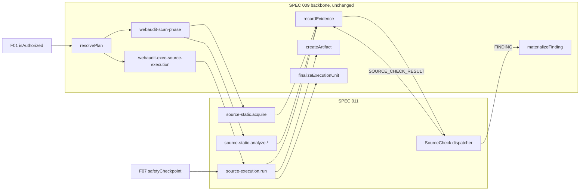

### Diagram 2 - Source acquisition and immutable snapshot

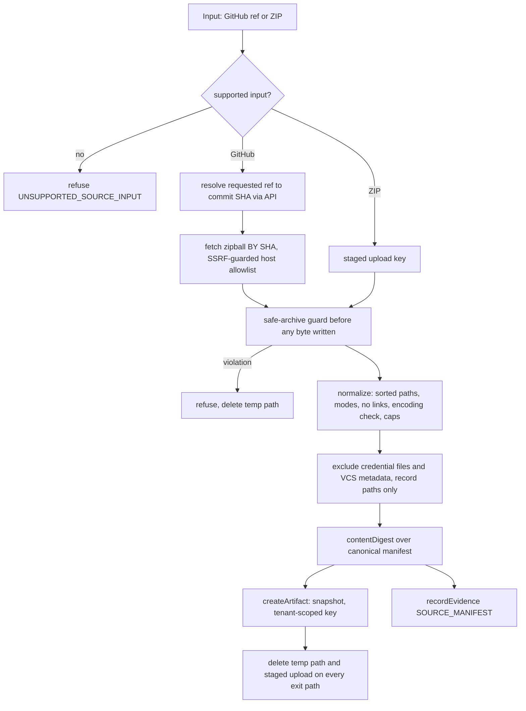

### Diagram 3 - Static analysis pipeline

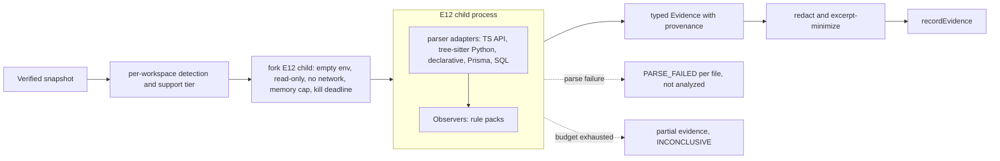

### Diagram 4 - Untrusted-code execution isolation

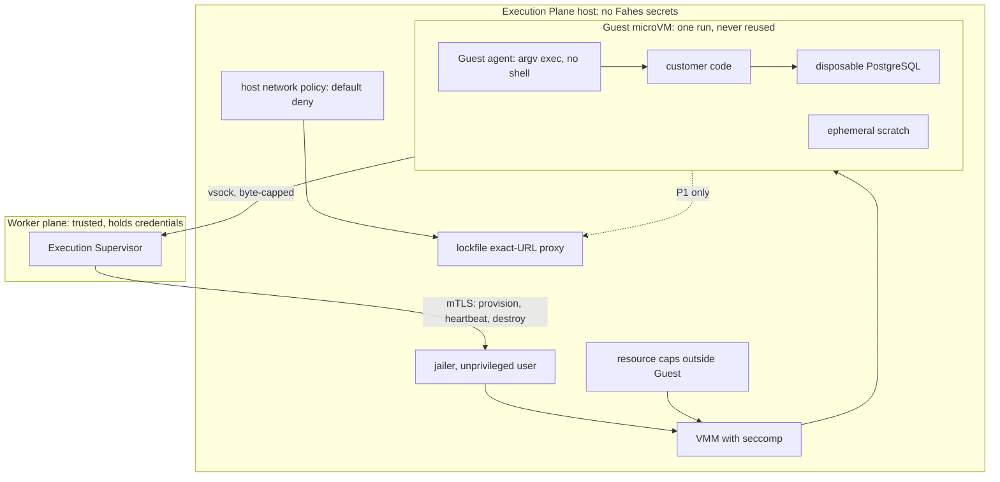

### Diagram 5 - Trusted worker versus hostile execution boundary

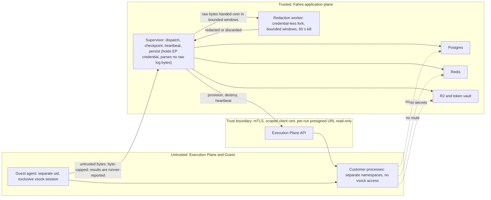

### Diagram 6 - Dependency installation policy

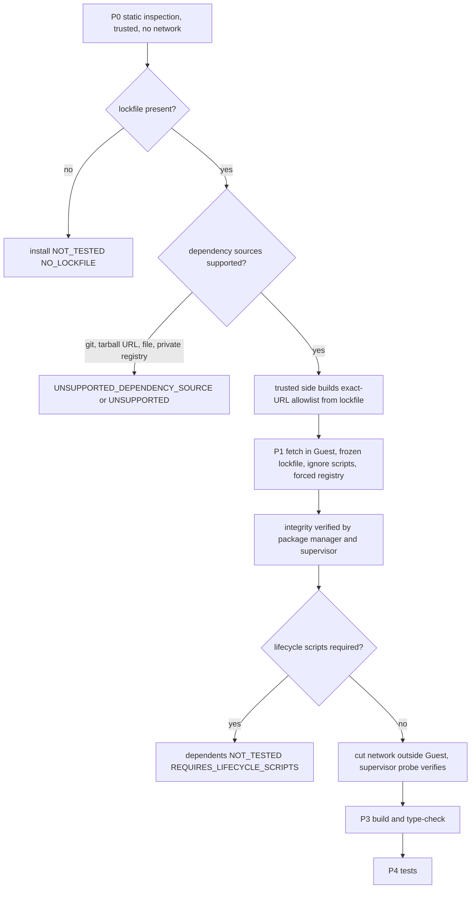

### Diagram 7 - Build and type-check execution

```mermaid
sequenceDiagram
  participant SUP as Supervisor
  participant EP as Execution Plane
  participant GA as Guest agent
  participant PAR as Parent worker
  SUP->>EP: provision runId from snapshot digest
  EP-->>SUP: Guest ready
  SUP->>PAR: checkpoint via IPC every 5 s
  SUP->>GA: run template node.install argv
  GA-->>SUP: step result over vsock
  SUP->>EP: cut network, verify probe
  SUP->>GA: run template ts.typecheck.tsc
  GA-->>SUP: diagnostics, exit status, bounded log
  SUP->>PAR: redact, validate, persist evidence
  SUP->>EP: destroy runId
  EP-->>SUP: DESTROYED and wiped
  SUP->>PAR: finalize COMPLETED with step verdicts
```

### Diagram 8 - Automated test discovery and execution

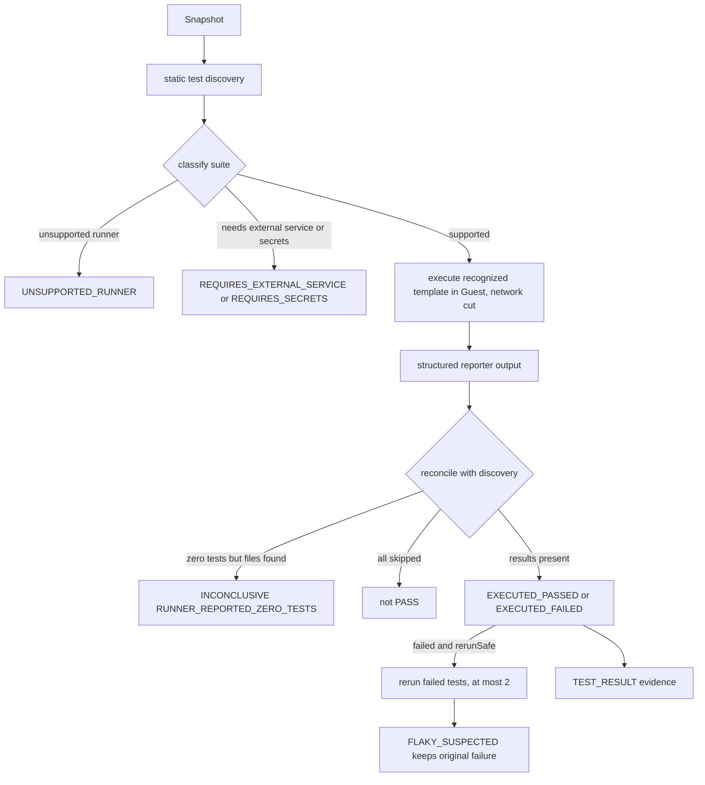

### Diagram 9 - Backend local-fixture testing

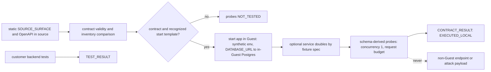

### Diagram 10 - Database migration testing

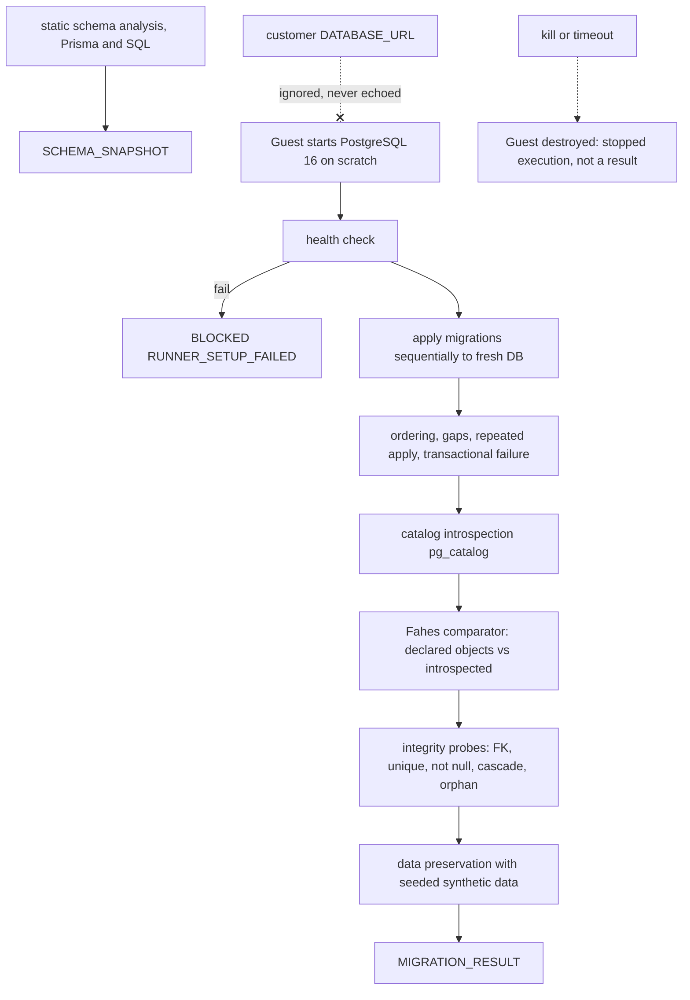

### Diagram 11 - Evidence -> checks -> findings

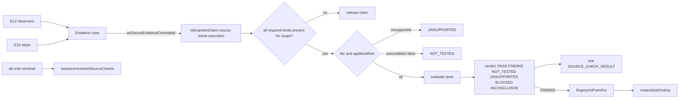

### Diagram 12 - Coverage aggregation

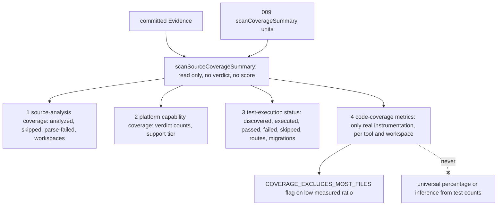

### Diagram 13 - Cancellation and crash recovery

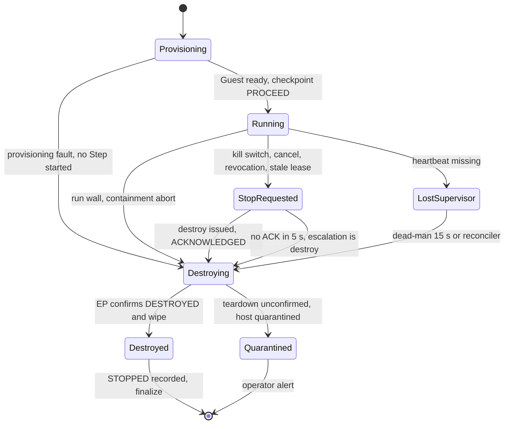

### Diagram 14 - Reverify

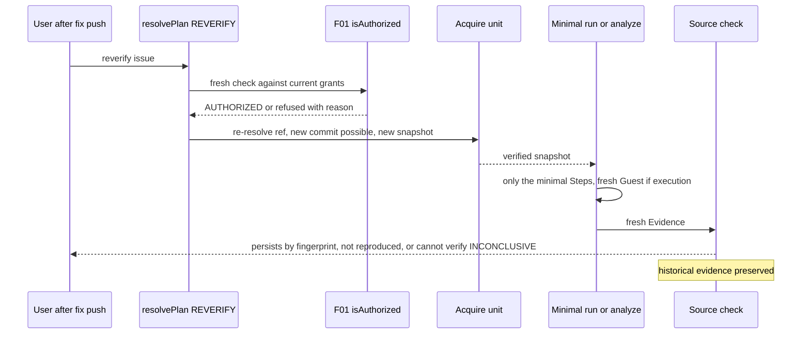

### Diagram 15 - SPEC 010 / 012 / 013 / 014 boundaries

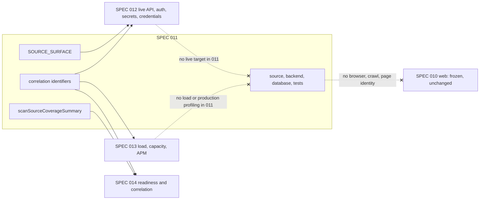

## Complexity Tracking

Every deviation or added complexity, with justification. None violates a principle.

| Added complexity | Why needed | Simpler alternative rejected because |
|---|---|---|
| **New Execution Plane deployable** (`infrastructure/execution-plane/`), separate from the app plane (Principle VIII requires a genuine isolation need) | Principle XI and ADR-003 forbid running customer code in the worker, sandbox-runner or a shared-kernel container; the app hosting offers no KVM or privileged spawning; the worker holds DB/Redis/R2 credentials and sits on the egress network. Hardware-virtualized per-run isolation needs hosts the app plane cannot provide. This is isolation, not org-chart mirroring. | Hardened container in the worker (shared kernel, secrets nearby); extending sandbox-runner (documented non-boundary); dropping execution (violates "Fahes itself performs the testing"). |
| 10 new `EvidenceKind` values | Typed, validated payloads per Evidence class are required for reproducibility (Principle IX) and per-contract checks; reusing generic kinds would erase schema safety. 3 existing kinds are reused. | Untyped JSON in `Issue.evidence` (loses provenance); reusing 010 `CHECK_RESULT` (web payload, would widen a frozen contract, FR-114). |
| 4 new `ModuleType` values | One product-domain axis per domain keeps checks, readiness and reports separable and avoids overloading `TESTING`; additive enum is the lightest change (010 R1 precedent). | One `SOURCE` module (conflates distinct domains); overloading `TESTING` (does not test customer code). |
| E12 as a forked child process on the scan-phase queue | Parsing hostile text justifies defense in depth (memory cap, kill deadline, empty env); work is bounded (5 min) and stays within scan-phase assumptions; no new queue needed. | In-process parsing (a parser crash/OOM takes down the worker); container per parse (unjustified for non-executing work, and not a Principle XI claim). |
| Source Check registry parallel in shape to 010's `WebCheckDefinition` | Fields differ (support tier, rule class, readiness scope by workspace/digest, no browser matrix); coupling to a frozen 010 type would require amending it. Shares `IdempotentClaim` and verdict taxonomy by pattern (Principle VIII reuse). | Reusing 010's type directly (needs 010 amendment); no registry (checks inside engines, violating FR-017). |
| Supervisor in 009's per-unit child process plus Provider Port with three implementations | Keeps Fahes-side liveness (FR-019) separate from hostile-code containment; port makes `DisabledProvider` default and tests deterministic; `LocalProcessProvider` is forbidden. | Direct EP calls from the worker body (no fake, no disabled default); single production-only provider. |
| Guest agent (custom static binary) and host-side vsock output capture | Needed for shell-free argv exec (FR-072), byte-capped output, and agent-tamper detection. | Running a shell in the Guest (injection surface). |
| Lockfile-pinned exact-URL allowlist proxy at the EP edge | Only egress during P1; makes install-time exfiltration a policy denial; integrity re-checked outside the Guest. | Open registry egress; mirrors without per-URL gating. |
| Fahes-owned schema drift comparator (declared objects vs `pg_catalog`) | Avoids executing Prisma's engine/CLI (code) and works for SQL migrations. | Prisma `migrate diff` (needs engine/CLI execution). |
| Credential-less redaction worker (FR-156) | The supervisor holds the EP credential and must not parse hostile log bytes; the existing detector is quadratic on hostile input. | Redacting inside the supervisor (a parser bug or ReDoS hands an attacker the EP credential or starves the 5 s checkpoint). |
| Fahes in-Guest SQL applier `db.apply.sql` (FR-104) | `psql -f` interprets backslash meta-commands (`\!` runs a shell command) and has different atomicity than Prisma's migrator. | `psql -f` over customer SQL (contradicts the no-shell invariant). |
| TLS-terminating reverse-mirror dependency proxy (FR-066) | An exact-URL policy over HTTPS cannot be enforced by a CONNECT/SNI allowlist. | CONNECT allowlist (cannot see paths; leaves a covert channel). |
| Three flags and a tenant allowlist | 009 defines no activation switch; staged rollout of the highest-risk class requires independent gating (G6). | A single flag (cannot stage E13 separately from static work). |
| One reason-code registry (FR-136) | One place for stable codes shared by 19 contracts; no free-text drives logic. | Per-contract codes (drift and ambiguity). |
| External penetration review and Linux-only CI gate | IAB items 7 and 9; developer Windows machines cannot reproduce Linux isolation. | Self-attestation only (insufficient for hostile-code activation). |
| Plan carries step *kinds*, parameters bound inside the unit at phase 2 | Plan immutability versus snapshot non-existence at resolution; keeps steps from becoming units. | Creating units at dispatch (violates 009); resolving after acquisition (changes 009 resolution semantics). |

## Upstream Compatibility

**U-1 RESOLVED by an owner-authorized controlled amendment to SPEC 009 (2026-10-10); U-2 resolved by interpretation** (SC-010; full record in `upstream-amendment-requests.md` and `specs/009-.../plan.md` "Controlled Upstream Amendment U-1 — Scan Deadline Policy"): U-1 is a plan-level scan deadline with enforcement in the existing sweep, because the 15-minute sweep would have terminated scans with live `SOURCE_EXECUTION` units; U-2 is read as already allowed by SPEC 009 FR-033. No amendment to 006, 007, 008 or 010 is required. SOURCE_EXECUTION stays default-off until the 009 implementation tasks and the isolation gates pass; SOURCE_STATIC work is unaffected. Every other gap, including those raised by the independent adversarial review, is resolved locally (table below). 011 consumes 006's classes/engines/domains, 007's Target/Authorization/Scope, 008's admission/checkpoint/kill/audit, 009's plan/runtime/evidence/artifact/finding/reverify and 010's `IdempotentClaim` and taxonomy by pattern only. Enum additions are the additive extension 009 FR-028 and 010 FR-003 already authorize. Discovered upstream gaps are handled locally or recorded as explicit future amendment triggers:

| Gap | Description | Local handling |
|---|---|---|
| G1 | 009/008 have no process-tree/descendant kill | Termination primitive is destroying the whole Guest (FR-051). |
| G2 | 009 `CUSTOMER_CODE_FAILURE` status ambiguity | Customer outcomes are `COMPLETED`; `FAILED` + `CUSTOMER_CODE_FAILURE` only for containment aborts (FR-056). |
| G3 | 009 has no unit heartbeat / stuck-RUNNING sweeper | EP dead-man (15 s), F07 lease reclamation, orphan reconciler, and the 011 sweep `finalizeStuckSourceExecutionUnits`. |
| G4 | 15-minute scan-wide timeout vs long `SOURCE_EXECUTION` units | Determinate (verified in `timeout-scheduler.ts`/`timeout.ts`). Could not be resolved inside 011; resolved by **U-1**, the owner-authorized 009 amendment (immutable bounded plan deadline, planned pass in the existing `timeout-sweep`, dispatch step 0, host-loop expiry). Activation waits for the 009 implementation tasks (FR-139). |
| G5 | 007 has no DB/API Target kind | 011 avoids the need: fixtures are Guest-local and are not Targets. |
| G6 | 009 has no feature flags | 011 defines three flags (`## Activation and Strict Parallel Run`). |
| G7 | F07 SCAN-scope kill does not cover REVERIFY (no `scanId`) | REVERIFY units carry `configuration.originScanId`; supervisor also subscribes to that scan channel (FR-140). |
| G8 | 007/008/009/010 entities are spec-only | 011 runtime implementation sequenced after their landing (FR-138); no interim tables. |
| G9 | sandbox-runner documentation claim is misleading | Flagged in the migration map; no change; sandbox-runner is never a fallback (FR-058). |

**Findings of the independent adversarial review resolved locally (no amendment).** (a) 008 `ExecutionAuditEventType` is closed: the disclosure event is an `AuditLogEntry` action (FR-147). (b) 008 forbids SYSTEM triggers at PLATFORM scope and new automatic triggers: no PLATFORM scope anywhere; attestation revocation is handled by each supervisor destroying its own Guest plus optional per-execution operator stops (FR-143). (c) 009 treats a concurrency refusal as terminal: partitions are serialized by plan-level dependency edges (FR-152). (d) 009 `recordEvidence` has no lease/terminal check: 011's evidence wrapper fences in one locked transaction (FR-055). (e) 008 admission re-checks concurrency on every call that sets it: the periodic checkpoint consumes nothing (FR-050). (f) Legacy scoring would score "nothing measured" as 100: additive `ModuleResult` mapping (FR-154). Additional upstream observations recorded without amendment: 008's refusal-reason count wording, 009 FR-012 vs data-model `scanId`/`planId`, and the unspecified SIGKILL-deadline renewal are not relied upon by 011.

**ADR conformance (006 ADRs cited by this plan).** ADR-002 additive capability contract: 011 adds enum values, evidence kinds, registries and engines only, never a changed contract (touch list T1-T9). ADR-003: `apps/sandbox-runner` is never extended for customer code. ADR-004 authorization is not ownership: acquisition/E12 need ownership only; `SOURCE_EXECUTION` needs a separate grant (FR-003/FR-004). ADR-005 metering is narrow to `SOURCE_EXECUTION` (FR-125). ADR-006 strict parallel run: new sibling code, flags default off, no cutover (FR-133; FR-024/FR-025). ADR-007 artifact retention parity: snapshot, log and evidence retention follows report data, REVERIFY Artifacts follow `originScanId` (FR-130, FR-148). ADR-009 redaction and size budgets: `@webaudit/redaction` before every persist and before Finding text; 20 MiB/50 MiB Artifact budgets (FR-117, FR-119, FR-150).

**Requirements added by the repair passes (FR-143..FR-158) and where they land (FR-154 ModuleResult mapping: `## ModuleResult mapping`; FR-155 result integrity: Hostile-Code Isolation Model and untrusted-execution-contract invariant 16; FR-156 redaction worker: lifecycle phase 8 and invariant 15; FR-157 provider-selection preconditions: isolation-policy-contract; FR-158 timing: lifecycle table).** FR-143 IAB attestation revocation (`## F07 Integration`, IAB item 9); FR-144 operator access (F07 table); FR-145 IDOR-safe reads (Constitution XIII, `data-model.md` tenant table); FR-146 per-run credentials and 10-minute presign (F07 table, budget table); FR-147 `source.sent_to_execution_plane` (an `AuditLogEntry` action; F07's closed `ExecutionAuditEventType` is not extended) disclosure audit event (F07 table; consent UI deferred to the U30 UX spec); FR-148 REVERIFY `Artifact.scanId = originScanId` (Principle XIV table, `data-model.md`); FR-149 tenant/target-filtered prior-evidence lookups (Evidence flow); FR-150 Finding-text redaction (Evidence flow); FR-151 ref/repo grammar (`## F01 Integration`); FR-152 workspace cap 4 (budget table, 009 integration); FR-153 versioned credential denylist recorded as `SOURCE_MANIFEST.denylistVersion` (`data-model.md`, `research.md` R33). Upstream compatibility is recorded here (the plan section `Upstream Compatibility`) and in the checklist `checklists/upstream-architecture-compatibility.md`.
