# Phase 1 Data Model: Security / Authentication / Authorization / API / Business-Logic Testing Platform

**Status**: planning artifact only. **NO Prisma edit is made now**: `apps/api/prisma/schema.prisma` is untouched, no
migration is written or run, no dependency is added, no table, role, bucket or KMS resource exists. Every shape below is a
contract a future implementation must satisfy, not existing code. Prisma blocks and TypeScript shapes are labelled
**not final** (naming and column order may change at implementation; the decisions, invariants and constraints may not
change without an amendment to this file).

**Authority split**: `spec.md` and `plan.md` are the single source of truth for decisions, FR-001..FR-201, the closed
83-code `SEC_*` reason registry, evidence kinds, class fills, budgets, SG gates and P1–P18. This file introduces **no** new FR
number, **no** new `SEC_*` code and **no** new evidence kind or execution class. Anything this file needs that the spec/plan
do not state is recorded in the final section §15 ("Resolved additions" with reconciliation-log ruling ids, and "Open for
closure"); nothing is silently resolved.

**Outcome in one paragraph.** 012 reuses the platform's existing entities for everything that is a *fact about an execution*
(009 `Evidence`, `Artifact`, `Issue`/`IssueEvidenceLink`, `ExecutionUnit`, `ExecutionDependency`; 010 `IdempotentClaim`; 008
`ExecutionAuditEvent`, `AdmissionLease`, `KillSwitchState`; existing `AuditLogEntry`). It adds **nine** tenant-owned durable tables, all
of which exist because their state must outlive a process, be tenant-owned and be mutated under concurrency — none of which
a typed Evidence payload can provide: `CredentialReference`, `CredentialVersion`, `CredentialLease`, `TestIdentity`,
`TestRole`, `FixtureResource`, `SecurityConfigVersion` (one table for the three customer-authored versioned documents),
`MutationIntent`, `ApiDescriptionDocument` (FR-168), plus the platform-global `AdvisorySnapshot` (twenty tables in all, including `BrokerPrincipalIssueEvent`, `UnitDispatchRecord` and `WorkerPrincipal`, with `SecurityConsentRecord`, `ApiOperationDeclaration`, `TargetAddressProof`, `ActiveTestingEnablement`, `AuthAttemptReservation`, `SecuritySettlement` and `BrokerPrincipalState`;
`AdvisorySnapshot` is the only one that is not tenant-owned). Everything else is Evidence payload, code-level registry, execution-local state or a derived view.
**Zero `@relation` edges into any existing/frozen model** (009's rule, restated: every reference to `User`, `Target`,
`Scan`, `Issue`, `TargetAuthorization`, `ExecutionUnit`, `ScanPlan`, `Evidence`, `Artifact` is a plain indexed scalar
column). Relations *between* the new 012 tables are ordinary Prisma relations only where both sides are 012-owned and the
child cannot meaningfully exist without the parent (`CredentialVersion` → `CredentialReference`; `CredentialLease` →
`CredentialVersion`; `TestIdentity` → `TestRole`); every other cross-table reference inside 012 is also scalar so a
tenant/credential deletion never cascades into forensic ledgers.

---

## 1. Entity Decision Table

Decision vocabulary (identical to 011): **Durable table** | **Versioned configuration** | **Evidence payload** |
**Execution-local state** | **Derived view**. The test applied to every candidate (010/011 precedent): *"Can a typed
Evidence payload, a code-level versioned registry or execution-local state do this?"* A table is created only on a "no".

| Concept | Decision | Lives in | Justification (why this and not another category) |
|---|---|---|---|
| **CredentialReference** | **Durable table** | `CredentialReference` (vault schema) | Tenant-owned, long-lived (up to 90 days), mutated by customers over time (rotate/revoke), bound to Target + identity + environment and enforced by the broker on every issue (FR-019, FR-029). No execution owns it; Evidence cannot hold it. |
| **CredentialVersion** | **Durable table** (ciphertext) | `CredentialVersion` (vault schema) | The only place envelope-encrypted secret material may rest (FR-016). Versions are immutable (FR-020), must be revocable and crypto-shreddable independently, and must be pinned by id at unit start (US2 scenario 3). |
| **CredentialLease** (broker ledger, no secret) | **Durable table** | `CredentialLease` (vault schema) | FR-035's `(credentialVersionId, executionUnitId, attempt)` uniqueness is a cross-process, crash-surviving, race-safe guarantee: only a unique index in Postgres gives it. Also the sweeper's work-list for orphan-lease destruction (FR-039, SC-004). Holds **no** secret and no secret-derived value. Distinct from 008's `AdmissionLease` (a concurrency slot) — different guarantee, different owner. |
| **TestIdentity** | **Durable table** | `TestIdentity` | Customer-declared, tenant-owned record bound to one role and one Target; its id *is* the 007 `includedAccountRefs` semantics (Clarifications, FR-030) and is a stable referent for expectations, fixtures, leases and Evidence. Not secret (labels only; login identifier lives in ciphertext). |
| **TestRole** | **Durable table** (small) | `TestRole` | Its `key` is the 007 `includedRoles` semantics; roles must be unique and stable per Target and are referenced by identities, expectations and fingerprints. A bare string on `TestIdentity` would allow two spellings of one role and give vertical tests no declared ordering. |
| **FixtureResource** | **Durable table** | `FixtureResource` | Customer-registered, environment-scoped, mutable-over-time records with a per-fixture mutation counter and consent state (FR-126, FR-125); every object identifier used in an authorization/logic probe must come from here (FR-092), so it needs a queryable registry with tenant isolation. |
| **AuthSessionLease / SessionHost** (session jar, tokens, cookies) | **Execution-local state** (never persisted) | `SessionHost` in the E14/E15 child process memory | FR-041/FR-047: jars and tokens must never be persisted or serialized. Lifetime = one `(executionUnitId, attempt, testIdentityId)`. Persisted *shadows* are only (a) the `CredentialLease` ledger row and (b) redacted `AUTH_STATE_TRANSITION` Evidence. |
| **AuthorizationExpectation** | **Versioned configuration** (customer-authored, immutable versions) | `SecurityConfigVersion` (`kind = AUTHORIZATION_EXPECTATION`) | Customer data that changes over time, must be reproducible per scan (digest pinned in `ExecutionUnit.configuration`), and is not code. Shares lifecycle with the two entities below, hence one table. |
| **BusinessInvariant** | **Versioned configuration** | `SecurityConfigVersion` (`kind = BUSINESS_INVARIANT`) | Declarative predicate over a closed vocabulary (FR-115); validated at write; never executed as code. |
| **WorkflowDefinition** | **Versioned configuration** | `SecurityConfigVersion` (`kind = WORKFLOW_DEFINITION`) | Finite, ≤ 25-step, closed-action-category step list (FR-117). Same lifecycle as the others. |
| **SecurityCheckDefinition** & **ProbeDefinition** | **Versioned configuration** (code-level registry) | `packages/security-registry/` (vendored, semver, immutable per `(id, version)`) | FR-146/FR-150: Principle II (vendored), pure functions cannot be rows, adding a check must need zero dispatch edit (FR-149), loader recomputes the class (FR-007). Persisting them would add a second source of truth and a tenant-editable attack surface. 010 `WebCheckDefinition` / 011 `SourceCheckDefinition` precedent. |
| **ProbeAttempt** (idempotent claim + evidence) | **Evidence payload + IdempotentClaim row** (no table) | `IdempotentClaim{scope:"sec-probe-attempt"}` + `HTTP_TRANSACTION` Evidence | A probe attempt is "claim once, observe once" — exactly `IdempotentClaim`'s guarantee (FR-148). The observation is Evidence. A third table would duplicate both. Mutating probes additionally have a `MutationIntent` row (below). |
| **MutationIntent** | **Durable table** | `MutationIntent` | FR-120: write-ahead intent must be durable *before* the request is sent, survive a worker crash, and be CAS-updated through `INTENDED → SENT → …`; recovery and the residual manifest are built from it. Evidence is append-only and unit-fenced (refused after the unit is terminal), so it cannot be the system of record for a state that must be readable and updatable by a recovery sweeper. |
| **CleanupRecord** (concept) | **Evidence payload** projecting `MutationIntent` | Evidence `CLEANUP_RECORD` | One immutable outcome record per mutation (or per unconfirmed session, FR-046). Source of truth for state is `MutationIntent`; the Evidence is the reportable, finding-linkable projection. |
| **ApiDescriptionDocument** | **Durable table** (tenant-owned) + object-storage payload | `ApiDescriptionDocument` row + R2 object `api-descriptions/<userId>/<targetId>/<digest>` (FR-168) | A customer OpenAPI document exists *before* any scan or unit; 009 `Artifact` requires `scanId` and `executionUnitId`, so it cannot hold it. Tenant-owned, Target-bound, digest-keyed, with its own retention and deletion. |
| **AdvisorySnapshot** | **Durable table** (platform-global) + object-storage payload | `AdvisorySnapshot` row + R2 object `advisory-snapshots/<digest>` (own storage key, **not** an `Artifact` row — FR-168) | Versioned, provenance-stamped, operator-imported dataset with a freshness bound, pinned by digest from `ADVISORY_MATCH` Evidence. Needs a queryable "current snapshot per ecosystem" pointer and import audit; not tenant-owned. |
| **API_SURFACE** | **Evidence payload** (+ `Artifact` for the entry list when large) | Evidence `API_SURFACE` | A derived, immutable, per-scan inventory (FR-098). No lifecycle of its own. |
| **SECURITY_CHECK_RESULT** | **Evidence payload** | Evidence `SECURITY_CHECK_RESULT` | The verdict record; 010 `CHECK_RESULT` / 011 pattern (R9). |
| **AUTH_STATE_TRANSITION** | **Evidence payload** | Evidence `AUTH_STATE_TRANSITION` | Redacted auth-state facts (names/flags/lengths only). |
| **PERMISSION_COMPARISON** | **Evidence payload** | Evidence `PERMISSION_COMPARISON` | Pairwise expected-vs-observed record (FR-093/094). |
| **CLEANUP_RECORD** (kind) | **Evidence payload** | Evidence `CLEANUP_RECORD` | See CleanupRecord above. |
| **ADVISORY_MATCH** | **Evidence payload** | Evidence `ADVISORY_MATCH` | Dependency→advisory fact with provenance; no lifecycle. |
| **ActiveTestingEnablement** | **Durable table** (operator-created) | `ActiveTestingEnablement` (§4.9E) | The operator-reviewed element of the Destination Authorization Policy (FR-197); tenants cannot write it. |
| **AuthAttemptReservation** | **Durable table** (vault schema) | `AuthAttemptReservation` (§4.9F) | Per-attempt RESERVED→SENT→RESOLVED lifecycle with an idempotency key (FR-191); a counter alone cannot distinguish unsent, sent and unresolved attempts. |
| **SecuritySettlement** | **Durable table** | `SecuritySettlement` (§4.9G) | The idempotency anchor of execution-backed partial settlement (FR-198); proposed policy P17. |
| **BrokerPrincipalState** | **Durable table** (vault schema) | `BrokerPrincipalState` (§4.9H) | Quarantine must survive a broker restart and is the per-principal lock row (FR-173). |
| **UnitDispatchRecord** | **Durable table** (vault schema) | `UnitDispatchRecord` (§4.9I) | Evidence that the unit was claimed through the privileged function; `dispatchSeq` anti-replay (FR-201). |
| **BrokerPrincipalIssueEvent** | **Durable table** (vault schema) | `BrokerPrincipalIssueEvent` (§4.9J) | Durable, replica-shared anomaly windows (FR-173, FR-201). |
| **WorkerPrincipal** | **Durable table** (platform-level) | `WorkerPrincipal` (§4.9K) | The only source of authenticated `principalId`/`hostInstanceId` (FR-201). |
| **ApiOperationDeclaration** | **Durable table** | `ApiOperationDeclaration` (§4.9C) | Customer assertions that enable active API probes (FR-192); versioned, tenant-owned, closed DTO. |
| **TargetAddressProof** | **Durable table** | `TargetAddressProof` (§4.9D) | Recency record of the verified address binding the API plan-resolution checks (FR-172); the unit's pin is execution-local. |
| **Ledger checkpoint** (restore detection) | **External write-once store, not a database entity** | signed record `(platformEpoch, maxLeaseSeq, ledgerDigest, dbSystemIdentifier, issuedAt)` | Must survive a database restore, so it cannot live in the database (FR-193); store selection is part of P11. |
| **securityBillableWorkSummary** | **Derived view** | pure read over `ExecutionUnit` status + `SECURITY_CHECK_RESULT` | FR-189: executed vs refused/blocked/not-tested work, consumed by credit/refund logic; stores nothing. |
| **SecurityCoverageSummary** | **Derived view** | `securityCoverageSummary(scanPlanId)` pure read | FR-143: computes from committed Evidence + `scanCoverageSummary`; stores nothing, computes no verdict or score. |
| **IdempotentClaim new scopes** | **Versioned configuration** (string constants in the 012 contract; `IdempotentClaim.scope` is a free `String` column) | `IdempotentClaim` rows | No enum, no migration: `scope` is already a string in 010's model. §6 fixes names and claimKey formats. |
| **Security finding** (Issue) | **Existing entity** (`Issue` + `IssueEvidenceLink`) via 009 `materializeFinding` | existing | FR-139; confidence/verdict is *not* an `Issue` column (FR-136); it lives in `SECURITY_CHECK_RESULT` Evidence linked by `IssueEvidenceLink`. |
| **Credential/lease/mutation audit trail** | **Existing entity** (`AuditLogEntry`; `ExecutionAuditEvent.payload`) | existing | FR-022. No new audit table; no new `ExecutionAuditEventType` value (008 enum is closed). |

---

## 2. What each existing platform entity carries for 012 (no schema change to any of them)

| Existing entity (owner) | 012 usage | 012 constraint |
|---|---|---|
| `Evidence` (009) | Six new `EvidenceKind` values (§3) plus reuse of `HTTP_TRANSACTION`, `SECURITY_REPRODUCTION`, `HAR`, `DEPENDENCY`, `SOURCE_SURFACE`, `CODE_FLOW` | Written only through the engine's fenced evidence wrapper (unit-produced, FR-058) or the parent-side evaluator (derived); always `redacted = true` for 012 kinds; payload field lists in §5 are the contract |
| `Artifact` (009) | Large `API_SURFACE` entry lists; reproduction record bodies when large (the customer OpenAPI document is **not** an `Artifact`: it is an `ApiDescriptionDocument`, §4.9A) | Key `artifacts/<scanId>/<executionUnitId>/…`; never contains secrets, session artifacts or raw bodies |
| `Issue` / `IssueEvidenceLink` (009/existing) | Materialized findings only for `CONFIRMED_VULNERABILITY`/`LIKELY_VULNERABILITY`/`CONFIGURATION_RISK`/`INFORMATIONAL` (FR-139) | `Issue.evidence` JSON column MUST receive only the redacted summary, never a payload from this file's "NOT stored" list; existing capabilities' raw `Set-Cookie` storage in `Issue.evidence` is the separate hardening task T-HARDEN-1 (research R4) |
| `ExecutionUnit` (009) | `configuration` carries `{checkIds+versions, endpointIdentities, probeIndices, identityRefs (TestIdentity ids), configRefs (SecurityConfigVersion id + digest), credentialBindingRef (opaque)}`; **never** a secret | `engineId` families `security.active.*` / `security.auth.*`; `retryPolicy.maxAttempts = 1` |
| `ExecutionDependency` (009) | Composite tests: ordering/baseline-validity edge only (FR-062) | Never carries a session |
| `IdempotentClaim` (010) | Five new `scope` strings (§6) | `@@unique([scope, claimKey])` is the guarantee |
| `ExecutionAuditEvent` / `AdmissionLease` / `KillSwitchState` (008) | Consumed unchanged. Broker/session detail rides in the redacted `payload` of existing event types (`ADMISSION_GRANTED`, `ADMISSION_REFUSED`, `SAFETY_VIOLATION`, `EXECUTION_COMPLETED`) | No new `ExecutionAuditEventType` or `KillSwitchReason` value (Clarifications) |
| `AuditLogEntry` (existing) | Control-plane credential/identity/fixture/config/advisory lifecycle (action strings in §4.10) | `before`/`after` carry **only** the allow-listed non-secret fields of §4.10 |
| `TargetAuthorization` / `ScopeDefinition` (007) | `includedAccountRefs` ⇒ `TestIdentity.id`; `includedRoles` ⇒ `TestRole.key`; `includedActionCategories` ⇒ closed set of FR-011 (semantics enforced by 012 `securityScopeGate`, a named limitation) | 012 adds no column |
| `ModuleType.SECURITY`, `ModuleResult` (existing) | Facets (API/Auth/Authz/Logic) are coverage facets inside the SECURITY module result; **one additive nullable column `coverageComplete Boolean?`** (M012-5c) — tri-state: `true` complete, `false` partial, `null` only for scans not evaluated by 012; on a scan whose `Scan.capabilitySnapshot.x012.coverageRequired = true` a `null` is treated as `false` (FR-186) | Single writer discipline (FR-196): the legacy persist path writes only while `coverageComplete IS NULL`; the 012 finalizer is the last writer and recomputes the score over all SECURITY `Issue` rows; no enum change |

---

## 3. Enum additions (planned; all additive)

```prisma
// 009 EvidenceKind (existing in the 009 plan; extension per 009 FR-028). Six additive values:
enum EvidenceKind {
  // ...existing 009/010/011 values unchanged...
  SECURITY_CHECK_RESULT
  API_SURFACE
  AUTH_STATE_TRANSITION
  PERMISSION_COMPARISON
  CLEANUP_RECORD
  ADVISORY_MATCH
}
```

New 012-owned enums (names **not final**; `CredentialSecretKind` is deliberately not `SecretKind` because
`@webaudit/redaction` already exports a *different* `SecretKind` type — the detector's pattern kinds; reconciliation L23):

```prisma
enum CredentialSecretKind {      // FR-027: v1 kinds only
  PASSWORD_LOGIN                 // ciphertext JSON: {username, password}
  API_KEY_HEADER                 // ciphertext JSON: {value}; non-secret header name in CredentialReference.injectionSpec
  BEARER_TOKEN                   // ciphertext JSON: {value}
  SESSION_FIXTURE                // ciphertext JSON: {cookies[]|token}; declared expiresAt mandatory (FR-050)
  // CLIENT_CERTIFICATE, OAUTH_CLIENT_CREDENTIALS: designed-for, NOT in the enum in v1.
  // A request naming them is refused at validation with SEC_UNSUPPORTED_CREDENTIAL_KIND (FR-027).
  // Adding them later is an additive ALTER TYPE ... ADD VALUE.
}

enum CredentialStatus {          // CredentialVersion.status (FR-020)
  ACTIVE                         // the single usable version of its reference
  SUPERSEDED                     // rotated away; ciphertext retained until grace, never issuable
  REVOKED                        // immediate, one-way (FR-020); never issuable
  EXPIRED                        // sweeper-written audit marker; the broker ALWAYS recomputes from expiresAt and never trusts this column
  SHREDDED                       // crypto-shredded tombstone: ciphertext + wrappedDataKey nulled; terminal
}

enum LeaseStatus {               // CredentialLease.status
  ISSUED                         // secret delivered to the worker parent
  REVOKED                        // broker-marked (credential/grant/kill/env/terminal unit); awaiting destroy confirmation
  EXPIRED                        // TTL passed without confirmation (≤ min(unit timeout + margin, 30 min), FR-033)
  DESTROYED                      // confirmLeaseDestroyed received: session provably invalidated + jar disposed (FR-039/FR-052); terminal
}

enum CleanupState {              // MutationIntent.cleanupState (plan D8; lead ruling after analyze F-4: terminal states are REVERTED and RESIDUAL only)
  NOT_REQUIRED                   // intent not yet CONFIRMED, never sent (ABANDONED), or no cleanup required by definition
  PENDING                        // CONFIRMED; cleanup + verification read still to do
  REVERTED                       // cleanup performed AND verified by a read (FR-121)
  RESIDUAL                       // fixture may hold residue; carries residualReason; residual manifest emitted (FR-122/FR-162)
  ACKNOWLEDGED                   // customer-only audited exit from RESIDUAL (FR-184); fixture usable again
}

enum ResidualReason {            // MutationIntent.residualReason; maps 1:1 to registry codes
  CLEANUP_FAILED                 // cleanup attempted, not effective              → SEC_CLEANUP_FAILED
  CLEANUP_UNVERIFIED             // verification read not obtained                → SEC_CLEANUP_UNVERIFIED
  ADMISSION_REFUSED              // stop/revocation/budget: no cleanup after stop → SEC_RESIDUAL_FIXTURE (FLAG) + check INCONCLUSIVE
  SENT_UNCONFIRMED               // crash/kill/timeout after SENT                 → SEC_MUTATION_SENT_UNCONFIRMED (FLAG)
  MANUAL_REQUIRED                // cleanupMethod MANUAL                          → customer action listed in the manifest
}

enum ReferenceStatus {           // CredentialReference.status (FR-021 disable, FR-187)
  ACTIVE
  DISABLED                       // reversible by the owner (or operator disable, FR-021); never issuable while DISABLED
  REVOKED
  RETIRED
}

enum MutationState {             // MutationIntent.state (write-ahead machine, FR-120)
  INTENDED
  SENT
  CONFIRMED
  SENT_UNCONFIRMED               // crash/kill/timeout after SENT                → SEC_MUTATION_SENT_UNCONFIRMED (FLAG)
  ABANDONED                      // INTENDED but never SENT: terminal, no residue (analyze F-4)
}

enum IdentityState {             // TestIdentity.state (test-identity-contract)
  DRAFT                          // stored without a resolvable role: any check needing it is NOT_TESTED SEC_IDENTITY_ROLE_UNMAPPED
  ACTIVE
  DISABLED
  RETIRED
}

enum IdentityUsage {             // TestIdentity.usage (test-identity-contract rule 11, FR-095; G-23 default-deny)
  UNSET                          // DEFAULT: not selectable as an actor (FR-095)
  ACTOR_ALLOWED                  // explicit: may act as the requesting identity
  FIXTURE_OWNER                  // only ever a fixture OWNER, never selected as an actor (admin-ranked identities)
}

enum AdvisorySnapshotState {     // AdvisorySnapshot.state (advisory-matching-contract; analyze F-6: contract state machine adopted)
  IMPORTED
  VERIFIED
  ACTIVE
  SUPERSEDED
  REVOKED                        // a revoked snapshot is never used, including by reverify
}

enum SecurityConfigKind {        // SecurityConfigVersion.kind
  AUTHORIZATION_EXPECTATION
  BUSINESS_INVARIANT
  WORKFLOW_DEFINITION
}
```

`IdempotentClaim.scope` additions are **strings, not an enum** (§6). `AdvisorySnapshotState` is a two-value enum inside
`AdvisorySnapshot` (§4.9). The lease `purpose` is a **code-level closed set** `LOGIN | SESSION_REFRESH | API_AUTH` (a bounded
string column validated against that set, not a Prisma enum, so it can be extended without `ALTER TYPE`). No change to `ModuleType`, `ExecutionUnitClass`, `FailureClass`, `ExecutionAuditEventType`,
`KillSwitchReason` or `ExecutionClass`.

---

## 4. Planned tables (not final)

**Common rules for every table in this section**

- Tenant ownership: every tenant-owned table has `userId String` (scalar, indexed, immutable after insert, **denormalized
  and re-derived from the owning `Target.userId` by the service layer, never caller-supplied** — 007 FR-016/FR-019
  pattern). Every read/write by id MUST also filter by `userId` (`findFirst({ where: { id, userId } })`).
- No `@relation` to `User`, `Target`, `ExecutionUnit`, `ScanPlan`, `Evidence`, `Artifact`, `TargetAuthorization`, `Issue`,
  `Scan`. Consequently `User` deletion does **not** cascade into these tables; account deletion (existing
  `deletion.service.ts`) MUST be extended to call the vault shred + purge path explicitly (FR-167; §12 deletion order). **012
  tables have no `User` relation by design, so the existing `User` cascade does not reach them.**
- **Vault schema** (`CredentialReference`, `CredentialVersion`, `CredentialLease`): planned in a dedicated Postgres schema
  `credential_vault` with column-level privileges: the **broker** role has full access; the **API** role may INSERT/UPDATE
  non-ciphertext columns and **INSERT ciphertext only** (sealing path, below) but has **no SELECT on ciphertext columns**;
  the **worker** role has **no** privilege on the schema (lease liveness is answered by the broker; a status-only view is
  not granted in v1). These roles (broker RW, API and operators only through the `vault_*` security-definer functions of 4.10A, worker none) are an **SG3 acceptance item**
  (reconciliation L23). **Sealing**: the API process wraps the per-version data key by calling KMS with a **wrap-only**
  permission (no unwrap), so plaintext transits API memory once per registration; **unwrap is done only by the broker**.
  The KMS role split (wrap-by-API, unwrap-by-broker) is likewise an SG3 item. Physical topology (same cluster vs separate database)
  is `UNKNOWN — REQUIRES INVESTIGATION` (P11). The vault-schema roles are part of migration M012-1; the worker, orchestrator, planner, broker and operator roles, positive grants (section 4.10A) and the `sec_*` functions are migration M012-7 (FR-201).
- **KMS-dependent fields** (marked ⟂KMS below) depend on the unresolved KMS/HSM provider (P11): their *shape* here is the
  minimum any acceptable provider must support (unwrap-only IAM scoping, key versioning, audit — FR-016); exact encodings
  are decided at implementation.
- All timestamps `timestamptz`. All ids `cuid()` unless stated. `Json` columns never hold secret material or anything in §9.

### 4.1 `CredentialReference` (Durable table; vault schema)

```prisma
model CredentialReference {
  id               String               @id @default(cuid())
  userId           String               // tenant owner; scalar (no relation)
  targetId         String               // scalar; exactly one Target (FR-019)
  testIdentityId   String               // scalar to TestIdentity (same schema family; see note)
  environmentClass String               // TargetEnvironmentClassification snapshot at registration; informational — the broker RE-READS the Target's current value on every issue (FR-029)
  secretKind       CredentialSecretKind // immutable; rotation keeps the kind
  label            String               // customer-chosen, ≤ 80 chars, validated not to look like an email/secret (§9 V-3)
  injectionSpec    Json                 // NON-secret: e.g. {headerName:"X-API-Key"} | {scheme:"Bearer"} | {loginWorkflowRef:{configVersionId,digest}}
  currentVersionId String?              // pointer to the ACTIVE CredentialVersion; updated under row lock (history/pointer split — 010 CF-1 lesson)
  expiresAt        DateTime             // finite, ≤ createdAt + 90 d, default 30 d (FR-019, P12)
  retiredAt        DateTime?            // set on revoke/delete/expiry-grace; the "slot" is then free for re-registration
  retiredBy        String?              // userId or "SYSTEM" / operator id; never a secret
  status           ReferenceStatus      @default(ACTIVE) // FR-021/FR-187 owner/operator disable is reversible; REVOKED/RETIRED are one-way
  disabledAt       DateTime?
  createdAt        DateTime             @default(now())
  updatedAt        DateTime             @updatedAt

  versions CredentialVersion[]

  @@index([userId, targetId])
  @@index([testIdentityId])
  @@index([expiresAt])
  // Planned RAW-SQL partial unique index (Prisma cannot express it):
  //   CREATE UNIQUE INDEX credref_active_slot ON credential_vault."CredentialReference"
  //     ("testIdentityId","secretKind") WHERE "retiredAt" IS NULL;      -- FR-030: ≤ 1 active credential per kind per identity
}
```

- **Tenant ownership**: `userId` (owner); operators may revoke/disable only (FR-021), never create/read/widen.
- **Relationships**: `versions[]` (new-to-new). `targetId`, `userId`, `testIdentityId` scalar.
- **Retention**: row kept as a tombstone for the report retention period (audit continuity; `Evidence` references only
  `CredentialVersion.id`); contains no secret and no value-derived field.
- **Deletion semantics**: user "delete" = revoke all versions + crypto-shred (§4.2) + set `retiredAt`; the row remains as
  a tombstone until account deletion, which removes it (after shred is confirmed).
- **Concurrency/locking**: rotate, revoke, delete and the broker's issue all take `SELECT … FOR UPDATE` (rotate/revoke/delete)
  or `FOR SHARE` (issue) on this row first, then on the version row — a fixed lock order (reference → version → lease; a broker-contract rule)
  prevents deadlock and makes "revoke vs concurrent issue" serialize: whichever commits first wins; a revoke commit marks
  every outstanding `ISSUED` lease `REVOKED` in the same transaction (FR-039).
- **Audit events**: `credential.create`, `credential.rotate`, `credential.revoke`, `credential.expire`,
  `credential.delete`, `credential.operator_revoke`, `credential.revoke_all_for_tenant` (FR-022/FR-023).
- **Encryption**: no secret columns. `injectionSpec` is non-secret by validation (§9 V-4).
- **Consumed by**: secrets-management, credential-broker, test-identity, auth-session contracts; plan Context B.

### 4.2 `CredentialVersion` (Durable table; vault schema; ciphertext)

```prisma
model CredentialVersion {
  id                    String           @id @default(cuid())
  credentialReferenceId String
  userId                String           // denormalized tenant owner (immutable); also bound into the AEAD AAD
  version               Int              // 1,2,3… per reference
  status                CredentialStatus @default(ACTIVE)

  // --- envelope encryption (FR-016); ⟂KMS = shape depends on the unresolved provider ---
  ciphertext            Bytes?           // AES-256-GCM(data key, nonce, AAD); includes GCM tag; ≤ 16 KiB; NULL after shred
  nonce                 Bytes?           // 96-bit random, unique per version; NULL after shred
  wrappedDataKey        Bytes?           // ⟂KMS: data key wrapped by the KEK; NULL after shred
  kekRef                String           // ⟂KMS: opaque KMS key identifier (not a secret)
  kekVersion            String           // ⟂KMS: KEK version used to wrap; needed for rotation/rewrap and incident scope (FR-023)
  wrapAlgorithm         String           // ⟂KMS: provider-specific label; dataKeyAlgorithm is fixed "AES-256-GCM" in code, not a column
  aadVersion            Int              @default(1) // version of the AAD canonical encoding (F-17)
  // AAD = canonical encoding of {userId, referenceId, versionNumber, secretKind, targetId, kekVersion} + aadVersion — RECOMPUTED at decrypt except aadVersion (secrets-management-contract is the authority; column names in this model are canonical: wrappedDataKey, kekRef, kekVersion).

  expiresAt             DateTime         // ≤ reference.expiresAt; SESSION_FIXTURE: customer-declared, never extended (FR-050)
  supersededAt          DateTime?
  revokedAt             DateTime?
  revokedBy             String?          // actor id / "SYSTEM"; no secret
  shredAfter            DateTime?        // = revokedAt + grace (default 7 d) | expiresAt + grace | supersededAt + grace
  shreddedAt            DateTime?
  createdAt             DateTime         @default(now())

  reference CredentialReference @relation(fields: [credentialReferenceId], references: [id])
  leases    CredentialLease[]

  @@unique([credentialReferenceId, version])
  @@index([userId])
  @@index([status, shredAfter])   // the shred sweeper's query shape
  @@index([expiresAt])
  // Planned RAW partial unique: one ACTIVE per reference
  //   CREATE UNIQUE INDEX credver_one_active ON credential_vault."CredentialVersion"
  //     ("credentialReferenceId") WHERE status = 'ACTIVE';
}
```

- **Immutability**: after insert only `status`, `supersededAt`, `revokedAt`, `revokedBy`, `shredAfter`, `shreddedAt`, and the
  three secret columns (to NULL, on shred) may change. A trigger/DB-role policy forbids any other UPDATE (planned in M012-1); the only write paths are the `vault_*` functions of 4.10A (owner and operator, closed column sets) and the broker role (lease ledger, expiry, shred), so an insert-only API role is never asked to supersede, revoke or shred (MA-05).
- **Retention**: ciphertext deleted at `shredAfter` (revocation + 7 d, expiry + 7 d, supersession + 7 d). **Rotation grace is 7 days**
  (FR-023 states revocation/expiry grace; supersession grace is the same 7 days per reconciliation L23). After shred the
  row remains (no secret, `SHREDDED`) for report-retention parity.
- **Deletion semantics (crypto-shred)**: set `ciphertext = NULL`, `nonce = NULL`, `wrappedDataKey = NULL`, `status =
  SHREDDED`, `shreddedAt = now()` in one transaction; ⟂KMS: no per-version KMS call is required because the data key was
  only ever stored wrapped. **Named limitation**: a database backup/PITR snapshot taken before shred still contains the
  wrapped key and ciphertext; shred is cryptographically effective only after the backup window passes or the KEK version
  is retired. The vault schema's backup/PITR retention is therefore **bounded to 35 days, or per-tenant KEKs are used so that destroying the
  tenant KEK shreds backups too**; which of the two is chosen is an **SG3 item** (reconciliation L23).
- **Concurrency/locking**: see §4.1 lock order. Rotation: `FOR UPDATE` on the reference; insert version `n+1` as `ACTIVE`,
  set previous `SUPERSEDED`, update `currentVersionId`, all in one transaction (the partial unique index is the backstop).
- **Audit events**: as §4.1 plus `credential.shred` (system) and `credential.rewrap` (KEK rotation, system).
- **Encryption requirements**: per-version random 256-bit data key; AES-256-GCM, fresh 96-bit nonce, AAD binds tenant +
  credential + version (FR-016); no custom cipher or KDF; **not** the shared env `ENCRYPTION_KEY` and **not** `token-vault.ts`
  (FR-017, FR-026 — pattern reuse only). Plaintext exists only inside the broker for unwrap, and transiently in the API process at seal time (wrap-only KMS
  permission; the API can never unwrap).
- **Consumed by**: secrets-management-contract, credential-broker-contract (issue path), security-evidence-contract (id only).

### 4.3 `CredentialLease` (Durable table; vault schema; broker ledger — no secret)

```prisma
model CredentialLease {
  id                  String      @id @default(cuid())
  userId              String      // tenant owner (denormalized from the unit's tenant; verified against the credential's)
  credentialVersionId String
  executionUnitId     String      // scalar (009)
  attempt             Int         // 009 ExecutionUnit.attempt at issue time
  scanPlanId          String      // scalar (009)
  targetId            String      // scalar
  targetAuthorizationId String    // scalar (007 grant that authorised the unit)
  admissionLeaseId    String?     // scalar to 008 AdmissionLease whose fence was verified at issue
  testIdentityId      String      // scalar
  purpose             String      // closed set: LOGIN | SESSION_REFRESH | API_AUTH (broker contract, L23); an INFORMATIONAL tag of the ONE lease that exists per (version, unit, attempt) — refresh/API use reuse the in-memory secret, they do not take a second lease (analyze F-13)
  status              LeaseStatus @default(ISSUED)
  issuedAt            DateTime    @default(now())
  expiresAt           DateTime    // ≤ min(unit remaining timeoutPolicyMs + hardStopMarginMs, issuedAt + 30 min) (FR-033, L8, P12)
  revokedAt           DateTime?
  endReason           String?     // verbatim SEC_* registry code or upstream passthrough (F01/F07/009 U-1 strings); NEVER free text
  destroyedAt         DateTime?   // set by confirmLeaseDestroyed (FR-039)
  platformEpoch       Int         // FR-179: epoch at issue; a lease of an older epoch is dead after a restore
  leaseSeq            BigInt      @default(autoincrement()) // FR-193: monotonic ledger sequence; the signed ledger checkpoint carries max(leaseSeq)
  createdAt           DateTime    @default(now())

  version CredentialVersion @relation(fields: [credentialVersionId], references: [id])

  @@unique([credentialVersionId, executionUnitId, attempt])  // FR-035: replay after crash is a unique violation → SEC_CREDENTIAL_LEASE_ALREADY_ISSUED
  @@index([executionUnitId])
  @@index([status, expiresAt])                               // sweeper: ISSUED/REVOKED/EXPIRED leases of terminal units
  @@index([userId])
  @@index([testIdentityId])
  // Planned RAW-SQL partial unique index (FR-181, G-19): CREATE UNIQUE INDEX lease_one_issued_per_identity
  //   ON credential_vault."CredentialLease" ("testIdentityId") WHERE "status" = 'ISSUED';   -- second concurrent issue => SEC_CREDENTIAL_LEASE_BUSY
}
```

- **Credential binding (MA-03)**: `ExecutionUnit.configuration.x012.credentialBindings` is the sorted list `[{testIdentityId, credentialReferenceId}]` (ids only; no version, no secret) and `credentialBindingRef` is the SHA-256 hex of its RFC 8785 canonical JSON; the MAC covers the digest, so the list cannot be changed after resolution; the identity set of the list equals the MAC-covered `identityRefs`; the broker resolves the reference for a requested identity only from this list.
- **Unit stamp (FR-173; B-2)**: the **Plan Resolver in `apps/api`** is the only signer. It writes `ExecutionUnit.configuration.x012.unitMac` = HMAC-SHA-256 under the versioned `unitMacKey` over `(unitId, scanPlanId, userId, targetId, credentialBindingRef, grantIds, executionUnitClass, identityRefs, configurationDigest, inputsRootDigest, platformEpoch, keyVersion)`; the broker verifies it on every issue; the key is held only by the API plan-resolution principal and the broker verifier (never by any worker). Absent/invalid stamp, unavailable key or unknown `keyVersion` => denial `SEC_BROKER_DENIED`. The broker also reads grant, plan, scan, kill-switch and credential rows itself and treats `AdmissionLease` as a liveness fence only. No 009 column is added.
- **Holds no secret and nothing derived from one**: no secret hash, no prefix, no length, no token id. The channel binding
  material (worker/parent identity) is verified at issue and not stored.
- **Denials are not `CredentialLease` rows** (a denied request must not consume the unique triple; integrity denials are additionally counted as `BrokerPrincipalIssueEvent` rows, FR-173): denials are `AuditLogEntry`
  (`lease.deny`, with the closed reason in `after.reason`) and, when tied to an execution, redacted `payload` on the
  existing `ADMISSION_REFUSED`/`SAFETY_VIOLATION` event.
- **Retention**: report-retention parity (it is the proof that the secret's custody ended — SC-004). Contains only ids,
  timestamps and a closed reason.
- **Deletion semantics**: never deleted independently; removed only with account deletion after all versions are
  `SHREDDED`. `userId` mismatch with the version's `userId` is a constraint violation (§9 I-4).
- **Concurrency/locking**: issue transaction = `FOR SHARE` reference → `FOR SHARE` version → re-read unit/grant/env/kill-switch
  → INSERT lease (unique triple is the race-safe replay guard, no application-level lock). State transitions are
  compare-and-set (`UPDATE … WHERE id=$1 AND status=$expected`).
- **Audit events**: `lease.issue`, `lease.deny`, `lease.revoke`, `lease.expire`, `lease.destroy` (control-plane
  `AuditLogEntry`; execution-bound detail in existing `ExecutionAuditEvent.payload`).
- **Encryption**: none required (no secret); integrity protected by the DB role policy.
- **Consumed by**: credential-broker-contract, auth-session-contract (teardown), active-security/auth-workflow execution
  contracts (checkpoint liveness), runtime-finalization (lease sweeper).

### 4.4 `TestRole` (Durable table)

```prisma
model TestRole {
  id            String    @id @default(cuid())
  userId        String
  targetId      String
  key           String    // stable slug [a-z0-9_.-]{1,40}; THE value matched against grant includedRoles
  displayLabel  String    // ≤ 80 chars, non-PII by validation
  privilegeTier Int?      // OPTIONAL customer-declared ordering for vertical tests (the contract spells it privilegeRankHint); null = unordered
  retiredAt     DateTime?
  createdAt     DateTime  @default(now())
  updatedAt     DateTime  @updatedAt

  identities TestIdentity[]

  @@unique([userId, targetId, key])
  @@index([userId, targetId])
}
```

Retention: kept while referenced by identities/expectations/Evidence; `retiredAt` soft-retire. Deletion: only when no
`TestIdentity` and no `SecurityConfigVersion` references it (service check). Locking: unique index; role rename is not
allowed (key immutable — fingerprints and grants reference it). Audit: `role.create|retire`. Consumed by: test-identity,
security-scope (grant `includedRoles`), authorization expectations, fingerprint `identityRole` part (FR-141).

### 4.5 `TestIdentity` (Durable table)

```prisma
model TestIdentity {
  id                String    @id @default(cuid())
  userId            String
  targetId          String    // scalar
  testRoleId        String
  label             String    // customer-chosen opaque label (NOT a login name / email), ≤ 80 chars
  tenantFixtureKey  String?   // customer-declared "customer tenant/org" marker for tenant-boundary tests (FR-097); never a Fahes tenant
  mfaMode           String    // closed code-level value: "DISABLED_FOR_TEST" | "SESSION_FIXTURE_ONLY" (P3); anything else refused SEC_MFA_CHALLENGE_UNSUPPORTED at validation
  state             IdentityState @default(DRAFT)  // DRAFT until a role resolves; a DRAFT identity makes any dependent check NOT_TESTED SEC_IDENTITY_ROLE_UNMAPPED
  usage             IdentityUsage @default(UNSET) // G-23/FR-095: UNSET is not selectable as an actor; ACTOR_ALLOWED must be explicit
  authAttemptWindowStart DateTime?  // FR-070/FR-187: rolling window start (provisional 24 h) across scans and reverify
  authAttemptCount  Int       @default(0) // SENT attempts in the window (FR-191); RESERVED/RELEASED attempts never count
  authFailureCount  Int       @default(0) // RESOLVED failures + UNRESOLVED_AS_FAILURE in the window; reset by SUCCESS; limit 3 (hard max 5)
  lockoutThreshold  Int?      // customer-declared target lockout threshold; local cap is strictly below it
  lockoutSignalAt   DateTime? // set on a lockout signal (FR-074); blocks further attempts for the window
  credentialSuspectAt DateTime? // set when a stored credential is rejected; blocks attempts until the customer re-confirms (G-18)
  sideEffectSinksAttested Boolean @default(false) // FR-088/G-38: login/notification mail+SMS for this identity go to customer-owned sinks only
  retiredAt         DateTime?
  createdAt         DateTime  @default(now())
  updatedAt         DateTime  @updatedAt

  role TestRole @relation(fields: [testRoleId], references: [id])

  @@unique([userId, targetId, label])
  @@index([userId, targetId])
  @@index([testRoleId])
}
```

**Per-Target limits** (provisional, LOCAL): ≤ 20 identities, ≤ 20 roles, ≤ 200 fixtures per Target (test-identity-contract rule 10).
The login identifier (username/email) is **credential material**: it lives inside the `PASSWORD_LOGIN` ciphertext, never in
a cleartext column, Evidence, log or AI prompt (it is PII and an enumeration aid). `TestIdentity.id` is the only identity
referent in Evidence, grants (`includedAccountRefs`), fixtures and fingerprints. FR-030: one role per identity (enforced by
the single `testRoleId`). Retention: report-retention parity as a tombstone. Deletion: retire (never hard-delete while
referenced by a `CredentialLease`/`FixtureResource`/`MutationIntent`). Locking: unique label index; role change on an
identity with an `ISSUED` lease is refused (service check). Audit: `identity.create|update|retire`. Consumed by:
test-identity, credential-broker, auth-session, authorization-testing, fixtures.

### 4.6 `FixtureResource` (Durable table)

```prisma
model FixtureResource {
  id                  String    @id @default(cuid())
  userId              String
  targetId            String    // scalar
  ownerTestIdentityId String    // scalar: the identity that owns this fixture; an admin identity may only ever be an OWNER (FR-095)
  resourceKind        String    // customer label, e.g. "order" (≤ 40 chars; no PII)
  locatorTemplate     String    // path template with named placeholders, e.g. "/api/orders/{orderId}"; validated against the Target host (no scheme/host)
  identifiers         Json      // {orderId:"synthetic-123"}: customer-asserted SYNTHETIC values; PII-pattern scan rejects emails/phones (§9 V-6)
  environmentClass    String    // snapshot at registration; Fahes re-reads the Target's current value per check (FR-014)
  sandboxConfirmed    Boolean   @default(false)   // customer assertion (FR-117); unverifiable by Fahes — reported as "customer-asserted fixture safety" (canonical spelling; contracts use the same)
  resetMethod         String    // ONE closed set (analyze F-2): "FIXTURE_CLEANUP_REQUEST" | "CUSTOMER_FIXTURE_RESET" | "MANUAL" | "NONE"; NONE with maxMutations>0 is refused
  markerSpec          Json?     // THE oracle (analyze F-3): {kind:"MARKER_FIELD"|"MARKER_ABSENCE_SHAPE"|"STATE_READBACK", markerRef, markerValueLength>=16}; the marker value itself is a synthetic secret-class value held only in the exact-value registry at run time, never in Evidence (FR-140)
  collection          Boolean   @default(false)   // FR-092/G-27: a collection locator is refused unless true
  maxCollectionSize   Int?
  resetDefinitionRef  Json?     // {configVersionId,digest} of a WORKFLOW_DEFINITION step list or customer-hook locator; no secret
  maxMutations        Int       @default(0)       // default 0 = read-only (analyze F-9); ≤ 3 (FR-125)
  // Per-mutation-class consent is NOT a column here: it lives in SecurityConsentRecord (FR-177, §4.9B); absent record => SEC_CONSENT_MISSING.
  retiredAt           DateTime?
  createdAt           DateTime  @default(now())
  updatedAt           DateTime  @updatedAt

  @@index([userId, targetId])
  @@index([ownerTestIdentityId])
}
```

Fahes never creates fixtures implicitly (FR-126): creation is a declared `FIXTURE_MUTATE` workflow step, after which the
customer (or a later registered step) records the fixture. Mutation counters are **not** a column here: per-fixture counts are **per scan plan from the durable `MutationIntent`
rows** and the cap is enforced atomically by the unique `mutationOrdinal` (FR-125, MA-06 — idempotent, no drift, no read-then-insert race, survives crashes), per-unit counts
by `(executionUnitId)`, and both are also pre-checked by the engine-local budget. A fixture whose latest intent is `RESIDUAL`
is excluded from later plans until the customer acknowledges it (`SEC_FIXTURE_RESIDUAL_BLOCKED`).
Retention/deletion: tombstone (`retiredAt`) while any `MutationIntent` references it. Concurrency: a fixture may be used
by at most one `ISSUED`-lease unit at a time per grant concurrency (F07), enforced by the plan's serialization, not a lock
column. Audit: `fixture.create|update|retire|consent_grant|consent_revoke`. Consumed by: authorization-testing,
business-logic-security, mutation-cleanup contracts.

### 4.7 `SecurityConfigVersion` (Versioned configuration, durable; one table for three kinds)

```prisma
model SecurityConfigVersion {
  id            String             @id @default(cuid())
  userId        String
  targetId      String
  kind          SecurityConfigKind
  key           String             // customer-stable key, [a-z0-9_.-]{1,60}
  version       Int                // immutable; a change is version n+1
  schemaVersion Int                // closed-vocabulary schema this content validated against (code-level)
  content       Json               // validated declarative content; ≤ 256 KiB; NO scripts/regex/code; NO secrets (§9)
  contentDigest String             // sha256 of canonical content; pinned from ExecutionUnit.configuration
  supersededAt  DateTime?
  createdBy     String
  createdAt     DateTime           @default(now())

  @@unique([userId, targetId, kind, key, version])
  @@index([userId, targetId, kind])
  @@index([contentDigest])
}
```

**Why one table, not three**: the three kinds share an identical lifecycle (customer-authored, immutable versions,
validated against a closed code-level vocabulary, pinned by digest into units, never executed). A row per kind would triple
the indexes and routes for zero behavioral difference. Kind-specific *validation* lives in code (the vocabularies of
FR-115/FR-117/FR-093), not in the schema.
`content` shapes (canonical; contracts reference these, analyze F-3/F-20): **AUTHORIZATION_EXPECTATION** `{rows:[{subject:{role|identityId}, operation:{method,pathTemplate}|operationId, fixtureRef:{fixtureResourceId|"ANY"}, expected:"ALLOW"|"DENY"|"DENY_OR_NOT_FOUND"}]}` — the oracle is the **fixture's `markerSpec`** (one vocabulary), never a per-row oracle. **BUSINESS_INVARIANT** `{predicate:{op:"EQUALS"|"NOT_EQUALS"|"SUM_EQUALS"|"MONOTONIC_STATE_TRANSITION"|"AT_MOST_ONCE"|"NON_NEGATIVE"|"WITHIN_QUOTA"|"IDEMPOTENT"|"OWNER_ONLY", args…}, observationRefs:[stepKey…], workflowRef, recordMode:"CLASS_ONLY"|"VALUE_RECORDED"}` · **WORKFLOW_DEFINITION** (the ONE canonical step schema) `{steps:[{stepKey, actionCategory(FR-011 closed set incl. AUTH_RECOVERY_OBSERVE), identitySlot|actorIdentityRef, endpointIdentity|{method,pathTemplate}, fixtureRef?, requestTemplate(typed, harmless alphabet), expectedOutcome, onUnexpected, mutation?{mutationClass, cleanupMethod}, maxRequests, observations?[], repeat?(≤3 total executions)}] ≤ 25 steps (no larger cap), edges (DAG)}`.
References to identities/fixtures/roles are **ids validated at write and re-validated at plan resolution**; a dangling
reference yields `SEC_FIXTURE_INVALID` / `SEC_IDENTITY_ROLE_UNMAPPED` / `SEC_EXPECTATION_MISSING` as the spec defines —
never a guess. Retention: report-retention parity (units cite versions; superseded versions are kept). Deletion: user may
retire; hard delete only with account deletion or when no retained unit/Evidence cites the digest. Concurrency: version
allocation `max(version)+1` under the unique index (retry on conflict). Audit: `config.create|supersede|retire`. Consumed
by: authorization-testing, business-logic-security, auth-workflow-execution, plan resolution (reads), reverify.

### 4.8 `MutationIntent` (Durable table)

```prisma
model MutationIntent {
  id                 String        @id @default(cuid())
  userId             String
  scanPlanId         String        // scalar
  executionUnitId    String        // scalar
  attempt            Int
  targetId           String        // scalar
  fixtureResourceId  String        // scalar (FixtureResource may be retired; intent must survive)
  testIdentityId     String        // scalar: the identity performing the mutation
  checkId            String
  checkVersion       Int
  stepKey            String
  mutationClass      String        // closed code-level mutation class label (FR-119); consent is per class
  requestTemplateId  String        // method + pathTemplate hash id; NEVER values (§9)
  claimKey           String        // the IdempotentClaim{sec-probe-attempt} key this intent is bound to (unique)
  mutationOrdinal    Int           // 1..FixtureResource.maxMutations (<= 3): allocated as max+1 per (scanPlanId, fixtureResourceId); the unique index below is the ATOMIC per-fixture cap, not a count-then-insert (MA-06)
  state              MutationState @default(INTENDED)
  cleanupState       CleanupState  @default(NOT_REQUIRED)
  residualReason     ResidualReason? // set iff cleanupState=RESIDUAL
  lastConfirmedState Json?         // redacted shape/class summary of the fixture's last CONFIRMED state (for the residual manifest); no values
  residualAction     String?       // closed template id of the expected manual customer action (FR-122); no free text
  cleanupMethod      String        // same closed set as FixtureResource.resetMethod: FIXTURE_CLEANUP_REQUEST | CUSTOMER_FIXTURE_RESET | MANUAL | NONE
  intendedAt         DateTime      @default(now())
  sentAt             DateTime?
  confirmedAt        DateTime?
  cleanupAt          DateTime?
  updatedAt          DateTime      @updatedAt

  @@unique([claimKey])
  @@unique([scanPlanId, fixtureResourceId, mutationOrdinal])   // raw CHECK mutationOrdinal BETWEEN 1 AND 3: two sibling units cannot both pass a count of 2 (FR-181 serializes per identity, not per fixture)
  @@index([userId])
  @@index([executionUnitId])
  @@index([fixtureResourceId])
  @@index([scanPlanId, fixtureResourceId])   // per-scan-plan mutation counting (FR-125)
  @@index([state, cleanupState])      // recovery sweeper: SENT/SENT_UNCONFIRMED/PENDING/RESIDUAL of terminal units
}
```

- **Write path**: the engine child has **no DB connection** (plan §ACTIVE_SECURITY item 6). Intent writes are
  synchronous IPC round-trips to the parent, which writes through the **fenced evidence/state writer**; the child MUST NOT
  send a `C2` request before the parent acknowledges `INTENDED` and again `SENT` (ordering: checkpoint
  PROCEED → INTENDED → SENT → request; a `STOP` leaves no intent, MA-10).
- **Two writer classes** (FR-162, reconciliation L3): (a) unit-produced transitions (`INTENDED/SENT/CONFIRMED/cleanup*`) go through the
  fenced writer and are **refused** once the unit/scan is terminal or the deadline passed (FR-058); (b) **recovery/finalizer
  transitions** (`SENT → SENT_UNCONFIRMED`, `* → RESIDUAL`) are written by the parent-side recovery sweeper / module-result
  finalizer, which is not a unit-produced write, by CAS on the prior state — this is what makes "no cleanup after stop +
  residual manifest" implementable. The finalizer also writes the `CLEANUP_RECORD` residual-manifest Evidence from these rows
  (FR-162): idempotent (`sec-evidence-write` claim), no request, not subject to the unit fence.
- **Retention**: report-retention parity; residual rows additionally appear in the customer-facing residual manifest until
  the customer acknowledges (acknowledgement storage = a later UI spec; out of scope).
- **Deletion**: only with account deletion. **Concurrency**: CAS on `state`; `claimKey` unique prevents a duplicate
  mutation after a worker retry/recovery (US7). **Audit**: `mutation.intend|send|confirm|cleanup|residual` as redacted
  `payload` on existing `ExecutionAuditEvent` types (no new type) + one `AuditLogEntry` `mutation.residual` for operator
  visibility. **Counts**: per-fixture ≤ 3 **per scan plan** and per-unit ≤ 10 (provisional) are enforced by the database for the fixture cap (`mutationOrdinal`: a unique `(scanPlanId, fixtureResourceId, mutationOrdinal)` allocated max+1 with retry on conflict; an ordinal above `maxMutations` is refused `SEC_BUDGET_LOCAL_MUTATIONS`) and by counting rows for `(executionUnitId)` (one host per unit), and also pre-checked engine-locally (FR-125, MA-06). Each mutation also
  reserves **3 request units** locally (action, cleanup, verification read; FR-121, L9) — local accounting, not a column.
- **Consumed by**: mutation-cleanup-contract, active-security/auth-workflow contracts, runtime-finalization, security-evidence
  (`CLEANUP_RECORD` projection), coverage.

### 4.9 `AdvisorySnapshot` (Durable table; platform-global, NOT tenant-owned)

```prisma
model AdvisorySnapshot {
  id                String                @id @default(cuid())
  source            String                // "OSV" in v1 (closed code-level list)
  osvSchemaVersion  String                // unknown major => not activatable
  ecosystems        String[]              // e.g. ["npm"]; ONE ACTIVE snapshot per source (contract: a plan never mixes snapshots)
  advisoryCount     Int
  snapshotDigest    String                @unique   // sha256 over the canonical sorted advisory records; pinned by ADVISORY_MATCH Evidence
  signerKeyId       String?
  manifestSignature Bytes?                // mandatory for ACTIVE (FR-170 / G-32)
  signatureVerified Boolean               @default(false)
  payloadKey        String                // "advisory-snapshots/<digest>" (FR-168) — platform prefix, not a 009 Artifact
  sizeBytes         Int
  state             AdvisorySnapshotState @default(IMPORTED)
  sourceRetrievedAt DateTime              // FRESHNESS ANCHOR (FR-170); inside the signed manifest; bound provisional 14 d
  newestAdvisoryModifiedAt DateTime?      // FR-170/G-32: freshness is also bounded by the newest advisory `modified` inside the payload
  importedAt        DateTime              // informational, NOT the freshness clock
  importedBy        String                // operator id
  supersededAt      DateTime?
  revokedAt         DateTime?
  createdAt         DateTime              @default(now())

  @@index([source, state])
  // Planned RAW partial unique: CREATE UNIQUE INDEX advsnap_one_active ON "AdvisorySnapshot"(source) WHERE state='ACTIVE';
}
```

Freshness is measured from `sourceRetrievedAt`, never `importedAt` (FR-170): re-importing old data does not make it fresh;
`ADVISORY_MATCH.snapshot` carries both. Import is an **operator action** (never scan-time, Principle II): verify signature/digest (`IMPORTED`→`VERIFIED`) → activate (`ACTIVE`) → mark
the previous `SUPERSEDED` in one transaction (a poisoned snapshot becomes `REVOKED`, never used again, even by reverify), guarded by `IdempotentClaim{scope:"advisory-import", claimKey:"${source}:${ecosystem}:${snapshotDigest}"}`
(a duplicate import is a no-op). Retention: **keep every snapshot referenced by retained `ADVISORY_MATCH` Evidence** (so a
report stays reproducible) plus the last N (provisional 3) per ecosystem; others purge payload+row. Deletion: operator only,
refused while referenced. Audit: `advisory.import`, `advisory.supersede`, `advisory.revoke` (records the affected Issue count, MA-16), `advisory.purge`. Encryption: integrity (digest +
optional signature), not confidentiality (public data); at-rest default storage encryption. Consumed by: advisory-matching
contract, security-coverage. Note: a snapshot is large (full ecosystem OSV data); only the payload is stored in object
storage and loaded by the parent-side matcher — never by an engine child.

### 4.9A `ApiDescriptionDocument` (Durable table; tenant-owned; FR-168)

```prisma
model ApiDescriptionDocument {
  id              String    @id @default(cuid())
  userId          String                      // tenant owner; scalar (no relation)
  targetId        String                      // scalar; exactly one Target (the API host must satisfy 007 boundedness)
  format          String                      // "OPENAPI_3_0" | "OPENAPI_3_1" (FR-084, P6)
  contentDigest   String                      // sha256 of the canonical document bytes; part of the storage key
  storageKey      String                      // R2 key "api-descriptions/<userId>/<targetId>/<digest>"
  sizeBytes       Int                         // <= 5 MiB (FR-084)
  validationState String                      // closed: "PENDING" | "VALID" | "REJECTED"
  rejectReason    String?                     // verbatim SEC_API_SPEC_INVALID | SEC_API_SPEC_EXTERNAL_REF_REFUSED | SEC_API_SPEC_TOO_LARGE; never free text
  label           String                      // customer label <= 80 chars, validated (section 11 V-3)
  uploadedBy      String
  retiredAt       DateTime?
  createdAt       DateTime  @default(now())

  @@unique([targetId, contentDigest])         // digest-keyed: re-upload of identical content is a no-op
  @@index([userId, targetId])
}
```

- **Why a table (L21)**: the document exists before any scan or unit; 009 `Artifact` requires `scanId`/`executionUnitId` and a
  scan-scoped key, and a platform-global key would not be tenant-isolated. The row is tenant-owned and Target-bound; every read
  filters `(id, userId)`.
- **Intake**: upload, size/depth/node pre-checks, offline parse (external `$ref`, `file:`, `http(s):`, `data:` refused, no
  network), then `validationState`. A scan references the document by `id` + `contentDigest` in `ExecutionUnit.configuration`
  (pinned like a `SecurityConfigVersion`); `API_SURFACE.sources[]` cites the document id and digest.
- **Retention**: report-retention parity while any retained `API_SURFACE` Evidence cites the digest; otherwise customer retire
  (`retiredAt`) then purge of row and object. **Deletion**: user retire; purge with account deletion (FR-167, section 12). The
  document is customer data and must contain no credentials: examples/defaults/enums are never copied into Evidence (7.3).
- **Concurrency**: unique `(targetId, contentDigest)`; CAS on `validationState`. **Audit**: `api_description.upload|retire|purge`.
  **Consumed by**: api-discovery-contract (API Surface Builder), api-security-check-contract.

### 4.9B `SecurityConsentRecord` (Durable table; tenant-owned; FR-177, G-13)

```prisma
model SecurityConsentRecord {
  id                      String   @id @default(cuid())
  userId                  String
  targetId                String   // scalar
  disclosureVersion       String   // versioned disclosure/ToS text id the customer accepted (U30 copy dependency)
  acceptedBy              String   // userId
  authorityAttested       Boolean  // the accepter attests authority over the Target
  thirdPartyAttested      Boolean  // hosting-provider / third-party policy and production-isolation attestation (FR-176 b)
  originOwnershipWarranty Boolean  // FR-197: the customer warrants the origin is owned/controlled by the customer and nothing forwards to a third party's origin; accountability, NOT proof
  nonProductionAttested   Boolean  // target uses no production data stores, payment keys or third-party production integrations (FR-176 b)
  dataHandlingAck         Boolean  // credential storage / evidence / AI-processing acknowledgement
  mutationConsents        Json     // {mutationClass:{grantedAt,grantedBy,targetAuthorizationId}} — closed mutationClass vocabulary (test-identity/mutation contracts); default {} = OFF
  sourceAddressHash       String?  // salted hash of the accepting client address (audit only; not an identifier shown)
  acceptedAt              DateTime @default(now())
  supersededAt            DateTime?
  createdAt               DateTime @default(now())

  @@index([userId, targetId])
}
```

A grant for `ACTIVE_SECURITY`/`AUTHENTICATED_WORKFLOW` on a 012 target and any mutation class require a current (non-superseded) record whose `disclosureVersion` equals the live disclosure; otherwise `SEC_CONSENT_MISSING`. Immutable rows; a change creates a new row and supersedes the prior. Retention: report-retention parity (it is the legal record). Deletion: only with account deletion. Audit: `consent.accept|supersede`. Consumed by: security-scope, mutation-cleanup, credential-broker, test-identity.

### 4.9C `ApiOperationDeclaration` (Durable table; tenant-owned; FR-192, B-10)

```prisma
enum DeclaredOperationClass { READ_ONLY FIXTURE_CONFINED }

model ApiOperationDeclaration {
  id                 String                 @id @default(cuid())
  userId             String
  targetId           String                 // scalar
  operationKey       String                 // "METHOD /normalized/{template}" or the OpenAPI operationId; normalized like the RouteIdentity pattern
  version            Int                    // immutable per version; a change is version n+1
  declaredClass      DeclaredOperationClass // customer assertion; reported as "customer-asserted"
  fixtureResourceId  String?                // required for FIXTURE_CONFINED (scalar)
  protectedMarkerRef String?                // optional for READ_ONLY (no marker => no tripwire, reported as unverified); required for FIXTURE_CONFINED; names the markerSpec used by the change tripwire (no value)
  unsafeMethodAcknowledged Boolean          @default(false) // READ_ONLY on POST/PUT/PATCH/DELETE; requires consent class READONLY_UNSAFE_METHOD; max 4 probes (FR-192)
  declaredBy         String                 // userId
  declaredAt         DateTime               @default(now())
  supersededAt       DateTime?
  flaggedForReviewAt DateTime?              // set when a baseline-vs-probe marker change was observed (FR-192)

  @@unique([userId, targetId, operationKey, version])
  @@index([userId, targetId, operationKey])
}
```

Writes go through a closed DTO (no `userId`, `declaredAt`, `flaggedForReviewAt` from clients) covered by the FR-182 IDOR/mass-assignment conformance test. No row => the operation is potentially mutating for every method (FR-007). `FIXTURE_CONFINED` requires the per-class consent in the `SecurityConsentRecord` (FR-177). Retention: report-retention parity; deletion with account deletion. Audit: `declaration.create|supersede|flag`. Consumed by: api-security-check, security-scope, probe-family contracts.

### 4.9D `TargetAddressProof` (Durable table; tenant-owned; FR-172, N2-1)

```prisma
enum DestinationClass {
  DIRECT_PROVEN        // passed hostname proof and address-control proof: the only class eligible for active use (and only under FR-197)
  DNS_TXT_ONLY
  PLAINTEXT_TARGET     // plain-HTTP target: unsupported for active use in v1 (P18)
  NON_DEFAULT_PORT     // target on a port other than 443 (proofs are bound to hostname and port): unsupported in v1 (P18)
  SHARED_OR_EDGE       // hostname proof passed, address-control failed: shared hosting, CDN, PaaS, anycast edge, LB without default-vhost token
  TLS_UNVERIFIED       // certificate failed chain/expiry/hostname validation (private CA / self-signed unsupported in v1, P18)
  NO_DEFAULT_VHOST     // port 80 closed, redirected, or the default vhost does not serve the verification file
  TOO_MANY_ADDRESSES   // more than 4 candidates (never truncated)
  NON_PUBLIC_ADDRESS   // safe-net classified a candidate as non-public
}

model TargetAddressProof {
  id                 String           @id @default(cuid())
  userId             String
  targetId           String           // scalar
  hostname           String           // exactly one in-scope hostname (wildcard scopes: one row per hostname)
  verificationMethod String           // must be "FILE" (HTTP-file); DNS-TXT-only Targets cannot produce a PROVEN row
  destinationClass   DestinationClass
  provenAddresses    String[]         // at most 4; each passed BOTH proofs; empty unless DIRECT_PROVEN
  addressSetHash     String           // sha256 of the sorted candidate set (also recorded for failures, for audit)
  spkiHash           String?          // leaf SPKI hash from the TLS hostname proof; null for plain-HTTP targets
  allowedSubset      String[]         // customer may only NARROW the proven set; never add (FR-172)
  provedAt           DateTime         @default(now())
  provedByUnitId     String?          // dispatch-time proofs record the unit that created the pin; plan-time proofs null
  outcome            String           // closed: PROVEN | FAILED_HOSTNAME | FAILED_TLS | FAILED_ADDRESS_CONTROL | ERROR | RATE_LIMITED

  @@index([userId, targetId, hostname, provedAt])
}
```

A `PROVEN` row older than 24 h is dead for plan resolution (API plan time performs **no** network proof); the **dispatch-time** proof is always fresh and creates the unit's pin (execution-local `provenAddressSet` + SPKI hash, re-proven every 5 min and on any mismatch). Failure rows are written for audit and never authorize. Rows hold addresses, hashes and outcomes only, never the verification token. Retention: report-retention parity. Audit: `address_proof.run`. Consumed by: security-scope-contract, active-security-execution-contract.

### 4.9E `ActiveTestingEnablement` (Durable table; tenant-owned; operator-created; FR-197, N2-2)

```prisma
model ActiveTestingEnablement {
  id                  String    @id @default(cuid())
  userId              String    // tenant owner of the Target
  targetId            String    // scalar
  hostnames           String[]  // the hostnames the approval covers
  approvedBy          String    // operator id (never the tenant); operator-only route
  evidenceRef         String    // reference to the reviewed evidence (object-storage key; no secret)
  disclosureVersion   String    // the consent/warranty version the operator reviewed against
  approvedAt          DateTime  @default(now())
  expiresAt           DateTime  // <= approvedAt + 90 days
  revokedAt           DateTime?
  revokedBy           String?
  createdAt           DateTime  @default(now())

  @@index([userId, targetId])
  @@index([expiresAt])
}
```

Checked at plan resolution, dispatch, broker issue and every admission (FR-190 A2); expired/revoked/absent => `SEC_DESTINATION_AUTHORIZATION_UNMET`. Creation requires an operator principal; tenants cannot write this table (closed DTO, FR-182 conformance test). Audit: `enablement.{approve,revoke,expire}`. Without the owner-approved policy (P16) no row may be created and active execution is refused everywhere (SG8). Deletion with account deletion.

### 4.9F `AuthAttemptReservation` (Durable table; vault schema; FR-191, N2-5)

```prisma
enum AttemptState { RESERVED SENT RESOLVED_SUCCESS RESOLVED_FAILURE UNRESOLVED_AS_FAILURE RELEASED }

model AuthAttemptReservation {
  id              String       @id @default(cuid())
  userId          String
  testIdentityId  String       // scalar
  executionUnitId String       // scalar (009)
  attempt         Int
  ordinal         Int          // parent-assigned request ordinal
  kind            String       // closed: LOGIN | REFRESH
  state           AttemptState @default(RESERVED)
  reservedAt      DateTime     @default(now())
  sentAt          DateTime?
  resolvedAt      DateTime?
  createdAt       DateTime     @default(now())

  @@unique([testIdentityId, executionUnitId, attempt, ordinal])   // idempotency anchor: a duplicate delivery returns the same row
  // partial unique index (raw SQL migration): UNIQUE (testIdentityId) WHERE state IN ('RESERVED','SENT')  -- at most one non-terminal row per identity (FR-191)
  @@index([testIdentityId, state])
  @@index([state, reservedAt])                                    // sweeps: RESERVED > 2 min => RELEASED; SENT > 2 min => UNRESOLVED_AS_FAILURE
}
```

Transitions are compare-and-set on `state`; terminal states are `RESOLVED_*`, `UNRESOLVED_AS_FAILURE`, `RELEASED`; `RELEASED` is legal only from `RESERVED`; `markAuthAttemptSent` fails on `RELEASED`. Only `SENT`-reaching attempts increment `TestIdentity.authAttemptCount`; only `RESOLVED_FAILURE` and `UNRESOLVED_AS_FAILURE` increment `authFailureCount`. At most one non-terminal row per identity, enforced by the partial unique index above (lease exclusivity alone does not enforce it: a crashed unit's `SENT` row outlives its revoked lease); `reserveAuthAttempt` lazily resolves rows older than 2 minutes in its own transaction and counts non-terminal `SENT` rows pessimistically as failures (FR-191). Written only by the broker (vault role). Retention: report-retention parity; contains no secret. Audit: `auth_attempt.{reserve,send,resolve,release,expire}`.

### 4.9G `SecuritySettlement` (Durable table; tenant-owned; FR-198, N2-6 — PROPOSED policy P17, NOT approved; rows exist only in `CLASS_LEVEL` mode)

```prisma
model SecuritySettlement {
  id               String   @id @default(cuid())
  userId           String
  scanId           String   // scalar
  scanPlanId       String   @unique   // idempotency anchor: one settlement per ScanPlan
  weights          Json     // {PASSIVE_SECURITY:{planned,executed}, ACTIVE_SECURITY:{...}, AUTHENTICATED_WORKFLOW:{...}}
  classPrices      Json     // the F06 class price table in force (interim: passive = today's SECURITY price)
  charges          Json     // per-class floor(classPrice x executed / planned)
  refundCredits    Int      // sum(classPrice - classCharge); integer by construction
  creditTransactionId String? // the existing credit-ledger transaction (refund to the originating lot); null when refundCredits = 0
  settledAt        DateTime @default(now())

  @@index([userId, scanId])
}
```

The existing credit ledger and refund-to-originating-lot rule are reused unchanged; settlement runs once at the scan's terminal state; a replay finds the row and is a no-op; reverify is billed separately; in `x012.settlementMode = CLASS_LEVEL` only (default `AREA_COUNT` creates no row), the SECURITY area is excluded from the existing area-count refund (no double refund). Not created until P17 and AR-17 are approved. Financial-ledger companion: retained with the credit ledger, not purged by `tenant.purge_012`. Audit: `settlement.run`.

### 4.9H `BrokerPrincipalState` (Durable table; vault schema; FR-173, N2-7, N5-8)

```prisma
model BrokerPrincipalState {
  principalId     String    @id   // per-instance worker identity authenticated by the broker (a pool-shared credential fails SG3)
  quarantinedAt   DateTime?
  quarantineReason String?  // closed: R1 | R2 | R3 | R4 | R5 | R6 | CS1 | PRE_CLAIM_PROBING (F3; R7 is a tenant quota and never quarantines a principal)
  breachStreak    Int       @default(0)   // consecutive tumbling 10-minute breach windows (FR-173); 3 sets quarantinedAt
  lastBreachBucket BigInt?  // floor(epoch seconds / 600) of the most recent breach window; null = none
  clearedAt       DateTime?
  clearedBy       String?   // operator id
  updatedAt       DateTime  @updatedAt
}
```

Sliding-window counters for R1-R7 (R7 being a tenant quota, see below) are **durable and shared by every broker replica**: they are computed in the issue transaction from `BrokerPrincipalIssueEvent` rows (`id`, `principalId`, `kind` `ISSUE | INTEGRITY_DENY`, `tenantId`, `credentialReferenceId?`, `at`; no secret; retained 24 h; index `(principalId, at)`), and quarantine state is durable, so a broker restart or a second replica neither resets nor fragments a window, a breach streak or a quarantine. **Creation and update (N5-8)**: the row is created by `sec_register_worker_principal` in the same transaction as the `WorkerPrincipal` row (zero streak, not quarantined); the broker refuses a principal without a row (registration error, fail closed, not an anomaly). `breachStreak`/`lastBreachBucket` change only inside the issue or integrity-denial transaction that holds the principal row `FOR UPDATE` (a breach in bucket b: unchanged if `lastBreachBucket = b`, `+1` if `lastBreachBucket = b - 1`, otherwise `1`, then `lastBreachBucket = b`); a streak of 3 sets `quarantinedAt`; `clearPrincipal` clears quarantine and resets the streak. R6 is evaluated only with at least 10 events in its 5-minute window. Every threshold is an unmeasured design starting value (T523 calibrates it before activation). Only integrity denials (stamp/MAC failure, unit-state or claim mismatch, R4/R5 violations, R1-R3 anomaly denials) are recorded as `INTEGRITY_DENY`; tenant-attributable denials (revoked, disabled, expired, consent/enablement missing, lease busy, identity suspect, attempt limits) and **R7 tenant-quota denials** (`SEC_BROKER_DENIED`, detail `TENANT_QUOTA`, audit `broker.tenant_quota.deny`, no event row, no streak change) are never recorded, so one tenant cannot drive R6 or a breach streak; R7 is tenant-level quota enforcement and is not principal-misbehavior evidence (FR-173). A quarantined principal's issues and claims are all denied (`SEC_BROKER_DENIED`, `CLAIM_DENIED`) until an operator `clearPrincipal` (audited). Audit: `broker.anomaly.deny`, `broker.principal.{quarantine,clear}`.

### 4.9I `UnitDispatchRecord` (Durable table; vault schema; written only by `sec_claim_unit_host`/`sec_record_step_table`; FR-201, N-10)

```prisma
model UnitDispatchRecord {
  id               String   @id @default(cuid())
  executionUnitId  String   // scalar (zero-relation rule)
  attempt          Int
  scanPlanId       String
  userId           String   // tenant (denormalized for purge and RLS)
  dispatchSeq      BigInt   @unique   // from a database sequence: monotonic, never reused (raw `DEFAULT nextval(...)` if Prisma cannot express it)
  principalId      String   // derived from session_user via WorkerPrincipal inside the function; never a function argument
  hostInstanceId   String   // = principalId (one live host instance per principal)
  inputsRootDigest String?  // set once by sec_record_step_table; equals the MAC-covered x012.inputs.rootDigest
  tableDigest      String?  // set once by sec_record_step_table; a second, different value is refused
  dispatchedAt     DateTime @default(now())   // database clock

  @@unique([executionUnitId, attempt])
  @@index([userId])
}
```

No secret. It is the broker's evidence that the unit was claimed through the privileged function (FR-201f) and the idempotency anchor of the claim. Retention: report-retention parity; purged by `tenant.purge_012`. Audit: `unit.claim`, `unit.step_table_recorded`.

### 4.9J `BrokerPrincipalIssueEvent` (Durable table; vault schema; FR-173, FR-201, N-4, N-10)

```prisma
model BrokerPrincipalIssueEvent {
  id                    String   @id @default(cuid())
  principalId           String
  kind                  IssueEventKind   // ISSUE | INTEGRITY_DENY
  userId                String   // tenant
  credentialReferenceId String?
  leaseKey              String?  // ISSUE: "${credentialVersionId}:${executionUnitId}:${attempt}"
  executionUnitId       String?
  attempt               Int?
  reasonCode            String?  // INTEGRITY_DENY only: closed (MAC_INVALID | UNIT_STATE | CLAIM_MISMATCH | R4 | R5 | ANOMALY)
  at                    DateTime @default(now())   // database clock

  @@unique([principalId, leaseKey])                                   // idempotent issue (partial: kind = ISSUE)
  @@unique([principalId, executionUnitId, attempt, reasonCode])       // idempotent denial (partial: kind = INTEGRITY_DENY)
  @@index([principalId, at])
  @@index([userId, at])
}
```

No secret. Windows are computed from these rows under the lock order of FR-173 (principal row, then tenant advisory lock). Retention 24 h (swept by the broker). Tenant-attributable denials are never recorded.

### 4.9K `WorkerPrincipal` (Durable table; platform-level; operator-provisioned; FR-201, A4)

```prisma
model WorkerPrincipal {
  principalId   String    @id
  loginRole     String    @unique   // per-instance database login role (member of fahes_worker_exec)
  mtlsSubject   String    @unique   // per-instance workload identity presented to the broker
  servedClasses ExecutionUnitClass[] // 009's enum, unchanged; non-empty subset of ACTIVE_SECURITY | AUTHENTICATED_WORKFLOW; enforced by sec_claim_unit_host (N5-7)
  servedTenantIds String[]            // empty = shared pool (any tenant, bounded only by CS1); non-empty = sec_claim_unit_host refuses every other tenant's unit (Mode S, OD-4); requires per-tenant job routing (AR-20)
  registeredAt  DateTime  @default(now())
  registeredBy  String    // operator id
  revokedAt     DateTime?
  denialWindowStart DateTime?          // tumbling 10-minute window of pre-claim denials (database clock); written only by the three pre-claim functions (F3)
  denialCount       Int       @default(0)  // denials in the current window
  denialSuppressed  Int       @default(0)  // denials in the window beyond the audit emission bound A
}
```

Rows are written only by the operator-only security-definer functions `sec_register_worker_principal` (inserts this row and its `BrokerPrincipalState` row atomically) and `sec_revoke_worker_principal` (sets `revokedAt`); no role has direct INSERT/UPDATE. `servedClasses` is a database-enforced class bound on the claim; `servedTenantIds` is a tenant bound only when non-empty (Mode S). With an empty list a compromised instance can still claim any live unit of any tenant in its classes, bounded by rule CS1 (FR-173 residual, 4.10D). The only source of `principalId`/`hostInstanceId`: the database functions join `session_user` to `loginRole`, the broker joins the connection's identity to `mtlsSubject`; a revoked or unregistered row is refused; a pool-shared login is a registration error (SG3). Holds tenant ids only in `servedTenantIds`; `tenant.purge_012` removes the deleted tenant's id from every list (FR-167); the row itself is not purged.

### 4.9L Unit input manifest and `PlanStepTable` (JSON; not tables; FR-200, A1/A2)

`ExecutionUnit.configuration.x012.inputs` (MAC-covered through `inputsRootDigest`):

```json
{ "schema": "x012.inputs.v1",
  "items": [ { "kind": "API_SURFACE_ROW | API_DESCRIPTION_DOC | OPERATION_DECLARATION | FIXTURE_RESOURCE | TEST_ROLE | TEST_IDENTITY | SECURITY_CONFIG_VERSION | CHECK_REGISTRY",
               "ref": "<immutable id>", "userId": "<tenant>", "targetId": "<target>", "version": "<int|registry hash>",
               "contentDigest": "<sha256 hex of the canonical bytes>", "sizeBytes": 0 } ],
  "rootDigest": "<sha256 hex of RFC 8785 canonical JSON of items sorted by (kind, ref)>" }
```

Canonical bytes: the raw stored bytes for a document, an object or a 009-owned Evidence content (R2; 009 owns the envelope columns, so the digest is over the content bytes, not the envelope row); RFC 8785 canonical JSON of **exactly the columns in the table below** for a 012-owned row. Columns not listed are runtime state that is re-read live by its own guard (counters, lockout and suspect flags, the credential version pointer, timestamps) and are never plan authority. Immutable references only: evidence rows and document versions are append-only; a mutable row (`FixtureResource`, `TestIdentity`) is digest-bound to the version at resolution, so any later change is a mismatch (refused, never silently re-read). Evidence produced **during** the plan is never an input (FR-063). Caps: 2000 items; staleness limit 30 days (provisional); an item newer than the resolution time is refused. The renderer reads nothing outside these items (test `engine.inputs.renderer-reads-only-manifest`); `inputsRootDigest` in the MAC tuple (FR-173) is this manifest's `rootDigest` and nothing else.

| `kind` | Source | Canonical columns / bytes (everything else is excluded) |
|---|---|---|
| `API_SURFACE_ROW` | 009 Evidence `API_SURFACE` (persisted before this plan) | raw stored content bytes of the Evidence; `ref` = Evidence id |
| `API_DESCRIPTION_DOC` | `ApiDescriptionDocument` version | raw stored document bytes (R2) |
| `OPERATION_DECLARATION` | `ApiOperationDeclaration` | `id, userId, targetId, operationKey, version, declaredClass, fixtureResourceId, protectedMarkerRef, unsafeMethodAcknowledged, declaredBy, declaredAt` (excluded: `supersededAt`, `flaggedForReviewAt`, re-read live) |
| `FIXTURE_RESOURCE` | `FixtureResource` | `id, userId, targetId, ownerTestIdentityId, resourceKind, locatorTemplate, identifiers, sandboxConfirmed, resetMethod, markerSpec, collection, maxCollectionSize, resetDefinitionRef, maxMutations, retired` (`retired` = `retiredAt` is not null; excluded: `environmentClass` (re-read per check, FR-014), `createdAt`, `updatedAt`) |
| `TEST_ROLE` | `TestRole` | `id, userId, targetId, key, privilegeTier, retired` (excluded: `displayLabel`, timestamps) |
| `TEST_IDENTITY` | `TestIdentity` | `id, userId, targetId, testRoleId, label, tenantFixtureKey, mfaMode, usage, state, lockoutThreshold, sideEffectSinksAttested, retired` (excluded counters and signals `authAttemptWindowStart`, `authAttemptCount`, `authFailureCount`, `lockoutSignalAt`, `credentialSuspectAt`, which the broker and `reserveAuthAttempt` re-read live) |
| `SECURITY_CONFIG_VERSION` | `SecurityConfigVersion` | `id, userId, targetId, kind, key, version, schemaVersion, content` (the stored `contentDigest` must equal the digest of canonical `content`; excluded: `supersededAt`, `createdBy`, `createdAt`) |
| `CHECK_REGISTRY` | code-level pinned registry | the registry hash (`registryDigest`); `ref` and `version` are that hash |

A `TEST_IDENTITY` item binds its role by `testRoleId`; the `TEST_ROLE` item of that id must be in the manifest, so a role key or `privilegeTier` change after resolution is a digest mismatch (refused, never silently re-read).

Slot axes (L3): `type` (origin class), `position.kind` (where), `constraints.shape` (how validated) and `source` (provenance by type) are independent; `PATH_SEGMENT` is only ever a position. `RESPONSE_DERIVED` is a token slot only (`tokenClass` required, never a path position, never an object identifier: FR-092). `HOP_MATCHED` values exist only inside a planned `REDIRECT_HOP` step and are cut by the parent's byte-exact matcher from the retained `Location`; the frame schema has no field for them, and there is still no `REDIRECT_LOCATION` slot type. A `REDIRECT_HOP` step's path and query substitutions both use closed shapes and the query must equal the template's parameters exactly (FR-200(e)). `declaredClass = READ_ONLY` is a customer assertion, not proof that an operation is non-mutating; hops are labelled `customer-asserted` in evidence.

`PlanStepTable` (parent-held, never persisted except its digest in `UnitDispatchRecord.tableDigest`):

```json
{ "schema": "x012.steps.v1", "unitId": "", "attempt": 1, "scanPlanId": "", "userId": "", "targetId": "",
  "inputsRootDigest": "", "registryDigest": "", "tableDigest": "<sha256 of canonical JSON of steps>",
  "steps": [ { "stepId": "<deterministic hash of unitId, checkId, checkVersion, probeIndex, seq>", "seq": 0,
      "checkId": "", "checkVersion": 1, "probeIndex": 0,
      "callSite": "HTTP_REQUEST | REDIRECT_HOP | LOGIN_ATTEMPT | SESSION_REFRESH | LOGOUT | FIXTURE_MUTATION | FIXTURE_CLEANUP",
      "actionCategory": "", "mutationClass": null, "classification": "C0 | C1 | C2 | C3",
      "identityRef": null, "role": null, "fixtureResourceId": null,
      "destination": { "scheme": "https", "host": "", "port": 443 },
      "operationRef": { "operationKey": "METHOD /template", "declarationVersion": 1 },   // required for REDIRECT_HOP and any step with a path-position slot; must be a READ_ONLY OPERATION_DECLARATION item for REDIRECT_HOP
      "method": "", "pathTemplate": "", "queryTemplate": "", "headerTemplate": [], "bodyTemplate": null,
      "slots": [ { "slotId": "", "type": "CANARY | FIXTURE_IDENTIFIER | CREDENTIAL | RESPONSE_DERIVED | HOP_MATCHED",   // ORIGIN class of the value; never a position
                   "position": { "kind": "HEADER | QUERY | BODY_FIELD | COOKIE | PATH_SEGMENT", "name": "" },   // WHERE the value is substituted
                   "constraints": { "shape": "UUID | UINT | HEX | ENUM | TEXT", "charset": "", "maxBytes": 256, "values": [] },   // HOW the value is validated. A PATH_SEGMENT position, and any QUERY position of a REDIRECT_HOP step, must use UUID | UINT | HEX | ENUM (TEXT is refused at render, SEC_SCOPE_GATE_ERROR / unit.step_table_invalid); ENUM values are fixed in the step and never state-changing words
                   "source": { /* by type: CANARY none (parent-derived); FIXTURE_IDENTIFIER { "fromInput": "<FIXTURE_RESOURCE manifest ref>", "identifierKey": "" }; CREDENTIAL none (frame value checked against the identity's exact-value registry); RESPONSE_DERIVED { "fromStepId": "", "extractor": { "kind": "JSON_POINTER | HEADER | SET_COOKIE | BOUNDED_CAPTURE", "expr": "" }, "tokenClass": "CSRF_TOKEN | SESSION_TOKEN | ANTI_REPLAY_NONCE", "maxAgeMs": 60000, "consumeLimit": 1 } (token slot only: never PATH_SEGMENT, never an object identifier); HOP_MATCHED { "fromStepId": "<originating step>", "part": { "kind": "PATH_SEGMENT | QUERY_VALUE", "index|name": "" } } (cut by the parent matcher from the Location of that step's retained ResponseRecord; never in a frame; constraints.values[] is mandatory and holds plan-known identifiers only) */ } } ],
      "successors": [], "redirect": { "allowedTargetStepIds": [], "maxHops": 0 },
      "maxExecutions": 1, "idempotent": false, "expectedObservation": "", "evidenceKinds": [] } ] }
```

Replay and consistency controls: ordinals are parent-assigned and monotonic per unit; each step has `maxExecutions`; the parent holds per-step execution state and the retained `ResponseRecord`s (bounded, in memory, discarded at unit end); `tableDigest` is recorded once (`sec_record_step_table`) so a restart that renders a different table is refused; the table is deterministic from the digest-covered inputs.

### 4.10 Audit action vocabulary (existing `AuditLogEntry`; strings, not enum — repository convention e.g. `capability.update`)

`credential.{create,rotate,revoke,expire,delete,shred,rewrap,operator_revoke,revoke_all_for_tenant}` ·
`lease.{issue,deny,revoke,expire,destroy}` · `identity.{create,update,retire}` · `role.{create,retire}` ·
`fixture.{create,update,retire,consent_grant,consent_revoke}` · `config.{create,supersede,retire}` ·
`mutation.residual` · `advisory.{import,supersede,revoke,purge}` · `api_description.{upload,retire,purge}` · `tenant.purge_012` (FR-167 account-deletion shred/purge step) · `consent.{accept,supersede}` · `declaration.{create,supersede,flag}` · `address_proof.run` · `auth_attempt.{reserve,send,resolve,release,expire,block}` · `ledger.{checkpoint,quarantine,acknowledge_restore}` · `run.sensitive_confirmed` (interactive sensitive-class confirmation, FR-117) · `enablement.{approve,revoke,expire}` · `broker.anomaly.deny` · `broker.principal.{quarantine,clear}` · `settlement.run` · `unit.{finalize,finalize_denied,write_denied}` · `unit.pre_claim_denied` and `unit.pre_claim_denied_summary` (platform scope, no tenant; operator-visible only; F3) · `principal.pre_claim_probing` (platform scope) · `unit.orphan_detected` (platform scope; written by the orchestrator when the reconciler reports a unit past its hard TTL, F1) · `evaluator.{enqueue_overflow,poison_plan}` (platform scope, F4).
**Allow-listed `before`/`after` fields** (everything else is dropped; the value-aware redactor runs with the credential's
own value registered as a known secret — FR-022): `id, userId, targetId, testIdentityId, secretKind, version, status,
expiresAt, kekRef, kekVersion, reason (closed code), actorKind, counts`. Never: ciphertext, nonce, wrappedDataKey, any
plaintext, any identifier typed by the customer other than the label.

---

### 4.10A Role grant matrix (positive grants; FR-201; every table or function not listed is denied, REVOKE ALL)

Six roles. `fahes_worker_exec` is per-instance (each login registered in `WorkerPrincipal`). `fahes_sec_derive` (new in the final pass) is the trusted evaluator and finalizer service that writes parent-derived records; it is not a worker role. For units of the 012 classes the worker role has **no direct DML and no direct SELECT** on any protected table: it reaches data only through the claim-scoped functions of 4.10D, which derive tenant, plan, class and grant from the unit row and take no argument that names them (FR-201(j)). Every function named in this section is created and operated under the hardening requirements of 4.10E (FR-201(k)); the `fahes_worker_exec` column is a NOLOGIN provisioning template whose grants are copied to each instance's own NOINHERIT login, not a runtime group.

| Object | `fahes_worker_exec` | `fahes_orchestrator` | `fahes_api_planner` | `fahes_broker` | `fahes_operator` | `fahes_sec_derive` |
|---|---|---|---|---|---|---|
| `ExecutionUnit` | **none direct**; EXECUTE `sec_peek_unit` (class, status, effective deadline, scan state only; no tenant, configuration or grant data) and `sec_unit_context` (claimed unit only) | SELECT; 012-class status writes only via `sec_sweep_finalize_unit` (cause derived, no caller outcome) | INSERT (plan resolution); no status write | SELECT | SELECT | SELECT |
| `ScanPlan`, `Scan` | **none direct** (claimed-unit context only) | existing 009 writes | INSERT/UPDATE (plan resolution, scan creation) | SELECT | SELECT | SELECT |
| `TargetAuthorization`, `ScopeDefinition` | **none direct** (read only inside the confined functions) | SELECT | SELECT (007 owns writes) | SELECT | SELECT | SELECT |
| `AdmissionLease`, `BudgetConsumption` | **none**; EXECUTE `sec_f07_checkpoint`, `sec_f07_liveness` only (4.10C) | EXECUTE 008 functions | none | SELECT | SELECT | none |
| `KillSwitchState` | **none direct**; EXECUTE `sec_stop_pending` | SELECT | SELECT | SELECT | existing 008 operator paths | SELECT |
| `IdempotentClaim` | **none** for `sec-probe-attempt`, `sec-evidence-write`, `sec-unit-host` (created inside the confined functions with derived keys) | SELECT | none | SELECT | SELECT | INSERT/UPDATE for `sec-check-execution`, `sec-evidence-write` (derived kinds), `advisory-import` |
| `Evidence`, `Artifact` | **none direct for 012 classes**; EXECUTE `sec_append_evidence`, `sec_register_artifact`, `sec_read_evidence` (own unit only) | finalizer and sweep paths | none | none | none | derived kinds only, through `sec_derive_*` |
| `Issue`, `IssueEvidenceLink`, `ModuleResult`, `CapabilityExecution` | **none direct for 012 classes** | existing 009 paths | none | none | none | through `sec_derive_*` only (FR-141 group barrier, FR-196 single writer) |
| `MutationIntent` | **none direct**; EXECUTE `sec_mutation_intend`, `sec_mutation_transition` (own unit's intents, closed edges) | SELECT | none | none | none | recovery edges only (`SENT->SENT_UNCONFIRMED`, `*->RESIDUAL`) |
| `ExecutionUnit.progressSnapshot` | EXECUTE `sec_report_progress` (own claimed unit, size-capped) | finalize path | none | none | none | none |
| `SecurityConsentRecord`, `ApiOperationDeclaration`, `TargetAddressProof`, `SecurityConfigVersion`, `FixtureResource`, `TestRole`, `TestIdentity`, `ApiDescriptionDocument` | **none direct**; EXECUTE `sec_read_input` (members of the unit's signed manifest only) | SELECT | INSERT/UPDATE per route | SELECT | SELECT | SELECT |
| `ActiveTestingEnablement` | **none direct** (checked inside the confined functions) | SELECT | SELECT | SELECT | INSERT/UPDATE (operator route) | SELECT |
| `CredentialReference`, `CredentialVersion`, `CredentialLease` | **none** | none | **no direct write**; EXECUTE `vault_put_version`, `vault_revoke_reference`, `vault_set_reference_disabled`, `vault_delete_reference` (security definer, closed column sets of 4.2, `userId` from the authenticated API session re-checked against the row; the API holds wrap-only KMS) | read/write (lease ledger, `expireSweep`, shred, rewrap) | EXECUTE `vault_revoke_reference`, `vault_set_reference_disabled` (single operator, one tenant), `vault_revoke_all_for_tenant`, `vault_revoke_all_for_kek` (each requires two distinct operator principals); no read | none |
| `AuthAttemptReservation`, `BrokerPrincipalState`, `BrokerPrincipalIssueEvent` | **none** | none | none | read/write | `clearPrincipal` only | none |
| `UnitDispatchRecord` | **none** (written by the claim and step-table functions) | SELECT | none | SELECT | SELECT | SELECT |
| `WorkerPrincipal` | none | none | none | SELECT | EXECUTE `sec_register_worker_principal`, `sec_revoke_worker_principal` (no direct INSERT/UPDATE) | none |
| `SecuritySettlement` | none | INSERT (settlement, `CLASS_LEVEL` only) | none | none | SELECT | none |
| functions | `sec_principal_probe`, `sec_peek_unit`, `sec_claim_unit_host`, `sec_record_step_table`, `sec_unit_context`, `sec_read_input`, `sec_transition_unit` (non-terminal edges only), `sec_finalize_unit` (claim owner), `sec_refuse_unclaimed_unit`, `sec_f07_checkpoint`, `sec_f07_liveness`, `sec_stop_pending`, `sec_append_evidence`, `sec_register_artifact`, `sec_read_evidence`, `sec_probe_claim`, `sec_probe_release`, `sec_probe_set_result`, `sec_mutation_intend`, `sec_mutation_transition`, `sec_report_progress`; all terminal writes share one internal body (FR-201(c)) | `sec_sweep_finalize_unit` (orchestrator login only; **no worker `EXECUTE`**) | none | none | `sec_register_worker_principal`, `sec_revoke_worker_principal`, vault functions | `sec_derive_check_result`, `sec_derive_api_surface`, `sec_derive_advisory_match`, `sec_derive_residual_manifest`, `sec_derive_materialize_finding`, `sec_derive_module_result`, `sec_derive_sweep_checks`, `sec_derive_record_verification` |

A row-level `UPDATE` trigger on `ModuleResult` for `module = SECURITY` denies every worker role once `coverageComplete` is non-null (the legacy persist guard of FR-196 becomes database-enforced, not application-side). Grants on the 007/008/009-owned tables and on non-012 execution classes are changed only by their implementation owners (AR-13, AR-21).

### 4.10B Pre-run refusal reason matrix (closed; FR-201(c); independently verifiable database predicates)

A refusal reason is never free text and never a caller-chosen status: `REFUSED` is the only status any refusal path writes, and the reason must be a row of this table. **Tier U** reasons are the only ones accepted without a claim (`sec_refuse_unclaimed_unit`, which also requires the class to be in `servedClasses`, status `PLANNED`, no `UnitDispatchRecord` and no unreleased `AdmissionLease`); **tier C** reasons are accepted from the claim owner (`sec_finalize_unit`); **tier S** causes are derived by `sec_sweep_finalize_unit` itself. A predicate is evaluated by the security-definer function on the **database clock**, reading only tables on which no worker role has write privilege (test `db.refusal-predicate-tables-not-worker-writable`); tenant, plan, scan, grant ids, target and timing come from the unit's own rows, never from an argument.

| Reason (verbatim) | Tiers | Database predicate (verified) | If the predicate is false or unreadable |
|---|---|---|---|
| `SCAN_CANCELLED` | U, C, S | `Scan.state = CANCELLED` | denied |
| `SCAN_FAILED` | U, C, S | `Scan.state = FAILED` | denied |
| `SCAN_DEADLINE_EXPIRED` | U, C, S | `now() >= effectiveDeadlineAt` of the unit's plan (U-1) or `Scan.state = TIMED_OUT` | denied |
| `SCAN_DEADLINE_INSUFFICIENT` | U, C, S | `effectiveDeadlineAt - now() < timeoutPolicyMs + hardStopMarginMs`; `timeoutPolicyMs` from the unit row, `hardStopMarginMs` from the class timing constant generated with `ExecutionUnitTransitionPolicy` and compared at SG1 | denied |
| `KILL_SWITCH_PENDING` | C, S | a `KillSwitchState` row in `REQUESTED`, `ACKNOWLEDGED` or `STOPPED` for the unit, scan, one of the unit's `grantIds`, target, tenant or platform | denied |
| `SEC_PRODUCTION_PROHIBITED` | C | the unit's Target `environmentClass = PRODUCTION` (current row) | denied |
| `SEC_ENVIRONMENT_UNCLASSIFIED` | C | the unit's Target environment is unclassified (current row) | denied |
| `SEC_ENGINE_DISABLED`, `SEC_SCOPE_GATE_ERROR`, `SEC_TARGET_ADDRESS_UNVERIFIED`, `SEC_TARGET_TLS_UNVERIFIED`, `SEC_DESTINATION_AUTHORIZATION_UNMET`, `SEC_CONSENT_MISSING`, `SEC_UNSUPPORTED_TARGET_TYPE`, `SEC_ACTION_CATEGORY_NOT_GRANTED`, `SEC_ENVIRONMENT_COOLOFF` | C | **none: host-asserted** (flag state, input digests, proofs and scope-gate reads live in the worker); accepted only from the claim owner and recorded `reasonVerified=false` | not applicable |
| F01 and F07 checkpoint `STOP` reasons verbatim, the complete closed passthrough set of plan.md (F01: `NO_MATCHING_GRANT`, `REVOKED`, `EXPIRED`, `BUDGET_EXHAUSTED`, `OUT_OF_SCOPE`, `ENVIRONMENT_UNCLASSIFIED_OR_NOT_PERMITTED`; F07: `BUDGET_EXHAUSTED_REQUEST`, `BUDGET_EXHAUSTED_CONCURRENCY`, `INTERNAL_ERROR`; `KILL_SWITCH_PENDING` is the verified row above) | C | **none: host-asserted** relay of the checkpoint result; accepted only from the claim owner and recorded `reasonVerified=false` | not applicable |

The tier-C list is exactly the union of every reason a 012 contract names for a pre-run refusal and the plan.md passthrough sets (a reason missing from it would leave a legitimately refused unit stuck `PLANNED`; test `db.refusal-matrix-covers-every-contract-reason` is part of the T013 parity check). Any other string is denied (`FinalizeDenied(REASON_NOT_IN_MATRIX)`). Dispositions: a denied no-claim refusal leaves the unit `PLANNED` for a later claim or the orchestrator sweep (a denial never becomes a caller-controlled refusal); a denied claim-owner refusal leaves the status unchanged, and the host stops and does not retry with another reason. **Host-asserted reasons are the actual residual**: a compromised principal can claim a live unit of a served class (any tenant) and then refuse it with any tier-C reason, or drive it to `RUNNING` and finish it with any outcome 009 allows from `RUNNING`; it cannot do either to a unit it did not claim, except through the four tier-U reasons whose predicates the database already holds true (a unit that should be refused anyway). Dependents: `BLOCKED` propagation reaches only direct `PLANNED` dependents of the finalized unit in the same plan and tenant (FR-201(c)(5)); it cannot be requested separately and cannot be triggered by a denied call.

### 4.10C Required SPEC 008 integration contract: transactional admission, checkpoint and lease release (upstream gate; no 008 text is edited; AR-19)

SPEC 008 specifies `requestAdmission(targetId, userId, executionClass, destination, executionId, idempotencyKey, consumes, now)` and `safetyCheckpoint(executionId, targetId, userId, executionClass, destination, idempotencyKey, consumes, abortSignal)` as application operations whose identifying arguments are **all caller-supplied** (including `now`), and names a `releaseLease` companion "not separately respecified". Evidence: `008 contracts/safety-admission-contract.md` (signature and `AdmissionResult`), `safety-checkpoint-contract.md` step 3 (release), `008 data-model.md` `AdmissionLease` (`executionId`, per-acquisition `holderToken`, renewal guarded by the token, `@@index([executionId])`). Two consequences for 012: (a) a worker role with EXECUTE on those operations could charge another tenant's budget or hold its concurrency lease by naming that tenant's `targetId`, `userId` and `executionId` (MA-18), and (b) an application function cannot be assumed to join a database function's transaction. 012 therefore requires the following contract, implemented either by the 008 implementation owner as SQL functions (owner `fahes_f07_admission`) or by the AR-13 alternative (a separate dispatch and admission service that owns these writes and exposes the same semantics); it is **not** an existing capability and nothing in 012 claims it is. The wrappers and the `f07_*` internals are subject to 4.10E like every other privileged function.

| Aspect | Required behavior |
|---|---|
| Exact input identifiers | Wrappers `sec_f07_checkpoint(unitId, attempt, callSite, ordinal, consumes)`, `sec_f07_liveness(unitId, attempt, holderToken)` and the internal `f07_release_leases_for_unit(unitId, reason)`. **`targetId`, `userId`, `executionClass`, `destination` host, `grantIds`, `executionId` and `now` are never arguments**: they are read from the claimed unit row and its plan (`executionId` = `unitId`; `now` = database clock, FR-178; `idempotencyKey` = `H(unit idempotencyKey, callSite, ordinal)` per FR-072). `holderToken` (returned once to the claim owner at acquisition, never stored by 012) is accepted only for renewal. |
| Authorization context | The wrappers run only after `sec_ctx` (4.10D): authenticated principal, live claim, class in `servedClasses`, unit status allowed, plan and scan live. Direct EXECUTE on the 008 functions is revoked from every worker role; only the function owner and `fahes_orchestrator` hold it. |
| Transaction ownership | The calling `sec_*` function owns the transaction. The 008 functions must not `COMMIT`, `ROLLBACK`, open an autonomous transaction or use an out-of-session connection pool; they run in the caller's session and savepoint. An exception aborts the whole `sec_*` transaction. |
| Fencing | Acquisition and renewal: the live `AdmissionLease` row is locked `FOR UPDATE` after the `ExecutionUnit` row lock; renewal requires the `holderToken` of the live row and fails closed on zero rows (008 FR-006a). **Release by authority** (finalize and sweep): keyed by `executionId`, no `holderToken` argument, authorized by the claim owner, the sweep role or the sweep itself; after release a renewal is a no-op returning zero rows (008 FR-015). |
| Idempotency | Release of a lease that is released, expired or reclaimed returns "already applied" with count 0 (008 FR-007); the concurrency counter (`BudgetConsumption`) is corrected in the same transaction and a repeated release changes nothing; acquisition is idempotent on `(targetAuthorizationId, idempotencyKey)` (008 FR-008). |
| Failure and rollback | Any 008 error rolls back the entire finalize or admission transaction: status, dependents, snapshot and audit are unchanged and the lease stays held until its 30 s expiry; the host retries with the same key or the orchestrator sweep finishes the unit. 012 never releases a lease outside the finalizing transaction and never finalizes with the lease still held. |
| Sweep and recovery | `sec_sweep_finalize_unit` calls `f07_release_leases_for_unit` inside its own transaction for a crashed host's unit (no token); an expired or reclaimed lease is a no-op; `onUnitExpired` semantics (`TERMINATED` only after lease destruction) are unchanged. |
| Observable audit evidence | The 008 function writes its own `ExecutionAuditEvent` inside the same transaction (admission, refusal, release with released count), and the finalize body writes `unit.finalize` (entry point, principal, reason, `reasonVerified`, `leasesReleased`). A rolled-back transaction leaves neither row. |

**Required upstream amendment (AR-19, recorded not approved)**: 008 must state (1) the signature and semantics of `releaseLease` including a unit-keyed release by authority that does not require the `holderToken`, (2) that admission, checkpoint consumption and release are callable inside a caller's database transaction (SQL-level surface or an equivalent transaction-participating interface), (3) that the identifying arguments may be derived from the unit rather than supplied by a worker, and (4) the counter-correction and audit behavior above. Until then SG1, CHK032 and T835 stay open, FR-201 cannot be deployed, and broker and active-engine activation remain blocked. If 008 cannot provide it, the AR-13 alternative (a separate dispatch and admission service) must be approved after an independent review.

### 4.10D Claim-scoped write and read capability model (FR-201(j); MA-07, MA-17, MA-18)

**Threat addressed**: a compromised `fahes_worker_exec` login. Without this model the role's table-level DML and SELECT let it write or squat evidence, findings, module results, mutation intents and claims for any tenant's plan, and read every tenant's identities, fixtures, consent, declarations and unit configuration (MA-07, MA-17), and call 008 admission for any tenant (MA-18), without claiming a unit.

**Options evaluated**

| Model | Binds the write to | Verdict |
|---|---|---|
| A. Tenant-scoped write authority | the tenant only | Necessary for isolation under compromise but not sufficient (the worker still names the unit or scan inside the tenant). Offered as **Mode S**: principals registered with `servedTenantIds` and routed only to those tenants' jobs. Mode S needs per-tenant job routing (AR-20) and is therefore an owner and deployment decision (OD-4). |
| B. Execution-unit-scoped authority | the claimed `ExecutionUnit` | **Adopted**: the unit is the unit of authority; no function accepts an unclaimed unit. |
| C. Claim-scoped database capabilities | the live `UnitDispatchRecord` of the session principal | **Adopted**: the capability is the claim row; all functions derive context from it (below). |
| D. Dedicated privileged writer service | a validated immutable execution context | **Adopted for parent-derived records** (`fahes_sec_derive`, evaluated by a separate evaluator process); not on the hot per-request path, where B+C definer functions give the same guarantee without a new network hop. D is also the AR-13 alternative if the 007/008/009 owners reject SQL functions. |

**Context derivation `sec_ctx(unitId, attempt, allowedStatuses, needLease)`** (every worker function, first step, one transaction): (1) `session_user` joined to `WorkerPrincipal`, not revoked, and `BrokerPrincipalState` not quarantined; (2) `UnitDispatchRecord(unitId, attempt)` exists and its `principalId` equals the principal; (3) `ExecutionUnit` row locked (`FOR SHARE` for writes, `FOR UPDATE` for transitions), its class in `ACTIVE_SECURITY` or `AUTHENTICATED_WORKFLOW` and in the principal's `servedClasses`, status in `allowedStatuses`; (4) `userId`, `scanPlanId`, `targetId`, `grantIds` and the signed manifest read from the unit and plan rows; (5) plan and scan non-terminal, database clock before `effectiveDeadlineAt`, no pending `KillSwitchState` for the unit, scan, grants, target, tenant or platform; (6) when `needLease`, an unreleased, unexpired `AdmissionLease` of the unit exists. Any failure is `FinalizeDenied`-style denial (closed detail, audit `unit.write_denied`, no state change). No function takes `userId`, `scanPlanId`, `targetId`, `grantId`, a status or a record owner as an argument.

**Worker function catalog** (each calls `sec_ctx`; inputs are only what the child legitimately produces)

| Function | Accepted input | Derived and enforced | Effect and invariants |
|---|---|---|---|
| `sec_peek_unit(unitId)` | unit id | no claim yet; tenant derived from the unit row; principal registered, unrevoked and not quarantined; class in `servedClasses`; tenant in a non-empty `servedTenantIds`; any failure returns the same result as a nonexistent unit (IC-2) | returns only class, status, effective deadline and scan state for an in-scope unit; reveals no tenant, configuration or grant data and no existence oracle for an out-of-scope unit |
| `sec_principal_probe()` | none | principal derived from `session_user` only (4.10E.2) | read-only, no audit, no counter, no policy decision: returns the caller's own `principalId` or NULL; used by the deployment conformance run and by a worker at start-up and at every reconnect to fail closed; nothing trusts what a worker reports about itself (F6) |
| `sec_unit_context(unitId, attempt)` | ids | claim owner; allowed statuses `PLANNED..RUNNING` | returns the unit's own configuration, grant references, plan deadline; nothing of another unit |
| `sec_read_input(unitId, attempt, kind, ref)` | manifest member | `(kind, ref, version)` must be an item of the unit's signed manifest (4.9L); tenant and target equal the unit's | returns the canonical bytes (or a download grant for R2 documents) so digest verification precedes parsing |
| `sec_append_evidence(unitId, attempt, kind, naturalKey, payload)` | kind in the unit-produced set (`HTTP_TRANSACTION`, `PERMISSION_COMPARISON`, `AUTH_STATE_TRANSITION`, in-unit `CLEANUP_RECORD`); naturalKey; redacted payload | unit `RUNNING` and lease live (fence first); `checkId` in payload must be in the unit's `checks[]`; claim `sec-evidence-write` key built by the function (`scanPlanId:unitId:attempt:kind:naturalKey`); `redacted = true` set by the function; payload schema and size validated | one transaction: fence, claim, insert; a replay returns the recorded id; never writes another unit's, kind's or tenant's row |
| `sec_register_artifact(unitId, attempt, contentDigest, sizeBytes, kind)` | digest, size, kind | key `artifacts/<scanId>/<unitId>/<digest>` built by the function; size cap | returns a prefix-confined upload grant; metadata row inserted once; the object store never receives a worker-chosen key |
| `sec_read_evidence(unitId, attempt, evidenceId)` | evidence id | evidence must belong to the claimed unit | readback and replay of own rows only |
| `sec_probe_claim`, `sec_probe_release`, `sec_probe_set_result` | `(checkId, checkVersion, endpointIdentity, identityRef, probeIndex)` | tuple must match an entry of the unit's `checks[]`; key built by the function | `sec-probe-attempt` claim (FR-148, FR-190 B0); release only before C1; result links an evidence id of the same unit |
| `sec_mutation_intend`, `sec_mutation_transition` | step key, fixture id, class, closed edge | `fixtureResourceId` must be a `FIXTURE_RESOURCE` member of the manifest; `mutationOrdinal` allocated max+1 (MA-06); edges only `INTENDED->SENT`, `SENT->CONFIRMED`, cleanup edges of 8.3 on the unit's own intents; refused after stop or deadline | no `RESIDUAL` or `SENT_UNCONFIRMED` writes by the worker (recovery role only) |
| `sec_report_progress(unitId, attempt, snapshot)` | counters-only snapshot | claimed unit, size cap, closed keys | the only worker write to `progressSnapshot` |
| `sec_stop_pending(unitId, attempt)` | ids | claimed unit | the A6 kill-switch read without exposing `KillSwitchState` |
| `sec_f07_checkpoint`, `sec_f07_liveness` | per 4.10C | per 4.10C | all budget, lease and kill-switch work of FR-190 Phase C |
| `sec_claim_unit_host`, `sec_record_step_table`, `sec_transition_unit`, `sec_finalize_unit`, `sec_refuse_unclaimed_unit` | per FR-201(c) | `sec_claim_unit_host` additionally enforces `servedTenantIds` and rule CS1 | unchanged semantics |

**Parent-derived records** are written only by `fahes_sec_derive` (the evaluator and finalizer service, fed by a 012-owned `sec-evaluate` queue whose payload is `{scanPlanId, reason}` ids only and whose producers are trusted components only, F4): `sec_derive_check_result`, `sec_derive_api_surface`, `sec_derive_advisory_match`, `sec_derive_residual_manifest`, `sec_derive_materialize_finding` (first-writer-wins fingerprint, `IssueEvidenceLink`), `sec_derive_module_result` (the FR-196 single writer), `sec_derive_sweep_checks`, `sec_derive_record_verification` (reverify). Each derives tenant and plan from the `ScanPlan` row named by `scanPlanId`, requires every referenced evidence id to belong to that plan and tenant, requires every producing unit terminal (or the sweep context), and builds its own claim keys. The `onSecurityEvidenceCommitted` hook in the worker is a registered no-op for 012 classes: it neither enqueues nor writes (F4).

**Lock order (global, deadlock-free)**: `BrokerPrincipalState` row, tenant advisory lock, `ExecutionUnit`, `AdmissionLease`, `IdempotentClaim`, `Evidence`, `MutationIntent`, `Issue`, `ModuleResult`; the credential reference, version and lease order of 4.1 is unchanged and never combined with the worker functions in one transaction.

**Claim-spread rule CS1 and tenant scope**: the claim checks run in the fixed order of FR-201(c) (principal registered and unrevoked, not quarantined, unit and class, tenant in a non-empty `servedTenantIds`, plan and scan live, then CS1 and the earlier-record check under the principal-row lock). CS1 counts the distinct tenants of the principal's `UnitDispatchRecord` rows in the last 10 minutes and refuses (`CLAIM_DENIED(CLAIM_SPREAD)`) when the count would exceed the starting value 5; a CS1 denial is a breach that advances `breachStreak` exactly like R1 to R6 (FR-173) and the value is uncalibrated until T523. A principal with a non-empty `servedTenantIds` is refused every other tenant's unit with the uniform denial of the pre-claim boundary below.

**Pre-claim boundary and Mode S (IC-2, F2, F3; FR-201(l))**: the three functions callable without a claim (`sec_peek_unit`, `sec_claim_unit_host`, `sec_refuse_unclaimed_unit`) do **the same work on every call**: (1) derive the principal from `session_user` (4.10E.2); (2) read the unit row once by its indexed id (the unit's tenant is `ExecutionUnit.userId`, never an argument), whether or not the row exists and whether or not an earlier check has already failed; (3) evaluate, in this fixed order, registered, unrevoked and non-quarantined principal, class in `servedClasses`, and tenant in a non-empty `servedTenantIds`; (4) select the result. *Result (F2)*: an expected policy denial is a **returned structured result, never an exception**: `NOT_FOUND` for peek, `CLAIM_DENIED` with detail `NOT_FOUND` for claim, `FinalizeDenied` with detail `NOT_FOUND` for refuse, with one fixed shape (same columns, types, keys and length class) for every cause: nonexistent unit, other tenant, other class, unregistered, revoked or quarantined principal. The call returns normally (SQLSTATE `00000`) in all of them. A closed-code exception (4.10E requirement 11) is reserved for unexpected failures and for malformed arguments; argument validation depends only on the argument, so an exception is independent of the unit's existence, tenant or class. Outcomes after all three boundary checks pass (claim conflict, CS1, plan or scan not live) are the function's ordinary results and reveal only units inside the principal's own classes and tenants. *No oracle*: no existence, status, scan, deadline, class or tenant difference, no row-count difference, and the constant work above is tested against a constant-work bound (not proven). A denial mutates no unit, claim, plan, F07 budget, lease or kill-switch state (the 008 wrappers require a claim). *Audit (F2)*: the denial audit row is inserted by the same function **in the same database transaction** as the function's normal return, so the audit and the return commit atomically; there is no autonomous transaction, `dblink`, `NOTIFY`, external write or any other shortcut that bypasses the transaction (4.10C, 4.10E requirement 10). An unexpected failure rolls back the whole transaction, including the audit row, and surfaces as a closed error. **Named limit**: a caller that wraps the call in its own transaction and rolls back erases its own denial audit row and counters; the uniform result means it learns nothing from doing so, and the residual is load and a lost audit row, which the operator controls outside the transaction (database server log of the worker roles, role `CONNECTION LIMIT`, `statement_timeout`; SG3). *Audit mapping (F3)*: `AuditLogEntry.action = 'unit.pre_claim_denied'`, `actorId = WorkerPrincipal.principalId`, `subjectType = 'WORKER_PRINCIPAL'`, `subjectId = WorkerPrincipal.principalId`, `before = null`, `after = {function: peek|claim|refuse, cause: UNREGISTERED|REVOKED|QUARANTINED|CLASS|TENANT|NOT_FOUND, windowCount}`. No unit id, no hash of it, no tenant id, no scan or plan id and no caller-supplied text is written to any platform-visible field; `cause` is operator-only and never returned to the caller. `AuditLogEntry` has no tenant column; these rows are platform scope: every tenant-facing audit read selects by an allow-list of tenant-owned `subjectType` values that excludes `WORKER_PRINCIPAL`, and `principalId` is a platform-assigned cuid disjoint from user ids (T879 tests that no tenant view returns them). *Bounded emission*: counters are durable and database-backed, per principal, on the principal's own `WorkerPrincipal` row (4.9K: `denialWindowStart`, `denialCount`, `denialSuppressed`; tumbling 10-minute window by the database clock). The first A denials of a principal in a window (starting value 20, T523) each write one audit row; further denials only increment `denialSuppressed` (one UPDATE of the principal's own row, no insert); the first denial of a new window first writes one `unit.pre_claim_denied_summary` row (`{windowStart, denialCount, denialSuppressed}`). Audit rows are therefore at most A + 1 per principal per window whatever the call volume, so denial traffic cannot amplify audit volume, and the work per call is constant on every cause (a nonexistent unit updates the same counters). A login that maps to no `WorkerPrincipal` row has no principal to count: it receives the uniform denial, no audit row and no counter, and is detected by the database server log; provisioning registers a login before it receives any grant (4.10E requirement 12 catches a grant without a registration). *Monitoring and quarantine*: when `denialCount` in a window reaches Q (starting value 200, T523) the same function sets the principal's quarantine with reason `PRE_CLAIM_PROBING` through the 4.9H mechanism (idempotent, one `principal.pre_claim_probing` audit row), after which claims and issues are denied uniformly (FR-173); clearing is operator-only; an operator alert fires at Q/2 and on every summary row. Because the principal comes from `session_user`, one principal cannot cause another's quarantine. Operational risk: a worker misrouted by an honest error could reach Q, so Q must exceed realistic misroute rates (T523) and the alert precedes it. Redis plays no part in any of this. Unit ids are cuids learned from the job queue and the boundary does not rely on their secrecy. In a shared pool (empty `servedTenantIds`) these functions are tenant-agnostic by design and the tenant check applies only in Mode S.

**Evidence truthfulness boundary (IC-3)**: what the model enforces for worker-written evidence is provenance, not truth: the record belongs to the principal's own live claim, has an allowed kind, names a check that is in the unit's signed `checks[]`, passes the fence and schema, and is written once under a derived key. What it does not enforce is that the content is true. A compromised claimant can fabricate request and response summaries, `PERMISSION_COMPARISON` outcomes and the child-evaluated oracle booleans for its own unit, and the parent-derived layer then produces verdicts from them: a false `NO_ISSUE_DETECTED`, a false `LIKELY_VULNERABILITY` or `CONFIRMED_VULNERABILITY` (a `confirmable` check still needs an oracle result, and that result is worker-reported), or a false `BLOCKED`. Trust boundaries: the worker parent and child are trusted for the truth of what they report about their own claimed unit; `fahes_sec_derive` is trusted for derivation; nothing independently attests target responses in v1. Remaining mitigations: the closed harmless alphabet, the verdict caps and `requiresProducerCompleted` of the registry, redaction, a fresh-unit reverify (which a different principal may execute), the per-tenant allowlist, Mode S (restricts which tenants a compromised instance can falsify), and the SG10 review, which must record this limitation as accepted. Every report, coverage summary, export and readiness surface carries the caption "results rest on worker-reported evidence" (FR-188, T871). Nothing here claims evidence integrity beyond provenance.

**Evaluator queue `sec-evaluate` (IC-4, F4)**: *decision (option A, database-driven, trusted producers only)*: a Redis message carries no authenticated principal, so no per-principal quota can be enforced at the queue, and every derive function requires all producing units terminal, so a per-evidence wake-up never enabled earlier derivation. Therefore **workers are not producers**. *Authority*: the database, never Redis; Redis carries only a wake-up. *Message schema* (closed, version 1, at most 512 bytes): `{v: 1, scanPlanId, reason: PLAN_TERMINAL | SWEEP}`; no tenant, unit, evidence, verdict or payload field. *Producers*: only trusted components, namely the orchestrator (`continueScanIfPlanTerminal` enqueues `PLAN_TERMINAL`; the sweep pass enqueues `SWEEP` for a plan whose database predicate shows registered checks not yet derived) and the evaluator service itself (a retry). For 012 classes the `onSecurityEvidenceCommitted` hook is registered because the 009 hook contract expects a registration, but it does **not** enqueue; Redis ACLs deny every worker identity any write on this queue (defense in depth, not authority). A worker's only levers on queue pressure are database-bounded: the units it may claim (claim checks, CS1, R1 to R7) and the rows it may append, because `sec_append_evidence` refuses an evidence row beyond the unit's cap (the unit's MAC-covered request budget plus a fixed allowance for state rows, starting value T523) with a closed code; no per-principal enqueue cap exists or is claimed. *Consumer*: the evaluator service, which logs in as a registered `fahes_sec_derive` identity; a message from any other source is just a message. *Rate-limit ownership*: the orchestrator owns the only limits, **at most one job per `scanPlanId` and reason** (job id `H(scanPlanId, reason)`) and a global queue-depth cap (starting value, T523); state lives in the database predicate, not in Redis. *Idempotency and deduplication*: BullMQ drops a duplicate job id, and every derived write is idempotent on claim keys built by the `sec_derive_*` function (`sec-check-execution`, `sec-evidence-write`), so a replay or a forged duplicate writes nothing new. *Retry*: a failed job is retried a fixed small number of times with backoff (starting values, T523); after the last failure the evaluator writes one `evaluator.poison_plan` audit row (platform scope, `subjectType = 'SCAN_PLAN'`, `subjectId` = the database-verified `scanPlanId`, `after = {code: closed}`) and an operator alert, and the sweep re-enqueues that plan at most once per hour. *Overflow*: at the depth cap the orchestrator does not enqueue, the database predicate stays true and the next sweep retries, and at most one `evaluator.enqueue_overflow` audit row is written per 10 minutes (durable evidence of overflow, bounded). The evaluator drops jobs for plans that are unknown or already derived without any write. *Sweep context*: the `reason` field is never authority; a derive function treats the call as a sweep only when the database shows the scan terminal or the plan deadline passed (database clock). *Database revalidation before every derived write*: the `scanPlanId` exists; the tenant is read from the plan row; every evidence id used belongs to that plan and tenant; every producing unit is terminal (or the sweep predicate holds); the check is registered at the pinned version; otherwise the call writes nothing and returns a closed code. *Loss*: a lost or dropped message is recovered by the sweep (009 self-healing pass, `sweepUnresolvedSecurityChecks`); no correctness property depends on delivery. *Residual*: a compromised orchestrator or evaluator service is outside this model (trusted components, SG10); a worker can still cost database and queue work through the bounded levers above, which is a load risk, not an authority risk.

**Claim liveness and worst-case recovery delay (IC-7, corrected by F1)**: a claim is never stale-reclaimed and no takeover exists (`maxAttempts` 1, FR-195, FR-201(e)); 012 invents none. The authoritative statement of what ends a crashed or hung unit, in each of seven cases, with the deadline, the responsible component, the lease and credential behavior and **only the bounds that something other than the parent enforces**, is the crash matrix in 4.10F. Summary: a crashed parent is **not** the end of enforcement (broker lease expiry, a child-side deadline and the execution-plane reconciler are independent of it, once approved and implemented, otherwise activation is blocked); the F07 lease of a crashed claim owner expires within 30 s (008) and frees concurrency; the unit's status row ends only through finalization by a sweep cause, so its worst case is the remaining plan deadline (U-1 ceiling 21 600 000 ms) plus one sweep interval, and a unit whose termination is unconfirmed stays non-terminal. Operational implications: the scan cannot pass the plan barrier earlier, dependents stay `PLANNED` (not `BLOCKED`) until the unit ends, and the customer sees a stalled scan. Mitigations without new behavior: alerts (4.10F) and the existing user or operator cancel, which is an F07 stop and makes the sweep finalize the unit `REFUSED(KILL_SWITCH_PENDING)` or `CANCELLED`. Faster status recovery would need a new cause in 009's status-by-cause matrix; it is **not requested** and nothing in 012 depends on it (AR-22).

**Compromised-worker outcomes under this model**

| Attack | Outcome |
|---|---|
| INSERT or UPDATE evidence, findings, module results, mutation intents or claims for another tenant's plan | Denied: no direct DML; every function requires the principal's own live claim |
| Read another tenant's identities, fixtures, consent, declarations, configuration or evidence | Denied before a claim (`sec_peek_unit` returns no tenant data); after a claim only that unit's manifest members |
| Call F07 admission or release for another tenant | Denied: the wrappers derive grant, tenant, unit and clock from the claimed unit |
| Forge `SECURITY_CHECK_RESULT`, `Issue`, `ModuleResult` | Denied: only `fahes_sec_derive` can write them; the `ModuleResult` trigger blocks worker updates after the marker |
| Squat a `sec-*` claim | Denied: keys are built inside the functions for the principal's own claimed units |
| Claim a live unit of another tenant (shared pool) | **Allowed** (not tenant-scoped), bounded by CS1; afterwards it can write only that unit's records, finalize it and lease its credentials (FR-173 residual) |
| Same, with `servedTenantIds` (Mode S) | Denied for tenants outside the registered set; the same boundary applies to `sec_peek_unit` and `sec_refuse_unclaimed_unit`, with a response identical to a nonexistent unit and no mutation (IC-2) |
| Shadow an object through `search_path`, `pg_temp` or a schema, call a function of another role, escalate through role membership or `SET ROLE` | Denied by the hardening requirements of 4.10E (fixed `search_path`, no worker CREATE or TEMP, no PUBLIC execute, NOINHERIT logins, non-superuser NOBYPASSRLS owners); unproven until T865 passes in the target deployment |
| Write or read the object store directly | Denied only if object-store credentials are prefix-scoped or issued per upload (write) and per manifest member (read) by `sec_register_artifact` and `sec_read_input`; otherwise an object-store residual (activation gate, T862) |

**What this model does not do**: it does not confine units of other execution classes or the legacy SECURITY capabilities (AR-21), it does not prove that evidence written by a compromised claimant is true (IC-3), it does not recover an orphaned claim faster than the sweep (IC-7), and it does not make a shared worker pool tenant-isolated. Tenant isolation under worker compromise is claimed only in Mode S.

### 4.10E Privileged function hardening (FR-201(k); IC-1)

**Scope**: every function created by migrations M012-1, M012-4, M012-5e and M012-7 that runs with its owner's privileges: the `sec_*` family (worker, orchestrator and operator entry points, the 4.10C wrappers, the `f07_*` internals), the `vault_*` family and the `sec_derive_*` family. A function that cannot meet all twelve requirements is not created. These are planning requirements; none is implemented or tested yet.

**Why**: the confinement of 4.10A to 4.10D is only as strong as the functions that implement it. A security-definer function that resolves an unqualified name through the caller's `search_path`, is executable by `PUBLIC`, is owned by a powerful role, or builds SQL from caller text hands its owner's privileges to the caller. Concrete path: a worker login that may create a schema object or a temporary table shadows an unqualified table, function or operator; the definer function then reads attacker-written rows as if they were the claim or unit rows and forges `sec_ctx`.

| # | Requirement | Enforcement and regression scenario |
|---|---|---|
| 1 | Each function is created with a fixed `SET search_path = pg_catalog, fahes_sec, pg_temp` (the trusted schema `fahes_sec` second, `pg_temp` last, never `public` or `$user`), declared in the function definition so no caller setting applies | catalog check on `proconfig`; `db.definer-search-path-fixed-and-trusted-only`; `db.definer-shadowing-temp-table-ineffective` |
| 2 | Every table, function, type and operator reference in a body is schema-qualified (`fahes_sec.`, `pg_catalog.`); no non-owner role holds `CREATE` on `fahes_sec` or `pg_catalog`, and no non-owner may create operators or casts | static lint plus `db.definer-shadowing-schema-function-and-operator-ineffective` |
| 3 | `REVOKE EXECUTE ON FUNCTION ... FROM PUBLIC` in the same migration step as the creation, and `ALTER DEFAULT PRIVILEGES IN SCHEMA fahes_sec REVOKE EXECUTE ON FUNCTIONS FROM PUBLIC` so a later function is never public by default | `db.execute-revoked-from-public-on-every-family-function` |
| 4 | Explicit minimal `GRANT EXECUTE` to exactly the roles of the matching 4.10A cell (a worker login gets only its worker family, never an orchestrator, derive, vault or operator function) | catalog diff against 4.10A: `db.execute-grants-match-4.10A-exactly`; `db.unauthorized-function-call-denied-per-role` (every role calls every other family's functions) |
| 5 | Function owners are dedicated NOLOGIN, NOSUPERUSER, NOBYPASSRLS, NOCREATEROLE, NOCREATEDB, NOREPLICATION roles, one per family (`fahes_fn_worker`, `fahes_fn_derive`, `fahes_fn_vault`, `fahes_fn_orch`, and `fahes_f07_admission` for 4.10C), each holding only the table privileges its family needs (the worker family owner has none on the vault; the vault owner has none on `Evidence`); `FORCE ROW LEVEL SECURITY` on tables that carry a policy so an owner does not bypass it; no owner is a member of another owner or of any login role | `db.function-owner-nologin-nonsuper-nobypassrls-minimal-privileges` |
| 6 | Worker instance logins are NOINHERIT and members of no privileged role: the `fahes_worker_exec` template role is NOLOGIN and its grants are copied to each login by the provisioning step, so nothing is inherited at runtime and no login can reach an owner role by membership | `db.worker-login-noinherit-no-owner-membership` |
| 7 | No unsafe dynamic SQL: bodies use static statements; where a statement must vary, identifiers come only from a closed allow-list constant and are built with `format(%I)` and values with bound parameters or `%L`, never by concatenating an argument | static scan in CI: `db.no-unsafe-dynamic-sql` |
| 8 | Strict argument validation before any table read: type and format (identifier shape, integer range), length caps, closed enums (`kind`, `callSite`, `purpose`, `reasonCode`, edge names), JSON payload size, depth and key limits, no NULL where not allowed; a failure raises a closed code | `db.argument-validation-rejects-malformed-and-oversize` |
| 9 | No worker, API, operator, broker, evaluator or function-owner role holds `CREATE` on any schema (including `public`) or on the database, and none holds `TEMP`, **by explicit `REVOKE` from `PUBLIC` and from each role, verified on the effective privileges including role membership** (4.10E.1), so `pg_temp` shadowing is unavailable; the trusted schema is owned by a migration owner that is not a login | `db.worker-no-create-on-any-schema-and-no-temp`; `db.public-create-and-temp-revoked`; `db.worker-login-effective-temp-create-false-through-membership` |
| 10 | No role escalation: no login is a member of any role it could `SET ROLE` to, and `SET ROLE`, `SET SESSION AUTHORIZATION` and `set_config('role')` are never called inside a definer function; the principal is derived from `session_user`, never `current_user` and never an argument, `application_name` or GUC (4.10E.2); no `pg_execute_server_program`, `pg_write_server_files` or `dblink` privilege exists for any of these roles | `db.worker-set-role-unavailable`; `db.function-uses-session-user-not-current-user` |
| 11 | Exceptions are mapped to closed codes (a dedicated SQLSTATE class) and raised without row data, tenant or unit identifiers of another tenant, SQL text or `DETAIL`; full diagnostics go only to the platform security audit; parameters that could carry secrets are never logged (functions take redacted payloads and ciphertext, never plaintext secrets) | `db.exception-messages-leak-no-row-data` |
| 12 | A catalog conformance check runs in CI and in the target deployment before activation: it enumerates `pg_proc` for `fahes_sec` and fails on any function that is not `SECURITY DEFINER` where required, lacks the `search_path` setting, has a `PUBLIC` ACL entry, has an unexpected owner or lacks a 4.10A grant | T866; all scenarios above are T865; privilege and pooler verification queries are T881 |

#### 4.10E.1 Explicit CREATE, TEMP and schema-privilege revocation set (F5; requirement 9)

Planning requirement for the provisioning step of migrations M012-1 and M012-4. **No statement here has been run.** Names are symbolic and the same statements are issued on every supported PostgreSQL version (no reliance on the PostgreSQL 15 change to `public`).

1. `REVOKE CREATE ON SCHEMA public FROM PUBLIC`; `REVOKE ALL ON SCHEMA fahes_sec FROM PUBLIC`; `USAGE` on `fahes_sec` only to the roles that call its functions; `CREATE` on `fahes_sec`, `public` and `pg_catalog` to no role except the migration owner.
2. `REVOKE TEMPORARY, CREATE ON DATABASE <db> FROM PUBLIC`, and the same explicit revoke from each worker login, the worker template role (`fahes_worker_exec`), `fahes_sec_derive`, the API, operator, broker, evaluator and orchestrator roles and every function owner (`fahes_fn_*`, `fahes_f07_admission`). A role keeps `TEMP` through `PUBLIC` and through membership of any role that holds it, so the revoke is verified on effective privilege, not only on the role's own ACL entry.
3. `ALTER DEFAULT PRIVILEGES IN SCHEMA fahes_sec REVOKE EXECUTE ON FUNCTIONS FROM PUBLIC` (requirement 3) and no `PUBLIC` privilege on any later table.
4. *Temporary schema*: a role without `TEMP` cannot create its `pg_temp_N` schema or any temporary object. Defense in depth, for any role that does hold `TEMP` (migration and operations tooling only, never a worker, derive, broker, evaluator or function-owner role, and never a member of them): `pg_temp` is last in every definer function's `search_path` and every reference is schema-qualified (requirements 1 and 2), so a temporary object cannot shadow a qualified reference.
5. *Managed-database restrictions*: if the provider keeps a default grant of `TEMP` or `CREATE` to a provider role of which every user is a member, forbids `REVOKE` on a needed object, forbids NOLOGIN non-superuser owner roles, or resets these ACLs on maintenance, then the condition is **verified, not assumed**, and if it cannot be neutralized FR-201 is not deployed (AR-13 alternative).

Planned verification queries (T881, run in the target deployment before activation and again after every provider maintenance window; none run now):

- `SELECT r.rolname, has_database_privilege(r.rolname, current_database(), 'TEMP') AS temp, has_database_privilege(r.rolname, current_database(), 'CREATE') AS cr FROM pg_roles r WHERE r.rolname = ANY(<every worker, derive, broker, evaluator, API, operator, orchestrator and owner role>)` returns no true.
- `SELECT * FROM aclexplode((SELECT datacl FROM pg_database WHERE datname = current_database()))` and the same for `pg_namespace.nspacl` of `public`, `fahes_sec` and `pg_catalog` show no grantee `0` (PUBLIC) holding `TEMPORARY` or `CREATE`.
- `SELECT has_schema_privilege(role, nsp, 'CREATE')` over the role by schema matrix returns true only for the migration owner.
- a recursive `pg_auth_members` closure from each login reaches no role that holds `TEMP` or `CREATE` and no owner role.
- `pg_default_acl` shows `PUBLIC` `EXECUTE` revoked in `fahes_sec`.

#### 4.10E.2 Principal identity under connection pooling (F6; requirement 10)

*Rule*: the only trusted identity is `session_user` of the server connection that executes the call, mapped one-to-one to `WorkerPrincipal.loginRole` (unique). Never trusted: a function argument, `application_name`, a custom GUC (`current_setting('app.*')`), a header or token forwarded by a pooler or proxy, `inet_client_addr`, and `current_user` (a definer function changes it). Functions keep no session-level state (only `SET LOCAL` and function-local settings), so connection reuse cannot carry an identity or a context across callers.

| Deployment mode | Status | Condition | Required verification (planned, T881) |
|---|---|---|---|
| Direct PostgreSQL connection | Supported | one login per worker instance | `db.principal-derived-direct` |
| Session pooling | Supported | the pooler authenticates each client as its own login and the server connection runs as that login (per-login pools); no shared server login; server connection reset between clients; no `SET ROLE` or `SET SESSION AUTHORIZATION` by the pooler | `db.principal-derived-through-session-pool`; `db.pooled-connection-reuse-carries-no-identity` |
| Transaction pooling | Conditional | as session pooling, and each client login maps to server connections that run as that same login (per-login pools); verified through the real pooler path | `db.principal-derived-through-transaction-pool-interleaved` (two principals interleaved through one pool, every call returns its own principal) |
| Managed proxy or shared-credential proxy (one server-side login for all clients, an IAM or token proxy that maps clients to one database user, forwarding of the client name as a parameter) | **Not supported** | the worker principal cannot be established | `db.pooler-shared-login-fails-closed` (the shared login is not a registered per-instance principal, so every call is denied) |

*Fail closed*: the first step of every function (`sec_ctx`, the pre-claim order) resolves the principal from `session_user`; no registered, unrevoked row means the uniform denial or the closed error of the function, and no function ever falls back to a pool, tenant or default identity. A shared login across instances is one principal (not separable) and fails SG3. *Conformance*: the operator runs `sec_principal_probe()` through every connection path actually used (direct, session pool, transaction pool); a NULL, an unexpected principal, or a principal whose `mtlsSubject` differs from the instance certificate subject (the comparison is made by the operator or the broker, never by the worker) fails the activation gate, and a worker whose start-up or reconnect probe returns NULL refuses to run. Application-supplied identifiers are never used: `db.application-supplied-principal-ignored` (an argument, `application_name` or GUC naming another principal changes nothing) and `db.client-set-session-authorization-unavailable`.

**Residual**: these requirements are design controls; PostgreSQL behavior, the managed-database provider's role model (for example whether a non-superuser migration owner and NOLOGIN owners are available) and the real catalog are unproven until the target deployment suite runs. If the provider cannot offer them, FR-201 cannot be deployed and the AR-13 alternative (a separate dispatch service) applies.

### 4.10F Hosting-failure backstop dependency and crash matrix (FR-052, FR-201(e); F1)

**Status**: planning requirement. It depends on SPEC 009 `scan-deadline-contract.md` "Interaction with cancellation, F01 and F07" rule 3 (an independent hosting-failure backstop that terminates execution within `hardStopMarginMs` after `timeoutPolicyMs` even if the hosting process is dead, with the SPEC 011 Execution Plane dead-man switch, an absolute hard TTL computed at dispatch and an orphan reconciler, "without it the engine may not be activated"). SPEC 009 U-1 is uncommitted (AR-8), the 012 side of the dependency is AR-22 and is **not approved**, and nothing is implemented or tested. Therefore **activation of E14 and E15 is blocked** until D1 and D2 below are approved upstream, implemented, and the T876 suite is green in the target deployment. 012 invents no takeover and no retry.

**Principle**: the parent process must not be the only authority able to enforce termination or end a credential. Three independent enforcers exist besides the parent:

- **B1, the broker** (separately deployed): the lease has an absolute `expiresAt` no later than the hard TTL `H` (and no later than the grant expiry); the broker refuses every later operation on it and its sweeper revokes leases of terminal or expired units (`revokeLease`, idempotent). This works with the parent dead. It bounds the platform's issuance and renewal; the validity of an already delivered session at the target is not controlled by the platform (named limitation).
- **B2, the engine child**: the child receives `H` at spawn and enforces it on its own clock (it exits at `H`) and exits on loss of its parent channel within a short detection time (starting value 5 s, T523). It is in-engine, 012-owned, and independent of the parent process. It does not cover a hung or compromised child (that is B3).
- **B3, the orphan reconciler** (SPEC 009 rule 3 and the SPEC 011 Execution Plane; a trusted component outside the workers): for a non-terminal unit past `H` whose parent is not proven alive, it terminates the process group by host-level means or confirms the host gone, requests broker revocation, and reports the unit to the orchestrator.

**Obligations (D1 to D6)**

| # | Obligation | Owner | State |
|---|---|---|---|
| D1 | `H` is an absolute instant computed at dispatch (dispatch time + `timeoutPolicyMs` + `hardStopMarginMs`: 660 000 ms E14, 960 000 ms E15) and readable by the broker, the child and the reconciler | 009 / SPEC 011 (AR-22), 012 consumes | unapproved, not implemented |
| D2 | an execution-plane dead-man switch and orphan reconciler (B3) that does not depend on the parent | SPEC 011 Execution Plane / 009 (AR-22) | unapproved, not implemented |
| D3 | durable claim and lease cleanup: the claim row (`UnitDispatchRecord`) is never deleted or reassigned (no takeover); it ends with the unit's finalization; the F07 lease is released inside the finalize transaction of whichever entry point finalizes the unit; an unrenewed lease expires within 30 s (008) and frees concurrency, while budget counters are corrected only at release | 012 (finalize body), 008 | planned in 012 |
| D4 | broker credential revocation by B1, plus an explicit `revokeLease` by the reconciler or the sweep | broker | planned in 012 |
| D5 | F07 budget release through the existing finalize body (`sec_sweep_finalize_unit` for an orphan), idempotent | 012, 008 (AR-19) | planned in 012; 008 surface unapproved |
| D6 | audit and alerting: platform audit `unit.orphan_detected`; alerts `unit-past-hard-ttl-not-terminal` (at `H` plus one sweep interval), `claim-without-progress` (T873, T874), `TERMINATION_UNCONFIRMED` (009, verbatim, after `hardStopMarginMs`) and `broker-unreachable-at-expiry` | orchestrator, ops | planned in 012 |

A unit's **status row** ends only through finalization by an existing 009 sweep cause (plan deadline, scan end, user cancel, kill switch) once termination is confirmed; `H` bounds the **execution** (process and credential), not the status row. A hard-TTL cause in 009's matrix that finalizes sooner is not requested and not relied on (AR-22).

**Crash matrix** ("enforced" below means by a component other than the crashed one)

| # | Case | Authoritative deadline | Responsible component | Expected terminal outcome | Lease and credential behavior | Recovery bound | Failure behavior |
|---|---|---|---|---|---|---|---|
| 1 | Parent alive, timeout reached | `timeoutPolicyMs` expiry, then hard stop at `H` | the parent (SIGKILL of the child group), with B2 and B1 as backstops | parent observes exit, `confirmLeaseDestroyed`, `onUnitExpired = TERMINATED`, `sec_finalize_unit` by the claim owner; a hard-stopped `RUNNING` unit ends per the 009 status-by-cause matrix (no new status) | broker lease `DESTROYED`, then F07 lease released in the finalize transaction | `H` (parent while alive; B2 and B1 enforce `H` if it dies) | unconfirmed termination: `onUnitExpired = PENDING`, unit non-terminal, F07 lease kept (009), `TERMINATION_UNCONFIRMED` alert |
| 2 | Parent crashed before `RUNNING` (`PLANNED`, `ADMITTED`, `DISPATCHED`) | plan deadline (no execution exists, no broker lease exists because leases are requested only after `RUNNING`) | the 009 sweep through `sec_sweep_finalize_unit` | `REFUSED` per the 4.10B matrix, cause derived from database state | no broker lease and no process; an F07 lease (from `ADMITTED`) expires within 30 s unrenewed; counters corrected at finalize | remaining plan deadline (U-1 ceiling 21 600 000 ms) plus one sweep interval; **no shorter bound exists or is claimed** | stalled scan, dependents stay `PLANNED`; `claim-without-progress` alert; user cancel ends it via the sweep; no credential or process exposure |
| 3 | Parent crashed after `RUNNING` | `H` for execution; plan deadline for the status row | B1 (credential), B2 (child exits at `H` or on parent loss), B3 (kills and confirms if the child persists), then the 009 sweep (status) | status stays `RUNNING` until the sweep finalizes it after termination is confirmed (not earlier) | broker lease expires or is revoked at or before `H`; F07 lease expires in 30 s; the child's in-memory secret ends with the child | credential: `H`, enforced by B1; process: `H` enforced by B2, or by B3 if the child hangs (B3 time is not claimed, D2 unapproved); status: plan deadline plus one sweep interval | no B2 or B3: the process may run until the host kills it, so **activation is blocked** until D1 and D2 exist; alert `unit-past-hard-ttl-not-terminal` |
| 4 | Host process crashed (parent and child lost together) | `H` for confirmation; plan deadline for status | B3 (confirms the host gone or fenced), B1, then the 009 sweep | status non-terminal until termination is confirmed, then finalized by the sweep | process gone with the host; broker lease expires or is revoked at or before `H`; F07 lease expires in 30 s | no confirmation bound is claimed without B3; status: plan deadline plus one sweep interval | `onUnitExpired = PENDING` (no parent can observe the exit), `TERMINATION_UNCONFIRMED` alert, unit keeps its record until confirmation (009) |
| 5 | Broker unreachable | `H` | the parent and B2 kill the child (killing needs no broker); the broker converges when it returns | `confirmLeaseDestroyed` cannot complete, so `onUnitExpired = PENDING` and the unit stays non-terminal until the broker confirms or the sweep cause applies | lease state stays `ISSUED` in the durable ledger until the broker returns, then `EXPIRED` or `REVOKED` (restart-safe); new issues fail closed (FR-032); F07 lease expires in 30 s | process: `H`; ledger and confirmation: **no bound claimed** | `broker-unreachable-at-expiry` alert; operator action; no new issue, no PASS from an unconfirmed unit |
| 6 | Reconciler delayed or down | `H` plus the reconciler's own service level, **none exists and none is claimed** | B2, the parent and B1 continue to bound process and credential; the sweep bounds status | unchanged: status ends by the sweep | unchanged | execution: `H` where the child is alive and honest; status: plan deadline | alert `unit-past-hard-ttl-not-terminal`; activation needs a measured reconciler service level approved by the 009 and 011 owners (open) |
| 7 | Plan deadline reached | plan `deadline` (database clock, U-1 ceiling 21 600 000 ms) | 009 timeout sweep and `continueScanIfPlanTerminal` calling `onUnitExpired`, then `sec_sweep_finalize_unit` (orchestrator only) | per the 009 deadline matrix: non-`RUNNING` units `REFUSED` (4.10B), `RUNNING` units after confirmation, direct dependents `BLOCKED` | F07 lease released inside finalize; broker lease `DESTROYED` or revoked by the sweeper | plan deadline plus one sweep interval (enforced by 009); `PENDING` extends it while termination is unconfirmed, with no bound claimed | `PENDING` plus `TERMINATION_UNCONFIRMED` alert; the unit remains non-terminal |

Unenforceable times are left unclaimed on purpose. The stated bounds are exactly those a non-parent component enforces, and each depends on D1 and D2 where marked.

## 5. Execution-local state (nothing here is persisted)

| State | Owner | Contents | Lifetime / disposal | Persisted shadow |
|---|---|---|---|---|
| `SessionHost` / `AuthSession` (per `(executionUnitId, attempt, testIdentityId)`) | E14/E15 child | cookie/token jar, CSRF tokens, login state, renewal timers, exact-value redaction registry entries, pre/post-login id hashes (fixation check, FR-049) | dropped at teardown on every exit path (FR-045); best-effort zeroization (named limitation) | `CredentialLease` row (custody ledger) + redacted `AUTH_STATE_TRANSITION` Evidence (names/flags/length classes only) |
| `LocalBudget` counters | child | requests, per-endpoint/identity/workflow, auth attempts, bytes, redirects, retries, mutations, steps | per unit | counts appear in Evidence `budgetCounters`; labeled "LOCAL — not F07-ledgered" |
| Exact-value redaction registry | child + parent pass | every secret in play (credential values, issued tokens, CSRF tokens, response-set cookie values) registered *before* any request (FR-128a) | per unit; never serialized | `redaction.registrySize` (an integer) in Evidence |
| In-flight request state, pacing timers, rate-limit pauses | child | endpoint+identity pause until unit end (FR-073) | per unit | none (`SEC_RATE_LIMIT_ENCOUNTERED` verdict is the record) |
| Recovery state for a crashed unit | parent sweeper | derived from `MutationIntent`, `CredentialLease`, `IdempotentClaim`, `ExecutionUnit` — never from the dead child | n/a | the durable rows named |

---

## 6. `IdempotentClaim` scope strings (010 model; `scope` is a free `String` — **no migration**)

| Scope | claimKey format (canonical; components joined by `:`; any component > 128 chars or containing `:` is replaced by its lowercase hex SHA-256) | Claimed by / when | `resultRef` | Collision rule |
|---|---|---|---|---|
| `sec-check-execution` | `${scanPlanId}:${check.id}:${check.version}:${scopeKey}` (FR-147) | parent-side evaluator, **before** the readiness query | `SECURITY_CHECK_RESULT` Evidence id | `scopeKey` = deterministic scope digest (e.g. `apiIdentity`/`identityRef`/`pairKey`); never empty |
| `sec-probe-attempt` | `${scanPlanId}:${checkId}:${checkVersion}:${endpointIdentityDigest}:${identityRef|-}:${probeIndex}` (FR-148 execution identity; **attempt is deliberately absent** so a recovered unit cannot re-send an already-`SENT` probe) | engine, via parent, **before** the request; for `C2` also the `MutationIntent.claimKey` | `HTTP_TRANSACTION` Evidence id (null ⇒ SENT-unconfirmed on recovery) | a probe whose claim exists with null `resultRef` is **never re-sent**; the check records `INCONCLUSIVE` (`SEC_RESPONSE_AMBIGUOUS`) or, for `C2`, `SENT_UNCONFIRMED` |
| `sec-evidence-write` | `${scanPlanId}:${executionUnitId}:${attempt}:${kind}:${naturalKeyDigest}` (FR-135) | fenced evidence wrapper: **fence first, claim second, write third** (009 U-1) | the Evidence id | `naturalKey` is kind-specific (e.g. `txOrdinal`, `checkId+scopeKey`, `apiIdentity`); long keys use digest |
| `advisory-import` | `${source}:${ecosystem}:${snapshotDigest}` | operator import job | `AdvisorySnapshot.id` | duplicate import is a no-op |
| `sec-unit-host` | `${scanPlanId}:${executionUnitId}:${attempt}` (FR-195) | unit host, **before** the dispatch checkpoint and before any broker lease | `hostInstanceId` | conflicting claim => `SEC_UNIT_HOST_CONFLICT`; **never stale-reclaimed** (attempts:1; recovery is the 009 sweep, not takeover); the engine wrapper verifies ownership before `finalizeExecutionUnit` |

**Claim staleness (FR-166)**: an `IdempotentClaim` with no `resultRef` older than the owning unit's `timeoutPolicyMs +
hardStopMarginMs` is stale and is re-claimable only by a conditional `UPDATE`; stale-claim recovery never re-sends a probe whose
durable intent (`MutationIntent` / `sec-probe-attempt`) is `SENT` or later.

`claimKey` length: the btree unique index tolerates keys well under ~2.7 KB; the digest rule above keeps every key < 512
bytes. Constraint inherited from 010: **no `requiredEvidenceKinds` of any 012 check may contain `SECURITY_CHECK_RESULT`**
(non-recursion, FR-149).

---

## 7. Evidence payload schemas (redaction-safe; **not final**)

Conventions for every 012 payload: all payloads are written with `Evidence.redacted = true`; every payload starts with the
common header **H** = `{schemaVersion:1, kind, scanPlanId, executionUnitId|null, attempt|null, environmentClass,
redaction:{valueAware:true, registrySize:int}, credentialVersionId?:id-only}`. **Length class** `lengthClass` ∈
`{XS:<16, S:16–63, M:64–255, L:256–1023, XL:≥1024}` (bucketed code-level vocabulary shared by all payloads; reconciliation L33). **Placeholders** are typed
(`<redacted:cookie lenClass=M>`) per FR-128c. **Authority (analyze F-15): `contracts/security-evidence-contract.md` is the sole authority for payload field lists; this section is a summary and MUST be regenerated from it — on any difference the contract wins.** **No field below may carry a value listed in §9.** Fields marked † are "closed
vocabulary" values defined in plan/spec.

### 7.1 `HTTP_TRANSACTION` (reused kind; 012 usage block `x012`, additive to 009's envelope)
`{H, txOrdinal, method, scheme, host (target-authorized only), pathTemplate (normalized, values removed), queryParamNames[], requestHeaderNames[], requestBody:{contentType, lengthClass, fieldNames[]≤64, depth}|null, status, statusClass, responseHeaderNames[], responseHeaderFlags:{<name>:{valueKind:"cookie"|"credential"|"token"|"other", lengthClass}}, setCookies:[{name, secure, httpOnly, sameSite:"strict"|"lax"|"none"|"absent", pathScope:"root"|"narrow", domainScope:"host"|"parent"|"absent", lifetimeClass:"session"|"short"|"long"}], responseBody:{contentType, lengthClass, shape?:{keys[]/types, depth}, excerpt?:≤600-char REDACTED string, redactedBodySha256?}, redirects:[{hop, hostClass:"same-origin"|"in-scope"|"out-of-scope", status, followed:bool}], timing:{totalMs, ttfbMs?}, probe?:{checkId, checkVersion, probeIndex, family}, budgetCounters:{requests,bytes,authAttempts,mutations,…} (LOCAL), checkpoint:{outcome:"PROCEED"|"STOP", reason?†}}`
Rules: no `Cookie`/`Set-Cookie`/`Authorization`/`Proxy-Authorization`/`X-*-Token` **values**; no query **values**; header names only; `redactedBodySha256` only for a whole body that contains no registered/detected secret, computed **after** redaction (hash hygiene, section 15 Open #1).

### 7.2 `SECURITY_CHECK_RESULT`
`{H, checkId, checkVersion, classification:"C0|C1|C2|C3", executionClass|null, scopeKey, synthesized:bool (true only on results written by `sweepUnresolvedSecurityChecks` for checks that never ran: BLOCKED/NOT_TESTED with a closed reason; L33), verdict†:"NO_ISSUE_DETECTED|INCONCLUSIVE|NOT_TESTED|BLOCKED|UNSUPPORTED", confidence†?:"CONFIRMED_VULNERABILITY|LIKELY_VULNERABILITY|CONFIGURATION_RISK|INFORMATIONAL", reason†?:SEC_* | upstream passthrough verbatim, flags†[]:SEC_* (FLAG codes), severity?, severityDerivation:{checkDefault, confidence, environment, prerequisites, assetCriticalityHint?}, cwe[], owaspTags[], cvss?:{vector} (only if every base metric determinable), executedProbeCount, endpointCount, identityCount, statement (the FR-137 "no issue detected by N executed probes of X vN against E endpoints/I identities" template fields, not free text), confirmationLimitation?†, evidenceRefs[]:evidenceId, rootCauseGroup?, fingerprintParts[], reverifyBehavior:"FRESH_MINIMAL_PLAN"}`

### 7.3 `API_SURFACE`
Summary (inline): `{H, buildId, sources:[{origin:"OPENAPI|SOURCE_DERIVED|OBSERVED", artifactRef|evidenceRef, specSha256?, specVersion?}], counts:{discovered, inScope, outOfScope, unauthorizedClass, probeEligible, tested, skipped}, surfaceComplete:bool, incompleteReasons[]†(SEC_API_SURFACE_INCOMPLETE flag), entriesArtifactId?}`; **entry list** (inline if small, else the `Artifact` at `entriesArtifactId`): `[{apiIdentity, method, pathTemplate, parameters:[{name,in,type,required,formatUri?:bool}], requestSchemaRef, responseSchemaRefs[], authRequirement:"NONE|DECLARED_SCHEME|UNDECLARED", scopeVerdict†:"IN_SCOPE|OUT_OF_SCOPE|UNAUTHORIZED_CLASS", probeEligible:bool, skipReason?†, environmentClass, origin, routeIdentity?:(011 grammar v1), sensitiveFieldClasses[]}]`. **Server URLs are inventory only** (FR-083): stored as `hostClass`, never as a request target. Values/examples from the spec are not copied.

### 7.4 `AUTH_STATE_TRANSITION`
`{H, testIdentityId, role (key), sessionOrdinal, from:"LEASE_ISSUED|LOGGING_IN|ACTIVE|RENEWING|LOGGING_OUT|BLOCKED|DESTROYED", to:(same set), trigger:"LOGIN_OK|LOGIN_REJECTED|MFA_CHALLENGE|LOCKOUT_SIGNAL|EXPIRY|RENEW|LOGOUT|GRANT_EXPIRED|KILL|CRASH_RECOVERY|DEADLINE", reason†?, authAttemptNumber, authAttemptLimit, cookieMeta:[{name, flags…, lifetimeClass}], tokenMeta:{type:"bearer|cookie|header", lengthClass}, fixationIndicator?:{preLoginIdChanged:bool, cookieName}, serverInvalidated:"CONFIRMED|NOT_OBTAINABLE|UNKNOWN" (FLAG SEC_SESSION_NOT_SERVER_INVALIDATED when not CONFIRMED), logoutReuse?:{status, statusClass}, leaseId, leaseStatusAtEvent}` — **never** a token, cookie value, session id, username or password.

### 7.5 `PERMISSION_COMPARISON`
`{H, expectationRef:{configVersionId, digest, rowKey}, subject:{role, testIdentityId}, fixtureOwner:{testIdentityId}, fixtureResourceId, operation:{method, pathTemplate, apiIdentity}, expected:"ALLOW|DENY|DENY_OR_NOT_FOUND", observed:{statusClass, shapeClass:"MARKER_PRESENT|MARKER_ABSENT|EMPTY|ERROR|OTHER", oracle:{kind, result:"CONFIRMS|CONTRADICTS|UNAVAILABLE"}}, outcome:"MATCH|MISMATCH_ALLOWED_UNEXPECTED|MISMATCH_DENIED_UNEXPECTED|INCONCLUSIVE", evidenceRefs:[txEvidenceId×2], fixtureLimitation?†}` — the fixture "marker" is compared inside the host; only the boolean/class is recorded (no marker value, no response data).

### 7.6 `CLEANUP_RECORD`
`{H, entryType:"MUTATION|SESSION_UNCONFIRMED|RESIDUAL_MANIFEST", mutationIntentId?, fixtureResourceId?, mutationClass?, stepKey?, state:MutationState, cleanupState:CleanupState, cleanupMethod, verificationRead?:{performed:bool, statusClass, shapeClass}, lastConfirmedState?:{redacted summary}, residualAction?:closed template id, session?:{leaseId, testIdentityId, expectedNaturalExpiryClass}, reason†?:"SEC_CLEANUP_FAILED|SEC_CLEANUP_UNVERIFIED|SEC_MUTATION_SENT_UNCONFIRMED|SEC_RESIDUAL_FIXTURE|SEC_SESSION_NOT_SERVER_INVALIDATED"}`. A `RESIDUAL_MANIFEST` entry (and a `SESSION_UNCONFIRMED` entry) is written by the **parent-side finalizer/sweeper** (not the dead engine) from durable `MutationIntent` rows (FR-162, L3): idempotent via `sec-evidence-write`, parent-derived rather than unit-produced, never sends a request.

### 7.7 `ADVISORY_MATCH`
`{H, dependency:{ecosystem, name, resolvedVersion, versionSource:"LOCKFILE|MANIFEST_EXACT", manifestPath(repo-relative), dependencyEvidenceRef (011 DEPENDENCY id), direct:bool}, advisory:{id (OSV/GHSA/CVE alias ids), aliases[], summary≤200-char (from snapshot), severityLabel?, cwe[], affected:{introduced?, fixed?, ranges[]}, fixedVersionSuggestion?:(only when unambiguous), referencesCount}, snapshot:{snapshotId, snapshotDigest, source, importedAt, ageDays, withinFreshnessBound:bool}, reachability:"UNKNOWN|CODE_FLOW_EVIDENCE", codeFlowEvidenceRef?, verdictInput:"MATCH|NO_MATCH|VERSION_UNRESOLVED|STALE_SNAPSHOT|ECOSYSTEM_UNSUPPORTED"}`; no live lookup field exists.

### 7.8 `SECURITY_REPRODUCTION` (reused kind; only for `CONFIRMED_VULNERABILITY`, FR-130)
`{H, checkId, checkVersion, requestTemplate:{method, pathTemplate, paramNames[], headerNames[], bodyShape}, observedOutcomeClass, fixtureRefs[], steps:[{ordinal, txEvidenceRef}], notAnExploit:true}` — a minimal reproduction **record**, never a working exploit, never a value.

---

### 7.9 `naturalKey` per evidence kind (claim-key component of `sec-evidence-write`, FR-135; L33)

| Kind | naturalKey |
|---|---|
| `HTTP_TRANSACTION` | `${checkId}:${probeIndex ?? 0}:${txOrdinal}` |
| `SECURITY_CHECK_RESULT` | `scopeKey` (shared with the `sec-check-execution` claim) |
| `API_SURFACE` | `${apiIdentity}:${origin}` |
| `AUTH_STATE_TRANSITION` | `${identityRef}:${attemptNo}:${seq}` |
| `PERMISSION_COMPARISON` | `${expectationId}:${actorIdentityRef}:${fixtureResourceId}:${operationIdentity}` |
| `CLEANUP_RECORD` | `${mutationIntentId}:${state}` (residual manifest: `${mutationIntentId}:RESIDUAL`) |
| `ADVISORY_MATCH` | `${snapshotDigest}:${advisoryId}:${packageName}@${resolvedVersion}:${lockfilePathIdentity}` |
| `SECURITY_REPRODUCTION` | `${checkId}:${checkVersion}:${scopeKey}` |

Any component over 128 characters or containing `:` is replaced by its lowercase hex SHA-256 (section 6).

## 8. State machines

### 8.1 Credential (`CredentialVersion.status`; reference-level `retiredAt`)

```mermaid
stateDiagram-v2
  [*] --> ACTIVE: create / rotate (new version)
  ACTIVE --> SUPERSEDED: rotate (new version becomes ACTIVE)
  ACTIVE --> REVOKED: owner or operator revoke (immediate and one-way, outstanding leases -> REVOKED same txn)
  ACTIVE --> EXPIRED: now >= expiresAt (sweeper marker; broker recomputes, never trusts column)
  SUPERSEDED --> REVOKED: owner revoke
  SUPERSEDED --> SHREDDED: shredAfter reached
  REVOKED --> SHREDDED: shredAfter (revocation + 7d default)
  EXPIRED --> SHREDDED: shredAfter (expiry + grace)
  ACTIVE --> SHREDDED: owner delete (revoke + shred immediately)
  SHREDDED --> [*]
```


Issuable only in `ACTIVE ∧ now < expiresAt ∧ reference.retiredAt IS NULL ∧ target env non-production`. Every other state ⇒ closed denial (`SEC_CREDENTIAL_REVOKED` / `_EXPIRED` / `_MISSING` / `_SCOPE_INVALID`). Transitions are CAS updates under the §4.1 lock order. `SHREDDED` and `REVOKED` are never reversible (a "re-enable" is a new reference/version).

### 8.2 Lease (`CredentialLease.status`)

```mermaid
stateDiagram-v2
  [*] --> ISSUED: issueCredentialLease (all FR-032 checks pass; unique triple inserted)
  ISSUED --> DESTROYED: confirmLeaseDestroyed (session provably invalidated, jar disposed)
  ISSUED --> REVOKED: credential revoked / grant revoked or expired / kill switch / env reclassified / unit terminal / deadline
  ISSUED --> EXPIRED: TTL (<= min(unit timeout + margin, 30 min)) elapsed without confirmation
  REVOKED --> DESTROYED: confirmLeaseDestroyed
  EXPIRED --> DESTROYED: confirmLeaseDestroyed or sweeper after confirming host gone (onUnitExpired = TERMINATED)
  DESTROYED --> [*]
```


`REVOKED`/`EXPIRED` leases of a terminal unit that never reach `DESTROYED` are the sweeper's work-list; `onUnitExpired`
returns `TERMINATED` only after `DESTROYED` (FR-052) — otherwise `PENDING` → `TERMINATION_UNCONFIRMED`. A second issue
for the same `(credentialVersionId, executionUnitId, attempt)` is a unique violation, never a re-issue.

### 8.3 Mutation (`MutationIntent.state` × `cleanupState`; maps to plan D8)

```mermaid
stateDiagram-v2
  [*] --> INTENDED: write-ahead intent (fenced), written after checkpoint PROCEED
  INTENDED --> SENT: durable immediately before the socket write; parent acks before the request is issued
  SENT --> CONFIRMED: response observed (redacted, recorded)
  SENT --> SENT_UNCONFIRMED: crash / kill / timeout / recovery sweep
  CONFIRMED --> PENDING: cleanupState=PENDING
  PENDING --> REVERTED: cleanup + verification read (cleanupState=REVERTED)
  PENDING --> RESIDUAL: residualReason CLEANUP_FAILED | CLEANUP_UNVERIFIED | ADMISSION_REFUSED (no cleanup after stop)
  SENT_UNCONFIRMED --> RESIDUAL: residualReason SENT_UNCONFIRMED (fixture flagged; manifest)
  RESIDUAL --> ACKNOWLEDGED: customer-only audited exit (FR-184)
  INTENDED --> ABANDONED: never sent (cleanupState=NOT_REQUIRED)
```


Mapping onto the two columns (plan D8 cross-references this section): D8's `INTENDED/SENT/CONFIRMED/SENT_UNCONFIRMED/ABANDONED` = `state`; D8's `PENDING/REVERTED/RESIDUAL/ACKNOWLEDGED` nodes are `cleanupState` values; the reason for `RESIDUAL` is `residualReason` (`CLEANUP_FAILED`→`SEC_CLEANUP_FAILED`,
`CLEANUP_UNVERIFIED`→`SEC_CLEANUP_UNVERIFIED`, `ADMISSION_REFUSED`→`SEC_RESIDUAL_FIXTURE`, `SENT_UNCONFIRMED`→`SEC_MUTATION_SENT_UNCONFIRMED`). Terminal states: `state ∈ {CONFIRMED, SENT_UNCONFIRMED, ABANDONED}` with `cleanupState ∈ {NOT_REQUIRED, REVERTED, RESIDUAL, ACKNOWLEDGED}`. A check
whose intent ends in `RESIDUAL` (or `ACKNOWLEDGED` after a residual) can never be `NO_ISSUE_DETECTED` (FR-123); `ABANDONED` intents carry no residue and do not block.

---

## 9. Invariants (enforced by schema, service layer or conformance tests)

| # | Invariant | Enforcement | Source |
|---|---|---|---|
| I-1 | No plaintext secret, ciphertext, nonce or wrapped key exists outside `CredentialVersion` (and broker/seal process memory) | DB column privileges + conformance test scanning every persisted/queue/log/AI surface | FR-016, FR-024 |
| I-2 | ≤ 1 `ACTIVE` version per reference; ≤ 1 non-retired reference per `(testIdentityId, secretKind)` | raw partial unique indexes + lock order | FR-020, FR-030 |
| I-3 | `CredentialLease` unique on `(credentialVersionId, executionUnitId, attempt)`; denials create no row | unique index | FR-035 |
| I-4 | `lease.userId == version.userId == reference.userId == unit tenant == target owner` at issue time | broker transaction check + constraint test | FR-032, XIII |
| I-5 | Lease `expiresAt ≤ min(unit remaining timeoutPolicyMs + hardStopMarginMs, issuedAt + 30 min)`; non-renewable; `purpose` ∈ {LOGIN, SESSION_REFRESH, API_AUTH} | broker check | FR-033 |
| I-6 | A credential is never issued for a PRODUCTION/unclassified Target; environment is re-read on every issue | broker check | FR-029, FR-032 |
| I-7 | `CredentialVersion` fields other than status/timestamps/secret columns are immutable | DB role policy / trigger | FR-020 |
| I-8 | `ExecutionUnit.configuration`/queue payload carry ids + digests only; queue payload is exactly `{executionUnitId}` | contract test | FR-024 |
| I-9 | Every 012 Evidence payload passes the value-aware redactor first; failure ⇒ `{"_redactionFailed":true}`, never raw | writer + conformance | FR-128/129 |
| I-10 | `MutationIntent.claimKey` unique; a `C2` request is never sent before `INTENDED` and `SENT` are durably acked; no request after F07 stop | IPC ack protocol + fixture test (kill during mutation) | FR-120/122 |
| I-11 | `NO_ISSUE_DETECTED` is impossible if any intent of the check has `cleanupState ∉ {REVERTED, NOT_REQUIRED}` | evaluator rule | FR-123 |
| I-12 | `SECURITY_CHECK_RESULT` is not in any check's `requiredEvidenceKinds` | registry loader | FR-149 |
| I-13 | `FixtureResource.maxMutations ≤ 3` **per scan plan**, enforced atomically by the unique `MutationIntent.mutationOrdinal` (not by count-then-insert); per-unit mutations ≤ 10; consent default OFF | unique index + service + local budget | FR-125 |
| I-19 | `ApiDescriptionDocument` unique `(targetId, contentDigest)`; storage key `api-descriptions/<userId>/<targetId>/<digest>`; never an `Artifact` | unique index + key builder | FR-168 |
| I-20 | Advisory freshness is computed from `sourceRetrievedAt`, never `importedAt` | evaluator | FR-170 |
| I-21 | Account deletion crypto-shreds every `CredentialVersion`, revokes leases and purges all 012 tenant tables (no `User` relation reaches them) | explicit audited deletion step + conformance test | FR-167 |
| I-14 | `SecurityConfigVersion` rows are immutable; `(kind,key,version)` unique; content never contains scripts/regex/secrets | validator | FR-115/116 |
| I-15 | `AdvisorySnapshot` has ≤ 1 `CURRENT` per `(source, ecosystem)`; matcher refuses a snapshot older than the freshness bound | partial unique + evaluator | FR-111/112 |
| I-16 | No `@relation` from any 012 table to `User/Target/Scan/Issue/ExecutionUnit/ScanPlan/Evidence/Artifact/TargetAuthorization` | schema review gate (migration checklist) | 009 rule |
| I-17 | Evidence units of `ACTIVE_SECURITY`/`AUTHENTICATED_WORKFLOW` always have `Evidence.redacted = true` | writer | FR-127 |
| I-18 | Operators can revoke/disable but have no code path that reads ciphertext or plaintext | no operator route; DB role | FR-021 |

---

## 10. What is **NOT** stored (explicit list)

Never persisted — in any table, Evidence, Artifact, `Issue`, log, Sentry event, queue payload, progress event, audit entry,
AI prompt, report or export — except as noted for `CredentialVersion` ciphertext:

1. **Raw secrets**: passwords, API keys, bearer/OAuth/refresh tokens, session cookies/ids, CSRF tokens, client certificates,
   private keys, MFA seeds/codes (not supported at all), customer-asserted secrets typed into any field.
2. **Derived-from-secret values**: hashes, prefixes, suffixes, masked previews, token ids, exact lengths of a secret (length
   *class* only, and only for response-exposure indicators), entropy scores.
3. **Login identifiers** (username/email) outside the credential ciphertext.
4. **Session artifacts**: cookie jars, auth headers, storage state, HAR/screenshots/traces of authenticated pages (FR-133).
5. **Request/response values**: query values, header values for `Cookie`/`Set-Cookie`/`Authorization`/`Proxy-Authorization`/`X-*-Token`-class, full request or response bodies (≤ 600-char *redacted* excerpts and shapes only). **One bounded exception (FR-116, analyze F-14)**: an invariant observation with `recordMode: VALUE_RECORDED` may persist a customer-declared non-sensitive numeric/enum/boolean business value after the value-aware redactor and PII scan, length/type capped, refused for any field matching secret/PII detectors.
6. **PII**: emails, phone numbers, names, addresses, national ids, payment data, customer records, user-generated content; only classes + counts. Fixture identifiers are customer-asserted **synthetic** values and are rejected if they match PII patterns.
7. **Executable material**: customer scripts, regexes, probe payload corpora downloaded at runtime, working exploits (reproduction *records* only).
8. **KEK / data keys in plaintext** at rest anywhere; the broker holds an unwrapped data key only in memory for the duration of one unwrap.
9. **Third-party/out-of-scope** responses or content from hosts outside the authorized Target.
10. **Advisory live-lookup results** (no live lookups exist).
11. **Customer source code** (011's domain; 012 stores only references/ids to 011 evidence).
12. **A "secure"/"passed security" claim**: no column or Evidence field represents a bare PASS; absence of findings is a coverage fact.

---

## 11. Validation rules

| # | Rule | Applies to | Failure |
|---|---|---|---|
| V-1 | `secretKind ∈ CredentialSecretKind`; `CLIENT_CERTIFICATE`/`OAUTH_CLIENT_CREDENTIALS` refused | create credential | `SEC_UNSUPPORTED_CREDENTIAL_KIND` |
| V-2 | `expiresAt` finite, > now, ≤ now + 90 d (default 30 d); `SESSION_FIXTURE` requires explicit declared expiry; version `expiresAt ≤ reference.expiresAt` | credential create/rotate | rejected (HTTP 4xx; no new code) |
| V-3 | `label` ≤ 80 chars, must not match email/secret detectors (reuse `@webaudit/redaction` detector) | credential, identity, role, fixture | rejected |
| V-4 | `injectionSpec`/`resetDefinitionRef`/`content` contain no secret-pattern, no URL with userinfo, no script/regex fields; closed key set per kind | all JSON columns | rejected |
| V-5 | Target environment is classified and non-production at registration (re-checked at every issue/dispatch) | credential/identity/fixture registration | `SEC_ENVIRONMENT_UNCLASSIFIED` / `SEC_PRODUCTION_PROHIBITED` |
| V-6 | Fixture `identifiers` values: synthetic only (PII-pattern scan: email, phone, long digit runs); `locatorTemplate` is a host-less path template whose rendered host is the Target's | fixture | `SEC_FIXTURE_INVALID` |
| V-7 | Role/identity/fixture references inside `SecurityConfigVersion.content` resolve to non-retired rows of the same `(userId, targetId)` at write **and** at plan resolution | config | `SEC_FIXTURE_INVALID`, `SEC_IDENTITY_ROLE_UNMAPPED`, `SEC_EXPECTATION_MISSING` (per spec) |
| V-8 | Workflow ≤ 25 steps (no larger cap), acyclic, every step's `actionCategory` ∈ FR-011 closed set, payment/refund/purchase/inventory/messaging steps require a `sandboxConfirmed` fixture endpoint | workflow | `SEC_FIXTURE_INVALID` / `SEC_MUTATION_NOT_PERMITTED` |
| V-9 | Business-invariant predicate ∈ closed FR-115 vocabulary; no invariant ⇒ no verdict | invariant | `SEC_INVARIANT_UNDEFINED` |
| V-10 | Identity has exactly one role; a PASSWORD_LOGIN identity has a login workflow reference or the platform default login contract (section 15 Open #3); MFA mode ∈ {DISABLED_FOR_TEST, SESSION_FIXTURE_ONLY} | identity | `SEC_IDENTITY_ROLE_UNMAPPED` / `SEC_MFA_CHALLENGE_UNSUPPORTED` |
| V-11 | `maxMutations ≤ 3` (default 0); `resetMethod NONE` with `maxMutations>0` refused; mutation consent read from `SecurityConsentRecord` (default none); `FIXTURE_MUTATE` must be in the grant's `includedActionCategories` | fixture / dispatch | `SEC_CONSENT_MISSING` / `SEC_ACTION_CATEGORY_NOT_GRANTED` |
| V-12 | Advisory import: digest recomputed and equal; signature (if present) verifies; `formatVersion` supported; size ≤ configured cap | import | rejected; no snapshot becomes `CURRENT` |
| V-13 | Every Evidence payload validates against its §7 schema (closed keys; unknown key ⇒ drop + redaction failure counter) and contains no §10 item | writer | `{"_redactionFailed":true}` |
| V-15 | `ApiOperationDeclaration`: `FIXTURE_CONFINED` requires `fixtureResourceId` and consent; DTO closed (FR-182); `operationKey` normalized | declaration | rejected |
| V-16 | `TargetAddressProof` can be written only by the address-proof service; `verificationMethod` must be `FILE`; `provenAddresses` <= 4 and each classified public by safe-net; `allowedSubset` must be a subset of `provenAddresses` | address proof | `SEC_TARGET_ADDRESS_UNVERIFIED` |
| V-17 | `ActiveTestingEnablement` is written only by an operator principal; `expiresAt <= approvedAt + 90 d`; a tenant write attempt is refused | enablement | `SEC_DESTINATION_AUTHORIZATION_UNMET` |
| V-18 | `AuthAttemptReservation` transitions are CAS on `state`; `RELEASED` only from `RESERVED`; `markAuthAttemptSent` refused on `RELEASED`; duplicate `(identity, unit, attempt, ordinal)` returns the existing row | reservation | `SEC_BUDGET_LOCAL_AUTH_ATTEMPTS` |
| V-19 | `SecuritySettlement.scanPlanId` unique; `refundCredits = sum(classPrice - classCharge)`; settlement never runs for a class that is not purchasable | settlement | no-op / `SEC_ENGINE_DISABLED` |
| V-14 | All reads/writes filter by `userId`; cross-tenant id ⇒ not-found (never a distinguishable error) | every service | n/a |

---

## 12. Retention and deletion matrix

| Data | Retention | Deletion / shred | Notes |
|---|---|---|---|
| `CredentialVersion` ciphertext + wrapped key | until `shredAfter` (revoke/expire/supersede + 7 d) | crypto-shred: NULL columns, `SHREDDED` | backup residue bounded to 35 days or per-tenant KEKs (SG3 item) |
| `CredentialVersion`/`CredentialReference` tombstones | report-retention parity | account deletion (after shred confirmed) | no secret |
| `CredentialLease` | report-retention parity | account deletion | custody proof |
| `TestIdentity`, `TestRole`, `FixtureResource`, `SecurityConfigVersion` | while referenced + report retention | retire / account deletion | `retiredAt` soft-retire |
| `MutationIntent` | report-retention parity (residual rows until customer ack — later spec) | account deletion | |
| `ApiDescriptionDocument` (row + R2 object) | while cited by retained `API_SURFACE` Evidence, else until customer retire + purge | retire / purge / account deletion | tenant-owned; FR-168 |
| `AdvisorySnapshot` | last N + every snapshot referenced by retained `ADVISORY_MATCH` | operator purge, refused while referenced | platform-global; key `advisory-snapshots/<digest>` |
| 012 Evidence/Artifacts | report-retention parity (009 `retentionPolicyRef`) | with the scan / account deletion | redacted only |
| `AuditLogEntry`/`ExecutionAuditEvent` | per existing audit retention | per existing policy | value-free |

**Account deletion (FR-167)**: existing `deletion.service.ts` relies on the `User` cascade, which does **not** reach 012 tables
(no `User` relation by the zero-relation rule). It must therefore, **in this order**: revoke all credentials of the tenant →
revoke/destroy outstanding leases → crypto-shred all `CredentialVersion`s → purge 012 tenant tables (`CredentialReference`,
`CredentialVersion`, `CredentialLease`, `TestRole`, `TestIdentity`, `FixtureResource`, `SecurityConfigVersion`,
`MutationIntent`, `ApiDescriptionDocument`, `SecurityConsentRecord`, `ApiOperationDeclaration`, `TargetAddressProof`, `ActiveTestingEnablement`, `AuthAttemptReservation`, `BrokerPrincipalIssueEvent` rows and their R2 objects) → purge Evidence/Artifacts through the existing path. `SecuritySettlement` (a financial-ledger companion, FR-198) and `BrokerPrincipalState` (platform-level principal, no tenant data) are **not** purged by the tenant purge: `SecuritySettlement` is handled exactly like the credit ledger rows it references, under the platform's financial-retention rule (open item for the owner: the retention period is not defined in the repository).
The purge is an explicit, audited step (`tenant.purge_012`) with a conformance test that fails if a new 012 tenant table is
not covered.

---

## 13. Future migration set (PLANNED — none is written or run now)

Constitution Development Workflow gate: *"Schema changes ship as reviewed, reversible migrations. No hand-edited production
schema."* Every migration below is a separate reviewed PR; Prisma changes only when the corresponding task runs. **Expand-then-contract**:
all 012 changes are *expand* (additive); there is **no contract step** in this spec (nothing existing is dropped or renamed);
T-HARDEN-1 is code-only (no schema change).

| ID | Contents | Depends on | Reversibility |
|---|---|---|---|
| M012-0 (prerequisite, not 012's) | 009 `Evidence`/`Artifact`/`ExecutionUnit`/…, 010 `IdempotentClaim`, 007/008 tables landed | 007–010 migrations | n/a |
| M012-1 | `credential_vault` schema, DB roles + column privileges, enums `CredentialSecretKind/CredentialStatus/LeaseStatus`, tables `CredentialReference/CredentialVersion/CredentialLease`, raw partial unique indexes, immutability trigger | M012-0; KMS provider decision (⟂KMS columns finalized) | down: drop tables/schema/roles (secrets are re-enterable; **no data loss beyond credentials**); enum types dropped with their tables |
| M012-2 | `TestRole`, `TestIdentity`, enums `IdentityState/IdentityUsage` | M012-1 (scalar refs only) | down: drop tables |
| M012-3 | `FixtureResource`, `SecurityConfigVersion`, `ApiDescriptionDocument`, enum `SecurityConfigKind` | M012-2 | down: drop tables (customer re-uploads documents) |
| M012-4 | `MutationIntent`, enums `MutationState/CleanupState/ResidualReason` | M012-0 | down: drop table; enums dropped |
| M012-5 | `AdvisorySnapshot`, enum `AdvisorySnapshotState`, partial unique index `ACTIVE` | M012-0 | down: drop table |
| M012-5b | `SecurityConsentRecord` (FR-177); `ReferenceStatus` enum + `CredentialReference.status/disabledAt`; `TestIdentity` attempt-window/lockout/suspect/side-effect columns (FR-187); Postgres RLS policies on vault + 012 tenant tables (FR-182) | M012-1/2 | down: drop table/columns/policies |
| M012-5d | `ApiOperationDeclaration` + enum `DeclaredOperationClass`; `TargetAddressProof` + enum `DestinationClass`; `CredentialLease.leaseSeq`; `TestIdentity.authFailureCount` | M012-1/2 | down: drop tables/columns |
| M012-5e | `UnitDispatchRecord`, `WorkerPrincipal`, enum `IssueEventKind`; `ActiveTestingEnablement`; `AuthAttemptReservation` + enum `AttemptState` + the partial unique index `(testIdentityId) WHERE state IN ('RESERVED','SENT')`; `SecuritySettlement`; `BrokerPrincipalState`; `BrokerPrincipalIssueEvent`; `UnitDispatchRecord` (vault schema for the broker-owned ones) | M012-1 | down: drop tables |
| M012-7 | **Database role and privilege migration (FR-201, AR-13 REQUIRED for activation)**: roles `fahes_worker_exec`, `fahes_orchestrator`, `fahes_api_planner`, `fahes_broker`, `fahes_operator`; REVOKEs on `ExecutionUnit` authority columns/status, `ScanPlan`, `TargetAuthorization`, `KillSwitchState`, `AdmissionLease`, vault and 012 authority tables; `UnitDispatchRecord` (§4.9I), `WorkerPrincipal` (§4.9K), the positive grants of §4.10A the role `fahes_sec_derive`, the `ModuleResult` worker-update trigger, the claim-scoped worker functions and `sec_derive_*` functions of 4.10A/4.10D (MA-07), and the functions `sec_claim_unit_host`, `sec_record_step_table`, `sec_transition_unit`, `sec_finalize_unit`, `sec_refuse_unclaimed_unit`, `sec_sweep_finalize_unit`, `sec_register_worker_principal`, `sec_revoke_worker_principal` (no status is added; each guards an existing 009 edge) and the vault functions `vault_put_version`, `vault_revoke_reference`, `vault_set_reference_disabled`, `vault_delete_reference`, `vault_revoke_all_for_tenant`, `vault_revoke_all_for_kek` (MA-05); the REVOKEs on 007/008/009-owned tables need their implementation owners' agreement (AR-13) but change no frozen document text | M012-1..5e | rollback = restore previous grants; activation stays blocked while absent |
| M012-5c | **Additive nullable column on the existing `ModuleResult`: `coverageComplete Boolean?`** (FR-186) — the only change to an existing model; additive per 006 FR-025; read by report/overall/014 | existing schema | down: drop column |
| M012-6 | `ALTER TYPE "EvidenceKind" ADD VALUE` ×6 | 009 enum present | **one-way**: Postgres cannot drop an enum value; rollback = leave unused (an unused value is harmless). Each `ADD VALUE` ships in its own non-transactional migration step per Postgres rules |
| (no migration) | `IdempotentClaim` scopes are strings (`sec-unit-host`, `sec-check-execution`, `sec-probe-attempt`, `sec-evidence-write`, `advisory-import`) | — | — |

Ordering and gating: M012-1 is not deployable to production until SG3 (broker/KMS) is satisfied; the flags
(`FAHES_SECURITY_PASSIVE|ACTIVE|AUTHENTICATED`) stay off; migrations are expand-only so they are safe to land ahead of
code. Each migration PR states the Constitution principles it touches (X, XI, XIII, XIV) and attaches the I-16 relation
audit. A migration drift check (`docs-check`) accompanies each.

---

## 14. Traceability: FR → entities

| FR range | Entities / data structures that carry it |
|---|---|
| FR-001–005 (target & scope resolution) | `SECURITY_CHECK_RESULT` (planning refusals), `ExecutionUnit.configuration`, `TestIdentity`/`TestRole` (scope semantics), registry |
| FR-006–010 (classification) | `SecurityCheckDefinition` registry (code), `SECURITY_CHECK_RESULT.classification` |
| FR-011–015 (action categories, environment, production) | registry `actionCategories`; `FixtureResource.environmentClass`, `CredentialReference.environmentClass` (informational; live Target env re-read) |
| FR-016–030 (secrets/credentials) | `CredentialReference`, `CredentialVersion`, `TestIdentity`, `TestRole`, `AuditLogEntry`; §3 `CredentialSecretKind`/`CredentialStatus` |
| FR-031–040 (broker) | `CredentialLease`, `CredentialVersion`, 008 `AdmissionLease` (fence verified), `ExecutionAuditEvent.payload`, `AuditLogEntry` |
| FR-041–052 (sessions) | execution-local `SessionHost`; `CredentialLease`; `AUTH_STATE_TRANSITION`; `CLEANUP_RECORD` (`SESSION_UNCONFIRMED`) |
| FR-053–068 (E14/E15) | `ExecutionUnit`, `ExecutionDependency`, `HTTP_TRANSACTION`, `IdempotentClaim` (`sec-evidence-write`) |
| FR-069–077 (budgets) | execution-local `LocalBudget`; counters echoed in `HTTP_TRANSACTION.budgetCounters`; F07 ledgers (existing) |
| FR-078–085 (production/SSRF) | `SECURITY_CHECK_RESULT` (`SEC_*` reasons), `API_SURFACE.scopeVerdict`; no 012 table |
| FR-086–090 (auth domain) | `AUTH_STATE_TRANSITION`, `SECURITY_CHECK_RESULT`, `TestIdentity.mfaMode`, `FixtureResource` (recovery sink) |
| FR-091–097 (authorization domain) | `SecurityConfigVersion(AUTHORIZATION_EXPECTATION)`, `FixtureResource`, `TestIdentity`, `TestRole`, `PERMISSION_COMPARISON` |
| FR-098–104 (API) | `API_SURFACE`, `ApiDescriptionDocument` (OpenAPI), `Artifact` (large inventory only), `HTTP_TRANSACTION` |
| FR-105–113 (probe families, advisories) | `HTTP_TRANSACTION`, `SECURITY_CHECK_RESULT`, `ADVISORY_MATCH`, `AdvisorySnapshot`, 011 evidence (consumed) |
| FR-114–118 (business logic) | `SecurityConfigVersion(BUSINESS_INVARIANT|WORKFLOW_DEFINITION)`, `FixtureResource`, `SECURITY_CHECK_RESULT`, `CLEANUP_RECORD` |
| FR-119–126 (mutation & cleanup) | `MutationIntent`, `CLEANUP_RECORD`, `FixtureResource`, `IdempotentClaim(sec-probe-attempt)` |
| FR-127–135 (evidence/redaction) | all §7 payloads, `Evidence.redacted`, `IdempotentClaim(sec-evidence-write)`, §9 I-9, §10 |
| FR-136–145 (findings/coverage) | `SECURITY_CHECK_RESULT`, `Issue` + `IssueEvidenceLink`, `SecurityCoverageSummary` (derived) |
| FR-146–150 (registry/idempotency) | registry (code), `IdempotentClaim(sec-check-execution, sec-probe-attempt)` |
| FR-151–154 (reverify) | `ScanPlan(REVERIFY)`, `CredentialLease` (fresh), `SecurityConfigVersion` (pinned digest re-resolved), `Issue.location` |
| FR-155–160 (integration/activation) | consumed 010/011 evidence; migration set §13; flags (config, not data) |
| FR-161 (dual-class checkpoint) | no table; `HTTP_TRANSACTION.checkpoint` records both outcomes; lease/unit are the E14 unit's |
| FR-162 (residual manifest) | `MutationIntent` (source of truth), `CLEANUP_RECORD` (`RESIDUAL_MANIFEST`, `SESSION_UNCONFIRMED`), `IdempotentClaim(sec-evidence-write)` |
| FR-163 (location binding) | `Issue.location` (existing), `FixtureResource.locatorTemplate`/`identifiers` (concrete destination binding), `SECURITY_CHECK_RESULT` |
| FR-164 (reverify routing) | no table; `Issue` state `UNVERIFIABLE` (existing machine) |
| FR-165 (AI boundary) | no table; AI output labeled `AI_JUDGMENT`, never persisted as a `SECURITY_CHECK_RESULT` |
| FR-166 (claim staleness) | `IdempotentClaim` (section 6 staleness rule) |
| FR-167 (account deletion) | all tenant tables (section 12 deletion order), `CredentialVersion` shred |
| FR-168 (document storage) | `ApiDescriptionDocument` (4.9A), `AdvisorySnapshot.storageKey` |
| FR-169 (reverify billing) | none (pricing is F06/P14); `ScanPlan(REVERIFY)` existing |
| FR-170 (advisory freshness) | `AdvisorySnapshot.sourceRetrievedAt`, `ADVISORY_MATCH.snapshot` |
| FR-171 (cancel residue warning) | `MutationIntent` residual rows feeding the UI/report warning (U30 dependency) |
| FR-172 (verified address binding) | `TargetAddressProof` (4.9D, `DestinationClass`, SPKI hash); existing `TargetVerification` (read; must be `FILE`) |
| FR-173 (signing authority, broker trust anchor, anomaly rules) | `ExecutionUnit.configuration.x012.unitMac` (no 009 column); `unitMacKey` held by API + broker only; `BrokerPrincipalState` (4.9H); R1-R7 counters from durable `BrokerPrincipalIssueEvent` rows and the durable breach streak in `BrokerPrincipalState`; DB role policy (FR-201, AR-13 REQUIRED for activation) |
| FR-174 (HostileTextExecutor) | none (worker-thread pool; code-level limits); failure sentinel in Evidence |
| FR-175 (child confinement, internal permits) | none (runtime posture; parent-hosted gate; permits are in-memory); SG5/SG7 |
| FR-176 (environment integrity) | `SecurityConsentRecord.nonProductionAttested`; cool-off derived from `AuditLogEntry environment.reclassified` |
| FR-177 (consent record) | `SecurityConsentRecord` (4.9B) |
| FR-178 (single time source) | none (DB clock usage rule) |
| FR-179 (restore epoch) | `CredentialLease.platformEpoch`; epoch stamp in `ExecutionUnit.configuration.x012` |
| FR-180 (logging posture) | none (process-global exact-value registry; SG4/SG7) |
| FR-181 (lease exclusivity) | `CredentialLease` partial unique on `testIdentityId WHERE status='ISSUED'` |
| FR-182 (route conformance, RLS) | all tenant tables (RLS policies keyed by `userId`) |
| FR-183 / FR-195 (unit host ownership) | `IdempotentClaim{sec-unit-host}` (section 6) |
| FR-184 (reverify limits, residual exit) | `MutationIntent.cleanupState ACKNOWLEDGED`; per-issue cooldown derived from `VerificationAttempt` (existing) |
| FR-185 (confidential kinds in exports) | Evidence kind classification (code-level) |
| FR-186 (persisted partial marker) | **existing `ModuleResult` + additive tri-state column `coverageComplete Boolean?`** (M012-5c); `Scan.capabilitySnapshot.x012.coverageRequired` |
| FR-187 (durable identity/credential state) | `TestIdentity` attempt-window/lockout/suspect columns; `CredentialReference.status/disabledAt` |
| FR-188 (readiness gating) | `ModuleResult.coverageComplete` (existing model, additive); readiness/certificate/report/export consumers (code); `overallScore().partialModules` |
| FR-189 (billing; P15 approved, P17 proposed) | derived `securityBillableWorkSummary`; `SecuritySettlement` (4.9G); existing credit/refund code reused |
| FR-190 (admission order, fail-closed matrix) | no table; Phase A reads `SecurityConsentRecord`, `ActiveTestingEnablement`, `CredentialLease`, `KillSwitchState`, `TargetAddressProof`; Phase B `AuthAttemptReservation` |
| FR-191 (auth-attempt reservation lifecycle) | `AuthAttemptReservation` (4.9F); `TestIdentity` counters (4.5) |
| FR-192 (operation declarations) | `ApiOperationDeclaration` (4.9C) |
| FR-193 (restore detection) | `CredentialLease.leaseSeq`; external signed ledger checkpoint |
| FR-194 (child output policy) | none (runtime posture; SG7) |
| FR-195 (unit host ownership) | `IdempotentClaim{sec-unit-host}` (section 6) |
| FR-196 (single writer, transaction design) | `ModuleResult.coverageComplete`; `Scan.capabilitySnapshot.x012.coverageRequired`; no table |
| FR-197 (Destination Authorization Policy) | `ActiveTestingEnablement` (4.9E); `SecurityConsentRecord.originOwnershipWarranty` |
| FR-198 (partial settlement) | `SecuritySettlement` (4.9G); existing `CreditTransaction` |
| FR-199 (egress request protocol) | none (runtime protocol; step reference frames) |
| FR-200 (parent-authoritative request authority) | `ExecutionUnit.configuration.x012.inputs` manifest and `PlanStepTable` schemas (4.9L); `UnitDispatchRecord.tableDigest` (4.9I) |
| FR-201 (database privilege isolation, authenticated principals, durable broker state) | roles, positive grants (4.10A) and `sec_*` functions (M012-7); `UnitDispatchRecord` (4.9I), `BrokerPrincipalIssueEvent` (4.9J), `WorkerPrincipal` (4.9K), `BrokerPrincipalState` (4.9H) (M012-5e) |

---

## 15. Resolved additions and open items

### Resolved additions (ids = reconciliation-log.md rulings; spec/plan carry the decisions)

| Former item | Ruling | Where it now lives |
|---|---|---|
| C-1 residual manifest vs fenced writer; P-11 derived-evidence fencing | **L3** / FR-162 | 4.8 two writer classes; 7.6; section 14 |
| C-2 OpenAPI vs `Artifact` | **L21** / FR-168 | 4.9A `ApiDescriptionDocument` |
| C-3 `AdvisorySnapshot` payload vs `Artifact` | **L21** / FR-168 | 4.9 key `advisory-snapshots/<digest>` |
| C-5 account deletion cascade | **L22** / FR-167 | section 4 common rules; section 12 deletion order; I-21 |
| C-6 advisory table 7 entries | **L25** | spec/plan corrected |
| C-7 D8 vs two columns | data-model mapping (D8) | 8.3 mapping `state` x `cleanupState` |
| C-8 / P-3 supersession grace | **L23** | 7 days (4.2) |
| P-2 who seals | **L23** | API wraps with a wrap-only KMS permission; broker unwraps (section 4 common rules); SG3 item |
| P-4 backup bound | **L23** | 35 days or per-tenant KEKs (4.2); SG3 item |
| P-5 naming | **L23** | `CredentialSecretKind` (section 3) |
| P-6 lease `purpose` | **L23** | closed set `LOGIN`, `SESSION_REFRESH`, `API_AUTH` (section 3, 4.3) |
| P-9 `lengthClass` | **L33** | buckets XS-XL (section 7) |
| naturalKey per kind; `synthesized:true` marker | **L33** | 7.9; 7.2 |
| P-12 vault DB roles | **L23** | broker RW, API and operators through `vault_*` functions only, worker none (section 4 common rules, 4.10A, MA-05) |
| lease cap | **L8** | `min(timeout + margin, 30 min)` (4.3, I-5) |
| 3 request units per mutation | **L9** | 4.8 |
| per-scan-plan mutation counting | **L10** / FR-125 | 4.6, 4.8, I-13 |
| advisory freshness anchor | **L32** / FR-170 | `sourceRetrievedAt` (4.9, I-20) |
| claim staleness | **L30** / FR-166 | section 6 |

### Open for closure (not resolved by a ruling; need the closure pass or the owner)

1. **Hash hygiene (former C-4)**: RESOLVED — spec FR-128(d) now allows only a non-secret *structure* hash (over key/type structure, never values) and FR-131 says an indicator contains no value, prefix, suffix or hash.
2. **Per-mutation-class consent storage (former P-8)**: RESOLVED by FR-177 — `SecurityConsentRecord.mutationConsents` (no 007 change).
3. **Login-flow definition (former P-1)**: provisionally a `WORKFLOW_DEFINITION` referenced from
   `CredentialReference.injectionSpec.loginWorkflowRef`; `auth-workflow-execution-contract` should name it.
4. **`TestRole.privilegeTier` (former P-7)**: canonical name is `privilegeTier` (data-model); contracts that say `privilegeRankHint` adopt it (analyze F-9).
5. **Audit action vocabulary (former P-10) and `AdvisorySnapshot` retention N=3 (former P-14)**: provisional code-level
   constants in 4.9/4.10; confirm.
6. **Lock order (former P-13)**: stated here (4.1); the broker contract must carry it as a rule.
7. **Naming drifts** — RESOLVED by this pass (analyze F-2/F-3/F-9/F-17): one `resetMethod` set (`FIXTURE_CLEANUP_REQUEST | CUSTOMER_FIXTURE_RESET | MANUAL | NONE`), one oracle vocabulary (`FixtureResource.markerSpec`), one workflow-step schema (4.7), canonical column names (4.2/4.4/4.5/4.6); each contract carries one consolidated authoritative section that uses these spellings (the earlier per-pass addenda were merged).
