# Implementation Plan: Security / Authentication / Authorization / API / Business-Logic Testing Platform

**Branch**: `012-security-auth-api-testing-platform` (directory only) | **Date**: 2026-10-10 | **Spec**: [spec.md](spec.md)
**Status**: planning only — nothing here is implemented; no code, schema, migration, queue or infrastructure change.

## Summary

SPEC 012 adds, on top of the frozen 007/008/009/010/011 contracts, (1) a credential vault and broker (F05), (2) two execution engines under existing 009 classes — E14 `ACTIVE_SECURITY` and E15 `AUTHENTICATED_WORKFLOW` — (3) a versioned Security Check Registry and parent-side evaluator (D20) in the existing `SECURITY` module, (4) deterministic API-surface discovery and offline advisory matching, and (5) honest coverage and fresh-minimal reverify. It introduces **no** scheduler, graph, authorization service, budget ledger, kill switch, evidence store, finding engine or *scan-evidence* artifact pipeline; every one of those is consumed (two non-scan stores — customer API descriptions and advisory snapshots — reuse the existing R2 client, FR-168). Everything that touches a target is non-production only (F01 FR-015a), customer-fixture-confined, bounded and checkpointed; everything that is not provable is reported as `INCONCLUSIVE`/`NOT_TESTED`/`BLOCKED`/`UNSUPPORTED` — never PASS.

**Feasibility statement**: this package is a planning contract. Nothing in it demonstrates runtime feasibility. The egress gate (T650), the verified address binding against real hosting, OS-level child egress denial (P11-dependent), the broker and checkpoint store, and F06 billing integration are unproven gates; if any fails the corresponding capability stays disabled (fail closed) until a replacement design is approved.

## Technical Context

**Language/runtime**: TypeScript, Node ≥ 22 (existing). **Storage**: PostgreSQL (authoritative), R2 (artifacts), Redis (advisory notification only). **Existing deployables reused**: `apps/api`, `apps/worker`, `packages/safe-net`, `packages/redaction`, `packages/scoring`, `packages/capability-sdk`. **New deployable (justified)**: `credential-broker` (isolation: the worker currently holds the app key and DB URL — repository audit R2/R4). **Test approach**: contract + adverse + fixture-server suites (`AI_MODE=fixtures`; fake KMS; fake target servers on loopback in test only). **Constraints**: no network from the broker to targets; no live advisory lookup; no runtime download of probes or payloads; strict parallel run with today's SECURITY capabilities. **Scale**: bounded by grant budgets and per-unit local limits (§Budgets). **UNKNOWN — REQUIRES INVESTIGATION**: KMS/HSM provider; broker hosting/network topology; OpenAPI/YAML parser library; OSV snapshot distribution mechanism.

## Constitution Check (v1.2.0)

| Principle | How 012 complies | Residual |
|---|---|---|
| I Skills are plugins | Checks are registry entries (`SecurityCheckDefinition`), core never names a concrete check | — |
| II Vendored forever | Probes, canary alphabet, advisory snapshot import are local/vendored; no runtime payload download | Snapshot refresh is an *operator import*, not a scan-time fetch |
| III Deterministic before probabilistic | All verdicts deterministic; zero LLM tokens in engines/registry; AI only explains committed verdicts | — |
| IV No single point of AI failure | AI via `ai-executor`; exhaustion degrades explanation only | — |
| V/XI Untrusted code isolated | 012 never runs customer code; source execution only via 011 Provider Port; no 012 credential reachable from a Guest | — |
| VI Metered, reconciled cost | Flat per domain (ADR-005) in the default `AREA_COUNT` mode; class-level settlement only if P17 and AR-17 are approved; engines record `costMicros = 0`; reverify billing is provisional P14 | F06 pricing dependency |
| VII Verify narrowly | REVERIFY single-unit minimal plan | Mutating reverify needs fresh consent |
| VIII Engines serve domains | E14/E15 engines produce Evidence; domain checks live in registry; browser/crawler/source reused | Broker is a new service — justified by isolation |
| IX Evidence reproducible | `fingerprintOf`; runner-assigned attribution; confidence vs measurement states; no fabricated PASS | — |
| X Authorization ≠ ownership | Per-class grant, fresh checks at every destination/step; production prohibited | Action-category/account semantics enforced by 012 (named limitation) |
| XII Long-running lifecycle | Dedicated queues, heartbeat via checkpoint, `attempts: 1`, U-1 `onUnitExpired` | `M` calibration pending |
| XIII Tenant boundaries | Tenant-scoped credentials, sessions, evidence keys; cleanup on every exit | — |
| XIV Capability contract | 18-field class contracts below; registry fields; budgets, retention, observability | — |

Gate result: **PASS with named limitations** (recorded in research.md R12 and the adversarial review).

## Consolidation mapping

| Source | Realized by | Notes |
|---|---|---|
| F05 Credentials/Secrets/Session | Contexts B, C; contracts secrets-management, credential-broker, auth-session, test-identity | `CredentialBinding`/`SessionBinding` of 006 ⇒ `CredentialReference`+`CredentialLease` / execution-local `SessionHost` |
| E14 Active Security Engine | Context E; active-security-execution, mutation-cleanup, security-evidence | Class `ACTIVE_SECURITY` |
| E15 Authenticated Workflow Engine | Contexts C, F, G, I; auth-workflow-execution | Class `AUTHENTICATED_WORKFLOW` |
| D20 Security Evolution | Contexts D, F–J; registry, coverage, finding, reverify | Existing `ModuleType.SECURITY`, additive |
| API security | Context H; api-discovery, api-security-check | WEB-kind destinations |
| Business logic | Context I; business-logic-security | Customer invariants only |
| Dependency advisories | advisory-matching | Consumes 011 `DEPENDENCY` |

## Bounded contexts (A–J)

| Ctx | Name | Owner (module) | Inputs | Outputs | Exec class | Authorization | Safety | Evidence | Failure states | Coverage | Reverify |
|---|---|---|---|---|---|---|---|---|---|---|---|
| A | Security Target & Scope Resolution | 012 domain module consumed by 009 Plan Resolver | `ScanConfiguration`, Target, env classification, grants, check registry | per-check `{classification, class, scopeVerdict, reason}`; unit templates | none (planning) | F01 `isAuthorized` per class at plan time (representative) | refuse before charge; no partial active plan for a refused class | `SECURITY_CHECK_RESULT` for planning refusals | `SEC_PRODUCTION_PROHIBITED`, `SEC_ENVIRONMENT_UNCLASSIFIED`, F01 reasons | `NOT_TESTED`/`BLOCKED` recorded | n/a (reverify resolves its own) |
| B | Secrets & Credential Handling (vault) | credential-broker service + API control-plane routes | customer credential entry (write-only) | ciphertext `CredentialVersion`, audit events | none | tenant owner only | envelope encryption; no worker KEK | audit (no values) | `SEC_CREDENTIAL_*` | `missing credentials` fact | revalidated at reverify |
| C | Authenticated Session Management | `SessionHost` in E15/E14 child + broker lease | `CredentialLease`, TestIdentity | in-memory jar; `AUTH_STATE_TRANSITION` | `AUTHENTICATED_WORKFLOW` / `ACTIVE_SECURITY` | F01+F07 per login/logout/refresh step | per-unit isolation; destroy on all exits | redacted metadata only | `SEC_SESSION_*`, `SEC_MFA_*`, `SEC_ACCOUNT_LOCKOUT_RISK` | auth states exercised | fresh session each time |
| D | Passive Security Analysis | parent-side registry evaluator | committed `HTTP_TRANSACTION`/`HAR`/`SOURCE_SURFACE`/`DEPENDENCY` | `SECURITY_CHECK_RESULT`, Findings | `PASSIVE_HTTP`/`BROWSER`/`CRAWLER`/`SOURCE_STATIC` producers | none (passive); production allowed | no crafted request | check result | `SEC_NO_EVIDENCE` | facts | single-unit passive REVERIFY |
| E | Active Security Probe Engine (E14) | worker child, `security.active.*` | probe definitions, inventory, optional lease | `HTTP_TRANSACTION`, results | `ACTIVE_SECURITY` | grant lists class; non-prod; action category | checkpoint per request; local budgets | sanitized transactions | budget/lockout/redirect reasons | probe families executed | re-run one probe |
| F | Authentication Testing Domain | registry checks `auth.*` executed by E15 | identity, expected outcomes | `AUTH_STATE_TRANSITION`, results | `AUTHENTICATED_WORKFLOW` | + `AUTH_LOGIN/LOGOUT` categories | ≤ 3 attempts, lockout stop, no side-effect w/o fixture | transitions | credential reasons | roles/auth states | re-run one scenario |
| G | Authorization Testing Domain | `authz.*` checks via E15 (+E14 for the crafted request as dependent unit) | identities, `AuthorizationExpectation`, `FixtureResource` | `PERMISSION_COMPARISON` | both classes, linked | + fixture scope | fixture-only identifiers | comparisons | `SEC_FIXTURE_*` | ownership pairs | re-run one pair |
| H | API Security Testing Domain | `api.*` checks; discovery parent-side | OpenAPI, `SOURCE_SURFACE`, observed traffic | `API_SURFACE`, results | derivation: none; probes: `ACTIVE_SECURITY` | IN_SCOPE ∧ class ∧ category | harmless alphabet; ≤ 8 probes/op | `API_SURFACE`, transactions | `SEC_API_*` | discovered/authorized/tested/skipped | re-run one op probe |
| I | Business Logic Security | `logic.*` via E15 | `BusinessInvariant`, workflow, fixtures | results, `CLEANUP_RECORD` | `AUTHENTICATED_WORKFLOW` (+E14) | + `FIXTURE_MUTATE` consent | mutation write-ahead; cleanup verified | step trace | `SEC_INVARIANT_UNDEFINED`, `SEC_CLEANUP_*` | workflow steps | re-run scenario step/scenario |
| J | Finding & Reverify Integration | 009 `materializeFinding`; registry finalizer | verdicts + evidence | Issues, module result, coverage | parent-side | reverify: fresh F01/F07 | no PASS without execution | `IssueEvidenceLink` | n/a | `securityCoverageSummary` | `resolvePlan(REVERIFY)` |

FR group → context mapping: FR-001–015 → A; FR-016–030 → B; FR-031–040 → B/C (broker); FR-041–052 → C; FR-053–068 → E (+C/F); FR-069–077 → E budgets; FR-078–085 → A/E safety; FR-086–090 → F; FR-091–097 → G; FR-098–104 → H; FR-105–113 → D/E/H probe families; FR-114–118 → I; FR-119–126 → mutation; FR-127–135 → evidence; FR-136–145 → J; FR-146–150 → registry; FR-151–154 → reverify; FR-155–160 → integration; FR-161–171 → reconciliation additions (dual-class, residual manifest, location binding, reverify routing, AI boundary, claim staleness, account deletion, API description storage, billing, advisory freshness, cancel warning); FR-188–201 → readiness gating, billing, admission order, auth-attempt reservation, operation declarations, restore detection, child output, unit host ownership, single writer, destination authorization policy, partial settlement, egress protocol, parent-authoritative request authority, database privilege isolation (Contexts J, E, B, A); FR-172–187 → adversarial-review repairs (address binding, broker trust anchor, redaction cost, child confinement, environment integrity, consent record, time source, restore epoch, logging posture, lease exclusivity, route conformance, single host, reverify limits, export classes, persisted partial marker, durable identity state).

## Execution class contract fills (006 template — all 18 fields)

### Execution Class: ACTIVE_SECURITY (engine E14)
1. **Trust boundary**: Fahes-trusted code sending crafted, bounded requests to a customer non-production target; target is adversarial *data*.
2. **Input**: `ExecutionUnit.configuration` (check ids+versions, endpoint identities, probe indices, identity refs), `credentialBindingRef?` (opaque).
3. **Output**: `HTTP_TRANSACTION`, `PERMISSION_COMPARISON`, `CLEANUP_RECORD` Evidence; no Findings (registry materializes).
4. **Statefulness**: stateless between units; per-unit local session only when an identity is referenced.
5. **Expected duration**: seconds–minutes; `timeoutPolicyMs` 600 000, `hardStopMarginMs` 60 000, `unitBudgetMs` = 1×(600 000+60 000+60 000)=720 000 (`maxAttempts: 1`).
6. **Isolation**: dedicated child OS process (009 FR-019) + parent SIGKILL; no DB connection in child; no KEK; **no network path at all** (OS/container egress denied, stdio ignored, only the parent IPC; FR-175) — requests are step reference frames that the parent resolves to an immutable plan step, renders and executes through the parent-hosted gate (FR-199, FR-200); exits on IPC disconnect (2 s) or missed heartbeat; closed-schema IPC validation; provisional resource limits (memory 512 MiB, 1 CPU, 64 MiB scratch-free); not the Principle XI VM bar (runs only trusted Fahes code).
7. **Network**: target hosts only, through the **parent-hosted egress gate** (canonical HTTP/1.1 serialization by the gate, one request per upstream connection, TLS fully validated, internal single-use permit, FR-175/FR-199) pinned to the proven address set (FR-172); the child has no other egress.
8. **Credential**: opaque `credentialBindingRef`; secret via broker lease → parent IPC → child memory; short-lived.
9. **Required authorization**: F01 grant listing `ACTIVE_SECURITY`; fresh `safetyCheckpoint` per request; `securityScopeGate` (account/role/category).
10. **Permitted environments**: `STAGING`, `DEVELOPMENT` only; PRODUCTION/unclassified refused.
11. **Queue**: `webaudit-exec-active-security` (009; first engine wiring provisions it).
12. **Evidence types**: `HTTP_TRANSACTION`, `PERMISSION_COMPARISON`, `CLEANUP_RECORD`, `SECURITY_REPRODUCTION` (confirmed only).
13. **Finding identity**: FR-141 (`fingerprintOf` with registry parts).
14. **Cost/metering**: flat per domain (ADR-005) and refund by delivered-area semantics in the default `AREA_COUNT` mode (FR-189); `CLASS_LEVEL` settlement (FR-198) only after P17 and AR-17 are approved; `costMicros` = 0 (code layer).
15. **Reverify**: fresh minimal plan, one probe family (FR-151).
16. **Retention**: report-retention parity; credential lease records follow vault retention; no secrets in any retained artifact.
17. **Observability**: events carry unit id, check id, outcome class, budget counters; never URLs with query values, headers, bodies or identities.
18. **Cancellation**: F07 `USER_CANCELLATION`⇒`CANCELLED`; stop while `RUNNING`⇒`KILLED` (before `RUNNING` the unit is `REFUSED` with the F07 reason: 009 has no pre-run `KILLED` edge); in-flight requests may complete remotely; no cleanup after stop; residual manifest.

### Execution Class: AUTHENTICATED_WORKFLOW (engine E15)
1. **Trust boundary**: as above, plus holds customer test credentials in memory for the unit.
2. **Input**: workflow/scenario definitions, identities, `AuthorizationExpectation`, `BusinessInvariant`, `FixtureResource` refs.
3. **Output**: `AUTH_STATE_TRANSITION`, `PERMISSION_COMPARISON`, `HTTP_TRANSACTION`, `CLEANUP_RECORD`.
4. **Statefulness**: stateful within the unit (isolated jars per identity); nothing persists after teardown.
5. **Duration**: minutes; `timeoutPolicyMs` 900 000, margin 60 000, `unitBudgetMs` 1 020 000 (`maxAttempts: 1`).
6. **Isolation**: as E14 (no network path, step reference frames resolved by the parent, parent-hosted gate, IPC validation and resource limits) plus per-identity jar isolation and best-effort zeroization on teardown (a GC runtime cannot guarantee it — short lease lifetimes and process kill bound exposure).
7. **Network**: target hosts only, through the parent-hosted egress gate and the proven address set (as E14).
8. **Credential**: broker lease(s) per identity; ≤ 4 identities.
9. **Required authorization**: grant listing `AUTHENTICATED_WORKFLOW`; categories `AUTH_LOGIN`, `AUTH_LOGOUT`, `READ`, optionally `FIXTURE_MUTATE`/`FIXTURE_CLEANUP`; each step re-checked.
10. **Environments**: `STAGING`, `DEVELOPMENT` only.
11. **Queue**: `webaudit-exec-authenticated-workflow`.
12. **Evidence**: `AUTH_STATE_TRANSITION`, `PERMISSION_COMPARISON`, `HTTP_TRANSACTION`, `CLEANUP_RECORD`.
13. **Finding identity**: FR-141.
14. **Cost**: flat per domain (ADR-005) in the default `AREA_COUNT` mode (FR-189).
15. **Reverify**: re-run one scenario step or whole scenario via fresh plan.
16. **Retention**: as E14.
17. **Observability**: as E14 plus session state transitions (names only).
18. **Cancellation**: must tear down sessions; logout attempted only if admission obtainable; residual sessions listed; `onUnitExpired` returns `TERMINATED` only after lease destroyed.

### Parent-side (no class): Security Check Evaluator, API Surface Builder, Advisory Matcher
Derived deterministic computation over committed Evidence; no network, no queue, no credential; run in the owning worker after producer units are terminal (010/011 pattern).

## Check classification and Production Safety Matrix

| Capability | Class | Min exec class | PRODUCTION | Non-prod | Default |
|---|---|---|---|---|---|
| Header/cookie/CSP/HSTS/disclosure observation on ordinary responses | C0 | `PASSIVE_HTTP` | **Allowed** | allowed | on |
| TLS-visible facts from existing fetch | C0 | `PASSIVE_HTTP` | Allowed | allowed | on |
| Real TLS handshake inspection | C0* | needs safe-net raw-socket door | Restricted: unsupported until door exists (`SEC_TLS_INSPECTION_UNAVAILABLE`) | same | off |
| Static source security signals (011 evidence) | C0 | `SOURCE_STATIC` | Allowed (ownership) | allowed | on |
| API surface derivation; advisory matching | C0 | none (parent-side) | Allowed | allowed | on |
| CORS crafted-Origin probe | C1 | `ACTIVE_SECURITY` | **Prohibited** | allowed | opt-in |
| Unauthenticated access probe, request-validation, error disclosure | C1 | `ACTIVE_SECURITY` | Prohibited | allowed | opt-in |
| Injection/XSS canary indicators | C1 | `ACTIVE_SECURITY` | Prohibited | allowed | opt-in |
| Login/session/logout checks | C3 | `AUTHENTICATED_WORKFLOW` | Prohibited | allowed | opt-in |
| Authorization pairwise (read) | C3 (+C1) | both, linked | Prohibited | allowed | opt-in |
| Authorization/business-logic with fixture mutation | C2/C3 | both | Prohibited | allowed, consent per class | **off** |
| Account recovery structure | C3 | `AUTHENTICATED_WORKFLOW` | Prohibited | only with recovery fixture | off |
| Active rate-limit probing, race/flood, OAST, fuzzing | C4/C5 | — | **Unsupported** | **Unsupported (v1)** | — |
| Credential attacks, brute force, DoS, data extraction, command execution, third-party testing, production mutation | C5 | — | Never | Never | — |

**Production prohibition means "customer-attested non-production"** (the classification is owner-set, FR-176 adds a cool-off, consent attestation and address-bound ownership re-proof FR-172 but cannot verify the customer's claim). No row requires a 007 amendment. If the owner later wants production active testing it is an evidenced amendment to 007 FR-015a — not requested.

## Budgets

**F07-authoritative** (request count cumulative per grant; concurrency leases; duration = grant expiry). **012 per-unit ceilings (LOCAL — not F07-ledgered; tighter than F07, provisional)**: `ACTIVE_SECURITY` ≤ 300 requests/unit, ≤ 2 in-flight; `AUTHENTICATED_WORKFLOW` ≤ 150 requests/unit, 1 in-flight per identity (F07 takes one concurrency lease per unit; in-flight > 1 is a local limit).

**Mutation reservation**: each mutation locally reserves 3 request units (mutation, cleanup, verification read). **Local limits (pre-checked, labeled "LOCAL — not F07-ledgered")**: per endpoint ≤ 8; per identity ≤ 100; per workflow ≤ 60; authentication attempts reserved through the broker (failure limit 3, hard max 5; total reservations ≤ 12 per 24 h; FR-191); redirect depth 0 cross-origin / ≤ 3 planned same-origin hops; body read ≤ 256 KiB; total response bytes ≤ 32 MiB/unit; retries ≤ 1 (only `idempotent` probes); mutations ≤ 3 per fixture, ≤ 10 per unit; workflow steps ≤ 25 (no larger hard cap); MFA timeout 120 s; inter-request delay 250 ms (C1) / 500 ms (C3).
**Unit timing**: composite critical path (AUTH 1 020 000 + ACTIVE 720 000) + passive legacy 900 000 + `M` 300 000 = 2 940 000 ms ≪ 6 h ceiling; grants must outlive the deadline (U-1). All values provisional; `M` calibration before activation.
**Claim liveness (IC-7, corrected by F1)**: a crashed claim owner is never replaced (no takeover, `maxAttempts` 1). The parent is not the only enforcer: the broker lease expiry (B1), a child-side deadline (B2) and the SPEC 009 / SPEC 011 execution-plane orphan reconciler (B3) bound a crashed or hung unit's process and credential at the absolute hard TTL, but B3 and the hard TTL (D1, D2) are an unapproved upstream dependency (AR-22) that **blocks E14 and E15 activation**; a unit's status row ends only through an existing sweep cause (the plan's remaining deadline, U-1 ceiling 21 600 000 ms, plus a sweep interval) once termination is confirmed. The seven-case matrix with only the enforceable bounds is data-model 4.10F.

## Reason-code registry (closed; one code per row; no free text; upstream reasons pass through verbatim)

Verdict column = the check verdict recorded, or FLAG = an annotation attached to another verdict (never a verdict itself).

| Code | Verdict | Meaning |
|---|---|---|
| SEC_PRODUCTION_PROHIBITED | BLOCKED | active/authenticated check against a PRODUCTION target |
| SEC_ENVIRONMENT_UNCLASSIFIED | BLOCKED | target has no environment classification |
| SEC_ENVIRONMENT_COOLOFF | BLOCKED | within the post-PRODUCTION reclassification cool-off (FR-176) |
| SEC_ACTION_CATEGORY_NOT_GRANTED | BLOCKED | grant scope lacks the action category |
| SEC_IDENTITY_NOT_IN_SCOPE | BLOCKED | identity/role not in grant `includedAccountRefs/includedRoles` |
| SEC_CONSENT_MISSING | BLOCKED | required consent record missing, stale or superseded, mutation/side-effect class consent not enabled, or a sensitive-class workflow on a non-interactive run (FR-117, FR-177) |
| SEC_SCOPE_GATE_ERROR | BLOCKED | `securityScopeGate` internal error (fail closed) |
| SEC_REDIRECT_OUT_OF_SCOPE | BLOCKED | redirect hop outside scope; not followed |
| SEC_DESTINATION_PROHIBITED | BLOCKED | destination class prohibited |
| SEC_TARGET_ADDRESS_UNVERIFIED | BLOCKED | verified address binding not established (FR-172): DNS-TXT-only Target, more than 4 or non-public candidate addresses, failed hostname or address-control proof (shared edge, CDN, PaaS, no default vhost), proof too old, proof path errored or rate-limited, peer address outside the pinned set, or re-proof overdue/failed |
| SEC_TARGET_TLS_UNVERIFIED | BLOCKED | target certificate failed chain, expiry or hostname validation, or the SPKI hash changed (FR-172, FR-199); private-CA/self-signed staging is unsupported in v1 (P18) |
| SEC_DESTINATION_AUTHORIZATION_UNMET | BLOCKED | Destination Authorization Policy not met: no current `ActiveTestingEnablement`, origin-ownership warranty missing, or policy not approved (FR-197, P16) |
| SEC_SAFE_NET_REFUSED | BLOCKED | safe-net layer refused the connection |
| SEC_CREDENTIAL_MISSING | BLOCKED | no credential registered/selected |
| SEC_CREDENTIAL_EXPIRED | BLOCKED | credential or lease expired |
| SEC_CREDENTIAL_REVOKED | BLOCKED | credential revoked |
| SEC_CREDENTIAL_REJECTED | BLOCKED | target rejected the credential |
| SEC_CREDENTIAL_RATE_LIMITED | BLOCKED | target rate-limited authentication |
| SEC_CREDENTIAL_SCOPE_INVALID | BLOCKED | credential invalid for requested target/tenant/environment/identity |
| SEC_CREDENTIAL_LEASE_ALREADY_ISSUED | BLOCKED | replay of a lease triple denied |
| SEC_CREDENTIAL_LEASE_BUSY | BLOCKED | another lease is already ISSUED for this identity (FR-181) |
| SEC_BROKER_DENIED | BLOCKED | broker denied for unit state, class, stale lease/fence, plan, deadline or attempt mismatch |
| SEC_BROKER_UNAVAILABLE | BLOCKED | broker unreachable at issue, or a per-request lease-status read errored or timed out; fail closed (FR-039, FR-190) |
| SEC_EGRESS_PERMIT_INVALID | BLOCKED | the parent refused or the gate refused a request: frame not an authorized plan step or successor, extra field, invalid or out-of-position slot value, replayed ordinal, expired or mismatched internal permit, forbidden header or method, unsafe path, host mismatch or oversize request (FR-175, FR-199, FR-200) |
| SEC_RESTORE_QUARANTINE | BLOCKED | database behind or divergent from the signed ledger checkpoint, or the checkpoint store unreachable/unverifiable (FR-193) |
| SEC_UNIT_HOST_CONFLICT | BLOCKED | another host already claimed this unit; this host stops and does not finalize (FR-195) |
| SEC_UNSUPPORTED_CREDENTIAL_KIND | UNSUPPORTED | credential kind not supported in v1 |
| SEC_MFA_CHALLENGE_UNSUPPORTED | BLOCKED | MFA challenge in an unsupported mode |
| SEC_MFA_TIMEOUT | BLOCKED | MFA challenge/fixture window timed out |
| SEC_SESSION_ESTABLISH_FAILED | BLOCKED | session could not be established |
| SEC_SESSION_EXPIRED | BLOCKED | session expired and renewal not permitted |
| SEC_SESSION_GRANT_EXPIRED | BLOCKED | grant expired/revoked while session active |
| SEC_SESSION_NOT_SERVER_INVALIDATED | FLAG | logout not possible after a stop |
| SEC_ACCOUNT_LOCKOUT_RISK | BLOCKED | lockout signal; auth attempts stopped |
| SEC_FIXTURE_MISSING | NOT_TESTED | no fixture registered |
| SEC_FIXTURE_INVALID | BLOCKED | fixture or identifier fails validation (e.g. not a registered fixture) |
| SEC_FIXTURE_RESIDUAL_BLOCKED | BLOCKED | fixture carries unresolved residual state from a prior run |
| SEC_FIXTURE_LIMITATION | INCONCLUSIVE | insufficient identities/resources for the test |
| SEC_IDENTITY_ROLE_UNMAPPED | NOT_TESTED | identity has no role |
| SEC_SIDE_EFFECT_FIXTURE_MISSING | NOT_TESTED | recovery/notification fixture missing |
| SEC_INVARIANT_UNDEFINED | NOT_TESTED | no customer invariant |
| SEC_EXPECTATION_MISSING | NOT_TESTED | no customer authorization expectation |
| SEC_WORKFLOW_INVALID | BLOCKED | workflow cyclic, over 25 steps, lacks expected outcomes or has mutation without cleanup |
| SEC_BUDGET_LOCAL_REQUESTS | BLOCKED | local total-request limit exhausted |
| SEC_BUDGET_LOCAL_BYTES | BLOCKED | local byte limit exhausted |
| SEC_BUDGET_LOCAL_ENDPOINT | BLOCKED | per-endpoint limit exhausted |
| SEC_BUDGET_LOCAL_IDENTITY | BLOCKED | per-identity limit exhausted |
| SEC_BUDGET_LOCAL_AUTH_ATTEMPTS | BLOCKED | authentication-attempt limit exhausted |
| SEC_BUDGET_LOCAL_MUTATIONS | BLOCKED | mutation limit exhausted |
| SEC_BUDGET_LOCAL_REDIRECTS | BLOCKED | redirect-depth limit exhausted |
| SEC_BUDGET_LOCAL_DURATION | BLOCKED | local duration limit exhausted |
| SEC_RATE_LIMIT_ENCOUNTERED | BLOCKED | 429/`Retry-After`; endpoint paused |
| SEC_API_NOT_AUTHORIZED | BLOCKED | endpoint discovered but not probe-eligible |
| SEC_API_SPEC_INVALID | BLOCKED | API description invalid |
| SEC_API_SPEC_EXTERNAL_REF_REFUSED | BLOCKED | external/file/data reference refused; no network call |
| SEC_API_SPEC_TOO_LARGE | BLOCKED | API description exceeds size/depth/node/operation limits |
| SEC_API_SURFACE_INCOMPLETE | FLAG | `surfaceComplete: false` |
| SEC_UNSUPPORTED_TARGET_TYPE | UNSUPPORTED | GraphQL/gRPC/SOAP/WebSocket/authenticated-browser/HTTP2-only/plain-HTTP target/non-default port etc. (FR-172, FR-199; P18 default unsupported) |
| SEC_PROBE_CLASS_UNSUPPORTED | UNSUPPORTED | probe class unsupported in v1 (C4/C5 registry entries, active rate-limit probing, fuzzing, timing-race, command/template/path-traversal/deserialization/NoSQL active probes) |
| SEC_NO_EVIDENCE | NOT_TESTED | no producing evidence |
| SEC_SIGNAL_WEAK | INCONCLUSIVE | signal insufficient |
| SEC_RESPONSE_AMBIGUOUS | INCONCLUSIVE | transport error or ambiguous outcome |
| SEC_CONFIRMATION_REQUIRES_UNSAFE_ACTIVITY | FLAG | confirmation would need unsafe activity |
| SEC_TLS_INSPECTION_UNAVAILABLE | UNSUPPORTED | no guarded raw-socket TLS door |
| SEC_OOB_UNSUPPORTED | UNSUPPORTED | out-of-band interaction unsupported |
| SEC_MUTATION_NOT_PERMITTED | BLOCKED | mutating step refused |
| SEC_CLEANUP_FAILED | INCONCLUSIVE | cleanup attempted and failed |
| SEC_CLEANUP_UNVERIFIED | INCONCLUSIVE | cleanup not verified |
| SEC_MUTATION_SENT_UNCONFIRMED | FLAG | mutation sent, outcome unknown |
| SEC_RESIDUAL_FIXTURE | FLAG | residual fixture state remains |
| SEC_ADVISORY_STALE | NOT_TESTED | advisory snapshot older than freshness bound |
| SEC_ADVISORY_SNAPSHOT_UNAVAILABLE | NOT_TESTED | no usable advisory snapshot |
| SEC_VERSION_UNRESOLVED | NOT_TESTED | dependency version not resolvable from lockfile |
| SEC_ECOSYSTEM_UNSUPPORTED | UNSUPPORTED | package ecosystem unsupported |
| SEC_UPSTREAM_PRODUCER_FAILED | BLOCKED | producer unit not COMPLETED |
| SEC_PRECONDITION_UNMET | NOT_TESTED | check precondition false |
| SEC_ENGINE_DISABLED | NOT_TESTED | feature flag or activation gate off |
| SEC_EVALUATION_ERROR | BLOCKED | check evaluator threw or overran |
| SEC_ANALYSIS_BUDGET_EXHAUSTED | BLOCKED | parent-side analysis budget exhausted |
| SEC_STALE_EVIDENCE_REJECTED | FLAG | unit-produced evidence write rejected by the fence |
| SEC_FINDINGS_CAPPED | FLAG | per-plan findings cap reached; remainder summarized as evidence |
| SEC_ENDPOINT_GONE | INCONCLUSIVE | endpoint no longer exists at reverify |
| SEC_REVERIFY_UNVERIFIABLE | INCONCLUSIVE | reverify could not execute |

**Total 012 codes: 83.** Codes are unique; the code-parity test (tasks T013) asserts that every `SEC_*` token in any 012 document is a registry code and every registry code appears in at least one contract.

Upstream passthrough (verbatim, never renamed): F01 `NO_MATCHING_GRANT, REVOKED, EXPIRED, BUDGET_EXHAUSTED, OUT_OF_SCOPE, ENVIRONMENT_UNCLASSIFIED_OR_NOT_PERMITTED`; F07 `BUDGET_EXHAUSTED_REQUEST, BUDGET_EXHAUSTED_CONCURRENCY, KILL_SWITCH_PENDING, INTERNAL_ERROR`; 009 U-1 `SCAN_DEADLINE_EXPIRED, SCAN_DEADLINE_INSUFFICIENT, SCAN_CANCELLED, SCAN_FAILED, PLAN_DEADLINE_EXCEEDS_CEILING, GRANT_EXPIRES_BEFORE_DEADLINE, TERMINATION_UNCONFIRMED`.

## Evidence kinds added (009 FR-028 extensible; each justified)

`SECURITY_CHECK_RESULT` (verdict record; mirrors 010/011 pattern), `API_SURFACE` (inventory has no existing kind), `AUTH_STATE_TRANSITION` (auth-state machine facts), `PERMISSION_COMPARISON` (pairwise expectation vs observation), `CLEANUP_RECORD` (mutation/cleanup truth), `ADVISORY_MATCH` (dependency→advisory fact with provenance). Reused unchanged: `HTTP_TRANSACTION`, `SECURITY_REPRODUCTION`, `HAR`, `DEPENDENCY`, `SOURCE_SURFACE`, `CODE_FLOW`. Consumed read-only from 010: `DOM_NODE`, `CONSOLE_MESSAGE`, `CRAWL_DISCOVERY` (unauthenticated browser/crawler evidence only; never written by 012).

## Capability migration map

| Existing | Verdict | Plan |
|---|---|---|
| `headers-checker` | EXTEND | value parsing, CWE/OWASP tags; remains passive (check ids `sec.cfg.*`) alongside until retired |
| `owasp-checker` | EXTEND + rename later | cookie-hygiene/disclosure; needs multi-value `Set-Cookie`; **stop storing raw cookie values (T-HARDEN-1)** |
| `ssl-analyzer` | EXTEND / NEW | HSTS/scheme reuse; real TLS = new safe-net door (gated) |
| `data-leak-scanner` | REUSE / EXTEND | extend to JS bundles and API responses; no validity probing |
| `dependency-scanner` | REPLACE (advisory half) / REUSE (hygiene half) | `AdvisorySnapshot` matching on 011 `DEPENDENCY` |
| `bundle-analyzer` source-map | REUSE (relabel SECURITY) | no change in this spec |
| marketing labels "OWASP Top 10 / pentest" | DEPRECATE claim | coverage-based wording only |
| Active probes, auth, authz, API, logic, CORS-active, injection indicators, CSRF fixtures | NEW | this spec |
| Network-inspector, lighthouse, css, content, meta, contradiction-detector | OUT OF SCOPE | — |
| `token-vault.ts` | REUSE pattern only | not for 012 credentials |

## Activation gates SG1–SG10 (all fail closed; flags `FAHES_SECURITY_PASSIVE|ACTIVE|AUTHENTICATED` default off, independent, plus tenant allowlist; no gate satisfied by a flag)

| Gate | Condition | Fail-closed behavior |
|---|---|---|
| SG1 | 007, 008, 009 runtimes landed incl. 009 U-1 tasks T-U1-1..10 implemented and the T-U1-10 adverse suite green in CI (recorded as CI status; 009 defines no separate behavioral self-test or attestation interface — see AR-12), the generated `ExecutionUnitTransitionPolicy` equal to the 009 implementation's transition table with every edge 012 uses present (`PLANNED->ADMITTED`, the three `->REFUSED` pre-run edges, `ADMITTED->DISPATCHED`, `DISPATCHED->RUNNING`, `RUNNING->` terminal) and 008's transactional, unit-keyed, holder-token-free lease release callable inside the finalizing transaction (data-model 4.10C: an application-only 008 API does not satisfy it; AR-18 items 5 and 6 clarified or confirmed, or the AR-13 alternative agreed; otherwise AR-13/AR-18 become amendment requests), **and** F06 per-component pricing with the refund-for-unexecuted-work rule exists (AR-15) for any active/authenticated purchase; class-level settlement additionally needs the owner's P17 approval and the ADR-005 amendment AR-17 (FR-189, FR-198): until then the default `AREA_COUNT` mode applies and active/authenticated work is not purchasable | `SEC_ENGINE_DISABLED`; nothing runs |
| SG2 | 010 runtime landed (only for browser/crawler-derived checks) | those checks `NOT_TESTED` |
| SG3 | Credential Broker deployed in separate trust zone, **KMS provider selected (P11, deferred by the owner until here)**, unwrap-only IAM, KEK rotation + incident drill passed, `unitMacKey` provisioned only to the API plan resolver and the broker verifier (`worker.no-mac-key` green), **the FR-201 database privilege boundary deployed and its privilege-bypass, replayed-historical-unit and multi-replica anomaly suites green, the claim-scoped write and read confinement suite (FR-201(j), T852 to T863), the CREATE / TEMP revocation and connection-pooler identity verification (4.10E.1, 4.10E.2, T881), the hosting-failure backstop (4.10F, AR-22, T876, T877) and the SPEC 008 integration suite (4.10C, AR-19) (AR-13, REQUIRED for activation)**, external write-once ledger-checkpoint store selected and restore-quarantine drill passed (FR-193) | all credentialed checks `BLOCKED` (`SEC_BROKER_UNAVAILABLE`); broker issuance refused |
| SG4 | Value-aware redaction (exact-value registry, structural header/cookie/query rules, name-value detection, PII detectors, linear-time/bounded cost FR-174), process-global registry in logger/Sentry/BullMQ sanitizers (FR-180) implemented and conformance-tested; T-HARDEN-1 done | active/authenticated flags refuse to enable |
| SG5 | `SecurityHttpClient` and the egress gate (step reference frames, parent-authoritative plan steps FR-200, gate-side canonical serialization, one request per connection, full TLS validation with SPKI pin; FR-175, FR-199), verified address binding (FR-172) and HostileTextExecutor (FR-174) implemented; **the T650 feasibility spike passed** (structured-frame gate, per-request TLS handshake cost at the request ceiling, response streaming to the child's parser, OS-level egress denial on the chosen hosting, TLS-stack exposure decision parent versus isolated helper); SSRF adverse suite incl. rebinding/metadata/IP encodings/DNS-TXT/shared-edge/mid-unit re-point/smuggling attempts green | active engines disabled; **if T650 fails they stay disabled until a replacement design passes a new independent review** |
| SG6 | Registry loader conformance (class recomputation, harmless-alphabet lint, probe lint) + full fixture suite (plan §Testing the tester) green in CI | engines disabled |
| SG7 | Teardown behavioral self-test: kill/cancel/crash leaves no live lease/session; `onUnitExpired`; `M` calibrated; runtime posture (no core dumps/heap snapshots, swap off or encrypted, child network-path denial, orphan-exit) verified (FR-175, FR-180) | authenticated flag refuses |
| SG8 | Owner confirmation of the still-provisional decisions (P4, P5, P6, P8, P9, P12, P14, P17, P18), **approval of the Destination Authorization Policy P16 and a working operator `ActiveTestingEnablement` process (FR-197)** — P1, P2, P3, P7, P10, P13, P15 are OWNER-APPROVED 2026-10-11 and P11 is deferred to SG3 | defaults stay at conservative values; **without P16 active/authenticated execution is refused for every destination** (`SEC_DESTINATION_AUTHORIZATION_UNMET`) |
| SG9 | Consent/disclosure copy for credential storage, active testing, AI-processing disclosure/opt-out and the line "observed responses are target-asserted" approved (U30 dependency); `SecurityConsentRecord` flow built (FR-177) | tenant not enrollable |
| SG10 | Named owners (broker ops, key rotation, incident response, snapshot cadence), operator dual-control and KMS deletion protection (FR-021), restore/epoch runbook (FR-179), **FR-201 privilege boundary verified in the target deployment** + external security review of broker & engines | active/authenticated stay off |

## Product decisions (owner approvals recorded 2026-10-11; nothing else is inferred as approved)

| # | Decision | Value | Status |
|---|---|---|---|
| P1 | Customer-provided test accounts mandatory | Yes | **OWNER-APPROVED 2026-10-11** |
| P2 | Stateful testing | Supported only in authorized non-production environments; default OFF; per-class consent | **OWNER-APPROVED 2026-10-11** |
| P3 | MFA | MFA-exempt test accounts or pre-established authorized sessions only | **OWNER-APPROVED 2026-10-11** |
| P4 | Dependency advisory matching in v1 | Yes, offline signed snapshot | PROVISIONAL — not yet approved |
| P5 | Customer-defined business invariants | Yes, declarative only | PROVISIONAL — not yet approved |
| P6 | Initial API types | OpenAPI 3.0/3.1 REST/JSON | PROVISIONAL — not yet approved |
| P7 | Release scope | Passive-first; authenticated testing only behind the activation gates | **OWNER-APPROVED 2026-10-11** |
| P8 | Authenticated browser testing | No (AR-2) | PROVISIONAL — not yet approved |
| P9 | Private-network targets / customer agent | No | PROVISIONAL — not yet approved |
| P10 | Existing web targets cover APIs when F01 authorization and scope requirements are satisfied (AR-3) | Yes; no distinct API Target kind; **no 007 amendment** | **OWNER-APPROVED 2026-10-11** |
| P11 | KMS provider and broker hosting | Deferred | **DEFERRED by the owner**: must be resolved before credential-broker activation (SG3) |
| P12 | Credential max lifetime 90 d / default 30 d; lease <= min(unit timeout + margin, 30 min) | as stated | PROVISIONAL — not yet approved |
| P13 | `DEGRADED` security scoring | Uncapped DEGRADED readiness scoring rejected; evidence-backed observed score preserved; readiness PASS prohibited while required security coverage is incomplete (FR-186, FR-188, `ModuleResult.coverageComplete`) | **OWNER-APPROVED 2026-10-11** |
| P14 | Reverify billing and refund of customer-side INCONCLUSIVE | Legacy `REVERIFY_COST` semantics; refund only platform failure/refusal before execution | PROVISIONAL — not yet approved |
| P15 | Partial billing | Charge only for actual billable work executed; never for BLOCKED/NOT_TESTED/unexecuted checks (FR-189; AR-15 dependency) | **OWNER-APPROVED 2026-10-11** |
| P16 | **Destination Authorization Policy** for active/authenticated testing of destinations whose origin cannot be proven (shared edge, CDN, PaaS, tenant-controlled reverse proxy or forwarder): verified address binding + origin-ownership warranty + operator-reviewed `ActiveTestingEnablement` + containment controls (FR-172, FR-197) | **Fail-closed default: active/authenticated testing refused for every destination until approved**; attestation alone is never proof | UNRESOLVED — PENDING owner approval |
| P17 | Execution-class-level billing with execution-backed partial settlement (`PASSIVE_SECURITY`, `ACTIVE_SECURITY`, `AUTHENTICATED_WORKFLOW`; FR-198), including legacy capability weights; requires the ADR-005 amendment AR-17; the passive partial-coverage gap of the default mode is stated in FR-189 | **Default `AREA_COUNT`: today's billing and refund semantics unchanged; active/authenticated not purchasable** | PROPOSED — NOT approved; the owner must also approve AR-17 before `CLASS_LEVEL` can be enabled |
| P18 | Private-CA / self-signed staging certificates, plain-HTTP targets and non-default ports for active testing (a customer-pinned certificate option would need its own reviewed policy) | unsupported in v1 for all three; certificate validation is never relaxed; refused with `SEC_UNSUPPORTED_TARGET_TYPE` / `SEC_TARGET_TLS_UNVERIFIED` | PENDING — default unsupported |

### Owner decision register (nothing below is approved; no option is selected by the author)

**OD-3 — P15 conflict (decision-ready).** *Approved principle (P15, 2026-10-11)*: charge only for billable work actually executed. *Fact*: in the default `AREA_COUNT` mode a partially covered passive SECURITY area is still charged and refunded exactly as today (`DEGRADED` counts as delivered; `refundForUndelivered` is an equal-share area-count function), so the default knowingly bills some unexecuted passive work; **the current `AREA_COUNT` behaviour therefore conflicts with the approved P15 principle for partially covered passive security work, and no owner-approved exception exists**. Active and authenticated work is not purchasable, so the conflict is limited to the passive class. The owner chooses exactly one:

| | Option 1 — retain `AREA_COUNT` with a transitional exception | Option 2 — approve P17 class-level settlement |
|---|---|---|
| What the owner approves | an explicit, time-boxed exception to P15: the passive SECURITY area keeps today's billing and refunds until a stated review point | class-level execution-backed settlement (FR-198) incl. legacy-capability weights and the settlement rules, **and** an ADR-005 amendment (AR-17) |
| Billing effect | none (today's behaviour) | partially executed passive work is refunded in proportion; active/authenticated classes priced per F06 table |
| Upstream | none | AR-17 (006 ADR-005 amendment through the controlled process), AR-15 (F06 class price table) |
| Implementation gates | none new | SG1 F06 gates, `SecuritySettlement` (M012-5e), T762/T763/T800/T801, legacy weight source confirmed (`CapabilityExecution` has only `succeeded`/`skippedReason`), `CLASS_LEVEL` arithmetic defined against `refundForUndelivered` |
| Residual | P15 principle knowingly unmet for passive partial coverage | larger change surface; depends on cross-owner approvals |

**OD-1 — `SecuritySettlement` retention.** The repository defines no financial-retention period for the credit ledger rows a settlement references. Owner decides the period and whether the row is anonymized on account deletion; until then FR-198/FR-167 say only that it is handled with the credit ledger and is not purged by `tenant.purge_012` (relevant only if Option 2 is chosen).

**OD-2 — AR-13 cross-owner scheduling.** FR-201's privilege boundary (roles, positive grants, `sec_*` functions routed through 009's status/claim writes) needs the 007/008/009 implementation owners; the owner decides who schedules it and when. Until deployed and its suites are green, the broker refuses issuance and active/authenticated execution stays disabled (SG3/SG10).

**OD-4 — Worker isolation mode (MA-07).** *Design (not an owner choice)*: every worker read and write is a claim-scoped security-definer function and parent-derived records belong to `fahes_sec_derive` (FR-201(j), data-model 4.10A, 4.10C, 4.10D), which removes every cross-tenant read or write that does not go through a claim. *Fact that remains*: a claim is not tenant-scoped in a shared pool. The owner chooses: **Mode S**, principals registered with `servedTenantIds` and routed only to those tenants' jobs (tenant isolation under worker compromise; needs per-tenant job routing, AR-20, a 009 topology and operations change and one pool per tenant or group); **Mode P**, a shared pool with claim-spread rule CS1 and the SG10 review (isolation not achieved; exposure stated in FR-173). *Default until decided*: Mode P is the only mode planned for implementation; active and authenticated execution stay disabled in any case until FR-201 is deployed (SG3, SG10). The recommendation is in `final-owner-approval-package.md`; no option is selected by the author.

Still pending and unapproved: P4, P5, P6, P8, P9, P12, P14, P16, P17, P18 (P11 deferred); open owner decisions OD-1 to OD-4.

## Testing the tester (deterministic fixtures, not executed now)

Fixture target servers (loopback, test-only) covering: missing/expired authorization; wrong class; production-prohibited action; redirect outside scope; DNS rebinding (resolver stub); missing/expired/revoked credentials; session leakage; cross-tenant cookie leakage; MFA challenge; account lockout; unauthorized role access; missing fixtures; API schema mismatch; unexpected mutation; duplicate mutation after retry; cleanup failure; rate-limit response; partial evidence; secret in response; secret in log; false-positive injection signal; unverified vulnerability claim; worker crash; kill switch during mutation; stale evidence write; reverify after authorization expiry. Each has an expected verdict/reason in `tasks.md` T-FIX series.

## Diagrams

### D1 — SPEC 009 → SPEC 012 execution integration
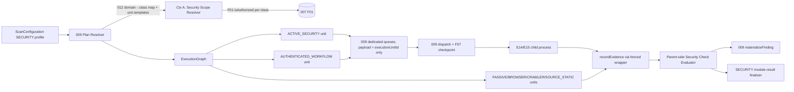
### D2 — Credential broker trust boundary
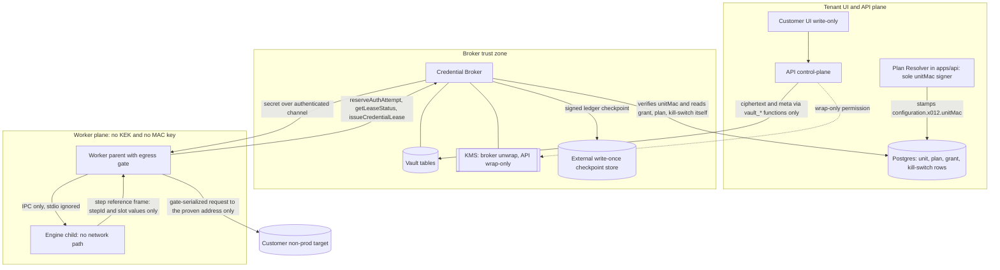
### D3 — Secret retrieval lifecycle
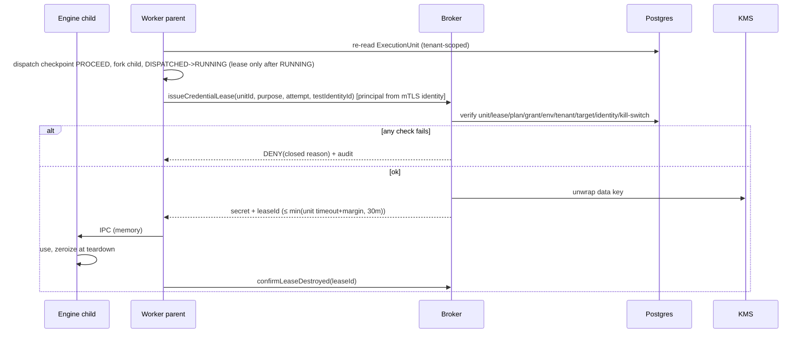
### D4 — Authenticated session lifecycle
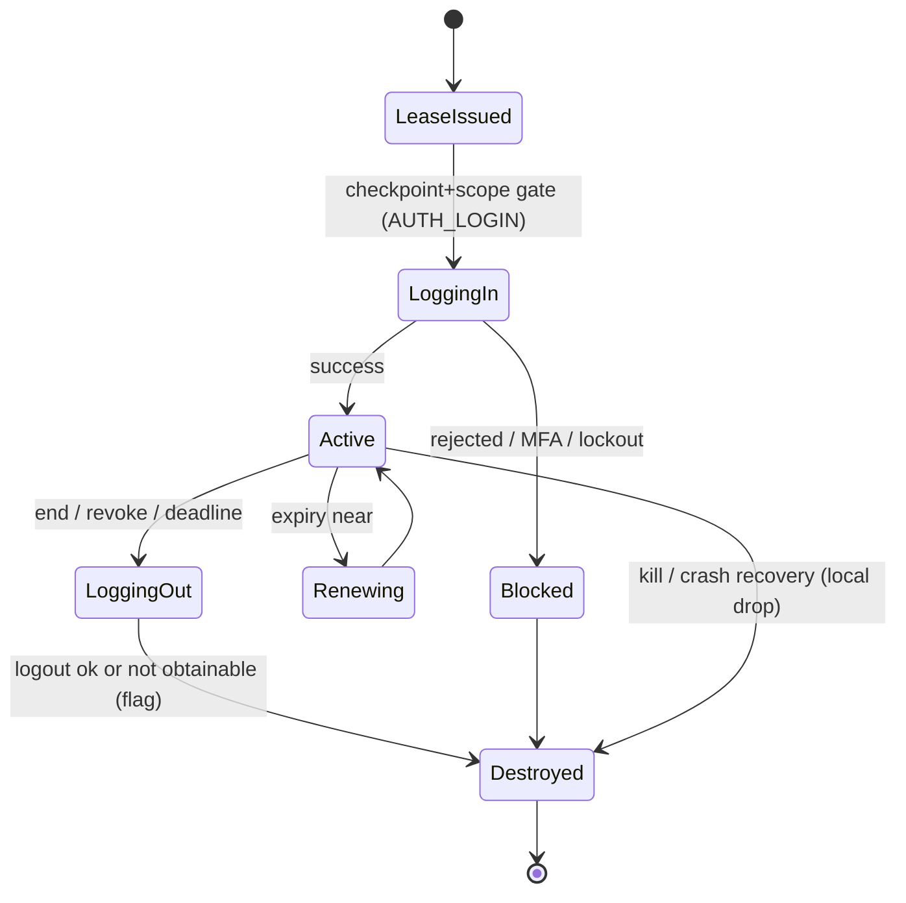
### D5 — Multi-role authorization test
*(Credentialed crafted requests in the E14 unit are dual-class checkpointed — FR-161; credentialed uncrafted replays are single-class E15.)*
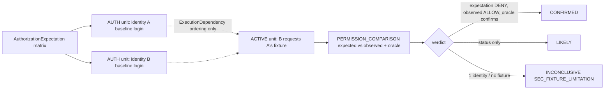
### D6 — API discovery and authorization
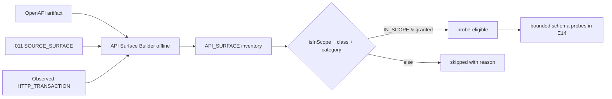
### D7 — Active security probe execution
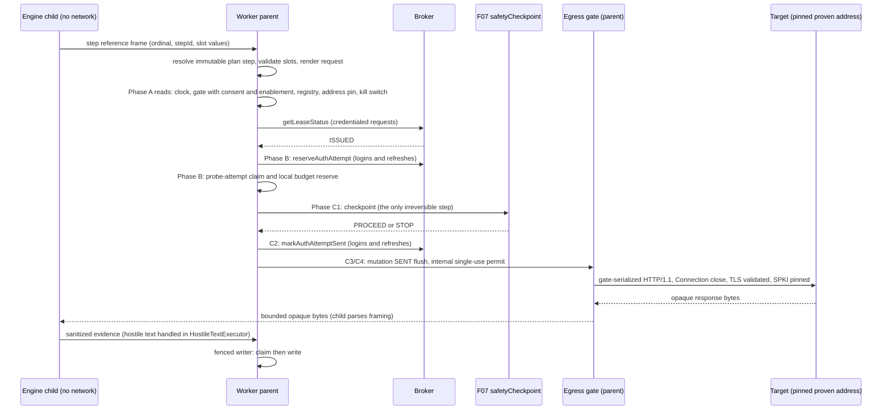
### D8 — Mutation and cleanup
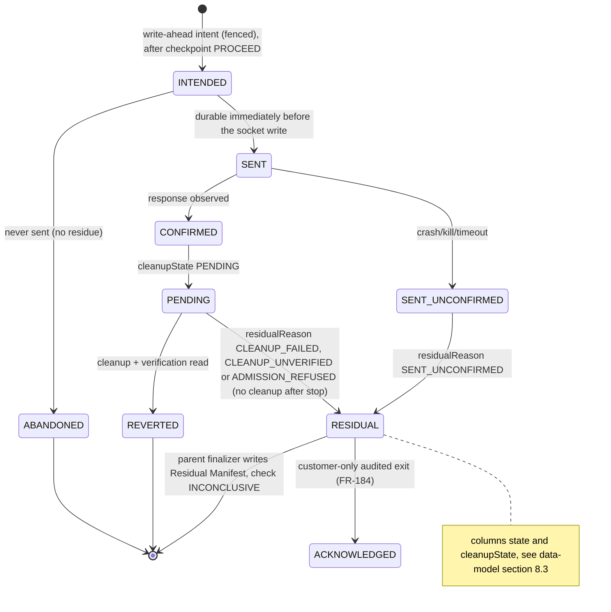
### D9 — F01 / F07 enforcement points
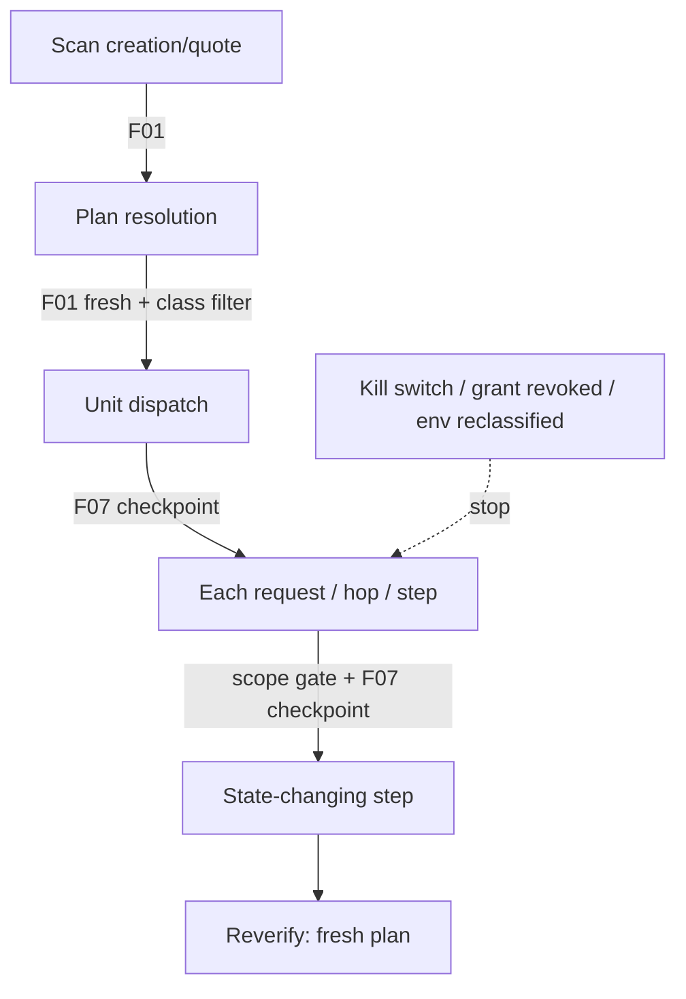
### D10 — Security evidence and findings
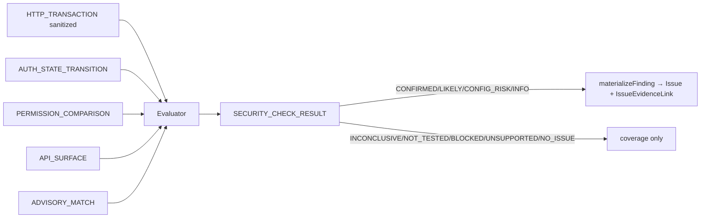
### D11 — Coverage aggregation
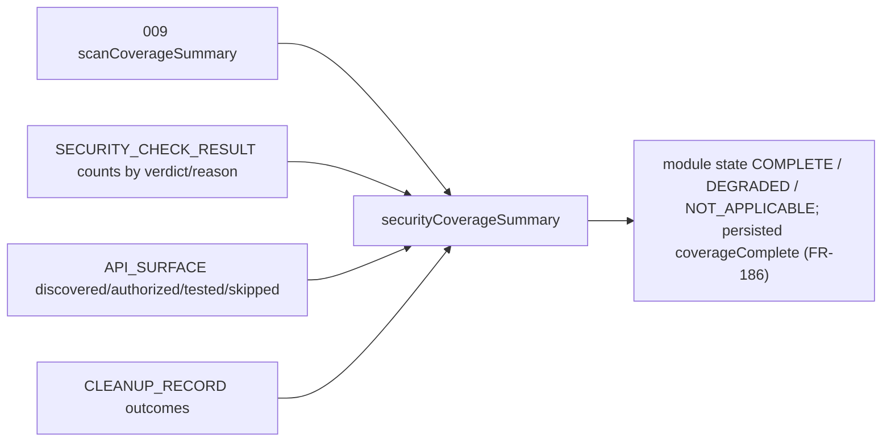
### D12 — Cancellation and crash recovery
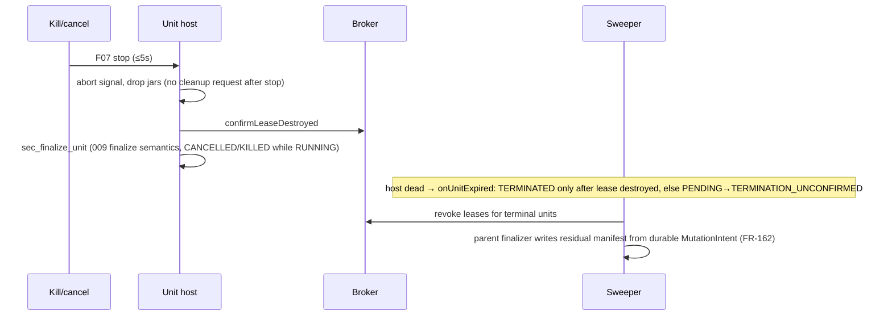
### D13 — Reverify
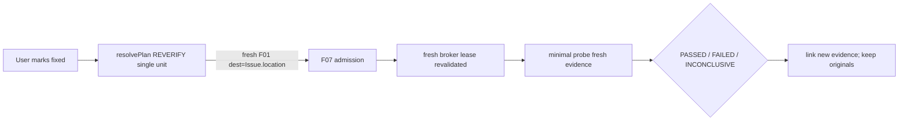
### D14 — SPEC boundaries
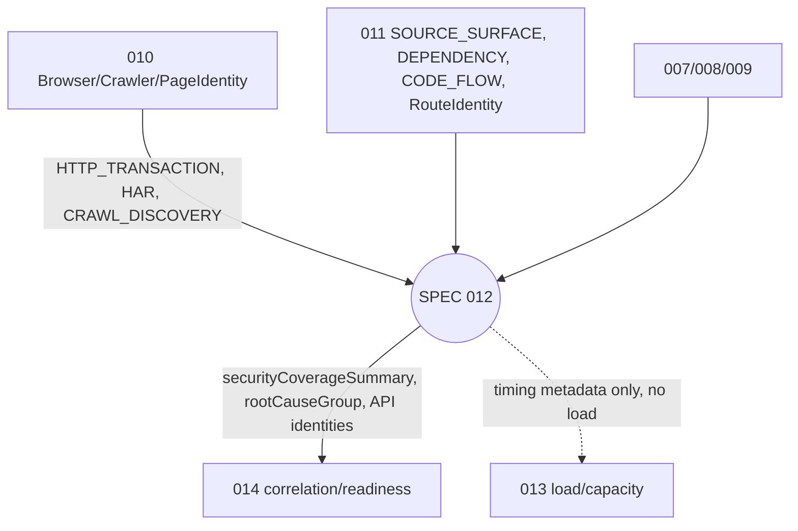

### D15 — Verified address binding and Destination Authorization Policy (FR-172, FR-197)
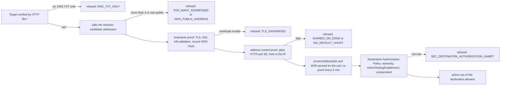
### D16 — Readiness and consumer gating (FR-188)
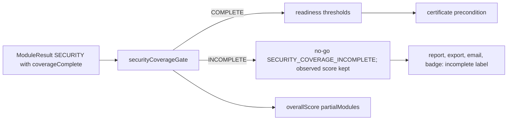

## Project structure (planned; not created)

```text
packages/security-registry/        # versioned SecurityCheckDefinitions, probe definitions, harmless alphabet (vendored)
packages/security-engine/          # SecurityHttpClient wrapper, LocalBudget, SessionHost, scope gate, fenced writer, HostileTextExecutor, egress gate, address binding
apps/credential-broker/            # broker service (separate deployable)
apps/api/src/services/security/    # credential/identity/fixture/invariant control-plane routes (write-only secrets)
apps/api/src/services/security/enablement/  # operator-only ActiveTestingEnablement routes (FR-197)
apps/api/src/services/planning/security/  # SECURITY plan-resolution contribution: class mapping, unit templates, unitMac signing, consent and address-proof plan checks (009 places the Plan Resolver in apps/api)
apps/worker/src/security/          # E14/E15 unit hosts (parent, egress gate with internal permits, admission pipeline), evaluator, API surface builder, advisory matcher, finalizer; holds NO signing key
packages/safe-net/                 # + SecurityHttpClient door (multi-value headers, no auto cross-origin redirect, timing)
packages/redaction/                # + exact-value registry, structural header/cookie/query rules
specs/012-security-auth-api-testing-platform/{spec,plan,research,data-model,quickstart,tasks}.md contracts/ checklists/
```

## Complexity tracking

| Added complexity | Why needed | Simpler alternative rejected because |
|---|---|---|
| Separate credential broker | worker holds app key + DB URL; any in-process compromise would expose all credentials | in-worker vault repeats the audited over-privilege |
| Engine-local budgets besides F07 | F07 has no byte/auth-attempt/mutation dimension | amending 007/008 now would delay; local is safe if pre-checked and labeled |
| Own `SECURITY_CHECK_RESULT` kind | 010/011 forbid widening their kinds | reusing `CHECK_RESULT` needs an amendment |
| `securityScopeGate` | F01 doesn't enforce accounts/roles/categories | no gate would leave grant fields decorative |
| Broker trust anchor (unit MAC, security-definer writes, anomaly rule; FR-173) | the broker's re-validation reads Postgres rows the worker role could otherwise write | without it the broker only protects data at rest; if resolver and host are one principal that must be stated |
| Destination Authorization Policy, verified address binding, consent, cool-off (FR-172/176/177/197) | proofs establish control of the serving front, not of an upstream origin; a tenant-controlled forwarder to a third party passes every proof | trusting a proof or an attestation alone lets a re-pointed name, a forwarder or a mislabeled target be attacked; the policy adds an operator-reviewed enablement and accountability instead of pretending to detect forwarding |
| Parent-hosted egress gate with parent-authoritative plan steps: step reference frames, gate-side canonical serialization, one request per connection (FR-175, FR-199, FR-200) | a child compromised by hostile response parsing must not be able to send anything the parent has not admitted, and a gate that forwards child-framed bytes would reintroduce request smuggling | a host-set-only proxy is a cooperative child; per-connection permits cannot stop pipelining inside a TLS tunnel; moving *parsing* into the parent is avoided by streaming opaque bytes (the TLS client remains a parent-side exposure, evaluated by T650) |
| HostileTextExecutor (FR-174) | a same-thread watchdog cannot interrupt a running regex | linear patterns alone leave a missed pattern able to stall the parent loop that renews locks and leases |
| Plan Resolver as sole MAC signer (FR-173) | the broker needs a trust anchor the worker cannot forge | signing in the worker makes the stamp worthless |
